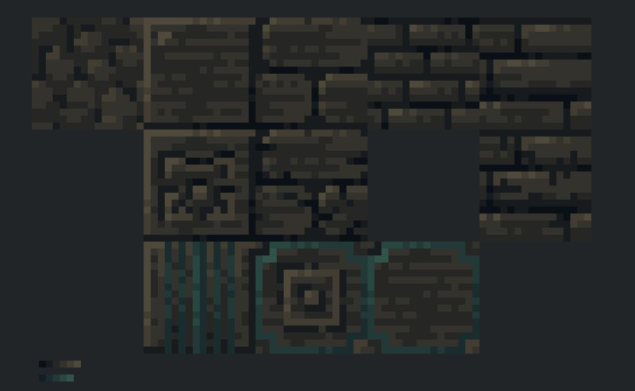
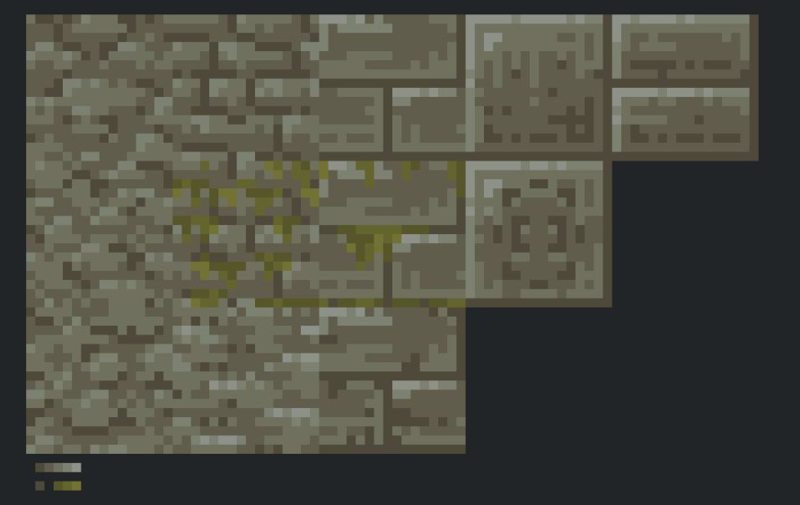
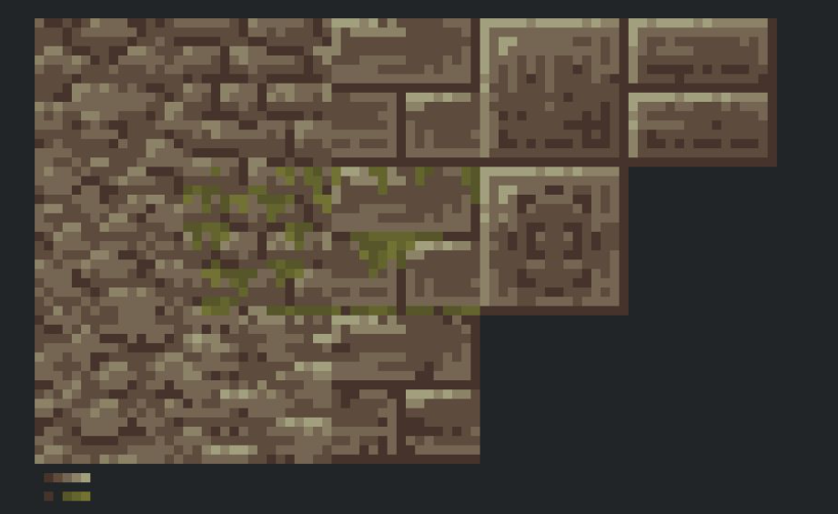
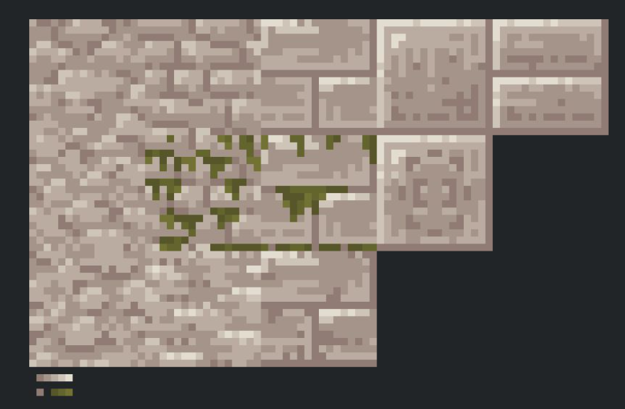
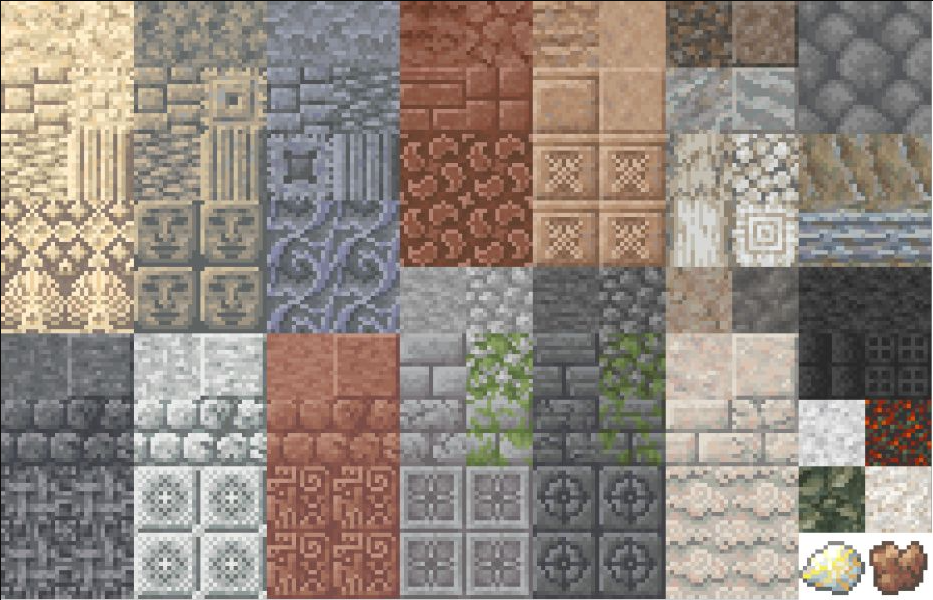
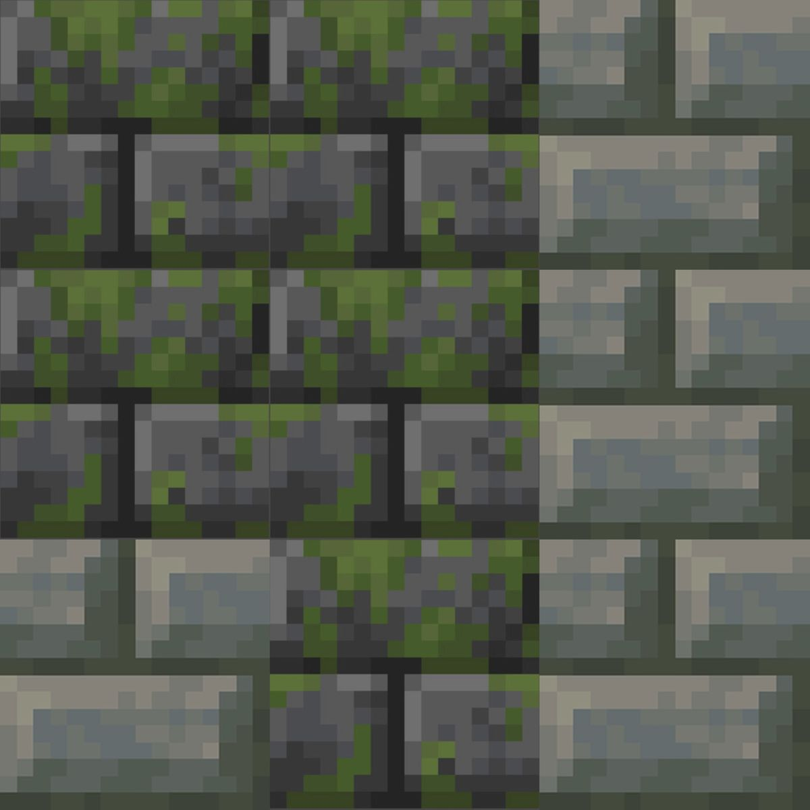

# Shared owner asset library

**23 October Jimtafacts:** [verified collection and implementation status](catalog/edited-2026-10-23-jimtafacts/README.md): 17,598 supplied files covering accessories, spellbooks, storage networks, industry, transport and computers. Preserved sources and native runtime integrations are tracked separately.

**19 October model recovery:** [original wildlife client model data](catalog/naturalist-models-2026-10-19/README.md), 228 client files preserved with SHA-256 hashes. This supplies 73 geometry layers and 441 animation clips for the 47 existing wildlife species; the supplied classes are inspected as data, never executed.

**18 October, part two:** [nine additional owner-edited collections](catalog/edited-2026-10-18-part2/README.md), 26,765 files preserved with SHA-256 verification. Native integration is tracked separately from intake.

**Owner clarification, 9 October 2026:** the owner says they rebuilt the supplied work using other mods as starting bases, but some earlier names, credits and supporter text remained. [Read the standing implementation rule and metadata locations](PROVENANCE.md). These labels alone are not a reason to reject the collection or ask for the same permission again; use suitable files and address specific issues at the affected file.

The project owner supplied this collection on 6 October 2026 and explicitly authorized Jugcraft contributors and AI coding agents to **use suitable assets directly, recolor or adapt them, or use them as visual/audio reference**. Check this library before making new assets.

It is shared across the whole project: **blocks, ores, metals, machinery, guns and mounted weapons, planes and airships, sounds, animations, weapons, armor, trees, biomes, farming, food and accessories**. The folder name `Blocks` is the original collection name, not a restriction on who may use it.

## Find assets

- [October 18 owner-edited animals, mounts, inventory pets and structures](catalog/edited-2026-10-18/README.md): 3,502 preserved files, including the additional animal data, with a source-completeness audit. Importing the collection does not register gameplay content.

**New: [owner magic collection and direct-use instructions](MAGIC_ASSETS.md) (8 October 2026).** Contributors and AI agents SHOULD use suitable files from these 7,909 textures, models, animations, sounds and data resources as supplied. The owner explicitly does not require redesigning, recoloring or renaming them. No repeat per-asset permission request is needed; make necessary technical compatibility changes in runtime copies and keep the source library intact. This collection-specific instruction takes precedence over generic art defaults.

- [Browse every category and file](catalog/README.md).
- [Download or search the complete CSV inventory](catalog/files.csv): filenames, types, image dimensions, animation sidecars and SHA-256 checksums.
- [Browse the original collection](originals/Blocks).
- [Browse the magic originals](originals/Magic), their [paginated catalog](catalog/magic/README.md), or [download the unchanged RAR](archives/magic-owner-2026-10-08.rar).
- [See counts and verification notes](catalog/summary.json).
- [Jug Nouveau archive cross-check and additional source variants](ports/jug-nouveau/README.md): all 4,847 resource entries from the owner's core/elemental JARs accounted for; 28 colliding elemental variants preserved separately.

Use the category pages for browsing and the CSV for searching across the collection. Texture metadata stays beside its image; sound and animation subfolders keep their supplied structure. Similar or duplicate files stay in place so references and animation pairs are preserved.

## Allowed project use

The owner's instruction is: "use these as either direct reference / straight up take to recolor or to directly use if they fit what they are working on."

Choose the approach that fits the feature. Direct reuse and recoloring of this owner-supplied collection are authorized; contributors do not need to ask again for each asset. Keep the relevant branch's material palette and art direction coherent. Record the source path and any changes in the feature's asset provenance.

The source of this import is the project owner's upload, described by the owner as textures they created. Filenames are preserved labels, not independently verified authorship or license evidence for other sources. Follow [the repository's license policy](../../LICENSE_POLICY.md) and retain any asset-specific attribution or license notices when integrating assets. This instruction covers this supplied collection; it does not grant permission for unrelated third-party material.

## Import into a feature

1. Choose a suitable file from the catalog. Keep `originals/` intact as the shared source collection.
2. Copy the required asset into the feature's runtime resources under `src/main/resources/assets/jugcraft/`, with a stable lowercase resource name.
3. Copy and adapt any adjacent `.png.mcmeta` together with its PNG. Check the frame layout and timing. Animation JSON needs matching model bones and a renderer that supports its format; audio needs an appropriate `sounds.json` entry. Publishing the library does not register those resources in the game.
4. For a sheet or packed atlas, inspect the layout and use the intended tile or UV mapping. Catalog dimensions distinguish individual textures from sheets; do not stretch a whole sheet onto one block face.
5. Describe direct reuse, recoloring, cropping or other modifications in `docs/features/`. Include the library path or CSV checksum, and keep reused files from being overwritten by a generator on the next run.
6. Run the feature's relevant asset checks and inspect the imported result in-game when available.

## Included preview sheets

The six sheets below were also attached by the owner. They are preserved unchanged as high-resolution reference previews; their pixels, aspect ratios and filenames in the source collection are not modified.

| Preview | Sheet |
|---|---|
| Dark stone with teal accents |  |
| Grey stone and moss variants |  |
| Brown stone and moss variants |  |
| Pale stone and moss variants |  |
| Stone and decorative block overview |  |
| Mossy stone tiles |  |

## Import verification

16,449 source files (25,339,959 bytes) were copied and matched against SHA-256 checksums. The six attached previews were also copied byte-for-byte. Images were opened and verified; JSON/animation metadata was parsed; Ogg container signatures and texture-sidecar pairings were checked. See [summary.json](catalog/summary.json) for any supplied-file issues. This is an asset library, not an in-game integration test.

### Gun models (7 October 2026)

On 7 October 2026 the owner uploaded a further archive of gun models with the message: "I have rights for all these". Earlier the same day they said of the Guns folder: "the files in the blocks folder are all mine I made all of them myself and have all the rights to them they are inspired by scorched guns 2 but I made all of them including the animations".

Its `models` folder is kept at [originals/Blocks/Guns/models](originals/Blocks/Guns/models) and listed in the [Guns catalog](catalog/guns/README.md) and the [CSV](catalog/files.csv). It holds Blockbench Java item models of the guns: each gun split per part under `special/<gun>/` (main body, bolt, barrels, magazines, stocks, grips, sights, silencers, bayonets), per-gun item models with display transforms (beside the other item models) under `item/`, and block models under `block/`. All 2,589 files (8,511,427 bytes: 2,579 model JSON files, 8 `.scmeta` attachment metadata files and 2 `.png.mcmeta` texture metadata files) were copied byte-for-byte and matched against SHA-256 checksums, and every one parsed as JSON. The two `.png.mcmeta` files arrived without their PNGs; [summary.json](catalog/summary.json) records them. The upload's two empty `test` folders are not kept, because Git does not store empty folders.

The JSON keeps the original `scguns:` resource namespace in its references, as supplied labels. A feature that imports a model must rewrite those references to `jugcraft:` and rename it to Jugcraft's own name, following the [fan-homage rules](../../LICENSE_POLICY.md#fan-homages). The 45 item models that name the Forge-only `forge:separate_transforms` loader also need that loader replaced for Fabric.

### Magic resources (8 October 2026)

The owner supplied **MAGIC ITEMS BLOCKS TEXTURES SOUNDS MODELS I MADE.rar** and explicitly instructed contributors to use its files freely without needing to change them. The original archive and all 7,909 extracted files are preserved with SHA-256 checksums. The [magic guide](MAGIC_ASSETS.md) documents direct use, necessary technical integration steps, and supplied format/companion-file issues. No runtime content is registered by this import.

The combined searchable library now contains **26,975 source files**, excluding the six preview sheets and the preserved archive. The [global CSV](catalog/files.csv) and [summary](catalog/summary.json) include every upload.

### Effect textures (8 October 2026)

On 8 October 2026 the owner uploaded two archives with the message "heres reticles and vignette":
- **`effect`:** 18 PNG textures, kept at [originals/Blocks/Guns/effect](originals/Blocks/Guns/effect) and listed in the [Guns catalog](catalog/guns/README.md) and the [CSV](catalog/files.csv).
  - The reticles and lens vignettes the scope models name: `effect/red_dot_reticle`, `long_scope_reticle2`, `scope_vignette` and `scope_vignette_circle`.
  - A second long-scope reticle (`long_scope_reticle`) and 13 muzzle flash frames.
  - All 18 files (19,191 bytes) were copied byte-for-byte and matched against SHA-256 checksums.
- **`crosshair`:** the 20 crosshair textures, byte-identical to the [crosshair](originals/Blocks/Guns/crosshair) folder of the 6 October upload. Nothing changed.

Two of the effect files carry embedded Photoshop metadata (XMP), which [summary.json](catalog/summary.json) records:
- `red_dot_reticle.png`: its editing history shows it saved inside a Just Enough Guns mod source folder (`assets/jeg/textures/effect/`) on 3 February 2024.
- `muzzle_flash.png`: created in Photoshop CC 2019 on 12 February 2021.

Shown this and asked what the scopes should use, the owner answered that they made these files and to use them. Asked the same day about the "Big Cannons and Mounted Guns" folder, whose muzzle flash frames the guns use, they confirmed it is theirs. (It holds a file named `wariumlogo.png`; Warium is also the name of another weapons mod.)

### Gun geometry (23 October 2026)

On 23 October 2026, told that the Grandle OG's body had no model in the library, the owner re-sent their gun collection (`Jimbos Heavily Edited Guns.rar`, 18,411,320 bytes, SHA-256 `d381c075e40a35b93082a40c7292cd7c819a0bab944d106e4580b41986370b83`) with the message: "Here are the files again these are all ok to use and put in it has remenant names and stuff from what I used to heavily edit this is how we've been doing all of them just use the models that I created from here".
- **Kept here,** each copied byte-for-byte into [originals/Blocks/Guns/geo/item/gun/](originals/Blocks/Guns/geo/item/gun):
  - the Grandle OG's GeckoLib geometry, `grandle_og.geo.json` (60,919 bytes, SHA-256 `136305c294647d5402ac14a58bb657bc0e60413f08eefb760bb53ac7a8136821`). Guns slice 14F builds the gun from it.
  - the MAS 55's, the Prush Gun's and the Valora's: `mas_55.geo.json` (69,029 bytes, SHA-256 `f279de6b94a2c214ce502840400b6314579e5e9e4efdb6116931f72f2bcdec80`), `prush_gun.geo.json` (67,304 bytes, SHA-256 `732ff89ffbd2be801e9f281f90632824a720650d6c220bbb69e2fbccab43313f`) and `valora.geo.json` (47,491 bytes, SHA-256 `2e5540135051e6a4eddd6c8db3d2bb3bc30b5f1273a6ab992d59a12221893062`). They are the owner's later edits of those guns: in places they differ from the guns' Java parts under `models/special/` (the Prush Gun's sights, silencer, grips and body most). Guns slice 15A builds the three guns from them.
  - the Krauser's, the Soul Drummer's and the Uppercut's: `krauser.geo.json` (46,219 bytes, SHA-256 `7fb800e0313868d4ab6145630ddb8741bef798efa282dbe19486432c716f54b2`), `soul_drummer.geo.json` (46,752 bytes, SHA-256 `a5b24e90849dc1b6584cd21e87861a0a5880022e23abf67891b9c08c6e7816ab`) and `uppercut.geo.json` (46,862 bytes, SHA-256 `3186043f8738987758274d9d68fcf1247a35f8d09f0440f1051102face176612`). They too are the owner's later edits: each one's body differs from its Java parts, and the Krauser's and the Soul Drummer's magazines too; the Uppercut's magazine and the Soul Drummer's stocks have no Java parts at all. Guns slice 15B builds the three guns from them.
  - the MAS Peddler's, the Inertial's and the Zilk 45's: `mas_peddler.geo.json` (70,696 bytes, SHA-256 `5c51ab04026ce22d2ef01c95ab8214f4ef6cb4285fcc369506f7860ac12686a6`), `inertial.geo.json` (75,351 bytes, SHA-256 `8a3272b54cfdebaa1565a9ca0c6d2f8529900cc4795b72422961c51c165b1c71`) and `zilk_45.geo.json` (51,939 bytes, SHA-256 `aca06aad8bb01edbc22dcc793a124e953558b72832496285deb0d201ba50cc3a`). The owner's later edits again: the MAS Peddler's takes barrel attachments, scopes, stocks, grips and bayonets that its Java parts (a body and magazines) never had. Guns slice 15C builds the three guns from them.

  [docs/features/guns.md](../../docs/features/guns.md) records the four slices.
- **Already here:** the archive's 2,589 gun models, 143 gun animations and 112 sounds are byte-identical to the files above; 978 of its textures are too.
- **Not imported yet:** the archive's other GeckoLib geometry (150 files: the other 133 guns and armor), about 200 textures not in the library (armor, effects, paintings, mob effects), language files, particles and data (the original guns' stat files, recipes). Its `top` folder holds 1,449 compiled Java classes of the original mod; they are code, not the owner's assets, and are not kept.
- **Sounds:** the archive's `sounds/SOUND-LICENSE.txt` reads: "All sounds are licensed under Creative Commons 0 https://creativecommons.org/publicdomain/zero/1.0/".
