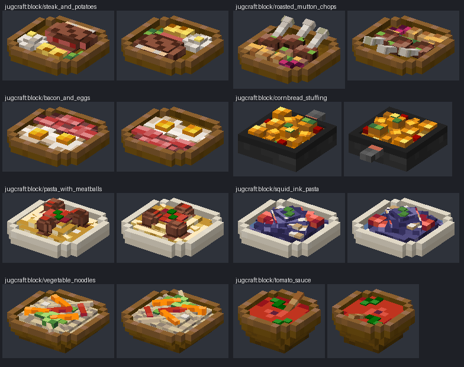

# Food dishes: how they are modelled and how they should look

How Jugcraft's placed food is built, so every dish set down on a table looks like the food itself, on real dishware, in
the owner's colours. Follow this page for every new placed dish and every remodel.

## Why this page exists

Eight of [the menu](features/the-menu.md)'s dishes used to be flat trays of coloured sticks and squares, sampled from
the inventory icon. On 3 November 2026 they were rebuilt piece by piece ([placed-food-remodels.md](features/placed-food-remodels.md)):
- Steak and Potatoes, Roasted Mutton Chops, Bacon and Eggs and Cornbread Stuffing;
- Pasta with Meatballs, Squid Ink Pasta, Vegetable Noodles and Tomato Sauce.

The owner said: "I love how good it looks and I want it to be a rule on the github about how all future food dishes
should be modeled and try to look". This page is that rule. The numbers in it come from those eight dishes.

*The eight dishes this rule is drawn from. These are offline renders, lit with the game's face shading; they are not
game screenshots.*

The owner's feasts were the references the eight were measured against, and they stand beside them:
- the Shepherd's Pie, Gleaming Salad and Nachos (`tools/feasts_data.py`);
- the Shepherd's Pie's `shepherds_pie_top` and `_side` textures, which the two-texture method below follows.

## The look

A placed dish should read, from a few blocks away, as *that* meal on *that* dish.
- **The food itself.**
  - Each part of the meal is its own piece, in its own shape and colour: the steak, its fat cap, the cut that shows pink, the slice lying in front.
  - Never a tray of coloured sticks, never a flat square of the icon, never colours sampled from the icon.
- **On real dishware.** The food sits on a plate, in a bowl or in a pan, and the dish is part of the model, closed on every side.
- **Plated as a cook would plate it.**
  - **Place:** the main subject at the back or in the middle, the sides in front, the garnish on top.
  - **Height:** the main subject is tallest, one piece stands proud of the others (the middle mutton chop), and nothing is a row of equal blocks.
  - **The dish shows:** a little of the plate's floor shows between the pieces.
- **Real shapes.** Round food is round, heaped food is heaped, and strands lie loose. Some things rise out of the dish: bones over the rim, a spoon leaning on it, a strip of bacon arching clear of the plate. The shapes are listed below.
- **Vanilla's density.**
  - One texel to a model pixel, on 16×16 textures, opaque.
  - Chunky enough to read at game distance.
  - Small things are still at least a pixel or so across: a basil leaf, a pat of butter, a cherry tomato half.
- **Light from the top left,** as the owner draws:
  - the north and west edges of each piece lit, the south and east edges shaded;
  - flat tones, a glint for a wet or glossy thing.
- **Colours from the owner's own drawing of the same food.**
  - **Where:** in `art/owner-library/originals/Blocks/farming and food textures/`, for example `cooked_bacon.png`, `fried_egg.png`, `beef_patty.png`, `tomato.png` and the dishes' own icons.
  - **How:** written out as hex in the generator, with the source file named beside them.
  - **Tones:** three to five per material.
  - **White:** large whites stay under about 235 (an egg's white, a glazed plate), with pure white only for a glint.

## The dishware

Pick the dish that lets the food read, and keep it the same across dishes that share it.

| Dish | Built from | For |
| --- | --- | --- |
| **Wooden plate** (`plate()` on `meal_wood_*`) | <ul><li>A foot.</li><li>A floor at 1.5 with stepped corners.</li><li>A rim one pixel high (top at 2.5), 12 across.</li><li>The rim lined inside.</li></ul> | The default: the owner's icons show their meals on wood. |
| **Glazed plate** (`plate()` on `meal_glazed_*`) | <ul><li>The same plate.</li><li>The cream and blue of Jugcraft's own Plate.</li></ul> | Food that would vanish on wood (squid-ink pasta), and saucy pasta. |
| **Wooden bowl** (`bowl()`) | <ul><li>A foot and a body.</li><li>Walls that flare as they rise, each ring overhanging the one below, the corners stepped.</li><li>Lined inside.</li><li>The contents fill it as a cap below the rim.</li></ul> | Soups, sauces, noodles: anything in liquid or heaped deep. |
| **An existing vessel** | The owner's own model, for example the Skillet, unchanged, shortened only to stay inside the outline. | Food that is cooked and served in its pan. |

## The shapes

The shapes the eight dishes use. Reuse the helpers in `tools/menu_meal_models.py` rather than inventing new ones.

| Food | How it is built | Examples |
| --- | --- | --- |
| Round | <ul><li>Two boxes crossed.</li><li>A smaller cap on top for height.</li></ul> | <ul><li>The meatball (`meatball()`).</li><li>The fried egg's white.</li><li>A mutton chop's eye.</li></ul> |
| Heaped or mounded | Stacked rounds, each set in from the one below. | <ul><li>The spaghetti mound (`nest()`).</li><li>The mash, with its pat of butter.</li></ul> |
| Twirled | Stacked rounds, each turned further than the one below (22.5°, 45°, −22.5°). | The squid-ink nest. |
| Strips | Several pieces that rise and dip. A raised piece arches clear and draws its under face. | The bacon. |
| Loose strands | Thin boxes turned 22.5° or 45° about their middle, laid across the heap or the plate. | <ul><li>Noodles (`strand()`).</li><li>Julienned carrot and pepper.</li></ul> |
| Standing out of the dish | A turned piece that rises over the rim or leans on it, touching it. | <ul><li>Chop bones with knuckles.</li><li>The spoon in the sauce.</li></ul> |
| Cut food | The cut face in another material (`faces_mat`), a slice lying beside it. | The steak's pink cut. |
| Chunks | Pieces of every size, a few turned askew. | The cornbread cubes. |
| Garnish | Small pieces on top, last, in contrasting colours. | Basil, parsley, sage, rosemary, the butter pat. |

Turns are 22.5° or 45° about one axis, as vanilla allows.

## The textures

Each dish wears two textures of its own, as the owner's Shepherd's Pie does: `<dish>_top` and `<dish>_side`.

**`<dish>_top`** is the meal seen from above, one texel to a model pixel.
- **How it is drawn:** from the model's own pieces, lowest first. Each piece gets its material's tile or tone. Its edges are lit on the north and west and shaded on the south and east wherever nothing of its kind and height adjoins.
- **The details layer:** a small grid of placed details goes on top: grill marks, glints, dabs of sauce, flecks of herb or cheese.
- **How it is read:** every upward face reads it by position. The drawing and the geometry therefore always agree, and pieces that overlap at one height draw the same texels.

**`<dish>_side`** holds each material's rows seen from the side.
- **Rows:** a lean row and a fat row for bacon, a crust over a crumb for potatoes.
- **How they are read:** side faces read them top-aligned.
- **Turned pieces:** a strand, a bone or the spoon reads its material's rows on its sides, and a small swatch on top.

**Patterns, not noise:**
- every tone means something: wound strands for twirled pasta and stirred sauce (`spiral`), wavy runs for noodles (`waves`), marbling rows for bacon, grill marks on every third diagonal of a steak;
- no random speckle, and no grain or grime;
- textures are deterministic (the same output on every run).

**Parts that touch read apart:** sauce against pasta, herb against plate. Give them different hue or brightness.

**The dish's particle texture stays the owner's icon.**

## Clean models

- **Inside the outline:**
  - every piece, turned ones included, stays inside the dish's outline (`PlacedDishBlock.DishShape`: PLATE is 1..15 across and 5.5 high, BOWL is 3..13 and 6.5);
  - the model faces south, and the blockstate turns it.
- **Closed and see-through-free:**
  - nothing floats or pokes through the dish;
  - every overhanging or arching piece draws its under face.
- **No hidden waste:**
  - boxes and faces buried inside other boxes are left out (`drop_buried`);
  - no element is left with no faces;
  - no two faces share a plane (`model_writer.finish_closed` and `finish_elements`).
- **Size:** the eight dishes run from 21 to 33 elements each. That is enough to sculpt a meal; a new dish should not need many more.

## Where it goes

- **Model:** add the dish to `MEALS` in `tools/menu_meal_models.py`: its dish, its food function, and a bowl's contents or a pan's bed.
- **Textures:** add its palette, materials and details to `MEALS` in `tools/menu_meal_textures.py`, with the source drawing named in a comment.
- **Routing:** `tools/menu_data.py` `dish_model` sends every dish listed there to the sculpted path. Everything else keeps its template in `tools/feast_meal_models.py`.
- **Regeneration:** `tools/generate_material_data.py` writes the models and `tools/generate_textures.py` the textures. Never hand-edit the generated JSON or PNG.
- **Nothing else changes in a remodel:** IDs, blockstates, recipes, food values, eating, setting down and drops.
  - Portion stages would need Java and blockstate changes. They are a separate feature.
- **Food in decorations:** food that is part of a decoration rather than a placed dish keeps the same look and is built in that prop's own generator. Examples are the pies on the Pie Stand and the rolls in the Bread Basket (`tools/thanksgiving_decor_data.py`).

## Checks before a dish is done

1. **Regeneration:**
   - only the new or remodelled dish's files change, and every other placed dish regenerates byte for byte the same;
   - a second run changes nothing.
2. **`tools/art_check.py` block-model rules** (I1, U1, Z1, N1, O1) find nothing on the dish. Also confirm that every piece is inside the outline.
3. **Renders at game scale:**
   - from four sides and up close;
   - from below;
   - in all four facings;
   - beside the reference feasts and the eight dishes above.
   Does it read as the meal? Is the main subject clear? Does any piece float, poke through, or flicker?
4. **In game:** normal distance and up close, each facing, and from below (on a glass block).
5. **The feature record says** which source drawings gave the palette, and what ran and what did not.

## Never

- Coloured sticks or squares standing in for food, or colours sampled from the icon.
- A flat food texture stretched over one box.
- A grid of equal cubes, or everything at one height.
- Food floating above the dish, or passing through its rim or floor.
- See-through or missing faces, or faces sharing a plane.
- Noise, speckle or grime on food; pure white over a large area.
- Hand-edited model JSON or textures, and drawings traced from Mojang's files.
