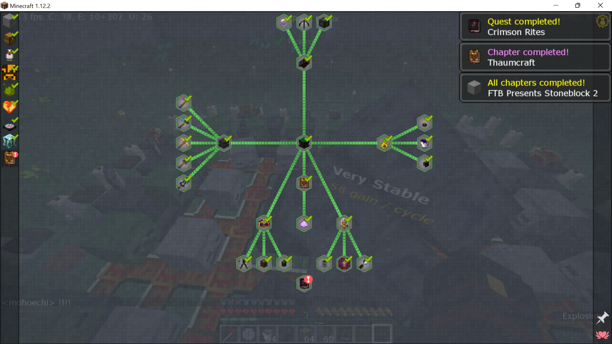
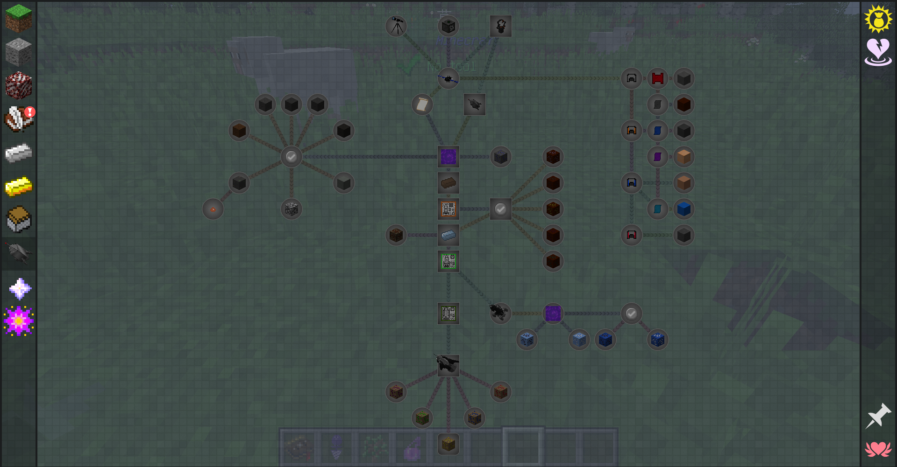
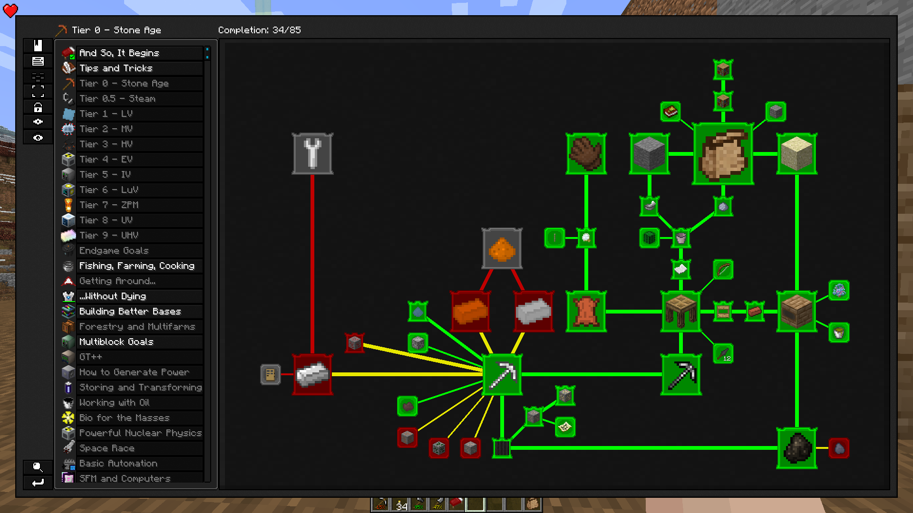
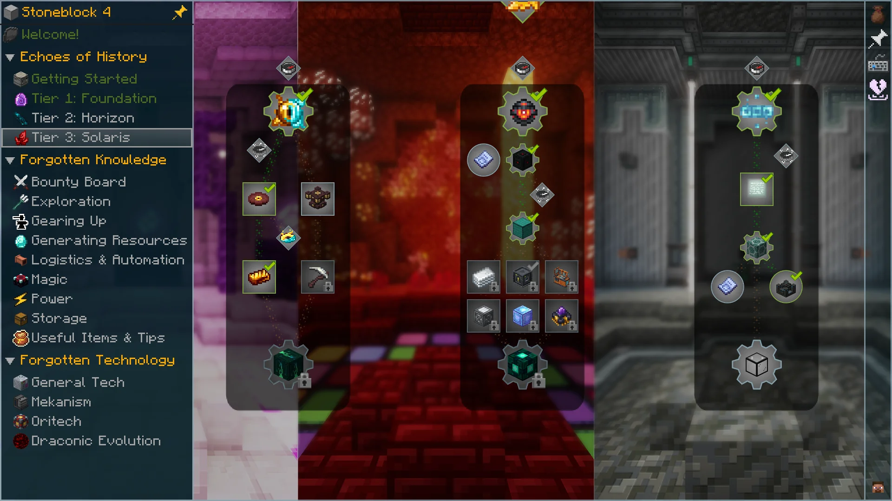
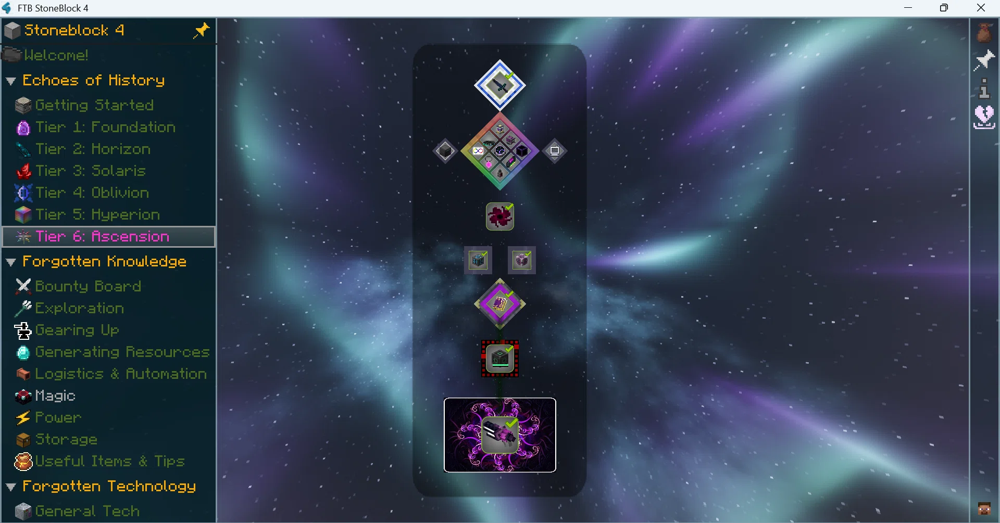
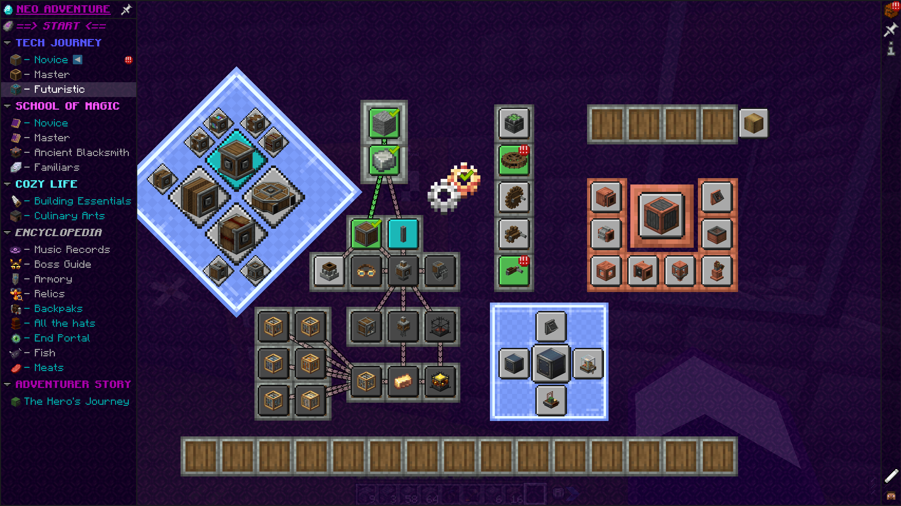
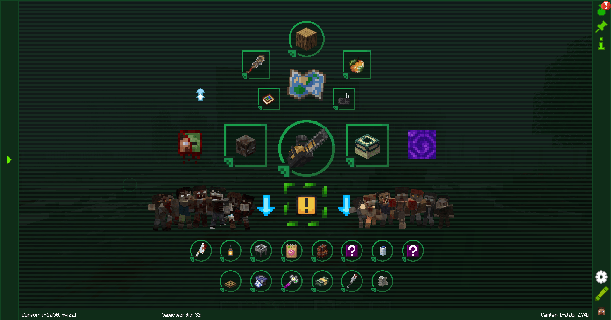

# Jugcraft TODO list

## Alchemical equipment — 16 October 2026

- [x] Local interface/access revision: engraved alchemy panels, consistent controls and selected states; remove equipment-use research gates, including traded charms and old owned factories. Gem controls work directly after equipping. See [interface/access record](features/alchemy-interface-and-access.md).
- [x] Interface/access validation: 1,929 server checks, rendered fresh-player menus and packet interactions, and data/art/repository audits passed locally.
- [x] Owner accepted the Alchemy Refined presentation and authorized publishing all alchemy additions and UI fixes on 18 October 2026. Earlier per-pack publication checkpoints are superseded by this combined approval; detailed survival balance and independent multiplayer remain follow-up work.

- [x] Local first slice: Philosopher's Stone interface, paid Repair Talisman and Black Hole Band, using supplied owner icons and the existing Prima Materia ledger.
- [x] Automated validation: 1,771 server tests, full data/art audit, rendered interface and live equipment checks.
- [x] Replace the transmutation book with a stone tablet and rename its currency to essence across Assay, gear and guides, preserving existing balances.
- [x] Local Dark Matter workshop: three fuel tiers, three covalence dusts, Dark Matter, pickaxe/hammer/axe modes, essence costs and anvil repair, using ten supplied icons unchanged.
- [x] Dark Matter validation: 1,787 server tests, full data/art checks, rendered mode switching/mining and held-model inspection passed locally.
- [x] Local stars/amulets: six Klein Stars, storage tablet, charge-preserving smithing upgrades and Evertide/Volcanite utility amulets using eight supplied icons unchanged.
- [x] Stars/amulets: 1,801 server tests, rendered transfers/amulet use, full data audit and original-art checks passed locally.
- [x] Local implementation of remaining Dark Matter equipment, Red Matter tools, three armor sets and material/fuel blocks with supplied art. Combined automated validation passed; owner accepted the combined presentation on 18 October. See [complete alchemy](features/complete-alchemy.md).
- [x] Local collectors/condensers: three daylight collectors, two material condensers, retained targets, essence/star transfers, hopper faces, pause controls and charge-preserving upgrades using supplied assets.
- [x] Collector/condenser validation: 1,820 server tests, rendered menus/models, live hoppers, daylight/roof behavior, full data/art audit and showroom ownership binding passed locally.
- [x] Local implementation of all remaining alchemy content: 82 entries across equipment, relays/furnaces/pedestals/wards/Nova charges, bags/chest/tablets/books/XP storage, mobility/combat/farming/support rings and mining/building artifacts. Existing 26 entries remain integrated.
- [x] Complete the requested combined validation phase after all 82 entries are integrated: 1,886 server tests, 67 Python tests, full data/art audits and the rendered client check passed. Final layout changes were rebuilt and client-tested. See [complete alchemy](features/complete-alchemy.md).
- [x] Local connected alchemy: learned patterns/favorites/search, Stone terrain/crafting, filtered converters and storage artifacts, expanded pedestals, collector fuel tiers, carried-star power, Gem controls, learned Eye building, remaining UI/state art and animated chest lids. See [connected alchemy](features/connected-alchemy.md).
- [x] Connected Alchemy automated validation: all 1,909 server tests, 67 Python tests, full data/art audit and real rendered interface checks passed locally.
- [x] Local alchemy playability pass: universal default-item values, one-screen dissolve/learn/withdraw, exact-value bulk withdrawal, wallet/star HUD, Gem direct controls/state, Density limits/reserve/status, storage sort/consolidation, factory offline operation, pedestal diagnostics/range and building/mining previews. See [playability record](features/alchemy-playability.md).
- [x] Replace retained-sample learning and the 25% formation surcharge in the active tablet workflow; preserve saved balances and existing learned identities.
- [x] Alchemy playability validation: all 1,923 server tests, 75 Python tests, full data/art checks, Stone and complete-showroom rendered checks passed. Final interface corrections were rebuilt and client-tested.
- [ ] Owner survival/economy feedback: tune provisional custom-item root values; confirm industrial recipe/byproduct economics and the first Star/collector/automation milestones.
- Scope and evidence: [alchemical gear](features/alchemical-gear.md).

## Spellcraft and encyclopedia UI — 16 October 2026

- [x] Local implementation: replace spell text entry with an animated, keyboard-accessible constellation editor over the existing compiler.
- [x] Local implementation: illustrated two-page encyclopedia, simple contents, topic directories and focused detail/recipe pages.
- [x] Rendered interaction/scale checks, full server regression and optional-library absence checks passed locally.
- [ ] Expand the bestiary beyond encountered-lair dossiers and consider optional search/favorites. Field notes are built: every Jugcraft creature a player has fought, with its own numbers and their tally ([bestiary field notes](features/bestiary-field-notes.md)); search and favorites wait for the owner's approval of the chapter organisation.
- Evidence and scope: [constellation and field-guide record](features/constellation-and-field-guide.md).

## Howitzer-Walker (owner request, 13 October 2026)

- [x] **Howitzer-Walker implemented and owner playtested.** Main includes its model/animation integration, crafting, fuel/ammunition, movement, aiming, shelling, jump/stomp and server-authoritative controls. PR #356 adds continuous mouse aiming and hides the pilot model while driving. See [Howitzer-Walker](features/howitzer-walker.md). Two-player manual verification remains open.

## MUST: consolidated machine recipe interface

Owner requirement, 13 October 2026, for the Concentrator, Gas Scrubber, Filter Press and Industrial Oven, then other multi-recipe machinery. See [consolidation and compatibility](features/machine-consolidation-playtest.md). Implemented in the [recipe interface](features/machine-recipe-interface-playtest.md) and included in the owner-authorized [factory integration](features/owner-machine-integration.md). Automatic mode remains available; choosing a row only previews it until Lock recipe is clicked.

- [x] **MUST provide a searchable recipe/product picker** so players can choose what to make before inserting materials; show supported recipes and any unmet upgrade requirements.
- [x] **MUST preview exact inputs, retained catalysts/tools, outputs, byproducts, time and power**, including which tank/hatch receives each output.
- [x] **MUST implement a persistent, server-authoritative recipe lock for automation.** A locked machine may only start the selected recipe; it must not silently switch when other inputs arrive. Save/reload and multiplayer must preserve this selection.
- [x] **MUST explain why work cannot start**: missing ingredients, incompatible leftovers, missing upgrade, full/wrong output, power or pause. Never delete tank contents or consumed batch inputs when changing selection.
- [x] **MUST preserve running batches when selection changes** and apply a new selection only to subsequent work; validate permissions, recipe eligibility and all client requests on the server.
- [ ] **MUST complete a two-player manual server playtest** of selection, lock, automation and reload before release. Automated server tests cover selection, persistence, input/output blocking and shared viewer state; the native client test covers controls and readable layouts. Automatic remains an explicit selectable mode.

Local consolidation checkpoint: four recommended machines share the former nine specialists' processes. Old block IDs and construction recipes remain supported. Included in the owner-authorized factory integration; combined human multiplayer verification remains open.

Local October 13 checkpoint: [fluorochemistry and PTFE](features/fluorochemistry-playtest.md) uses main's regional fluorite deposits and adds concentrated acid, HF, named fluorocarbon intermediates, PTFE powder/shaping/sintering, useful seals/fittings/liners and a larger two-lane reactor. It extends the [ordinary polymer factory](features/polymer-factory-playtest.md). Included in the owner-authorized factory integration.

Local implementation, 12 October: [coastal magnesium, staged titanium and Polymer Molding Press playtest](features/coastal-metals-and-polymer-playtest.md). Eight new stations, six reusable molds and current product consumers; validation/package details are tracked in that record. Local-only, not merged to main. Broader alloys, polymer grades and bulk plants remain follow-ups.

**12 October local implementation:** [Expanded fermentation and first aluminum refinery](features/biorefinery-and-aluminum-playtest.md) adds seven stations, connected ethanol/stillage processing and staged bauxite/lye recovery to existing aluminum products. Local playtest branch; not published to main. Larger variants, demanding fuel dehydration, alloys and new specialized aluminum products remain future work.

This list tracks concrete owner-requested follow-ups. An unchecked task is planned work, not implemented gameplay. See the [roadmap](ROADMAP.md) for the wider delivery direction and [existing-content map](WHAT_EXISTS.md) for current source. Feature details and dependencies belong in their linked briefs.

See the [organized implementation and next-work index](INTEGRATION_STATUS.md) for the current integration and priorities.

## Ars Goetia summoning and pacts

- [ ] Implement a shared summoning and pact system for all 72 Ars Goetia spirits, including Stolas.
- [ ] Begin with Stolas connected to Styx, botany, astronomy and minerals; expand through shared definitions and server-authoritative costs, permissions and persistence.

This is future gameplay, as recorded in the [roadmap](ROADMAP.md#owner-requested-todo-ars-goetia-summoning-and-pacts).

## Jugcraft Encyclopedia

Local implementation, 12 October: [acid factory and first Encyclopedia](features/acid-factory-and-encyclopedia.md) adds inventory/K access, searchable canonical guides, suggested route diagrams and personal advancement-backed goals. Await local review; the broader polish/editorial checklist below is not all complete.

Owner-requested 6 October 2026. Independent feature brief: [Jugcraft Encyclopedia](features/jugcraft-encyclopedia.md). All ten supplied screenshots are included in the [reference gallery](#reference-gallery) below and archived in the [reference folder](images/jugcraft-encyclopedia/README.md).

- [ ] **Build the full Jugcraft Encyclopedia UI**, covering technology, magic, detailed pathways and integrated quests.
- [x] Add an inventory entry button and a configurable keybind. Both open the same Encyclopedia without crafting, carrying or using an Encyclopedia item. (Concordance Chunk A's first slice; its client test passed in CI run 38435014953; not yet merged; [record](features/arcane-concordance-first-route.md).)
- [ ] Provide a home view explaining the overall machinery/technology route and the overall magic route.
- [ ] Add chapter/specialty navigation and in-depth pages for each pathway within both routes, including useful products, entry requirements, process steps and optional branches.
- [ ] Explain the essential technology path and the substantial pre-electric workshop's sideways possibilities. Show steel and electricity as parallel capabilities under the owner's planning direction.
- [ ] Cover technology specialties such as ceramics/construction, mechanical power, metals, electricity, logistics, industrial agriculture, mineral separation, chemical refining, recovery/pollution and later precision/expedition systems as those features become available.
- [ ] Give magic its own overview and detailed school/ritual/spell/apparatus/reagent pathways, with useful crafting, cultivation, exploration and combat applications.
- [ ] Design route graphs with readable connections, grouped nodes and prominent milestones. Distinguish actual required materials/capabilities from recommendations, trade alternatives and suggested quest order.
- [ ] Provide detailed machine/material/spell/ritual entries and recipe/process links using canonical game data; clearly label planned versus implemented content.
- [ ] Include quests linked to their pathway explanations, with objectives and visible progress/completion. Keep the guide useful without requiring every player to complete every branch.
- [ ] Decide quest objective types, detection/consumption rules, reward policy, spoiler rules and individual/shared-party progress before implementing those behaviors.
- [ ] Implement authoritative quest completion and any approved rewards with stable identifiers, persistence and duplicate-claim prevention.
- [ ] Design search, navigation/history, accessibility and readable states across supported GUI scales; consider optional bookmarks and pinned goals.
- [ ] Decide compatibility for the existing Engineer's Handbook while preserving saved registrations. The new Encyclopedia itself is not an item.
- [ ] Build an original Jugcraft visual presentation informed by the ten references, without importing their depicted artwork or requiring an external quest mod by assumption.
- [ ] Verify both entry points, route/content accuracy, GUI behavior, bounded performance, and relevant two-client/restart/reconnect/quest persistence behavior.

A [first-slice prototype](features/jugcraft-encyclopedia.md#first-slice-entry-points-and-route-home) of the entry points and the home's two routes is proposed in a community draft PR. These boxes stay open until the owner accepts it and it is verified in game. Exact visuals, the final default key, quests/rewards and release order remain to design. The feature is broader than the industrial plan: it must independently explain magic and the deeper pathways in both routes.

## Progression and balance

- [ ] Tune the minimum fresh-world route to first electricity toward **2–4 active hours when following known recipes**, excluding optional building detours. This is an approximate playtest target, not a timed gate or a measured result.
- [ ] Map the reachable essential ceramics/mechanical workshop/electrical component route and its bootstrap requirements, with parallel steel progression.
- [ ] Place substantial construction, agricultural, mineral and recovery choices beside the essential route; do not require completing every specialty before moving to another capability.
- [ ] Validate the route in representative solo and trade scenarios, then adjust material quantities, processing time and power costs from actual playtest evidence.

Related owner planning records: [industrial agriculture, PR #208](https://github.com/jimbozoomer-byte/jugcraft/pull/208), [mineral sands/refining, PR #209](https://github.com/jimbozoomer-byte/jugcraft/pull/209), and [waste/recycling/pollution, PR #210](https://github.com/jimbozoomer-byte/jugcraft/pull/210). These are planning work, not claims that those proposed systems are implemented.

- Regional mineral-sand world generation and finite reserves are implemented and visually accepted by the owner in [PR #354](https://github.com/jimbozoomer-byte/jugcraft/pull/354), public branch `speedygroyper:codex/regional-mineral-sands`; not yet merged. See the [deposit implementation record](features/regional-mineral-sands.md). Dedicated extraction and chemical separation/refining remain separate work.

## Art flagged for redo (contributor review, 19 October 2026)

The contributor reviewed the textures Claude made for their fork and flagged these for better versions. Some are still only on unmerged fork branches. Show redrawn art to the contributor before applying it, and follow [ITEM_ICONS.md](ITEM_ICONS.md) and [NATURAL_TEXTURES.md](NATURAL_TEXTURES.md).

- [ ] Fluid textures (`textures/block/<fluid>_still.png`, and `_flow.png` for liquids): biogas, carbon dioxide, carbon monoxide, concentrated sulfuric acid, dinitrogen tetroxide, electronic-grade sulfuric acid, ethylene dichloride, hydrazine, hydrochloric acid, hydrogen chloride, liquid hydrogen, liquid methane, methane, methanol, methyl chloride, methylamine, monomethylhydrazine, phosphoric acid, raw syngas, sodium hypochlorite, sulfur dioxide, sulfur trioxide, vinyl acetate.
- [ ] Bucket icons (`textures/item/<fluid>_bucket.png`): concentrated sulfuric acid, dinitrogen tetroxide, electronic-grade sulfuric acid, ethylene dichloride, hydrazine, hydrochloric acid, liquid hydrogen, liquid methane, methanol, methylamine, monomethylhydrazine, phosphoric acid, sodium hypochlorite.
- [ ] Blocks: `aged_maple_planks`, `magnalium_block`, and the lead-acid battery's `el_battery_case`, `el_lead` and `el_terminal_red`.
- [ ] Items: `cola`, `control_rod_assembly`, `glucose_syrup`.
- [ ] Titanium tools: axe, hoe, paxel, pickaxe, shovel, sword.
- PVAc glue keeps its redrawn icon (`claude/pvac-glue`, e1092c00b); it is not flagged.

## Industrial machine models textures and dimensions

Owner-requested 10 October 2026. Independent art specification: [industrial machine models, textures and dimensions](features/industrial-machine-models-and-textures.md). It covers 79 unbuilt machine/module forms and later candidates, with 23 additional larger variants. All sizes are **width × depth × height**, each axis 2–6 blocks; several installations are 6×6×6.

- [x] Describe silhouettes, modeled mechanisms, textures/palettes, interfaces and bounded motion for the unbuilt industrial forms across the connected plans. Distinguish existing foundations, future forms and optional later candidates.
- [ ] Turn the briefs into detailed models and textures in focused implementation work, preserving the familiar family appearance in larger variants and the specified 2–6-block envelopes.
- [ ] Reuse or recolour suitable owner-library art with exact source/transform provenance and preserved animation metadata. Finish backs, undersides, interior surfaces and UVs.
- [ ] Define actual multiblock occupancy, entry parts, placement/formation and moving-group bounds alongside independently reachable construction recipes. Keep shared processing roles rather than compulsory duplicate machines for every product.
- [x] Build the shared form foundation, package 1 of the [factory implementation plan (PR #302)](https://github.com/jimbozoomer-byte/jugcraft/pull/302): validated 2–6-block envelopes with structure/clearance/access positions, placement that names obstructions, port-only transfers, protected tool sockets, eight-state status, durable batch escrow with reserved outputs, entry/expanded/bulk lanes and legacy tank-layout migration. See [industrial machine foundation](features/industrial-machine-foundation.md); tested on test-mod forms only.
- [x] Package 2, first slice: the Electrolytic Separator, the first real form, with its sliced model from the art brief, the selected 20-plate construction, capability recipes for water and brine at the selected baseline, and lye kept with brine stopping when full. See [Electrolytic Separator](features/industrial-electrolytic-separator.md).
- [x] Package 2, second slice: the Gas Burning Generator, the shared hydrogen/methane generator and the first generator form, burning hydrogen at the selected 128 JE/t from the plan's steel bill, with its turning coupling and fan. Generator forms join the foundation: fuels listed on the form and power-out ports. See [Gas Burning Generator](features/industrial-gas-burning-generator.md).
- [x] Package 2, third slice: the Chemical Infuser, the shared gas-reaction form, with its sliced model and turning fan from the art brief, the plan's starter bill, its water drain and hydrogen chloride from hydrogen and chlorine at the plan's 9,600 JE a batch. See [Chemical Infuser](features/industrial-chemical-infuser.md).
- [x] Package 2, methane power: carbon dioxide from coal in the Oxidizer, CO2 methanation over the Nickel Catalyst Bed in the Infuser with its water drain, and methane as the Gas Burning Generator's second fuel at 256 JE/t. See [methane power](features/industrial-methane-power.md).
- [ ] Package 2, the rest of the starter gas and acid factory:
  - hydrogen chloride absorption into aqueous acid, and its consumers (the [Bulk Chemical Reactor](features/industrial-bulk-chemical-reactor.md) now makes hydrochloric acid and leaches ores with it; the Chemical Reactor also dissolves zinc in it for [hydrogen](features/zinc-hydrogen.md); later consumers remain);
  - contact conversion and absorption, for the sulfuric acid chain (implemented in [contact sulfuric acid](features/industrial-contact-sulfuric-acid.md), with the vanadium contact bed; the retained carrier-acid charge remains);
  - the Coal Gasifier with Gas Cleanup and Separation (implemented in [coal gasification](features/industrial-coal-gasification.md); its mixed residue and road/filler use are in [gasification residue](features/industrial-gasification-residue.md); numeric pollution remains);
  - portable handling.

  Local owner-playtest branch, 12 October: [starter chemistry slice](features/starter-chemistry-playtest.md) implements the four entry forms, gas recipes, permanent catalyst beds, recovered-water control, methane generation and a mixed-residue construction route. Existing portable gas cylinders handle the new gases. Await the owner's local visual/gameplay review before merging. The [acid factory follow-up](features/acid-factory-and-encyclopedia.md) now implements wet absorption in the Chemical Reactor and its retained acid carrier locally. Broader pollution integration and larger variants remain open; owner acceptance is still pending.

  Enforce the electrolysis energy floor before any expanded or bulk Separator.
- [ ] Inspect every completed form from all sides in-game, including idle/running states, module arrangements and lighting; verify bounds, placement and persistence. The current brief provides descriptions only.

## Industrial factory implementation planning

Owner-requested autonomous planning pass, 10 October 2026. [Delivery blueprint](features/industrial-factory-implementation-plan.md), [construction and operation](features/industrial-machine-construction-and-operation.md), and [production lines and layouts](features/industrial-production-lines-and-factory-layouts.md). New numeric defaults and layout choices are proposals; earlier owner selections remain authoritative.

- [x] Prepare a substantial connected plan with nine delivery packages, entry/expanded/bulk operating profiles, shared machine construction patterns, protected tooling/atomic work, 36 production routes and eight sample factories with 71 machine placements.
- [ ] Review the proposed package order, profile savings/buffer sizes, large-plant construction investment and one-pair reference flow-bank arrangement with the owner.
- [ ] Implement the shared form/port/tool/work foundation and legacy mappings before expanding incompatible machine layouts. Preserve the six-process-tank limit unless a separate reviewed schema change is needed.
- [ ] Complete explicit mineral/solution/fuel/precursor ledgers and independently reachable construction receipts, then deliver the starter gas/acid slice with rollback/restart/upgrade checks.
- [ ] Continue the selected useful metals/fertilizers/polymers, agricultural manufacture, large fuels, precision chips, grid storage and cryogenic consumer packages through focused tested changes. Integrate recovery, pollution measurement and Encyclopedia guidance alongside relevant packages.
- [ ] Build and measure the proposed small/medium/stress factory fixtures; validate art, transfers, persistent work/storage and all supported module combinations. Layout and arithmetic checks are documentation checks, not gameplay evidence.

## Industrial chemistry, gas fuels and advanced materials

Owner-requested 7 October 2026. Independent briefs: [industrial chemistry and fuels](features/industrial-chemistry-and-fuels-plan.md) and the [complete chemical, machine and consumer catalog](features/industrial-chemical-catalog-and-routes.md). These follow-ups are planning work, not implemented recipes or tested balance.

- [ ] Map a reachable **steel-built electrical chemistry entry**, preserving the earlier workshop/first-electricity route and prioritizing gas processing, aluminum and titanium.
- [x] Record all ten owner-selected A choices in the [eighth starter-factory batch](features/industrial-starter-gas-and-acid-factory.md#recorded-starter-factory-choices-eighth-batch): forms, Separator/nickel costs, automatic heat, full first acid chain, water/lye overflow, one residue and provisional processing/generation rates. This completes planning choices, not gameplay implementation.
- [x] Record all eight A selections in the [ninth catalyst/coal batch](features/industrial-starter-gas-and-acid-factory.md#recorded-acid-catalyst-and-coal-processing-choices-ninth-batch): independent mineral catalyst supply, recirculating initial acid, shared contact conversion, sulfur/carbon feeds, optional oxygen assistance, combined cleanup and useful stabilized residue. Planning only.
- [ ] Specify the selected starter catalyst/mineral preparation and absorber carrier accounting, coal carbon/heat/yields, residue binder/processing, and remaining construction/unit/energy limits before gameplay implementation.
- [x] Record all ten A selections in the [tenth metals-processing batch](features/industrial-chemistry-and-fuels-plan.md#magnesium-aluminum-and-titanium-processing-decisions-tenth-batch), including seawater pumping from **beach or ocean biomes**, concentration, staged dry chloride feed, titanium salt recovery/cleanup, aluminum carbon/lye handling, shared purification, whole-ingot alloys and stabilized bauxite filler. Planning only.
- [ ] Specify exact beach/ocean source IDs/tags and intake validation; magnesium hydroxide/HCl preparation, drying and electrolysis receipts; titanium salt conditioning/recovery and cleanup; lye makeup; carbon/CO2 quantities; alloy ratios; and bauxite binder/yields. Audit independent startup, material conservation and complete energy costs before implementation.
- [x] Record all eight A selections in the [eleventh polymer/electronics batch](features/industrial-chemistry-and-fuels-plan.md#polymer-and-advanced-electronics-decisions-eleventh-batch): later renewable ethylene, compatible ordinary PE/PVC products, clean same-grade offcut recycling, distinct high-purity silicon, shared precision cutting, reusable pattern plates, function-related module parts and one initial spent mixture. Planning only.
- [ ] Specify renewable ethylene feed/byproduct/energy receipts, product compatibility tags, conserved product/offcut allocation and recycling losses; high-purity silicon preparation, cutting and pattern-tooling entry; module bills/caps; and spent-mixture composition/output handling and future recovery. Preserve independent startup and current consumer routes.
- [x] Record all ten A selections in the [twelfth storage/fuel/cryogenic batch](features/industrial-chemistry-and-fuels-plan.md#grid-storage-synthetic-fuels-and-cryogenics-decisions-twelfth-batch): steel-era lead-acid, staged lithium electrolyte, mineral vanadium, attached paired flow modules, local priorities/reserves, reusable cobalt tooling, synthetic-crude refining, methane before hydrogen cooling, shared insulated tanks and hydrazine first. Planning only.
- [ ] Specify lead/electrode entry and bank statistics; LiPF6 precursors/formulation and cell components; mineral vanadium refining and paired module/control accounting; cobalt supply/tooling; synthetic-crude yields/refining; cryogenic tiers/conversions/tank compatibility; and hydrazine/oxidizer/engine receipts before implementation. Preserve current reachable routes and audit complete energy/material costs.
- [x] Record **A, A, B, A, A, A, A, A** in the [thirteenth resource/reagent/residue batch](features/industrial-chemistry-and-fuels-plan.md#resource-reagent-and-residue-decisions-thirteenth-batch): galena, spodumene first, **separate primary cobalt ore (3 B)**, chromite concentrate, vanadium-bearing iron concentrates, electrochemical peroxide, novolac/DNQ and prepared gypsum-rich residue ingredients. Planning only.
- [ ] Specify source identities where still unnamed, regional IDs/tags/discovery, galena/lithium/chromite refining, independent cobalt preparation, earlier non-sulfuric vanadium contact-bed preparation and later electrolyte refining. Preserve current feed/stock IDs and consumer entry; ordinary iron/nickel is not an unaccounted coproduct source.
  - Spodumene deposits implemented and visually accepted by the owner: [PR #351](https://github.com/jimbozoomer-byte/jugcraft/pull/351), branch `speedygroyper:codex/spodumene-deposits`; [scope, tests and combined mineral preview](features/spodumene-deposits.md). Expanded lithium refining remains separate.
  - Vanadium-bearing iron deposits and the mined-feed-to-concentrate route are implemented and the inspection world was visually accepted by the owner on 14 October 2026. [PR #378](https://github.com/jimbozoomer-byte/jugcraft/pull/378), branch `speedygroyper:codex/vanadium-iron-deposits`, awaits review and merge; [scope and validation](features/vanadium-iron-deposits.md). Later electrolyte refining remains separate.
- [ ] Specify powered oxygen/water peroxide capability/reagents and novolac/DNQ precursor/formulation/developer compatibility; add paid fictional gypsum-rich residue purification/preparation and finished plaster/board ingredients with conserved material/energy receipts. No real manufacturing/cleanup procedure is selected.
- [x] Consolidate the selected routes into a [connected production map and proposed implementation work packages](features/industrial-chemistry-and-fuels-plan.md#delivery-and-remaining-decisions). Work-package grouping is an assistant proposal; gameplay implementation and exact recipe/statistics specification remain unchecked.
- [ ] Deliver the selected **first starter gas/acid factory milestone**: water/brine electrolysis, CO/H2 preparation, synthesis, HCl/sulfuric supply, portable tanks/shared pipes and usable H2/methane generation. Use the [first-factory map](features/industrial-chemistry-and-fuels-plan.md#first-delivery-milestone-starter-gas-and-acid-factory); specify reachable construction/first acid catalyst and complete budgets before gameplay. Magnesium/aluminum/titanium and alloy expansion follows.
- [ ] Build the selected shared hydrogen/methane gas-burning generator role and separate lower-output **Bio-Generator for cleaned biogas and bioethanol**; methane improves electricity per tank and upgraded gas-generator output. Audit complete processing/generation energy to prevent closed positive-power loops. The [Bio Generator](features/industrial-bio-generator.md) now burns bioethanol at 96 JE/t; cleaned biogas waits for the Digester. It also burns the [Anaerobic Digester](features/industrial-anaerobic-digester.md)'s biogas at 64 JE/t ([biogas power](features/industrial-biogas-power.md)).
- [ ] Define distinct CO2 + 4 H2 and CO + 3 H2 methanation recipes, the reusable first catalyst bed from existing nickel/ceramic supplies, optional later ruthenium improvement, readable heat requirements and recovered water. The CO2 recipe, the Nickel Catalyst Bed and the water drain are implemented ([methane power](features/industrial-methane-power.md)), and the CO + 3 H2 recipe ([coal gasification](features/industrial-coal-gasification.md)); ruthenium and heat requirements remain.
- [ ] Keep gas-pipe pressurization automatic, with no player-managed compressor machines/modules, pressure tiers/settings or per-pipe pressure simulation.
- [ ] Add the earlier steel-era coal gasifier's CO/hydrogen mixture, cleanup and separation into useful gases, with substantial numeric pollution; keep CO separate from digester CO2. The Gasifier, the cleanup rack and CO methanation are implemented ([coal gasification](features/industrial-coal-gasification.md)); numeric pollution waits for a pollution system.
- [ ] Design the substantial first bulk Anaerobic Digester, with larger versions later, using the selected 60/40 methane/CO2 game mixture, usable digestate, direct cleaned-biogas Bio-Generator use and optional hydrogen upgrading into separated methane. The [Anaerobic Digester](features/industrial-anaerobic-digester.md) and the Infuser's biogas upgrading are implemented; Bio-Generator biogas burning, cleanup and larger versions remain.
- [ ] Develop the earlier milling/mashing -> fermentation -> distillation Bio-Generator fuel route, adding dehydration for later demanding fuel/blending uses and brewery CO2 collection/cleanup; preserve existing bioethanol IDs and consumers. The [Industrial Fermenter](features/industrial-fermenter.md) now ferments crops into bioethanol and collects the CO2, venting what is not collected; milling/mashing, distillation, dehydration and the 5×5×6 variant remain.
- [ ] Add optional CO2 capture/release to industrial carbonate cement processing and optional Coke Oven gas/condensate recovery. Full CO2 capture storage defaults to continued production/excess venting, with optional stop-instead; account for material, energy and recovered/released amounts once. The stop-instead setting is built: every form with a vented tank now has an "Excess: vent / hold" switch on its screen ([vent or hold](features/industrial-vent-or-hold.md)). Coal can now be coked in the Chemical Reactor with its gas recovered as methane ([coke gas recovery](features/coke-gas-recovery.md)); the condensate remains.
- [ ] Add the earlier steel-era coal gasifier's CO/hydrogen mixture, cleanup and separation into useful gases, with substantial numeric pollution; keep CO separate from digester CO2.
- [ ] Design the substantial first bulk Anaerobic Digester, with larger versions later, using the selected 60/40 methane/CO2 game mixture, usable digestate, direct cleaned-biogas Bio-Generator use and optional hydrogen upgrading into separated methane.
  - Local implementation: [digester factory playtest](features/anaerobic-digester-playtest.md) includes the 6×6×6 digester, biogas cleaner, digestate separator, Bio-Generator, usable fertilizer residue and optional Infuser methane upgrading. The owner tested the local factory previews and authorized integration. The expanded fermentation/biofuel routes are also included; larger variants remain open.
- [ ] Develop the earlier milling/mashing -> fermentation -> distillation Bio-Generator fuel route, adding dehydration for later demanding fuel/blending uses and brewery CO2 collection/cleanup; preserve existing bioethanol IDs and consumers.
- [ ] Add optional CO2 capture/release to industrial carbonate cement processing and optional Coke Oven gas/condensate recovery. Full CO2 capture storage defaults to continued production/excess venting, with optional stop-instead; account for material, energy and recovered/released amounts once.
- [ ] Use earlier copper conductors in entry aluminum-processing equipment, with aluminum improvements later; verify construction and reagent producers without self-output gates. The entry line (Electrolytic Separator, bauxite digester, aluminate press, alumina calciner, reduction cell and arc furnace) already uses copper; `check_aluminum_bootstrap` now verifies it and its lye and coke stay reachable with aluminum withheld ([aluminum bootstrap check](features/aluminum-bootstrap-check.md)). Aluminum improvements remain.
- [ ] Verify filled gas tanks retain exact content through break, pickup and placement and reconnect through shared pipes; cover joined-tank partitioning, simultaneous transfers and multiplayer pickup. Server game tests (`GasTankHandlingGameTests`) now cover a gas tank's exact contents through break and place, breaking one tank of a joined group, a placed tank rejoining its group and its pipe line, two pushes into a nearly full tank in one tick, and tanks of two fluids side by side; and two mock players reaching one dropped tank in the same tick (exactly one gets it, with its exact contents); a real two-client playtest remains.
- [ ] Detail H2/chlorine -> HCl and selected refinery-derived ethylene -> ethylene dichloride -> vinyl chloride -> PVC, with appropriate HCl recovery/reuse; retain existing PVC, butadiene rubber and natural-rubber routes. The ethylene dichloride route with HCl reuse is implemented ([PVC with HCl recovery](features/industrial-pvc-hcl-recovery.md)); the existing routes are kept.
- [ ] Expand process-specific reagents, useful rigid/flexible/protective/heat-resistant polymers and advanced ceramic linings/insulators/cutting/precision parts. Limit purity grades to meaningful consumers; prioritize refining/electronics over broad new everyday finishes.
- [x] Develop titanium mineral treatment -> crude titanium chloride -> purification -> magnesium reduction -> titanium sponge -> melting using compatible shared equipment. Supply first magnesium through **seawater pumped from beach or ocean biomes -> concentration -> magnesium hydroxide/HCl chloride preparation -> dry MgCl2 item -> internally heated molten-salt electrolysis**. Reuse shared distillation, integrate paid sponge cleanup and recycle separated MgCl2 from the first titanium installation. Define source validation and account for chlorine, water/residues and shared alloy demand, with independent earlier construction and no magnesium from freshwater/pure sodium-chloride brine. Preserve existing routes until replacements work.
- [ ] Add aluminum's affordable bulk electrical/lightweight structural/panel/vehicle roles; titanium advanced process/precision equipment and vehicle components; and stronger titanium tools/armor above steel with balanced statistics. Aluminum plates now stand in for steel in a bulk aluminum-sheathed cable, the zeppelin's frame and the heliostat ([aluminum roles](features/aluminum-roles.md)). Titanium plates now make rocket casings at twice steel's yield ([titanium rocket casings](features/titanium-rocket-casing.md)).

- [x] Build the selected shared **Polymer Molding Press with reusable molds** for housings, fittings, insulation, gaskets, flexible hoses and vehicle panels; use earlier supplies for the first station/tooling.
- [ ] Implement ceramic powders -> blanks -> firing -> shared grinding/polishing where needed: clay foundation, porcelain-style insulators and alumina, then specialist zirconia; shared finishing also serves metals/optics and clay-based first steel casting remains reachable.
- [ ] Develop selected **chromium/nickel stainless steel** for advanced chemical vessels/fittings/components and **aluminum-magnesium structural alloy** for frames/panels/vehicles on compatible shared alloy/forming equipment. Regional chromium-bearing ore deposits feed named chromite concentrate and shared refining; define regions, exact grades/ratios and independent producer receipts. Titanium alloys follow later.
- [ ] Begin refining with compact functional stations and optional larger bulk plants. Larger chemical machines gain **higher throughput and lower energy per unit**; upgraded small machines remain useful for smaller production lines. Balance complete process chains and retain the separately selected substantial first Anaerobic Digester.
- [ ] Develop general storage first, including requested lead-acid, later LiPF6 lithium-ion and major vanadium redox-flow chemistry; defer portable packs and specialty high-output banks.
- [ ] Map the requested Electrolytic Separator, Chemical Infuser, Chemical Oxidizer, Chemical Dissolution Chamber and Rotary Condensator roles onto existing shared systems; preserve current IDs and automatic gas-pipe pressure. Develop **both installed upgrade chips/modules and larger advanced physical versions**, with explicit compatible capabilities and independently reachable first controls.
- [ ] Make sulfuric acid a central industrial supply with reachable sulfur oxidation/conversion/absorption and useful fertilizer/battery/mineral/petroleum consumers. Implement selected **ordinary, concentrated and electronic-grade supplies**, distinguishing concentration from purity and accounting for water/impurities/losses. Avoid first-acid catalyst dependency cycles.
- [ ] Map the selected **shared reagent purification station** with specific electronic-grade sulfuric-acid and other demanding reagent recipes. Account for **water conditioning inside those recipes**, including water/energy/loss costs, without requiring a separate produced/stored purified-water fluid. Define earlier construction/controls and actual per-product capabilities; no self-output purifier gate or universal pure-fluid conversion.
- [ ] Design **substantial underground fluorite deposits in snow biomes with occasional surface outcrops**, with eligible biome IDs/tags, abundance/depth, discovery and existing-world behavior explicitly reviewed. Add independently reachable fluorite CaF2 -> heated concentrated-sulfuric processing -> HF plus accounted calcium sulfate; define gas/aqueous recovery and compatible starter hardware before HF/PTFE exists.
  - Deposit/worldgen slice implemented and locally tested, including the owner's follow-up stone-outcrop improvement: [PR #343](https://github.com/jimbozoomer-byte/jugcraft/pull/343), branch `speedygroyper:codex/fluorite-deposits`; [scope, validation and inspection-world coordinates](features/fluorite-deposits.md). HF/PTFE processing remains separate.
- [x] Local implementation: **snow-biome fluorite deposits and upper exposed veins**, explicit biome tags, depth/abundance defaults, Ore Survey support and new-chunks-only placement. Independent concentrated-acid/dissolution machines supply HF gas and accounted calcium sulfate; optional powered preparation makes gypsum construction binder. See [fluorochemistry](features/fluorochemistry-playtest.md). Owner terrain/balance playtest and publication remain; aqueous/electronic-grade HF belongs to the later wafer chain.
- [ ] Add phosphate-rock wet/hydrometallurgical dissolution, slurry filtration and phosphoric-acid recovery, with triple-superphosphate fertilizer and advanced technology consumers. Add the selected optional paid gypsum-rich residue preparation into plaster/board ingredients, with explicit inputs/losses/energy/yields rather than raw-residue placement.
- [ ] Extend nitric/ammonia chemistry for ammonium-nitrate fertilizer and compatible finished game ammunition/rocketry products; review owner-requested aged pine/maple finishes separately. Ammonium nitrate is built: a three-dose fertilizer and the filling of grenades and HE rockets ([ammonium nitrate](features/industrial-ammonium-nitrate.md)).
- [ ] Define selected **named nitrogen/phosphate fertilizers, broad crop-group applications and optional mixed-farm blends**, including ammonium-nitrate/triple-superphosphate consumers. Balance group/tag membership, benefits, application/blend costs and feedback loops with agriculture; retain ordinary compost/fertilizer and optional farm specialization.
- [ ] Connect HCl-assisted corn-starch hydrolysis to finished glucose syrup; acetic acid/vinegar to acetate monomers and PVAc adhesives/appropriate fibre applications; citrus/citric acid to preservation, sour candy and drinks; food-grade phosphoric acid to cola.
- [ ] Plan acetylsalicylic-acid medicine with independently reachable precursors and defined game effects; keep pharmacy optional to industrial progression.
- [ ] Implement the selected first advanced-chip core: **sulfuric/peroxide cleaner, TMAH developer and selective HF oxide etching**, with **novolac resin + DNQ photoactive additive -> one initial photoresist**, and a dedicated powered oxygen/water peroxide recipe on compatible shared electrochemical equipment. Connect separate shared wet-processing and lithography stations to wafer finishing/assembly; add silane/deposition later. Specify exact upstream precursors, formulation/developer compatibility, ancillary reagents/capabilities and earlier controls without self-output chip gates.
- [ ] Assemble **one general advanced chip into distinct speed, efficiency and automation upgrades** using shared circuit/assembly systems. Speed raises throughput/power draw; efficiency reduces energy per batch; first automation adds recipe priorities/stock targets, with remote/coordinated controls later. Define costs, compatibility, caps/curves and bounded stock accounting; preserve existing chip/circuit IDs and consumers during transition.
- [x] Local playtest: ethylene from refinery/bioethanol, staged PVC, HDPE/LDPE pellets, the **Polymer Extruder**, reusable dies, compatible molding and clean same-grade recovery. See [polymer factory](features/polymer-factory-playtest.md); included in the owner-authorized factory integration.
- [x] Local implementation: chloroform -> chlorodifluoromethane -> TFE -> PTFE powder -> shaped blanks -> sintered **seals, fittings and liners**, used together to build the larger Lined Fluorochemical Reactor. Shared press, kettle, paste extrusion and clean offcut recovery are connected. No retrofit or replacement-upkeep requirement; first equipment remains reachable. See [fluorochemistry](features/fluorochemistry-playtest.md); included in the owner-authorized factory integration.
- [ ] Prepare independently supplied primary cobalt ore -> compatible cobalt stock -> reusable cobalt/ceramic Fischer-Tropsch tooling. Connect coal/biomass/gas -> cleaned/conditioned CO/H2 syngas -> catalytic synthesis -> one synthetic-crude mixture -> shared refining/upgrading into gasoline and other fuels; audit complete material/energy allocations.
- [ ] Connect existing RP-1/LOX and requested methane/LOX, LH2/LOX and hydrazine/MMH/N2O4 families to compatible game rocket/station roles. Use selected **ordinary Rotary Condensator and upgraded Cryogenic Liquefier roles** with existing oxygen cooling -> methane -> more advanced hydrogen capability and insulated shared-tank variants. Hydrazine precedes MMH; define engine/oxidizer compatibility and preserve old routes and account for powered conversion without gas/liquid duplication.
- [ ] Extend existing vanadium electrolyte/Flow Battery for VOSO4-based formulated electrolyte and major grid storage, with paired functional sides, **modular tank capacity additions and cell-stack charge/discharge output upgrades**. Add the selected specifically vanadium-bearing iron-concentrate supply alongside refinery residue, attached paired modules around a bounded controller/cell stack and optional local priorities/minimum-charge reserve. Define sizes, limits, costs, control semantics, losses and atomic shared storage accounting; no routine cycle aging, no free energy from electrolyte.
- [ ] Add boric-acid/boron connections for suitable nuclear control and advanced solar manufacturing, plus later sulfamic/sulfamate terminal plating with reviewed nickel/zinc compatibility.
- [ ] Deliver industrial fertilizers, refining and polymers before the new optional chemical drinks, preservatives, adhesives and medicine; preserve independently useful earlier agriculture, food and adhesive routes.
- [ ] Document actual machine roles, recipes, consumer links and optional paths in the Encyclopedia; audit reachability, gas/element units, energy loops, pollution, bounded factory work and persistence before gameplay delivery.

## Reference gallery

All ten original owner-attached UI screenshots are preserved unchanged. They are documentation/design references, not Jugcraft runtime textures. Descriptions and individual file links are in the [independent feature brief](features/jugcraft-encyclopedia.md#visual-references-and-provenance); provenance and integrity metadata are in [the manifest](images/jugcraft-encyclopedia/reference-manifest.json).

Show all ten Encyclopedia UI references

| Reference 01: chapter sidebar / quest board | Reference 02: completed magic route |
| --- | --- |
|  |  |

| Reference 03: resource/process dependencies | Reference 04: tier and specialty navigation |
| --- | --- |
|  |  |

| Reference 05: main and side pathways | Reference 06: thematic route columns |
| --- | --- |
|  |  |

| Reference 07: focused major-milestone route | Reference 08: technology, magic and encyclopedia |
| --- | --- |
|  |  |

| Reference 09: illustrated chapter overview | Reference 10: grouped logistics/resource routes |
| --- | --- |
|  |  |

Reference rights and exceptions to the repository's default MIT grant are recorded in the [reference README](images/jugcraft-encyclopedia/README.md) and manifest. The screenshots inform navigation, grouping, route explanations and quest states; final Jugcraft visuals remain to design.
