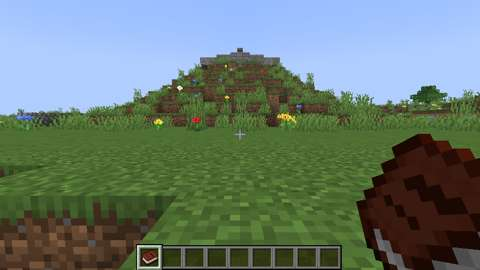
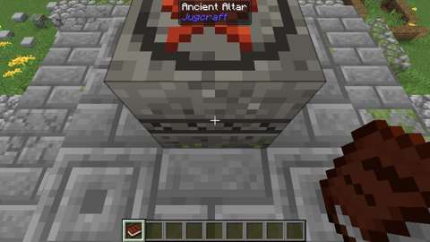
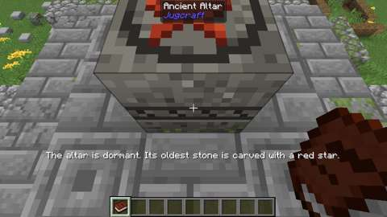

# Adam-ondi-Ahman (the valley and the altar)

Status: implemented on branch `claude/adam-ondi-ahman`, part 1 of 3 of the owner's Adam-ondi-Ahman boss ([branches/BOSSES.md](../branches/BOSSES.md#adam-ondi-ahman-and-the-cydonian-sentinel-the-plan-being-built)). Results are under Verification. **Not yet played.**
Proposal issue: none. On 14 October 2026 the owner proposed a peaceful valley near the start, modelled on Adam-ondi-Ahman, whose ancient altar opens a way to an instanced dungeon on Mars and a hard boss. They chose the real name, one valley near the start of every new world and rare ones elsewhere (the rarity a setting), a crafted late-game key, and a boss at the top of the planning pack's envelope. This part builds the valley and its knoll of altars; the altar is dormant until part 2.
Owner: @jimbozoomer-byte. AI-assisted implementation with Claude Code; the model is named in the commit trailers.
Target milestone and tier: world generation (Discovery). The altar's use waits for the late game (part 2's Altar Keystone).
Primary specialty and supported player role: exploration. Bossing comes in parts 2 and 3.

## Player experience
- **A valley near the start.** Every new world has one Adam-ondi-Ahman 800 to 1,600 blocks from where it starts: a quiet river valley about 350 blocks across. It has rolling prairie grass, wildflowers, goldenrod and oxeye daisies, and oaks and birches standing alone. Sheep, cows, chickens, horses and rabbits graze there. Monsters are few: every kind that spawns there spawns sparsely. Its grass and leaves follow the seasons, and winter snow covers it when `seasons.snow` is on. Rivers and lakes through it keep their own biomes, and no village, pillager outpost or ruined portal is built in it.
- **Rare valleys elsewhere.** About half of the Overworld's cells 3,072 blocks square try up to six places for one, and the first whose land suits becomes a valley. `/locate biome jugcraft:adam_ondi_ahman` finds the nearest.
- **The knoll of altars** stands at each valley's heart:
  - a grassy knoll rising about nine blocks over the land, with a worn path of coarse dirt and gravel up one side;
  - on its crown, three altars of ancient stone, stacked: a broad, broken footing of cobblestone and mossy cobblestone; a smaller course of stone bricks, cracked and mossy; and a third of carved stone;
  - fallen stones and wall stubs round the crown's rim;
  - on the top, the **Ancient Altar**: a block of old grey stone, lichened, with a red star carved in a ring on its face.
- **The old settlement:** at the knoll's foot, the log footings of two cabins (one of oak, one of stripped oak), a fallen chimney, a spring of still water in a ring of mossy stones, and a ring of flat stones round a mossy one, a place for gathering.
- **The Ancient Altar is dormant.** It cannot be broken, blown up or pushed, like an end portal frame. Used, it only says: "The altar is dormant. Its oldest stone is carved with a red star." Everything else on the knoll is ordinary stone, logs and earth, and can be mined.

The real Adam-ondi-Ahman stands on the bluffs above the Grand River in northern Missouri, where early accounts describe the ruins of stone altars on its hills, and where Latter-day Saints settled in 1838. The valley, the stacked altars and the cabin footings are modelled on that landscape. The Mars lore is the game's own, and comes in part 2.

## Connections
- Existing input producer: world generation (the Overworld's noise, Alpine Spawn's start and the town).
- Existing output consumer:
  - exploration and building (the knoll's stone, logs and earth);
  - grazing animals;
  - in part 2, the Altar Keystone's rite, which opens the way to the Cydonian Sanctum.
- Technology connection: none yet. Part 2's keystone has a factory recipe (titanium, tungsten, advanced circuits).
- Magic connection: none yet. Part 2's keystone has a Concordance recipe too, so neither specialty is forced through the other.
- Reachable entry path: every new world has a valley near its start, so nothing is needed to reach it. Worlds made before this, and worlds with the start valley switched off, have the rare valleys in new chunks. Nothing it gives is required.
- Which connections are required vs optional; trade and solo routes: all optional. The knoll's blocks are ordinary vanilla blocks; the altar has no item.
- How this specialty stays useful without mastering every other branch: it needs none.

## Balance and automation
Nothing to obtain but vanilla blocks from the knoll, and nothing to craft. The Ancient Altar drops nothing and has no item. Monsters' spawn costs (charge 0.7, energy budget 0.15 for each kind, as vanilla's soul sand valley does for its own) keep them sparse in the valley; mob caps are vanilla's. No conversion, no loop.

## Multiplayer and persistence
- **Server authority.** The server chooses the valleys and generates the knolls; clients see blocks and biomes as for any land.
- **The start valley** is chosen once, on a new world's first start (game time 0):
  - after Alpine Spawn has moved the world spawn and the town has been placed (a later event phase than both);
  - in rings 100 blocks apart from 800 to 1,600 blocks from the start, every 15 degrees, nearest first;
  - never within 768 blocks of the origin, where vanilla's own spawn search may already have generated chunks, and never where a chunk within 400 blocks is already loaded, so no chunk of it was made without the valley;
  - on suitable land: inland, not the mountains, temperate, not a river's bed, dry at a 3 x 3 grid of samples 40 blocks apart, 65 to 110 high at its middle, and no more than 10 blocks from the highest sample to the lowest. Only the land's noise is read (as the town's choice reads it), so nothing is generated to choose.
  - Its site is saved in the Overworld (`data/jugcraft_adam_ondi_ahman.dat`), chosen or not, and read back as the Overworld loads, before any chunk generates. Moving the world spawn later does not move it.
- **The rare valleys** come from the world seed: `adam_ondi_ahman.chance` of the cells `adam_ondi_ahman.spacing` blocks square try up to 6 places each, every one at least 272 blocks inside its cell so that its valley never reaches the next cell; the first whose land suits (as above) is the cell's valley. (CI's first real world found none within 12 km with one place a cell.) A rare valley that would touch the start valley gives way to it. The same seed always makes the same rare valleys.
- **How the valley and its knoll agree.** A valley is the land within 176 blocks of its site, give or take 32 round its wavering edge. Biome lookups there answer Adam-ondi-Ahman, except rivers, oceans, beaches and everything below the surface. Within 64 blocks of the site, the knoll's own ground, the valley answers even over a river. The knoll is built at its site by `world/AltarKnolls`, as the town is built: once every chunk under it and its blend ring (6 x 6 chunks) has been newly generated and is loaded, the ground is levelled to the knoll's height over its pad (25 blocks either way of the site), filling a hollow at most 24 deep and clearing land and trees at most 32 high, and blended back to the land's own height over an 8-block ring; then its template is placed, turned as the site's number says. The knoll's height is the middle of nine height samples over the pad, read from the land's noise. Which knolls are built, and which chunks under the others are new, is saved. A knoll is never built over a chunk the world had before. (It was first a vanilla jigsaw structure with a custom placement; CI's real worlds showed 26.3's generator never placed it, though the site chunk was chosen.)
- **Finding one:** `/locate biome jugcraft:adam_ondi_ahman` finds a valley. `/locate structure` does not find the knolls, as for the World Designer's pinned structures: vanilla's search knows only its own placements.
- **Settings** (config/jugcraft.properties):
  - `adam_ondi_ahman.enabled=false` stops new valleys and knolls. The biome and the altar stay registered, so old chunks keep them.
  - `adam_ondi_ahman.start=off`: new worlds get no valley near their start.
  - `adam_ondi_ahman.spacing` (1,024 to 16,384 blocks; default 3,072) and `adam_ondi_ahman.chance` (0 to 1; default 0.5). Changing them on an existing world moves the rare valleys for new chunks only, which can leave a valley cut off at the old chunks' edge.
- **Existing worlds.** Old chunks are never rewritten. A world made before this gets no start valley (its first start is long past), but its new chunks may hold rare ones.
- **Cost.** A biome lookup away from a valley does a few integer hashes for its cell and one distance test. Near a candidate, its land is judged once (one climate sample and 18 height samples) and remembered for the session. Choosing the start valley tries at most 216 places, once per world.
- **Worlds it leaves alone:** only the Overworld's multi-noise source is answered. Superflat, single-biome and World Designer worlds have no valleys.

## Dependencies and assets
- No new dependency. One new hook in each of two existing mixins: the biome lookup (`MultiNoiseBiomeSourceMixin`) and the Overworld's climate table (`OverworldBiomeBuilderMixin`).
- The knoll is a structure template written by `tools/adam_ondi_ahman.py` from vanilla block IDs and the Ancient Altar, built into the world by `world/AltarKnolls`. No Mojang structure file is copied.
- The Ancient Altar's textures are drawn by code in `tools/adam_ondi_ahman_textures.py`: weathered grey stone, a carved band on its sides, and a ring and a red star on its face. No Mojang texture is read, traced or copied.
- The land's climate is read with the world's own climate sampler. 26.3's `RandomState` holds none (CI's first compile and run showed it), so `MultiNoiseBiomeSourceMixin` notes the one the game hands to the Overworld's biome source with each biome lookup (`createResolver`, `createResolverForChunk`). Until it has, no land is judged (and nothing is remembered); the start valley's choice makes one lookup first to be sure.
- Java: `world/AdamOndiAhman` (placement, the start valley, the biome answer and the registrations), `world/AltarKnolls` (builds the knolls), `world/AdamOndiAhmanState` (the saved start valley and the knolls' progress) and `world/AncientAltarBlock`.
- Data:
  - the biome, from `tools/biomes.py` (`"placement": "site"`: placed round its sites, by no region rule);
  - from `tools/adam_ondi_ahman_data.py`: the knoll's template, and the altar's block assets, empty loot table and tags (wither- and dragon-immune; `#minecraft:features_cannot_replace`).

## Verification
Results are recorded under "Results" below after CI runs.
- `python3 tools/check_mod_data.py`, `check_adam_ondi_ahman`:
  - Java's numbers, IDs, settings and hooks match `tools/adam_ondi_ahman.py`;
  - the committed template is current, and the builder's numbers (pad, blend ring, fill and clearing) match, with the pad holding the template however it turns and the knoll inside its cell;
  - the biome is placed round its sites and by no rule;
  - the knoll as built: one Ancient Altar, on the top altar, with room to stand beside it; no gap in an altar under the one above it; the path up the knoll climbs at most a block at a time, with headroom; the settlement and the spring off the mound; ground under every column; tall grass whole.
  - Breaking the Java on purpose, one change at a time (a radius, a climate limit, the start rings, the tries, the builder's registration, its blend ring and pad, either hook, the altar's message, a setting's default), made the audit fail each time: 11 of 11.
- Server game tests (`AdamOndiAhmanGameTests`):
  - the biome loads, and a knoll's footprint is the 6 x 6 chunks round its site;
  - the valley is listed once in the Overworld's table, where no climate reaches;
  - the template loads at 48 x 18 x 48 with the altar and its stones, in the game's data version;
  - the altar cannot be broken or blown up, has no item, and used, only says it is dormant;
  - the rare valleys' sites keep to their cells, in about the configured share, the same for a seed and different for the next;
  - the climate a knoll needs (not the sea, mountains, desert, frozen north, jungle or a river's bed).
- Client game test (`AdamOndiAhmanClientGameTests`), a real world with seed `jugcraft`:
  - the start valley is 800 to 1,600 blocks from the start, and a search from the start finds the biome;
  - every rare valley within 12,000 blocks has the biome at its site;
  - the knoll generates there with the Ancient Altar on top, in the valley;
  - using the altar leaves it as it was;
  - pictures of the valley, the knoll, the altars and the altar's face.
- Not run: play by hand, a dedicated server, two clients, other seeds, performance measurements.

### Results
- Local, on this branch: `python3 scripts/check_repository.py` passed. `python3 tools/check_mod_data.py` passed (2,649 material IDs, data files and recipe audit), with the mutation check above. `javac` found no syntax errors in the new and changed Java (the game compiles only in CI).
- CI, on f663f5117 (Build run 38607580940):
  - `mod` (compile, data checks and the server game tests, `AdamOndiAhmanGameTests` among them): passed. `optional integrations absent`: passed.
  - `AdamOndiAhmanClientGameTests` (client shard 0 of 5): passed. In the world of seed `jugcraft` the knoll was built at the start valley's site, the Ancient Altar stood on it in the valley's biome, and using it left it as it was.
  - Client shards 0, 1, 2 and 4: passed. Shard 3: see the PR.
  - On the earlier head 2903fa5 the same client test logged the start valley at 688 -512, 1,108 blocks from the start at 304 528, and 2 rare valleys within 12,000 blocks of the start, the nearest 6,007 blocks away, each with the biome at its site. It found no altar there, because 26.3 never placed the knoll as a jigsaw structure. That is why `AltarKnolls` builds it now.
  - The overview picture of the valley fell to the ground on f663f5117 (its camera's chunk was not loaded, so no barrier was placed under it). b0746a5da loaded the chunk first. That run built the knoll again ("built the knoll at 688 -512"), but the test failed: the first camera's barrier now stood at y 149 over the site, which is the altar's own column, and the altar search read that column's top as the barrier. The search now looks under the test's barrier. The camera also flies, so it stays put before the client has the chunks it is moved to.

*In-game screenshots from CI's client game test (`AdamOndiAhmanClientGameTests`, software rendering, small previews), seed `jugcraft`, f663f5117.*

## World and event applicability
- Overworld only, as above. The valley is temperate land with four seasons; the knoll is never an arena, and nothing fights there.
- No seasonal content, pets, loot or dimension travel in this part. Part 2 adds the way to the Cydonian Sanctum and back; part 3, the boss.

## Rollout and open questions
- The start valley's distance and the rare valleys' rarity are first guesses. The client test logs how far the first world's start valley is and how many rare valleys lie within 12 km.
- On steep land the builder's pad and blend ring show; the slope limit (10 blocks over the knoll's samples) keeps them gentle. In a world explored before this, a rare valley whose knoll would cover old chunks has no knoll.
- Part 2 builds the Altar Keystone, its rite at the altar and the Cydonian Sanctum on Mars; part 3, the Cydonian Sentinel and its loot. The owner checks each part before the next.
