# The Archive of Last Names

Status: implemented in source; CI passes (below), and its client test's pictures are in the record. Part 1 of boss 6, the Crypt Lich, in the [bosses plan](../branches/BOSSES.md#the-crypt-lich-the-plan-being-built), built by [the boss playbook](../branches/BOSS_PLAYBOOK.md): the Archive of Last Names, a sixth lair on the shared framework ([hollow-acre.md](hollow-acre.md)), and the Writ of Exhumation that opens it. The Crypt Lich and his loot are part 2, in their own pull request ([crypt-lich.md](crypt-lich.md)). It has not been played by hand, and the two-client dedicated-server playtest is still to do.
Proposal issue: none. On 13 October 2026 the owner chose the recommendations at the Mire Hag's checkpoint ("go with recommendations"): the Crypt Lich next, built the same two-part way, his crypt lair and summoning first.
Owner: @jimbozoomer-byte

Target milestone and tier: Specialization tier (dungeon expeditions), as the other lairs are. The writ takes what a player has early on: paper, bones, an ink sac and a bottle of ectoplasm from a restless spirit.
Primary specialty and supported player role: adventuring, and the ghost hunter's craft, whose ectoplasm the writ is sealed with.

## Player experience

### The Writ of Exhumation

1. Craft a **Writ of Exhumation**: three paper over two bones and a bottle of ectoplasm, signed with an ink sac. Ectoplasm is taken from a restless spirit with a glass bottle, where the spirit lantern shows it: spirits rise from graves at night, all year.
2. Serve the writ on a stone sarcophagus (stone brick, deepslate or blackstone, `#jugcraft:writ_tombs`) in the Overworld that lies in a crypt: under a roof, so that no sky can be seen over either half of it. Any hour, all year: underground, night and day are alike.
3. The lid grinds aside, cold blue fire and grey mist well up from the dark inside, and you go down the stair under it: you come to the archive's landing. The writ is used up.
4. For 60 seconds (`lairs.gate_seconds`) the mist stays over the open sarcophagus. Anyone who uses the mist, or uses the open sarcophagus with an empty hand, follows, while the party has room (`lairs.party_size`). Nobody is taken in by standing near it. When the mist is gone (its time up, or the archive closed), the lid grinds shut.
5. When something is missing, the writ only says what, and nothing is used up:
   - outside the Overworld: "The writ holds only in the Overworld";
   - under the open sky: "The dead are not called up under the open sky: serve the writ in a crypt";
   - where its mist is already rising: "This tomb already stands open: use its mist to follow";
   - when every instance of the archive is taken, the shared message that every one is taken, and to try again soon.
6. Used on anything else, the writ says to serve it on a stone sarcophagus.
7. Every serving, answered or not, rests the writ for two seconds.

The writ is served before the sarcophagus opens its own lid: with a writ in hand, a sarcophagus never opens its slots.

The Crypt Lich is no Witching Season boss: the writ works all year, whatever `lairs.off_season` says.

### The Archive of Last Names

A vaulted crypt deep under the graves, closed all round: a box of deepslate hanging in the void, none of the void to be seen from inside. The sky and the fog are a cold blue-black, and white ash drifts in the air; the music is vanilla's soul sand valley.

- **The arrival:** a landing at the top of a stair five blocks wide, at the hall's south end. You come to it facing north, down the stair into the hall.
- **The way home:** behind you, Grey Mist fills the doorway of the stair's way back up. Use it at any time, in or out of a fight, to go back to exactly where you stood.
- **The hall,** the arena: 41 blocks square under a barrel vault of deepslate tiles that springs from the side walls and rises to its crown over the middle, crossed by ribs of blackstone. Its floor is deepslate tiles, cracked here and there; sixteen ledger stones of chiselled crypt stone lie in it, where the Lich's dead will rise (part 2). Four pairs of thick pillars of crypt stone stand in its quarters.
- **The four lanes:** walks three blocks wide paved with polished deepslate, a line of bone down the middle, from the dais west and east to the side alcoves, north to the throne's apse and south to the lectern. Nothing stands on them.
- **The dais:** a round step of blackstone slabs at the hall's heart, and on a plinth in its middle the **phylactery**: an urn of bone banded with gold, soul-fire burning in its windows (light 10), souls drifting up from it now and then.
- **The three alcoves,** one for each of the Lich's names: the Sexton's to the west, the Crowned's to the north behind the throne, the Scribe's to the east. In each a deepslate sarcophagus lies with its head to the back wall, and on that wall the name's **grave seal**, a disc of red wax on an iron plate pressed with the name's rune, and over it the **name-stone**, a tablet of pale limestone carved large with the rune over two lines of lettering. The runes are a spade (the Sexton), a crown (the Crowned) and a quill (the Scribe): a name is told by its shape, not by colour.
- **The throne's apse:** raised two blocks at the hall's north end, two steps up, the bone throne on it facing the hall and the Crowned's alcove behind it. The Lich will wait on the throne (part 2).
- **The Lectern of Last Names:** at the foot of the stair, at the south lane's end: a foot of crypt stone, a column of bone and a desk of black wood with the archive's book open on it. Any player can read it.
- **The walls:** the archive itself: bays of bookshelves and of ossuary niches by turns between pilasters, cracked brick over them. Soul lanterns hang on chains from the vault, candles burn in skulls, and bones lie piled in the corners.
- **The light:** hidden light blocks a little over head height, the soul lanterns and the phylactery. Every open cell of the hall's floor has block light 7 or more.

The fixtures, in part 1:
- **A grave seal** is used by any player. Until the Lich binds it (part 2) it is cold, and using it says so.
- **The Lectern of Last Names** is read by any player. It reads the three names, and if a name has been scraped from its stone, it is cut again. In part 2 the Lich scrapes names away, and reading them back is how a party answers.
- **A name-stone** cannot be used. It is dark, lit (the name the Lich answers to, burning with soul-fire at light 9) or erased (scraped to rough stone).
- **The phylactery** cannot be used. It is whole or cracked.

Everything else is the shared framework ([hollow-acre.md](hollow-acre.md#lairs-the-shared-rules)): an instance per opening, at most eight; at most four players; nothing can be built or broken (the seals and the lectern are the archive's fixtures besides the Grey Mist); the mist's toll at the edges; Grave Goods on death; closing after 30 seconds empty.

## Changes from the plan

- **The grave seal hangs on the alcove's back wall, under its name-stone,** rather than lying on the sarcophagus's lid. The stone sarcophagus's lid is drawn by its own renderer above its body, so a seal set on the lid would float over it. The plan now says so.
- **The lid shuts when the mist is gone,** whether its minute is up or the archive closed early, rather than only after the minute.
- **The open sarcophagus can be used to follow,** as well as the mist over it, with an empty hand.
- **The Writ of Exhumation stacks to 16.**
- **Grave Dust** in a cheaper writ comes with the Lich's loot in part 2.

## Connections

- **Inputs:**
  - three paper, from sugar cane;
  - two bones, from skeletons;
  - an ink sac, from squid;
  - a bottle of ectoplasm, from a restless spirit (Fall 10, ghost hunting: a spirit lantern and a glass bottle at a grave at night);
  - a stone sarcophagus (stone bricks, two bones and a chest) under a roof.
- **Outputs:** the way into the Archive of Last Names, where the Crypt Lich will wait (part 2).
- **Technology and magic:** none yet; the archive is an adventuring destination. Part 2 brings Arms VII's two Crypt Lich trophies (the Soulreaver and the Gravewarden) into survival. Of the plan's magic links, Radiance's Revelation already makes a creature glow.
- **Reachable entry path:** every input is reachable without the archive, in the Overworld's first nights, ectoplasm included (the spirit lantern is a gold nugget, a glass pane, an amethyst shard and a candle): no circular unlock.

## Balance and automation

- **The cost:** every opening uses up a Writ of Exhumation. There is no cooldown beyond the writ's two-second rest: the writ is the limit, as the other rituals' items are.
- **No loop:** nothing comes out of the archive in part 1. Its lair-only blocks drop nothing and have no item, and nothing in it changes by itself once placed.
- **No automation:** only a player's own hand serves the writ, only a player's own use of the mist or the open tomb takes them in, and only a player in the archive uses a seal or reads the lectern.

## Multiplayer and persistence

- **Server authority:** the server decides everything. Clients only send the use: the serving, the refusals (the Overworld, the roof, a mist already rising), the lid, the mist and the entry, and the seals' and lectern's answers all happen on the server. The writ's rest is counted there, and each player's uses of the seals and readings of the lectern are kept at least half a second and a second apart.
- **What is saved:**
  - the mist is never saved, since a restart closes its instance; a lid left open by a restart is shut by the next player who opens and closes the sarcophagus;
  - the fixtures' states are saved with the instance's chunks; each instance is placed fresh, every seal whole, every name-stone dark and the phylactery whole;
  - a player's visit and Grave Goods are saved with the player, as for every lair.
- **Chunks:** no chunk is force-loaded. The mist shows itself only where its chunk is loaded (an entity, ticked by its chunk), and a lid is shut once its chunk is loaded.
- **Griefing:** nobody is pulled in. A second writ where the mist is rising is refused and kept. Nothing in the archive can be changed but its fixtures, which every instance places as they were.
- **Still to do:** the two-client dedicated-server playtest.

## Dependencies and assets

No new dependency. Everything here is drawn by code or is the game's or Jugcraft's own:
- the archive is laid out by `tools/crypt_archive.py`, on `tools/lair_layout.py`. Its template is vanilla's deepslate, blackstone, bone, bookshelves, soul lanterns and chains, and Jugcraft's own crypt stone, ossuary walls, deepslate sarcophagi, bone throne, candles in skulls, hand sconces and bone piles (the Crypt and Ossuary and the churchyard's decorations), but for its four lair-only blocks;
- the name-stones' faces (each rune dark, lit and erased), the grave seals (each rune whole and broken), the lectern and the phylactery are painted by `tools/crypt_archive_textures.py`, in the Witching Season's clean style, and their models are built by `tools/lair_data.py`;
- the writ's icon is a 16×16 map, `tools/item_icons/exhumation_writ.txt`, drawn by [ITEM_ICONS.md](../ITEM_ICONS.md) in existing materials (paper, lacquer, garnet), and checked by `tools/check_icon_maps.py`;
- the dimension files are written by `tools/lair_data.py` from the archive's line in `tools/lairs.py`. Its music is vanilla's soul sand valley, and its motes vanilla's white ash.

No Mojang texture is read, traced or copied.

New IDs (all under `jugcraft`):
- the dimension, dimension type and biome `crypt_archive`;
- the structure `lair/crypt_archive`;
- the lair-only blocks `name_stone`, `grave_seal`, `archive_lectern` and `phylactery`;
- the item `exhumation_writ`, and its recipe;
- the block tag `writ_tombs`.

Nothing is renamed.

## Verification

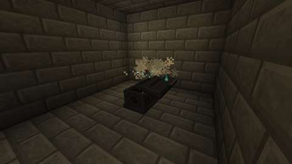
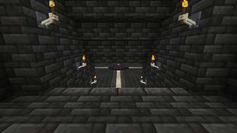
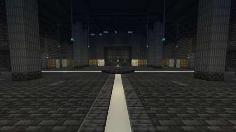
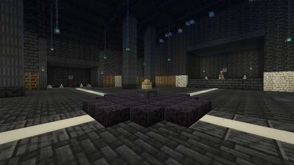
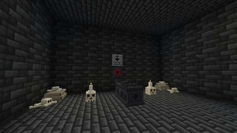
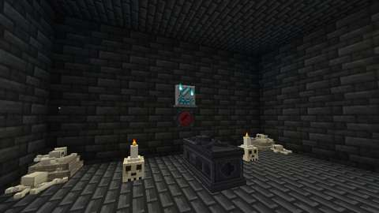
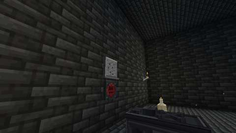
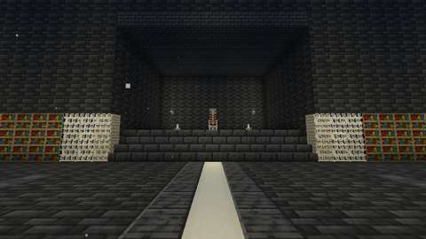
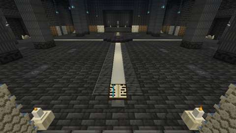
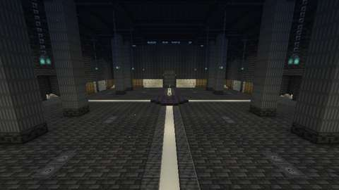
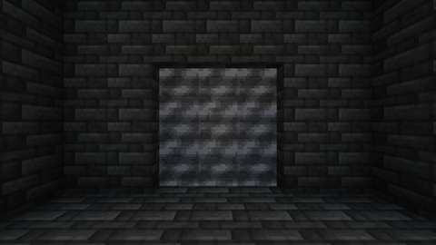

*The client game test's pictures (CI, commit `a3165b9`): the open tomb in the crypt, then in the archive the stair from the landing, the hall from the stair's foot, the dais and the phylactery, the Sexton's alcove, a name lit and a name scraped, the throne's apse, the lectern, the hall from the throne and the Grey Mist behind the landing. The test client renders at 480x270.*

CI (13 October 2026, GitHub Actions, the pins in [PLATFORM.md](../PLATFORM.md)):

| Commit | What ran | Result |
| --- | --- | --- |
| `69c5d40` | Build, data audit, game tests, client game tests | **Two failures.** The game compiled, and `repository` and every client shard passed, `CryptArchiveClientGameTests` among them. `mod` failed two of the archive's game tests: each laid its roof and asked the writ on the same tick, before the game had worked out the sky light under it, and was told "open sky" (below). `optional integrations absent` failed before it built anything: Gradle could not resolve its own plugins' dependencies (kotlin-gradle-plugin, gson, asm) from the plugin portal; `mod` resolved them on the same commit |
| `a3165b9` | The same, the two tests waiting for the light, and two pictures re-aimed | **All pass:** all 1406 required game tests, the archive's five among them, `optional integrations absent`, and the client test classes `tools/select_client_tests.py` picked, `CryptArchiveClientGameTests` among them: the writ passed end to end, and the game's own light on the hall's floor was at least 7 on all 1,597 of its open cells (the darkest at 7). The pictures above are from this commit |

Run locally (13 October 2026):

| Check | Result |
| --- | --- |
| `python3 scripts/check_repository.py` | Pass |
| `python3 tools/check_mod_data.py`: now also checks `Lair.CRYPT_ARCHIVE` against `tools/crypt_archive.py` (size, arrival, centre, bounds, floor, no moon); the writ's rest and reach and its tombs' tag against `tools/lairs.py`; the names and their runes, the name-stones' glows and light, the lectern's rest and the phylactery's light; the four fixtures' registrations; and the archive itself (`check_crypt_archive`, below) | Pass, 2199 IDs |
| Deliberate breaks of the archive and its Java, one at a time (below) | 37 of 37 failed it |
| `python3 tools/check_icon_maps.py tools/item_icons/exhumation_writ.txt` | Pass |
| `python3 tools/generate_material_data.py` and `tools/generate_textures.py`, then `git status` | Write this part's data and textures only (the PNGs they re-encoded with identical pixels were put back) |
| `javac` on the new and changed Java and the two test classes, for syntax only | No syntax errors |
| `python3 -m unittest discover -s scripts/tests` | Pass, 14 tests |
| `./gradlew build`, game tests and client game tests | Not run locally (the Fabric Maven is out of reach here); run by CI (above) |

`check_crypt_archive` checks the archive as `tools/crypt_archive.py` builds it, and `CryptArchive.java` against it:
- `CryptArchive.java`'s stand heights, the hall's bounds, the lectern, the phylactery, the throne, and each name's seal and name-stone in the order of `tools/lairs.py` NAMES, are the layout's;
- the arrival stands on the landing with room overhead, and the Grey Mist fills the way back up;
- a walk from the arrival, never stepping more than half a block, goes down the stair to every open cell of the hall's floor, up the apse's two steps, and within reach of each seal and of the lectern;
- the four lanes are open three blocks high and paved; each ledger stone lies in the floor with room over it; the pillars stand;
- each alcove's sarcophagus lies head to its wall, shut; its seal is whole and its name-stone dark, both with the name's rune, facing the hall, against their wall;
- the throne, the lectern (facing the stair) and the whole phylactery on its plinth stand where they should;
- the light, flooded from the hidden lights, the soul lanterns and the phylactery as the game floods block light, is at least `HALL_LIGHT` (7) on every open cell of the hall's floor (1,597 cells: 7 to 12, the median 9), and the client test reads against the same;
- nothing in it changes by itself once placed: no leaves, vines, water, lava, fire or grass.

The 37 deliberate breaks: no tiles under the arrival; a cell of the Grey Mist missing; a stone on the west lane; a row of the stair gone; the apse's upper step a whole block; the Scribe's stone with the spade; the Sexton's seal broken; the Crowned's stone lit; the wall behind the Sexton's seal gone; the Scribe's sarcophagus's foot turned; the phylactery cracked; the lectern facing north; the throne's upper half gone; a block on a ledger stone; a pillar hollowed; water in the archive; the hidden lights four levels dimmer; `HALL_LIGHT` raised to 9; the client test reading against 6; `Lair.CRYPT_ARCHIVE`'s bounds, and its arrival; `CryptArchive.LECTERN` moved, the seals out of order, and the hall's south edge; `ExhumationRite`'s rest, and its reach; a name-stone's light, the phylactery's, and the lectern's rest; the runes out of order; a glow missing; the name-stone registered without its light; the writ unregistered; the rite not registered; a writ message without words; the tombs' tag changed; the lectern no fixture.

What the building found:
- The hidden lights' lattice at first started four blocks in from the west wall, and left the cells along the walls and behind the pillars too dark; the audit's flood of the light found 79 cells under 7. The lattice now runs from wall to wall, its rows staggered, at level 14, as the fen's is.
- The throne's apse was carved after the alcoves were furnished, and carved away the Crowned's sarcophagus, seal and name-stone; a plan view of the template showed it. The apse is now carved first.
- The tablets' models drew the face and the rest of the tablet as two boxes, and the art check found the face of the one left open; each is now one box.
- CI's first run (`69c5d40`) failed two of the game tests: each laid a roof over the sarcophagus and asked the writ at once, on the same tick, but the game works out the sky light under a new roof a tick or more later. The writ is right to ask whether the sky can be seen; the two tests now wait for the light to settle under the roof laid, and lifted, before they ask. Its client pictures were taken on that run; two of them were re-aimed: the lectern is now pictured from the stair behind it, and the hall from the throne's apse rather than from high in a corner, where a pair of pillars and the vault hid the most of it.

The game tests (`CryptArchiveGameTests`) show what a game-test server can:
1. the archive's dimension type and biome load from their files;
2. its template loads in the running game, at the size `Lair.CRYPT_ARCHIVE` gives, with the name-stones, the seals, the lectern, the phylactery, the sarcophagi, the throne, the soul lanterns and the Grey Mist, and the game's data version, and without anything that changes once placed;
3. the writ's checks: on a stone sarcophagus under a roof it takes; with the sky over either half it is refused; either half finds the head; the three stone sarcophagi are tombs for it and a coffin is not; the lid grinds aside and shut on both halves;
4. the writ served by a player's hand when no instance can open: the archive is full, the writ is kept and rested, the tomb's slots are not opened, the lid stays shut, nobody moves, no mist rises; under the open sky it is refused and kept;
5. the fixtures: a name-stone gives light 9 lit and none dark or scraped; the phylactery gives light 10 whole and none cracked; none of the four can be broken or has an item; the seals and the lectern are lair fixtures and the name-stones and the phylactery are not; a seal used with no Lich to bind it stays whole; the lectern reads nothing back where no name-stone of the archive lies.

The client game test (`CryptArchiveClientGameTests`, CI job `client`) runs the writ from end to end in a real world, with its one player in survival:
1. served on a sarcophagus out under the sky, the writ is refused and kept;
2. served by the player's hand on a sarcophagus in a crypt of stone bricks, the writ opens an instance in the archive's own dimension and places the archive. It checks the landing under the arrival, the Grey Mist in the way back up, each name's seal whole and name-stone dark with its rune, the lectern, the whole phylactery on its plinth and the throne. The writ is used up and rested, the lid grinds aside on both halves, a mist rises over the tomb, and the player comes to the landing, unable to build;
3. a seal and the lectern can be used and a name-stone cannot. A seal used with no Lich to bind it stays whole. A name scraped from its stone is cut again when the player reads the lectern. Falling out of the archive throws the player back to the landing for the mist's toll;
4. leaving takes the player back to where they stood. A second writ at the risen mist is refused and kept, and using the open sarcophagus with an empty hand takes the player back into the same archive;
5. when the instance closes, the player goes home, the mist is gone and the lid grinds shut.

Then it takes eleven pictures: the open tomb in the crypt, and in the archive the view down the stair from the landing, the hall from the stair's foot, the dais and the phylactery, the Sexton's alcove, the Scribe's name lit, the Crowned's name scraped, the throne's apse, the Lectern of Last Names from the stair, the hall from the throne's apse, and the Grey Mist in the way back up. Last it reads the game's own block light on every open cell of the hall's floor, and fails under 7.

Not run: the two-client dedicated-server playtest, and play by hand.

## World and event applicability

The Archive of Last Names is its own dimension, so nothing here changes the Overworld but a sarcophagus's lid, which grinds shut again when the mist is gone. The writ works at any hour, all year, in any crypt in the Overworld. No season gates it.

## Rollout and open questions

The shared framework's defaults hold: four players and eight instances, Grave Goods on death.

Part 2, the Crypt Lich ([crypt-lich.md](crypt-lich.md)), adds:
- the fight in the hall: his ward, the soul chains from the seals to his phylactery, the lit name whose seal breaks, and the dead a wrong seal raises;
- his attacks: the Grave Sweep, the Bone Lanes down the lanes to his names' alcoves, the Soul Bolt struck back, Raise the Dead, the Soul Drain broken by the pillars, and the Grave Pull's dark way out;
- the Erasure, his names scraped from their stones and read back at the lectern;
- his loot: Grave Dust, the Soulreaver and the Gravewarden, the Emptied Phylactery, the Lich's Crown and the advancement Nameless;
- Grave Dust in a cheaper writ.

There is no generated crypt in the world yet; the crypt is any a player builds, or any cellar under a graveyard. A generated graveyard crypt, if the owner wants one, is a separate, reviewed piece of world generation.
