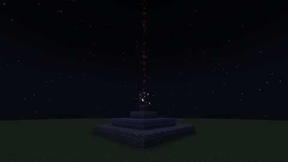
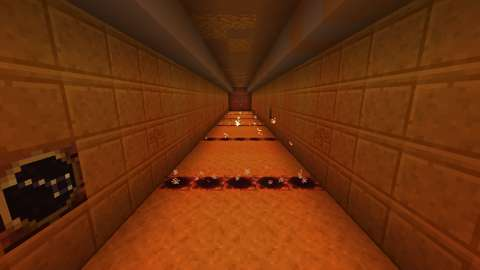
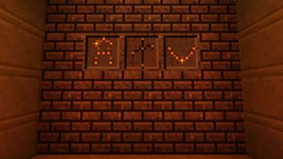
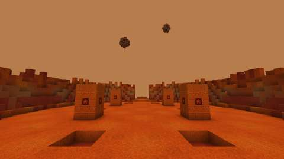

# The Cydonian Sanctum and the Altar Keystone (Adam-ondi-Ahman, part 2)

Status: implemented on branch `claude/cydonian-sanctum` (stacked on part 1's `claude/adam-ondi-ahman`, PR #370); see
Verification for what has run.
Proposal issue: none; the owner's own idea of 14 October 2026 is the scope approval, and on the same day the owner chose to
start part 2 ("Start part 2 now"). The plan is [BOSSES.md](../branches/BOSSES.md), "Adam-ondi-Ahman and the Cydonian
Sentinel".
Owner: @jimbozoomer-byte. AI-assisted implementation with Claude Code; the model is named in the commit trailers.
Target milestone and tier: late game (Jugcraft Expeditions): titanium ingots come only from the Kroll process, and the
Concordance's way needs dreamglass from dreams and a Starwatcher's astrolabe.
Primary specialty and supported player role: exploration and boss fights, reached from either the factories or the
Concordance.

## Player experience

**The Altar Keystone.** A wedge of carved grey stone set with the Ancient Altar's red star. It is made two ways, so
neither specialty is forced through the other:
- the factories': two titanium ingots, a tungsten ingot, two redstone, chiseled stone bricks and an advanced circuit;
- the Concordance's: three dreamglass (brought back from dreams), the Starwatchers' astrolabe, two redstone and chiseled
  stone bricks.

**The rite.** At night, set it into the Ancient Altar of Adam-ondi-Ahman ([part 1](adam-ondi-ahman.md)): use it on the
altar.
1. The keystone crumbles to dust. The three altars under the Ancient Altar kindle with red fire one after another, a
   second apart, the lowest first.
2. A column of red light rises over the altar, and a **red mist** opens there. Whoever set the keystone steps through onto
   Mars, if they are still within 8 blocks of the altar.
3. For 60 seconds (`lairs.gate_seconds`) anyone who uses the mist, or uses the altar with an empty hand, follows while
   there is room. Nobody is taken in by standing near it.
4. By day, with the altar already burning red or its mist open, or with every instance of the Sanctum taken, the keystone
   only says why, and nothing is used up. It works all year: it is no Witching Season boss.

**The Cydonian Sanctum.** Ruins on Mars, cut into red rock under a butterscotch sky, hanging in the void as every lair
does. Two small moons hang over the north rim: Phobos, and Deimos higher and further off.
- **Thin air.** Everyone in the Sanctum jumps higher (Jump Boost I, its icon shown) and takes half damage from falls. Both
  end on leaving.
- **The gate chamber** is the arrival: a hall cut into the rock, the **Red Mist** in an arch behind the arrival, the way
  home at any time. It is safe.
- **The Dust Gallery**, a corridor 40 blocks long, north from the chamber.
  - **Dust vents** lie across its floor in five lines. Every three seconds each line hisses and sends up a wisp (a
    second's tell), then puffs: whoever stands on it takes 3 damage and is thrown back south. Neighbouring lines puff
    half a period apart, so there is always a safe line of floor between two.
  - **Three star dials** stand in its walls. Each shows a constellation in a ring of bronze; using one turns it to the
    next of six: the Plough, the Hunter, the Lyre, the Swan, the Scorpion and the Crown.
  - **The Star Door** closes its north end. Three constellations are carved in it: the Hunter, the Swan and the Crown.
    Each burns red while a dial shows it. When all three burn, the door grinds open, crumbling away a row at a time from
    the top. Any player can do it.
- **The crater**, the arena: a floor of red sand and rust-red rock 44 blocks across, ringed by its rim wall.
  - **Four standing stones**, carved with the altar's red star, stand round it: part 3's shelter from the storm.
  - **The Sentinel's plinth** is on the north rim, steps down from it to the floor.
  - **Six small craters** pock the floor, where part 3's sentries will rise.

In this part the crater is empty: the Cydonian Sentinel comes in part 3. An instance nobody is in closes after 30
seconds, as every lair's does.

## Changes from the plan
- **The Concordance's recipe.** The plan asked for "a late reagent of its own". The Concordance has no item made only at
  its Master or Architect stages (its stages are research, not items). So the keystone asks for two of its traditions'
  own work instead: dreamglass, which only the Dreamwalkers bring back from dreams, and the Starwatchers' astrolabe. The
  owner can ask for a different ingredient.
- **Lighting.** Every lair's sky gives no light (sky light factor 0), so the open crater is lit by hidden light blocks,
  as the lairs' halls are, with a little more ambient light than the others (0.3).
- **The moons** are rock built into the template (tuff and packed mud), not the lairs' single moon disc, because there
  are two and they are not lamps.

## Connections
- Existing input producer: part 1's Ancient Altar (world generation); the factories' titanium (Kroll process), tungsten
  and advanced circuits; the Concordance's dreamglass (Hexes) and astrolabe (Celestial).
- Existing output consumer: the shared lair framework (`lair/Lairs`, instances, Grave Goods, the mist gate, the lair
  rules). Part 3's boss, sentries and loot.
- Technology connection: the factories' recipe.
- Magic connection: the Concordance's recipe.
- Reachable entry path (prove no circular unlock): the keystone's ingredients are all made before it, from the factories
  or the Concordance; the altar generates in every new world near its start. Nothing in the Sanctum is needed to make the
  keystone. (Part 3's Cydonian Shards will make a cheaper keystone, after the first.)
- Which connections are required vs optional; trade and solo routes: either recipe; keystones and their ingredients can be
  traded; the Sanctum can be entered alone or with up to `lairs.party_size` players.
- How this specialty stays useful without mastering every other branch: either branch alone makes the keystone.

## Balance and automation
- A keystone is spent each time the Sanctum opens. Refused settings spend nothing and rest it for 2 seconds.
- Nothing is produced in this part: the Sanctum gives no loot yet, and nothing in it can be broken or carried out
  (lair-only blocks have no item and no drops).
- No conversion loop: the keystone is consumed and makes nothing.

## Multiplayer and persistence
- **Server authority.** The setting, the kindling, the dials, the door, the vents and the thin air run on the server.
  Dials and the Red Mist are the only blocks players may use in the Sanctum (`#jugcraft:lair_fixtures`); everything else
  is refused by `LairRules`.
- **Instances.** Placed fresh from the template each time one opens (the Star Door whole and dark, the dials on their
  first constellations). Kindlings and gates are never saved: a restart closes every instance, and anyone found inside a
  closed one is sent home.
- **Kindling.** If the altar's chunk is unloaded when the mist should open (nobody left nearby), the instance closes again
  and the keystone stays spent.
- **Thin air.** A transient attribute modifier (fall damage ×0.5) and an ambient Jump Boost I, renewed each second while
  the player is in the Sanctum, removed (the modifier at once, the jump within 2.5 seconds) once they are anywhere else.
  A stronger jump of their own (a potion) is left alone.
- **Per tick:** the vents run only for open instances: five lines each, a few particles during their tell, and one box
  query per line while it puffs. The kindlings run only while one is under way (three seconds each).
- **Disable behavior:** the lairs' switch (`agriculture`) or Adam-ondi-Ahman's (`adam_ondi_ahman`) off refuses the
  keystone; everything stays registered.

## Dependencies and assets
- No new dependency.
- New IDs:
  - the item `jugcraft:altar_keystone`, and its recipes `jugcraft:altar_keystone` and
    `jugcraft:altar_keystone_from_dreamglass`;
  - the dimension `jugcraft:cydonian_sanctum` (its dimension type, level stem and biome) and the template
    `jugcraft:lair/cydonian_sanctum`;
  - the lair-only blocks `jugcraft:red_mist`, `star_stone`, `star_dial`, `star_door` and `dust_vent`;
  - the damage type `jugcraft:dust_vent`.
- **The dust vent's texture** is the owner's sulfur vent, from the supplied library:
  `art/owner-library/originals/Blocks/Guns/block/sulfur_vent.png` (32 × 32), with the faces its model takes from it
  (`.../models/block/sulfur_vent.json`). It is copied unchanged by `tools/cydonian_sanctum_textures.py` into
  `textures/block/dust_vent.png`; the model keeps the original's UVs, with Jugcraft's namespace and without Blockbench's
  `texture_size` and display settings. The owner supplied the library for Jugcraft and authorized its direct reuse
  ([PROVENANCE.md](../../art/owner-library/PROVENANCE.md)).
- Every other texture is drawn by code (`tools/cydonian_sanctum_textures.py`; the keystone's icon from its map,
  `tools/item_icons/altar_keystone.txt`). The star stone reuses part 1's red star. No Mojang file is read, traced or
  copied.

## Verification
Results are recorded under "Results" below after CI runs.
- `python3 tools/check_mod_data.py`:
  - `check_lairs`: the `Lair.java` line from the layout; the keystone's rest, reach and kindling; the altars it kindles
    are the ones part 1's knoll stacks; the fixtures' registrations; both recipes make the keystone and load only with
    their features; the dimension, its type, biome, template and words.
  - `check_cydonian_sanctum`:
    - the Java's numbers and enums are the layout's;
    - the arrival, the Red Mist, the door and its figures, the dials facing into the gallery, and the vents with room
      over them;
    - a walk from the arrival reaches the door, each dial, and (the door open) the crater's middle, the plinth and every
      standing stone;
    - the crater's floor is open over solid ground, the standing stones are whole with their star stones, and the moons
      hang high over the north rim;
    - block light flooded from the hidden lights is at least 7 on every open cell of the gallery's floor;
    - sand always lies on something, and nothing changes by itself once placed.
- Server game tests (`CydonianSanctumGameTests`):
  - the dimension type, biome and the vents' damage type load;
  - the template loads at the Lair's size, in the game's data version, with its fixtures;
  - the keystone is refused by day; when no instance can open it is kept and rested, nothing kindles and nobody moves;
    either switch off refuses it; it is not heard on a block that is no altar;
  - a dial turns through its six constellations; the door's figures burn and go dark as dials show them; all three open
    the door, which crumbles away;
  - the vents' rhythm (a tell, then a puff; neighbours never together), a puff's damage once and its throw south, on a
    test player given the 80 ticks a new player cannot be hurt in; off Mars, no thin air.
- Client game test (`CydonianSanctumClientGameTests`), in a real world with an Ancient Altar built on its three altars:
  - by day the keystone is refused and kept; at night, set by hand, it is spent and rested, the altars kindle, and an
    instance is placed with its Red Mist, door, dials and vents;
  - after the kindling the player stands in the gate chamber, unable to build, and a red mist was opened into the
    instance;
  - on Mars the player has Jump Boost I and half fall damage; a dial is a fixture, a vent is not; standing on a vent for
    two of its periods, a puff strikes (counted in the game's own damage-taken statistic, since peaceful mends a point a
    second);
  - the three dials turned by hand open the Star Door; a 12-block drop onto the crater costs at most half, rounded up
    (the same drop costs 8 or more without the thin air);
  - the Red Mist takes the player back to exactly where they stood, and the thin air goes; the red mist is still over the
    altar (with nobody left beside it, its chunk was hidden while they were away); a second keystone at the open mist is
    refused and kept; the altar with an empty hand takes them back into the same instance; closing it sends them home and
    the mist goes;
  - pictures, and the block light on every open cell of the gallery's floor.
- Not run: play by hand, a dedicated server, two clients, performance measurements.

### Results
- Local, on this branch:
  - `python3 tools/generate_material_data.py` and `python3 tools/generate_textures.py` ran clean. The texture generator
    re-encoded 306 unrelated existing PNGs; those were reverted, and only the 20 new textures are kept.
  - `python3 tools/check_mod_data.py`: PASS (2,655 material IDs, data files and recipe audit).
  - Breaking the Java on purpose, one change at a time, failed `check_lairs` 14 times out of 14: the Sanctum's bounds,
    the vents' period and a line's phase, a dial's place, the thin air's falls, the door's figures and how they are
    indexed, a lit figure's light, the dials' order, the kindling's pace, the altars kindled, the Sanctum's registration,
    the dial's block and the client test's light. Each file was restored afterwards.
  - `python3 scripts/check_repository.py` and `python3 tools/check_icon_maps.py`: PASS.
  - `javac`, syntax only, on the new and changed Java: no parse errors (the game compiles only in CI).
- CI on a04d2f980 (Build run 38636795105): **every check passed.**
  - `mod` (compile, data checks, every server game test with `CydonianSanctumGameTests`) and `optional integrations
    absent` passed.
  - `CydonianSanctumClientGameTests` passed from end to end (client shard 4: "the Altar Keystone and the Cydonian
    Sanctum passed end to end"). The darkest open cell of the gallery's floor had block light 8. The other four shards
    passed too.
- What CI found on the way there:
  - 6ecda427f did not compile: `Player.hurtMarked` is not in 26.3. The vents now send the throw to the player's client
    as the other knockbacks in the mod do.
  - **A real bug:** `CydonianSanctum.figure` indexed the three carved figures by the Figure enum's ordinal, which counts
    the plain block first. Turning a dial to the Crown crashed, and the Hunter was looked for in the Swan's cell. Both
    the server and client tests caught it; the figures are now found by their place after the plain block, and
    `check_lairs` holds the Java to that.
  - Three faults in the tests themselves:
    - the client test looked for the red mist while nobody was by the altar (its chunk hidden); it now does so once the
      player is home;
    - it read the vent's blow off the player's health, which peaceful mends;
    - the server test hurt a test player in the ticks a new player cannot be hurt.

*In-game screenshots from CI's client game test (`CydonianSanctumClientGameTests`, software rendering, small previews),
a04d2f980.*

## World and event applicability
- The rite works only in the Overworld, at the Ancient Altar (which generates only there). The Sanctum is its own
  dimension, a lair: no spawns, no beds or respawn anchors, nothing lost on death, home through the Red Mist.
- No seasonal content. The Sanctum works all year.
- Boss containment and loot are part 3's.

## Rollout and open questions
- Part 3 adds the Cydonian Sentinel on its plinth, its Shard Sentries rising from the small craters, the Red Storm and the
  standing stones' shelter, its loot (Cydonian Shards, a cheaper keystone among them) and the advancement Red Planet.
  Part 3 checks that the stones give shelter from anywhere on the floor.
- The Concordance's ingredient (above) is a first choice; the owner may want another.
- Removing the Sanctum would leave keystones without a use; its IDs must stay once released.
