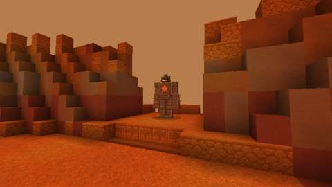
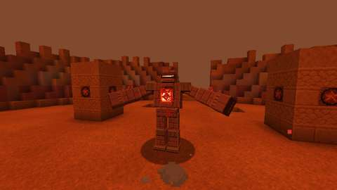
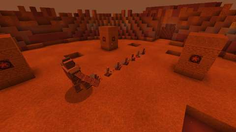
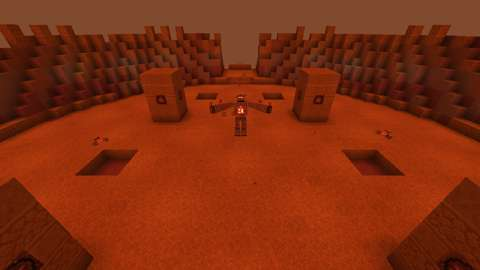
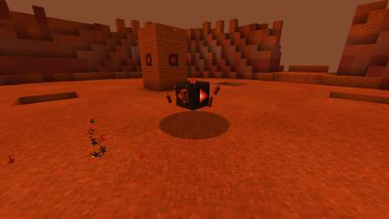
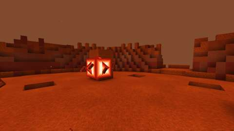

# The Cydonian Sentinel (Adam-ondi-Ahman, part 3)

## October 20 combined integration

The owner selected this three-PR group for integration into main after the titanium equipment group. Parts 1–3 are tested as one candidate, with all existing Foundry Trench, Moonlit Ring and other lair registrations, effects and audits retained. Current shared recipes, tags, essence values and acquisition reports are regenerated from the combined sources. The valley's saved chosen site and new-chunk placement evidence gain a serialization regression test.

Integration and fixes: OpenAI Codex (GPT-6), under direct owner authorization. The integration PR records the exact final commit, combined checks and merge result. The contributor results below are historical evidence for their original branches. No owner-world update, human playtest or independent two-client certification is claimed.

The combined server run exposed vanilla's random damage knockback fighting the Red
Storm's declared wind impulse. Red Storm now joins `minecraft:no_knockback`, with
all existing chemistry, gun and owner-content tag entries preserved. Its own server
wind impulse remains authoritative. A regression checks all four winds with twelve
random seeds apiece, from rest and with existing movement, while still requiring
damage. The shelter test retains every assertion and reports health/motion on failure.
Both full server CI jobs now have a 60-minute limit: the initial runs reached 2,196
passes but exceeded their former 30/45-minute limits with a test still running.
No tests or assertions were removed.

Status: implemented on branch `claude/cydonian-sentinel` (PR #382, stacked on part 2's `claude/cydonian-sanctum`, PR #372,
which is stacked on part 1's PR #370); CI passes on it (see Verification). It has not been played by hand, and the two-client
dedicated-server playtest is still to do.
Proposal issue: none; the owner's own idea of 14 October 2026 is the scope approval, and on the same day the owner chose to
start part 3 ("START PART 3 FINISH THIS ADDITION"). The plan is [BOSSES.md](../branches/BOSSES.md), "Adam-ondi-Ahman and
the Cydonian Sentinel", built by [the boss playbook](../branches/BOSS_PLAYBOOK.md). It is built on part 2, the Cydonian
Sanctum and the Altar Keystone that opens it ([cydonian-sanctum.md](cydonian-sanctum.md)), and on the lair framework
([hollow-acre.md](hollow-acre.md)).
Owner: @jimbozoomer-byte. AI-assisted implementation with Claude Code; the model is named in the commit trailers.
Target milestone and tier: late game (Jugcraft Expeditions), as the Sanctum is: it is reached only through an Altar
Keystone, whose recipes take titanium and tungsten (the factories) or dreamglass and an astrolabe (the Concordance).
Nothing a tier needs comes only from it.
Primary specialty and supported player role: boss fights. Its loot also serves the keystone's makers (Cydonian Shards in
a cheaper keystone), the factories (a shard crushed into rare earth oxide), builders and climbers (the Lowfall Core) and
costume wearers (the Sentinel's Visor).

## Player experience

### It waits

The Cydonian Sentinel waits on its plinth on the crater's north rim in every Cydonian Sanctum, placed with the Sanctum, a
statue with its core dark. It is a construct four blocks tall (two wide):
- plates of red Martian stone, stacked and seamed like dressed blocks, over a frame of rusted, riveted iron at its knees,
  feet, pauldrons and crest;
- arms like pillars, ending in knuckled stone fists, with stubs of rust crystal along the forearms that bristle out when
  it readies its volley;
- a carved visor for a face, a band of dark iron with a slit of red light across it;
- the Ancient Altar's red star cut across its two chest plates, burning; behind them its core, a sphere of red light,
  white-hot at its heart, which is cold dark stone while it waits.

Waiting, it takes no harm. It wakes when a player who can fight it (anyone not in creative or spectator mode) stands on the
crater's floor, or strikes it. Then:
- "The Cydonian Sentinel's core flares red, and it steps down from its plinth", its core flares, and its bar shows;
- it stirs on its plinth for a second, then steps down to the crater's floor in an arc in a second and a half; nothing can
  hurt it meanwhile;
- its health is set for the party: 480, half as much again for each player after the first within 38 blocks of the
  crater's middle, at most two and a half times (1200 for four or more).

It has armour 12 and cannot be knocked back. Fire, drowning, falls, poison and Wither never harm it. It cannot ride, be
leashed or be pushed. It strides over the floor at 0.12 blocks a tick and stops three blocks short of its foe. If it is
ever more than 30 blocks from the crater's middle, or fallen below the floor, it is drawn back in a burst of red dust to
where it stepped down.

### Its rule: the Red Storm and the standing stones

Fifteen seconds after it wakes, and then every 35 seconds (25 in the Red Storm, 20 unbound, 15 in the Red Giant), it calls
the storm:
- **The tell (2.5 s):** it plants its arms, and red dust streams in from one side of the crater; its bar and a line of
  chat name the side ("The storm comes from the east"; "... Shelter in the lee of a standing stone").
- **The storm (6 s):** a scouring wind crosses the crater from that side, the dust thick. Every half second, everyone over
  the crater (within its rim's wall) who is not sheltered takes 2 damage (`jugcraft:red_storm`) and is pushed downwind.
- **Shelter:** rock within 8 blocks upwind of you: the lee of a standing stone, or under the rim on the windward side.
- **There is always shelter:** from every cell of the crater's floor a sheltered place lies within 12 blocks, whichever
  way the storm blows (the audit checks every cell for each of the four winds: the farthest is 10 blocks).

**Its weak point: the core.** As it charges its Core Lance, its chest plates swing open. While they are open its core takes
double harm, and its armour does not count. A blow of 6 or more (by a player: a hit, an arrow or a thrown weapon) during
the lance's wind-up staggers it for 2 seconds, "Its core is struck: the Sentinel reels, and its lance fails", and the lance
fails. Its plates stay open while it reels, then swing shut.

### Phase 1, the Sentinel (full health to 60%)

Every attack has a wind-up you can read, a strike and a recovery. It waits at least a second between attacks.

| Attack | Read it by | What it does |
| --- | --- | --- |
| Hammerfall | It raises both fists over its head, red dust gathering on them (0.8 s) | Both fists slam the floor two blocks before it: 14 damage within 3 blocks of where they land, and everyone within 6 thrown back. Close in, its most frequent attack |
| Shard Volley | Rust shards bristle along its arms (0.7 s) | Five shards in a fan 40° wide at its foe, out to 24 blocks: 5 damage each. They break on rock |
| Quake Line | It stamps, and a glowing crack runs from its feet at its foe (1.0 s) | Spikes of red rock burst up along the 14-block line, one every 2 blocks: 10 damage to anyone within 1.2 blocks of it, thrown up. Off the line is safe |
| Core Lance | Its chest plates open, its core brightening (1.2 s) | A beam 16 blocks long at its foe for 1.5 s: 4 damage each quarter second. Rock stops it. Its core is open (above) |

### The Shell Cracks (at 60%)

"The Shell Cracks: the Sentinel roars, and its sentries rise from the craters". It roars for 3 seconds, unhurt, and two
**Shard Sentries** rise from the small craters nearest its foe. Then the Red Storm begins.

### Phase 2, the Red Storm (60% to 25%)

It keeps every attack, and adds:

| Attack | Read it by | What it does |
| --- | --- | --- |
| Sentry Call | It raises a fist, and the small craters nearest its foe glow (1.0 s) | Two Shard Sentries rise; at most four float at once |
| Storm Shards | Its storm's own tell | A second into each storm, twelve shards ride the wind across the crater's whole width from its windward edge: 5 damage each. A standing stone stops them |

**A Shard Sentry** is a ring of red stones round a red spark, a little under a block across. It rises out of its crater
for a second, unhurt meanwhile, then floats two blocks over the floor after the nearest player, keeping five blocks off,
and every 3 seconds looses a slow shard at a player within 20 blocks: 3 damage. It has 16 health. Whoever hurts one takes
part in the Sentinel's fight. It crumbles when the Sentinel falls, strides back to its plinth or is gone, drops nothing
and gives no experience.

### The Unbound Core (at 25%)

"The Unbound Core: its shell bursts apart, and the core floats free". Its shell bursts apart over 3 seconds, unhurt. The
core floats free two blocks over the floor, a red-hot sphere wreathed in orbiting shards, its body a block and a half
across. With no shell its armour is 4 and it floats at 0.2 blocks a tick. Its bar reads "The Cydonian Sentinel: the
Unbound Core". Its storm still blows, and still carries shards. Its attacks:

| Attack | Read it by | What it does |
| --- | --- | --- |
| Sweeping Lance | Its light gathers (1.0 s) | A beam sweeps 90° across where its foe stood, over 2 s: 4 damage each quarter second. Nothing staggers it |
| Shard Burst | Its orbit spins faster, whining (0.8 s) | Twelve shards fly outward all round it: 6 damage each. A standing stone is cover |
| Starfall | A red ring glows on the floor by each player in the crater (2.0 s); for the last second a meteor falls onto each | The meteors strike: 10 damage within 2 blocks of a mark. Then it sinks to the floor, dimmed, for 3 seconds: the moment for blows |

### Red Giant (below 10%)

"Red Giant: the core burns white-hot". Every cooldown, and its pause between attacks, is a third shorter; its storm comes
every 15 seconds; and its Starfall marks two places by each player. Its bar reads "The Cydonian Sentinel: Red Giant".

### Its fall

When it falls:
- its sentries crumble, and its shards, spikes and meteors are gone; the storm dies;
- each participant gets their loot (below) and Red Planet;
- "The Cydonian Sentinel falls: its core gutters out, and the storm dies": its core gutters out as it crumbles, and a gate
  of **Red Mist** three blocks wide and three high opens in the crater's middle. It takes players home, as the Red Mist in
  the gate chamber does;
- the instance is ended, and it closes once everyone has left. The next instance in that slot is placed fresh and it waits
  on its plinth again; the Red Mist it opened in that slot before is cleared first.

### Left alone

If no player it can fight is within 38 blocks of the crater's middle for 10 seconds: "The Cydonian Sentinel strides back
to its plinth, and its shell reforms". It heals fully, its shell reforms if it was unbound, its core goes dark, its
sentries crumble, its shards, spikes and meteors are gone, its storm dies, and who hurt it is forgotten, so a fresh fight
starts from nothing.

### Its loot

Each participant rolls their own loot. A participant is a player who hurt it or its sentries, and is within 64 blocks of
the crater's middle when it falls. The loot goes straight into their inventory, and what does not fit lands at their feet.
"Its shards are yours".

| Loot | Chance |
| --- | --- |
| **Cydonian Shards**, red crystal from its shell | 4 to 8, always |
| **A trophy:** the Corelance or the Redstar Cleaver (one of the two) | 15%; one is certain on a player's first kill (whoever has not yet earned Red Planet) |
| **The Lowfall Core** | 25% |
| **The Sentinel's Visor** | 20% |
| 400 experience, shared out among the participants | always |
| The advancement **Red Planet** (a challenge in the Adventure tab): "Weather the Red Storm and bring down the Cydonian Sentinel on Mars" | always |

It is no Witching Season boss: the Halloween event adds nothing to its loot.

**What they are for:**
- **Cydonian Shards:**
  - **A cheaper Altar Keystone:** four Cydonian Shards, chiseled stone bricks and redstone, shapeless (behind the
    `adam_ondi_ahman` switch). It takes the place of the factories' titanium, tungsten and advanced circuit, or the
    Concordance's dreamglass and astrolabe. This is the plan's "part of what summons it again".
  - **For those who never fight it:** the Crusher grinds a shard into a rare earth oxide (5 seconds; behind the
    `machines` and `rare_earths` switches), a second source of what monazite gives.
- **The Lowfall Core:** a fist-sized sphere of its red light, banded in iron. Held in the offhand, you fall as on Mars:
  slowly (Slow Falling, kept up quietly by the server), and so with no fall damage. Put away, it lapses within two seconds.
- **The Sentinel's Visor:** a costume worn on the head, its carved visor in small: cheek plates and a brow of red stone,
  a band of dark iron with a slit of red light (drawn full bright), and a crest. It counts for trick-or-treating and the
  costume contest.
- **The Corelance and the Redstar Cleaver:** two new Arms VII trophies (the ninth boss line). The Corelance is a pike of
  red Martian stone, its guard rusted iron round a burning core, its point red crystal; it fights as the steel pike does.
  The Redstar Cleaver is a battle axe, a haft of red stone bound in rusted iron and a broad bit of red crystal with the red
  star burning in it; it fights as the steel battle axe does. Both are epic, last twice as long as steel, read "Trophy of
  the Cydonian Sentinel", and carry its boon, **Rust**: a hit rusts the foe's armour, which counts for 30% less (Rusted,
  4 seconds, a new effect).

### Settings

Its settings are the ones every lair boss shares, in `config/jugcraft.properties` (`lair/LairBosses.java`):
- `lairs.boss_health` (1.0, from 0.25 to 4): multiplies its health;
- `lairs.boss_damage` (1.0, from 0.25 to 4): multiplies every attack's damage, its sentries' shots and its storm's.

`lairs.event_loot` does not touch it: it has no Halloween extra. Its damage numbers are Normal difficulty's: Easy and Hard
scale its blows and shards as they scale every monster's; the storm's damage and its lances' are its own and do not scale.

## Changes from the plan

- **The trophies are settled:** the **Corelance** and the **Redstar Cleaver**. The plan proposed "a lance and a war axe".
  Arms VII's lance is vanilla's charging spear, which no variant can be made of, so the Corelance is a **pike**, the
  long thrusting polearm Arms VII already has; the war axe is Arms VII's **battle axe**. **Rust** counts the foe's armour
  for 30% less for 4 seconds.
- **The first storm** comes 15 seconds after it wakes, then every 35 seconds as the plan says, so a fight meets its rule
  early. Each phase's interval (25, 20, 15 seconds) takes effect from the storm after the phase begins; the Red Giant
  brings the next storm forward to within 15 seconds.
- **The sky does not change colour:** the storm's tell is the dust streaming in from its side, the words on its bar and a
  line of chat. No sky or fog code was needed.
- **Shelter is decided as it scours:** rock (any block a player cannot walk through) within 8 blocks upwind of a player's
  chest. The audit checks the plan's promise, a sheltered place within 12 blocks of every cell of the floor, for every
  wind.
- **The storm reaches everyone over the crater,** on its floor or its rim's slope up to its wall (25 blocks from the
  middle) and from two blocks below the floor to six over it; the gate chamber and the gallery are never scoured.
- **Waking** is a second stirring on its plinth and a step down to the crater's floor in an arc of a second and a half,
  2.5 seconds in all, as the plan says.
- **Strayed beyond its leash it is drawn back** in a burst of red dust to where it stepped down; the plan said "strides
  back".
- **The Core Lance's stagger** needs a player's blow (a hit, an arrow or a thrown weapon of a player's); its plates stay
  open while it reels.
- **Unbound, its core is bare (armour 4) but takes no double harm:** the plan said "always open now, but nothing staggers
  it"; the double harm is the shell's opening only.
- **Storm Shards** fly a second into each storm, twelve across the crater's width.
- **The Starfall's marks:** one within a block and a half of each player in the crater; in the Red Giant a second, one
  and a half to three blocks off. Its meteors fall for the last second of the wind-up.
- **Its sentries, shards, spikes and meteors are their own entities,** `jugcraft:shard_sentry`, `jugcraft:rust_shard`,
  `jugcraft:quake_spike` and `jugcraft:sentinel_meteor`. The spikes and meteors only show where the strike lands; the
  server decides the hits.
- **Its lances leave from its core:** 2.5625 blocks over its feet and 0.375 before them in its shell, 0.75 over its
  middle unbound, where its model puts the core.
- **It is a monster:** on Peaceful it is gone, as every monster is, and the crater stands empty.
- **Animations by GeckoLib,** as the other lair bosses' are: GeckoLib 5.5.7 is already pinned.

## Connections

- **Inputs:** the way in is part 2's Altar Keystone, set at night in the Ancient Altar of part 1's valley; the keystone's
  two recipes take the factories' titanium, tungsten and advanced circuits, or the Concordance's dreamglass and astrolabe.
- **Outputs:**
  - **Cydonian Shards** feed back into the summoning (the cheaper keystone), and into the factories (rare earth oxide from
    the Crusher, for what rare earths make);
  - **the Lowfall Core** is an offhand charm against falls;
  - **the Sentinel's Visor** is a costume for trick-or-treating and the costume contest (`#jugcraft:trick_or_treat_costumes`
    and `#jugcraft:costume_hats`);
  - **the Corelance and the Redstar Cleaver** are Arms VII trophies of a ninth boss line, with a new boon.
- **Technology and magic:** none required. A Concordance player reaches it through the keystone's Concordance recipe.
- **Trade and solo routes:** a solo player can do everything: the storm's side is shown by the dust, its bar and chat, the
  stones are cover from it, its core is open to any weapon, and every attack is read before it lands. Its health is lowest
  for one player, and the first kill always brings a trophy. Its loot can be traded like any item.
- **Reachable entry path:** the keystone takes late-game things players already make (part 2), and nothing it drops is
  needed to reach it.

## Balance and automation

- **Every fight costs a keystone:** a fresh Altar Keystone, as part 2 set it.
- **No gain loop:** Cydonian Shards make a keystone that still needs chiseled stone bricks, redstone, a night at the
  Ancient Altar and a whole fight, or one rare earth oxide; no recipe makes shards, so nothing it drops turns into more of
  itself (the audit checks every recipe). Nothing it drops sells to a Jugcraft shop for Jugs.
- **No leeching:** only participants get loot. A bystander who took no part gets nothing, and loot is rolled per
  participant, so nobody takes another's.
- **First kill once:** the trophy's first-kill guarantee is stored with the advancement, so it comes once per player.
- **Abandoning resets it:** leaving it alone for 10 seconds heals it, reforms its shell and forgets everyone's part. It
  cannot be worn down between visits.
- **Trophy balance:** with Rust at its best (the foe's armour 30% less), neither trophy deals as much a second as a
  netherite sword (the Arms VII audit).
- **No automation:** it wakes only for a player, a stagger needs a player's blow, and its loot goes only to players. Its
  sentries, shards, spikes and meteors drop nothing and give no experience.
- **Units:** health and damage in half hearts, before `lairs.boss_health` and `lairs.boss_damage`. Times are in ticks, 20 a
  second; distances in blocks. Every number is in `tools/cydonian_sentinel.py`, and `tools/check_mod_data.py` holds the
  Java to it.

## Multiplayer and persistence

- **Server authority:** the server decides everything: waking, targets, every attack's hits, the storm, its side and who is
  sheltered, the plates and the stagger, the phases, its sentries and their shots, the shards, the Lowfall Core, the loot
  and the advancement. Clients only draw what its synced state says (its body's action, its core's light, its plates and
  its form) and play the matching animations; the storm's dust and the lances' beams are the server's particles.
- **What is saved:** it is saved with its instance's chunks: its phase and where its Sanctum is. A passing moment is not
  resumed: loaded waking, it lands on the floor and fights; cracking, the Red Storm begins; bursting, it is unbound. Its
  storm, sentries, shards, spikes and meteors are never saved. Instances close on a restart (part 1), and it goes with its.
- **Blocks:** the only blocks it changes are the Red Mist it opens in the crater's middle when it falls, cleared when the
  next instance in its slot is placed.
- **Chunks:** nothing is force-loaded. Its arena stays loaded while players stand in the Sanctum.
- **The Lowfall Core** is looked at every half second on the server for each player.
- **No griefing:** it cannot leave its lair, its attacks strike only players who can fight it, and its storm pushes only
  players over its crater.
- **Still to do:** the two-client dedicated-server playtest.

## Dependencies and assets

No new dependency. GeckoLib 5.5.7 for 26.3 is already pinned (`distribution/frameworks.lock.json`); it draws the Sentinel,
its Shard Sentries, its Rust Shards, its Quake Spikes and its meteors. Everything is drawn by code:
- **Bodies and clips:** `tools/cydonian_sentinel_models.py` builds the GeckoLib models and animations on Vesperine's
  builder: the Sentinel's 29 body clips (the statue, waking, idle, striding, every attack's wind-up and strike, the stagger,
  the planted arms of its storm, the roar, the burst, the unbound core's idle, drifting, sweep, burst and Starfall, sunk,
  and both deaths); its core's light (dark, lit, flaring, open, unbound, white-hot and dimmed), its chest plates (shut and
  open) and its form (shell and core) each on a controller of its own; the sentries' rise and hover; the shard's flight;
  the spikes' burst, stand and sink; and the meteor's fall.
- **Textures:** `tools/cydonian_sentinel_art.py` paints them at four times Minecraft's scale: 512 × 512 for the Sentinel,
  256 × 256 for the sentry, the spike and the meteor, 128 × 128 for the shard. The Sentinel's glowmask lights its core, its
  visor's slit, the star on its chest and its shards' edges; the others' their sparks, hearts and fire. It also paints the
  worn visor's stone and slit, and the Rusted effect's icon.
- **Icons:** the Cydonian Shard, the Lowfall Core and the Sentinel's Visor from icon maps (`tools/item_icons/`); the
  Corelance and the Redstar Cleaver from Arms VII's (`tools/arms_icons/`), in a new line style of Cydonian crystal, rusted
  iron and Mars stone (`tools/arms_variants_art.py`).
- **Data:** `tools/cydonian_sentinel_data.py` writes the bodies, the names, tooltips and messages, the item models (the
  visor worn as its own model), the loot table, the keystone recipe, the costume tags, the advancement and the
  `jugcraft:red_storm` damage type; the Crusher's recipe is written with the other machine recipes (`tools/machines.py`).

No Mojang texture is read, traced or copied.

## Verification

CI on 051daf62d (Build run 38660094306): **every check passed.**
- `mod` (compile, data checks, every server game test) and `optional integrations absent`: "All 1669 required tests
  passed", among them the 14 of `CydonianSentinelGameTests` (a 15th came later, below) and the Rust test in
  `ArmsVIIGameTests`.
- `CydonianSentinelClientGameTests` passed from end to end (client shard 1: "its fight passed end to end"), with its 16
  pictures. The other client classes the change picked (the armour tiers, the knight armour and Arms VII's, which show
  the new trophies) passed on the other shards.
- What CI found on the way there:
  - the waking test found the Sentinel a block below where it looked. The game tests laid the crater's floor in red
    sand, and, the arena being empty air, it fell before the Sentinel woke. They now lay red sandstone, which does not.
    (The Sanctum's own sand lies on rock.) Every other server test had passed;
  - 9acef93ff did not compile: `Blocks` has no `RED_TERRACOTTA` by that name in 26.3. Red sandstone, already used for
    the tests' standing stones, took its place.
  - on c068ec220 (the record only) the client test failed once: just after it woke it was found with its core open,
    not lit. With the player in the fight, its first second's pause was over and it had begun a Core Lance at them.
    The test now has the player stand out of the fight while it looks. That turned up **a real fault**: an attack
    broken off before its end (its foe gone, drawn back to its crater, its storm called, another attack begun) left a
    Core Lance's plates open, so its core took double harm with no armour until its next lance ended, and would have
    left a core sunk after its Starfall on the floor. It now breaks off an attack as its end would (`breakOff`: the
    plates shut and a sunk core rises), a game test shows it, and `check_mod_data.py` holds the Java to it.
- Three of the client test's cameras were moved after the first run, so the Quake Line, the rising sentries and the Red
  Giant's core are in view.

Run locally (14 October 2026):

| Check | Result |
| --- | --- |
| `python3 tools/check_mod_data.py`: now also checks (`check_cydonian_sentinel`) its Java numbers, attacks and its things' numbers against `tools/cydonian_sentinel.py`, and that its fight can be played (the Shell Cracks, the Unbound Core and the Red Giant come in order; the Red Giant shortens its cooldowns; a storm's tell and blowing fit between storms, which come no less often as the fight goes on; its sentries rise within their cap; the Hammerfall hurts within the ring it throws back; its lances burn in whole beats and reach whoever they are used on; a meteor starts falling within the Starfall's wind-up; every shard reaches its farthest foe, or crosses the crater, within its life); that its lances leave from where its model puts its core; that where its fight looks for the Sanctum's parts (`CydonianSanctum.java`: its plinth, where it steps down, the rim's wall, the standing stones, the small craters and where the Red Mist opens) is where `tools/cydonian_sanctum.py` builds them, and that it waits on its plinth with room for it, steps down to open floor with room for it, its sentries rise from the small craters, the Red Mist opens on open floor, and every cell of the crater's floor lies within its leash; **that from every cell of the crater's floor, for each of the four winds, a sheltered place lies within 12 blocks**; that its open plates double the core's harm, a strong blow in the lance's wind-up staggers it, and it is unhurt while it wakes, cracks or bursts; that whoever hurts a sentry takes part; its registrations, names and renderers; the GeckoLib models, every clip the Java plays, sheet sizes, glowmasks and controllers' bones; the loot table and its trophies against Arms VII's; recipes (none making Cydonian Shards), the Crusher's, costume tags, damage type, advancement and messages; the Lowfall Core on the server's tick; and that nothing of its loads chunks or changes dimension. 55 deliberate changes to its Java, the tables and the data, one at a time, each failed it | Pass, 2660 IDs |
| `python3 tools/check_icon_maps.py` on the five new maps | Pass |
| `python3 tools/generate_material_data.py` and `tools/generate_textures.py`, then `git status` | Write this part's data and textures only (the PNGs they re-encoded with identical pixels were reverted) |
| `python3 scripts/check_repository.py` | Pass |
| The Java and tests, parsed with the JDK's compiler for syntax only | No errors |
| `./gradlew build`, game tests and client game tests | Not run locally (the Fabric Maven is out of reach here); to be run by CI |

The audit caught one real fault before any build: the Corelance was first a variant of Arms VII's lance, which has no
fighting numbers to be a variant of, and the game would have refused to start ("Arms VII: no kind lance"). It is a pike.

The game tests (`CydonianSentinelGameTests`) show what a game-test server can, with a Sentinel put down on its own (no
lair) over a Sanctum laid out from beyond the corner of an arena the crater's size; each test lays the crater's floor (in
red sandstone, which, unlike sand, stays put over empty air) and the standing stones it needs:
1. it waits on its plinth, its core dark, and takes no harm; a creative player's blow does not wake it; a player who may
   fight it standing on the crater's floor does, at full health, its core flaring, unhurt while it wakes; it steps down
   to the crater's floor where it wakes, its health one player's, its core lit in its shut shell;
2. its health scales 1, 1.5 and 2.5 times for one, two and four or more players, and waking with two players by its crater
   it has 1.5 times its health; Wither and poison never take hold of it; a player's blow from afar wakes it, unhurt; the
   Red Giant makes its cooldowns a third shorter and its storms come every 15 seconds, and then a blow hurts it and counts
   as taking part, and a bystander does not;
3. charging its Core Lance its plates open, its armour gone; a light blow on the open core does double harm and does not
   stagger it; a blow of 6 in the wind-up does double harm and staggers it, the lance failing, its plates open; after the
   stagger its plates shut and its armour is whole; and a lance broken off by its storm, or by another attack begun,
   shuts its plates, its armour whole (a test of its own);
4. its rule: each of four players beside a standing stone is sheltered from the one wind the stone stands against, and
   from no other, and a player in the open from none; called from the west, it plants its arms; the storm blows after its
   tell, and its scouring hurts the player in the open and pushes them downwind, sparing the one in the stone's lee; after
   6 seconds the storm passes;
5. its Hammerfall strikes the player before it and one 2.5 blocks aside of where its fists land, throwing the one before it
   back; throws back one farther off unhurt; and touches nobody out of reach;
6. its Shard Volley looses five shards of its volley's damage, one strikes its foe, and a player well aside is untouched;
7. its Quake Line strikes and tosses up a player on the line and spares one beside it and one past its end; in the fight
   seven spikes burst up down the line as its wind-up ends, and are gone once they have sunk;
8. its lance's beam burns a player in it and spares one aside, and a standing stone stops it short, sparing the player
   behind the stone;
9. at 60% its shell cracks, unhurt, and two sentries rise over the two small craters nearest; a rising sentry is unhurt;
   never more than four float; risen, a blow on a sentry hurts it and counts as taking part; the Red Storm begins; when it
   strides back to its plinth its sentries crumble;
10. its shell bursts, unhurt, and its core floats free two blocks over the floor, a block and a half high, armour 4; the
    Starfall's meteors strike a player by a mark and spare one afar; in the fight it marks one place by its foe, one meteor
    falls onto it, then it sinks, dimmed, and after the recovery it rises again, lit; in the Red Giant it marks two places;
11. strayed farther than 30 blocks from its crater's middle, it is drawn back;
12. left alone 10 seconds, even unbound, it strides back to its plinth, healed, its core dark, its shell reformed (four
    blocks high, armour 12), its sentries crumbled, and who hurt it forgotten;
13. its loot is each participant's own: 4 to 8 Cydonian Shards and, on a first kill, one of its trophies into the inventory
    of each who struck it, with half its experience each, Red Planet theirs afterwards, nothing for a bystander; it falls
    with its core guttering out and the Red Mist opens in the crater's middle;
14. the Lowfall Core in the offhand keeps its holder falling slowly, quietly; put away, it is not renewed.

`ArmsVIIGameTests` gains a test of Rust: a Corelance's hit puts Rusted on the foe for 4 seconds, and while it lasts a foe's
10 armour counts for 7; when it wears off the armour is whole. Its other tests already take in the two new trophies (each
an arm of its kind, epic, twice steel's wear, hitting as the steel arm does; its boss's trophy table drops only them).

The client test (`CydonianSentinelClientGameTests`) runs its whole fight in a real Cydonian Sanctum, with the one player in
survival under Resistance: it waits on its plinth; standing on the crater's floor wakes it and it steps down, its core lit;
the Sentinel's Hammerfall, Shard Volley, Quake Line (spikes up the line) and Core Lance (its plates open, then the beam);
a Red Storm from the west, blowing, then passing; the Shell Cracks, two sentries rising; its shell bursting and its core
floating free; the Unbound Core's Sweeping Lance, Shard Burst and Starfall (a meteor falling, then it sunk and dimmed); the
Red Giant; and its fall: the player's Cydonian Shards, trophy and Red Planet, its sentries and shards gone, the Red Mist in
the crater's middle, a stand beside it wearing the Sentinel's Visor and holding the Corelance; then a fresh instance in its
slot with no Red Mist and it on its plinth again, its core dark. Sixteen pictures along the way.

**New game APIs:** only `SoundEvents.IRON_GOLEM_DAMAGE` (its stagger; a sibling of the iron golem's sounds already used).
Everything else it calls is already called elsewhere in Jugcraft: Rusted is registered as the hexes' effects are, with an
attribute modifier, and its unbound size changes as the companions' does. The build compiles it against the pinned
game.

*In-game screenshots from CI's client game test (`CydonianSentinelClientGameTests`, software rendering, small previews),
051daf62d.*

## Rollout and open questions

- **Difficulty:** its numbers are the plan's. After a hand playtest the owner may want its storms rarer or kinder, its
  stagger easier or harder (6 damage in the lance's 1.2 s wind-up), or its Unbound Core's armour lower.
- **The trophies' kinds:** a pike and a battle axe; the owner may prefer others.
- **Still to do:** the two-client dedicated-server playtest, and a play by hand.
