# The Foundry Trench

Status: implemented in source; CI passes (below), and the pictures are from its client test. Part 1 of boss 7, the Iron Dreadnought, in the [bosses plan](../branches/BOSSES.md#the-iron-dreadnought-the-plan-being-built), built by [the boss playbook](../branches/BOSS_PLAYBOOK.md): the Foundry Trench, a seventh lair on the shared framework ([hollow-acre.md](hollow-acre.md)), and the Sealed Orders that open it. The Iron Dreadnought and his loot are part 2, in their own pull request. It has not been played by hand, and the two-client dedicated-server playtest is still to do.
Proposal issue: none. On 14 October 2026 the owner chose the recommendations at the Crypt Lich's checkpoint ("go with recommendations"): the Iron Dreadnought next, built the same two-part way, his trench lair and summoning first.
Owner: @jimbozoomer-byte

Target milestone and tier: Steel tier, the first of the dieselpunk tiers. The orders need a steel plate (a steel ingot from the Steel Foundry, pressed in the Metal Press) and copper wire (drawn in the Wire Drawer), and the telephone they are used on is one of the trench works.
Primary specialty and supported player role: adventuring, and the engineer's and the trench builder's crafts, whose plate, wire and trench works call him up.

## Player experience

### Sealed Orders

1. Craft **Sealed Orders**: three paper over a steel plate and copper wire, sealed with a honeycomb.
2. Use them on a **Field Telephone** in the Overworld that stands in a trench: under the open sky, with at least four trench-works blocks (sandbags, timber revetment, duckboards, and their slabs and stairs, `#jugcraft:trench_works`) within three blocks of it. Any hour, all year.
3. The bell rings, a whistle shrills down the line, and you go over the top: you come to in the Foundry Trench's dugout. The orders are used up.
4. For 60 seconds (`lairs.gate_seconds`) the line stays open: sparks crackle off the telephone, a wisp of smoke rises over it, and its bell rings every two seconds. Anyone who uses the open line, or uses the telephone with an empty hand, follows, while the party has room (`lairs.party_size`). Nobody is taken in by standing near it. Then the line goes dead.
5. When something is missing, the orders only say what, and nothing is used up:
   - outside the Overworld: "No line runs to the front from here";
   - under a roof: "The line is dead under a roof: use the telephone in an open trench";
   - with fewer than four trench works round the telephone: "The telephone must stand in a trench: sandbags, revetments or duckboards round it";
   - where its line is already open: "This line is already open: use the telephone to follow";
   - when every instance of the trench is taken, the shared message that every one is taken, and to try again soon.
6. Used on anything else, the orders say to use them on a Field Telephone that stands in a trench.
7. Every use, answered or not, rests the orders for two seconds.

The orders are heard before the telephone answers its own use: with orders in hand, a telephone's channel is never changed. With an empty hand, a telephone with no open line still says its channel, as before.

The Iron Dreadnought is no Witching Season boss: the orders work all year, whatever `lairs.off_season` says.

### The Foundry Trench

A ruined test pit sunk behind the front line, a slab of churned ground hanging in the void under a sky of drifting smoke. The sky and the fog are a burnt umber, ash drifts in the air, and the music is vanilla's basalt deltas.

- **The arrival:** a dugout two steps down off the fire trench, shored with timber under a corrugated iron roof and sandbags: bunks, two lamps, a map table and on it the telephone the orders came by. You come to on its duckboards, facing north up the steps.
- **The way home:** behind you, Grey Mist fills the dugout's back doorway. Use it at any time, in or out of a fight, to go back to exactly where you stood.
- **The fire trench:** along the west half of the pit's south rim, duckboards underfoot, timber revetments on its south side and sandbags on its parapet over the pit, a periscope midway along. From its west end a ramp of sandbag steps goes down into the pit's south-west corner.
- **The pit,** the arena: 47 blocks by 41 of blast-scorched test-bed concrete, eight blocks below the rim, walled with reinforced concrete between girder pilasters, a shut blast door in each side wall.
- **The three pylons,** at the pit's west, east and south: towers of steel lattice nine blocks high on concrete footings, each with a tesla crown at its top (a ribbed brown insulator, a ring and ball of copper). At the foot of each a **breaker** faces the pit: an olive-drab steel cabinet with a knife switch on a slate panel, a yellow warning placard, a hazard stripe and a caged amber lamp. Before it, a copper **ground terminal** is set in the floor.
- **The lanes:** from the pit's middle to each terminal, three blocks wide, of bare light concrete with a hazard stripe down the middle. Nothing stands on them.
- **The cover:** three concrete bastions, two high, in three of the pit's quarters, and in the fourth the burnt-out hull of a landship on a rail spur, its turret ring burnt open.
- **The two service gantries:** steel catwalks of rusted grating along the west and east walls, five blocks up, railed on their pit side, on girder posts, with a ladder up at either end.
- **The assembly gantry:** a recess in the pit's north wall walled with riveted plate, floored with concrete, a hazard stripe at its mouth. Two girder columns stand there under a crane beam, chains hanging from it, before the cradle's back frame. The Dreadnought will wait there (part 2).
- **Round it:** barbed wire along the rim but over the trench and the gantry, a searchlight on sandbags at each of the pit's corners, and three brick smoke stacks beyond the north rim, a signal fire smoking at each top.
- **The light:** hidden light blocks a little over head height across the pit, the dugout's lamps and the searchlights. Every open cell of the pit's floor has block light 7 or more.

The fixtures, in part 1:
- **A breaker** is used by any player. Until the Dreadnought charges a pylon (part 2), there is no current, and using one only sparks the blade in its jaw and says so.
- **A crown** and **a terminal** cannot be used. Each is dark, or live: a live crown burns violet and crackles (light 12), a live terminal burns violet and sparks (light 8), and a live breaker's lamp burns amber (light 10). Part 2 lights them.
- **A breaker** can also be thrown, and fouled (a bent plate of armour jammed across its blade, smoking). Part 2 does both.

Everything else is the shared framework ([hollow-acre.md](hollow-acre.md#lairs-the-shared-rules)): an instance per opening, at most eight; at most four players; nothing can be built or broken (the breakers are the trench's fixtures besides the Grey Mist); the mist's toll at the edges; Grave Goods on death; closing after 30 seconds empty.

## Changes from the plan

- **The pylons stand at the pit's west, east and south,** not west, north and east: the north wall is the assembly gantry, where he waits, and a pylon there would stand in his way out. The plan now says so.
- **Three bastions and the landship's hull** are the cover, one in each quarter, rather than four bastions and the hull.
- **The ramp is of sandbag steps**, a half block a step, rather than duckboards.
- **The dugout is off the trench's south side**, two steps down, rather than under its parapet; the Grey Mist is in its back doorway.
- **The telephone can be used to follow** with an empty hand, as well as the open line over it.
- **Sealed Orders stack to 16.**
- **Salvaged Coil** in cheaper orders comes with the Dreadnought's loot in part 2.

## Connections

- **Inputs:**
  - three paper, from sugar cane;
  - a steel plate: a steel ingot from the Steel Foundry (iron and coke from the Coke Oven, neither powered), pressed in the Metal Press ([TECH_TREE.md](../TECH_TREE.md));
  - copper wire, drawn from a copper ingot in the Wire Drawer;
  - a honeycomb, from a bee nest with shears;
  - a Field Telephone (two iron plates, a bell, two copper and redstone) and four trench-works blocks round it ([trench-works.md](trench-works.md); the dugout's furnishings are [bunker-interiors.md](bunker-interiors.md)'s).
- **Outputs:** the way into the Foundry Trench, where the Iron Dreadnought will wait (part 2).
- **Technology and magic:** the orders are the industrial tier's: steel, a press and a wire drawer, and the trench works. Part 2 brings Arms VII's two Dreadnought trophies (the Dynamo Halberd and the Piston Hammer) into survival. Of the plan's magic links, none is in the game yet (a Tempest spell priming a terminal, Strata bracing against a piston, Clockheart helpers working a breaker, Tide cooling a vent); none will be needed.
- **Reachable entry path:** every input is reachable without the trench: steel needs no power, and the press and wire drawer are the early powered machines. No circular unlock.

## Balance and automation

- **The cost:** every opening uses up Sealed Orders. There is no cooldown beyond the orders' two-second rest: the orders are the limit, as the other rituals' items are.
- **No loop:** nothing comes out of the trench in part 1. Its lair-only blocks drop nothing and have no item, and nothing in it changes by itself once placed.
- **No automation:** only a player's own hand uses the orders, only a player's own use of the line or the telephone takes them in, and only a player in the trench uses a breaker. A redstone call into a telephone rings other telephones as before, and opens nothing.

## Multiplayer and persistence

- **Server authority:** the server decides everything. Clients only send the use: the call, the refusals (the Overworld, the roof, the trench, a line already open), the line and the entry, and the breakers' answers all happen on the server. The orders' rest is counted there, and each player's uses of the breakers are kept at least half a second apart.
- **What is saved:**
  - the line is never saved, since a restart closes its instance;
  - the telephone is not changed by the orders at all;
  - the fixtures' states are saved with the instance's chunks; each instance is placed fresh, every breaker open, dark and clear, every crown and terminal dark;
  - a player's visit and Grave Goods are saved with the player, as for every lair.
- **Chunks:** no chunk is force-loaded. The line shows itself only where its chunk is loaded (an entity, ticked by its chunk).
- **Griefing:** nobody is pulled in. Second orders where a line is open are refused and kept. Nothing in the trench can be changed but its fixtures, which every instance places as they were.
- **Still to do:** the two-client dedicated-server playtest.

## Dependencies and assets

No new dependency. Everything here is drawn by code or is the game's or Jugcraft's own:
- the trench is laid out by `tools/foundry_trench.py`, on `tools/lair_layout.py`. Its template is vanilla's dirt, mud, gravel, concrete, bricks, rails, chains and campfires, and Jugcraft's own bastion concrete, hazard plating, riveted and armour plate, rust grating, girders and I-beams, steel ladders, railings and blast doors, and its trench and bunker works (sandbags, revetments, duckboards, corrugated iron, barbed wire, timber shoring, the bunk, the periscope, the lamp, the map table, the telephone and the searchlights), but for its four lair-only blocks;
- the pylon's lattice and crown (dark and live), the breaker (its cabinet, panel, lamp dark and lit, blade, handle and the fouling plate) and the ground terminal (dark and live) are painted by `tools/foundry_trench_textures.py`, in the dieselpunk look of [ART_DIRECTION.md](../ART_DIRECTION.md), and their models are built by `tools/lair_data.py` (the breaker in all eight of its states, its blade swung open or closed);
- the orders' icon is a 16×16 map, `tools/item_icons/sealed_orders.txt`, drawn by [ITEM_ICONS.md](../ITEM_ICONS.md) in existing materials (khaki, garnet, rubber), and checked by `tools/check_icon_maps.py`;
- the dimension files are written by `tools/lair_data.py` from the trench's line in `tools/lairs.py`. Its music is vanilla's basalt deltas, and its motes vanilla's ash.
- `tools/lair_layout.py` now reads the searchlight's properties (its yaw, tilt and light) from `tools/trenchworks.py`, since its blockstate file, drawn by its block entity, names none.

No Mojang texture is read, traced or copied.

New IDs (all under `jugcraft`):
- the dimension, dimension type and biome `foundry_trench`;
- the structure `lair/foundry_trench`;
- the lair-only blocks `pylon_lattice`, `pylon_crown`, `discharge_breaker` and `ground_terminal`;
- the item `sealed_orders`, and its recipe;
- the block tag `trench_works`.

Nothing is renamed.

## Verification

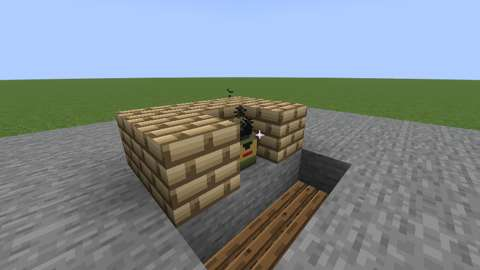
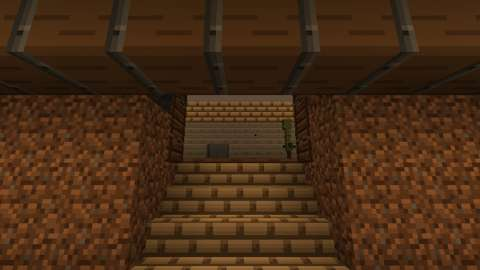
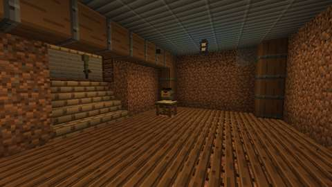
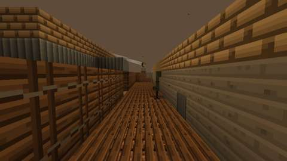
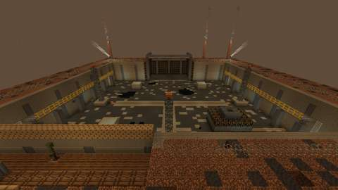
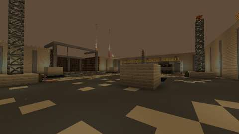
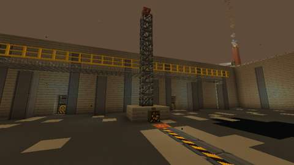
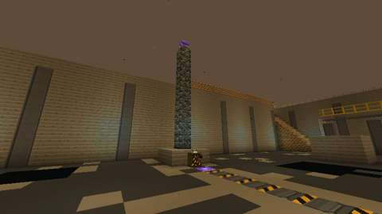
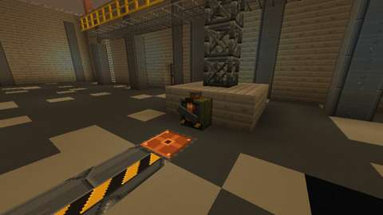
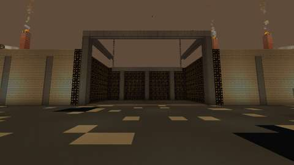
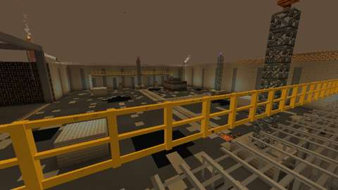
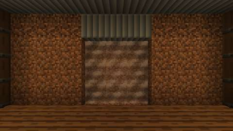

*The client game test's pictures (CI, commit `e1a74e7`): the open line over the telephone, then in the trench the dugout from the arrival, the dugout and its telephone, the fire trench, the pit from over the south rim and from the foot of the ramp, the west pylon, the south pylon live, the east breaker thrown and fouled, the assembly gantry, the pit from the west service gantry, and the Grey Mist in the dugout's back doorway. The test client renders at 480x270.*

CI (14 October 2026, GitHub Actions, the pins in [PLATFORM.md](../PLATFORM.md)):

| Commit | What ran | Result |
| --- | --- | --- |
| `e1a74e7` | Build, data audit, game tests, client game tests | **All pass:** all 1596 required game tests, the trench's five among them; `repository`; `optional integrations absent`; and the client test classes `tools/select_client_tests.py` picked for this change (six of 163: the lairs' and `FoundryTrenchClientGameTests`). The orders passed end to end, and the game's own light on the pit's floor was at least 7 on all 1,804 of its open cells (the darkest at 7). The pictures above are from this commit |

Run locally (14 October 2026):

| Check | Result |
| --- | --- |
| `python3 scripts/check_repository.py` | Pass |
| `python3 tools/check_mod_data.py`: now also checks `Lair.FOUNDRY_TRENCH` against `tools/foundry_trench.py` (size, arrival, centre, bounds, floor, no moon); the orders' rest, reach, trench and bell, and the trench works' tag, against `tools/lairs.py`; the crowns', breakers' and terminals' light and the breakers' rest; the four fixtures' registrations and the pylons' names; and the trench itself (`check_foundry_trench`, below) | Pass, 2564 IDs (on `main` at `1ce4e33`) |
| Deliberate breaks of the trench and its Java, one at a time (below) | 48 of 48 failed it |
| `python3 tools/check_icon_maps.py tools/item_icons/sealed_orders.txt` | Pass |
| `python3 tools/generate_material_data.py` and `tools/generate_textures.py`, then `git status` | Write this part's data and textures only (the PNGs they re-encoded, with identical pixels or for other features, were put back) |
| `javac` on the new and changed Java and the two test classes, for syntax only | No syntax errors |
| `./gradlew build`, game tests and client game tests | Not run locally (the Fabric Maven is out of reach here); run by CI (above) |

`check_foundry_trench` checks the trench as `tools/foundry_trench.py` builds it, and `FoundryTrench.java` against it:
- `FoundryTrench.java`'s heights, the pit's bounds and centre, where he waits, the gantry's Grey Mist, the dugout's telephone, the lanes, and each pylon's breaker, crown and terminal in the order of `tools/lairs.py` PYLON_NAMES, are the layout's;
- the arrival stands on the dugout's duckboards with room overhead, and the Grey Mist fills its back doorway;
- a walk from the arrival, never stepping more than half a block, goes up the dugout's steps into the fire trench, down the ramp, to every open cell of the pit's floor, and within reach of each breaker;
- each pylon stands on its footing, its lattice up to a dark crown, its breaker open, dark and clear, facing the pit against the footing, and its dark terminal in the floor before the breaker;
- the three lanes are open three blocks high and paved; the cover stands whole from the floor; each service gantry has its catwalk and railing, and a ladder up at either end whose foot is walked to;
- the light, flooded from the hidden lights, the lamps, the searchlights and the signal fires as the game floods block light, is at least `PIT_LIGHT` (7) on every open cell of the pit's floor (1,804 cells), and the client test reads against the same, on the same number of cells;
- nothing in it changes by itself once placed: no leaves, vines, water, lava, fire or grass (the stacks' signal fires burn on for good, in a dimension with no weather).

The 48 deliberate breaks: no duckboards under the arrival; a cell of the Grey Mist missing; a stone on the west lane; a row of the ramp gone; the dugout's steps a whole block; a wall across the pit; the west breaker thrown, the east one live, the south one fouled, and the west one facing west; the east crown live; the south terminal live; the west crown gone; a gap in the east lattice; the south footing broken; a bastion's edge hollowed; the west catwalk broken; the east ladder's rung gone; the dugout's telephone gone; water in the pit; the hidden lights four levels dimmer; `PIT_LIGHT` raised to 10; the client test reading against 6, and counting a cell short; `Lair.FOUNDRY_TRENCH`'s bounds, and its arrival; `FoundryTrench.TELEPHONE` moved, the breakers out of order, a crown a block low, a lane a block long, the pit's east edge, and where he waits; the pylons out of order; `OrdersRite`'s rest, reach, trench and bell; a crown's, a breaker's and a terminal's light, and a breaker's rest; the crown registered without its light; the orders unregistered; the rite not registered; the orders not in the creative tab; an orders message without words; the trench works' tag changed; the breaker no fixture.

What the building found:
- The searchlight's blockstate file has one model for every state, drawn by its block entity, so the template check could not see its properties; `tools/lair_layout.py` now takes them from `tools/trenchworks.py`, without importing it (that table draws its art when imported).
- Duckboards are 2.5 pixels high. The trench's and the dugout's were first laid a layer too low, which would have sunk their floors most of a block and left the Grey Mist a step down; they now lie on the earth at the standing layer, and the arrival stands on them.
- The hidden lights' lattice left five cells against the east wall at light 6; a row whose last light falls more than half a spacing short of the far wall now gets one more against it.
- The template leaves out blocks nobody can see, which left pockets of air inside the landship's hull and the ramp. The game would have counted them as open, dark floor, so the pit's footprint is now left whole.
- A plan view of the template first showed the pit floor speckled black all over; the scorching is now six ragged blast marks.

The game tests (`FoundryTrenchGameTests`) show what a game-test server can:
1. the trench's dimension type and biome load from their files;
2. its template loads in the running game, at the size `Lair.FOUNDRY_TRENCH` gives, with the lattices, the crowns, the breakers, the terminals, the sandbags, the duckboards, the telephone, the searchlights and the Grey Mist, and the game's data version, and without anything that changes once placed;
3. the orders' checks: sandbags, revetment, duckboards and their slabs and stairs are trench works and stone is not; with three trench works round the telephone it is no trench, with four it takes; under a roof it is refused; no line is open where nobody used orders;
4. the orders used by a player's hand when no instance can open: the trench is full, the orders are kept and rested, the telephone's channel is not changed, nobody moves, no line opens; with no trench round the telephone they are refused and kept; used with an empty hand and no line open, the telephone answers as itself;
5. the fixtures: a crown gives light 12 live and none dark, a terminal 8 live, a breaker's lamp 10 live; none of the four can be broken or has an item; the breakers are lair fixtures and the lattices, crowns and terminals are not; a breaker used with no Dreadnought to route stays open and dark; a breaker lights, throws and fouls when told to; each pylon is found by its breaker.

The client game test (`FoundryTrenchClientGameTests`, CI job `client`) runs the orders from end to end in a real world, with its one player in survival:
1. used on a telephone in a roofed trench, the orders are refused and kept;
2. used by the player's hand on a telephone in an open trench of sandbags and duckboards, the orders open an instance in the trench's own dimension and place the trench. It checks the duckboards under the arrival, the Grey Mist in the dugout's back doorway, each pylon's breaker open and dark with its crown and terminal dark, and the dugout's telephone. The orders are used up and rested, a line opens over the telephone, and the player comes to in the dugout, unable to build;
3. a breaker can be used and a crown cannot. A breaker used with no Dreadnought to route stays open and dark. Falling out of the trench throws the player back to the dugout for the mist's toll;
4. leaving takes the player back to where they stood. Second orders at the open line are refused and kept, and using the telephone with an empty hand takes the player back into the same trench;
5. when the instance closes, the player goes home and the line is gone.

Then it takes twelve pictures: the open line over the telephone, and in the trench the dugout from the arrival, the map table and its telephone, the fire trench, the pit from over the south rim, the pit from the foot of the ramp, the west pylon, the south pylon live, the east breaker thrown and fouled, the assembly gantry, the pit from the west service gantry, and the Grey Mist in the dugout's back doorway. Last it reads the game's own block light on every open cell of the pit's floor, and fails under 7, or if the cells are not the 1,804 the audit counts.

Not run: the two-client dedicated-server playtest, and play by hand.

## World and event applicability

The Foundry Trench is its own dimension, so nothing here changes the Overworld. The orders work at any hour, all year, at any telephone in an open trench in the Overworld. No season gates them.

## Rollout and open questions

The shared framework's defaults hold: four players and eight instances, Grave Goods on death.

Part 2, the Iron Dreadnought ([iron-dreadnought.md](iron-dreadnought.md)), adds:
- the fight in the pit: his plating, the discharge he charges every 20 seconds into the pylon nearest his foe, the breaker thrown to route it and overload him, and the lane it runs down if it is not;
- his attacks: the Piston Punch, the Rivet Fan stopped by cover, the Trench Charge that stuns him when he runs into anything solid, the Coil Arc, the Mortar, the Blowdown and the Sparkers;
- the Overcharge at half health, the plate he tears from his hull to foul a breaker, and Red Line below a fifth;
- his loot: Salvaged Coil, the Dynamo Halberd and the Piston Hammer, the Grounding Strap, the Dreadnought Visor and the advancement Grounded;
- Salvaged Coil in cheaper orders.

There is no generated front line in the world; the trench is any a player digs and lines with trench works. A generated one, if the owner wants it, is a separate, reviewed piece of world generation.
