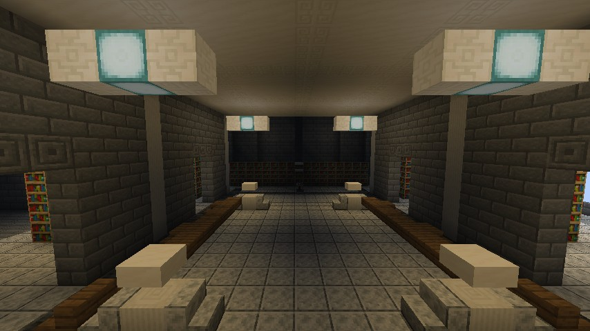
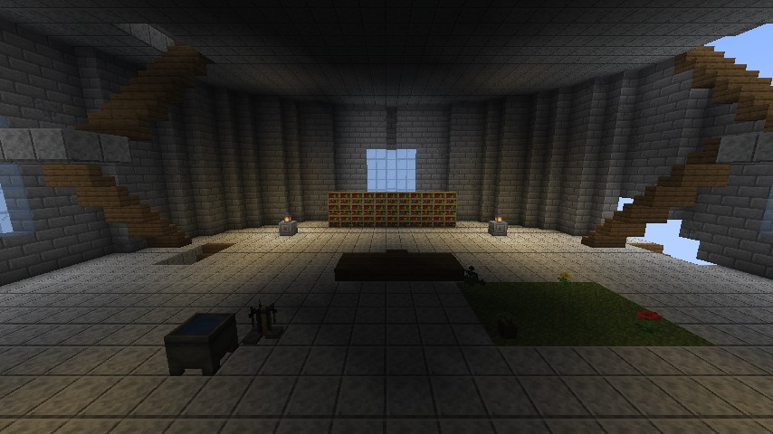
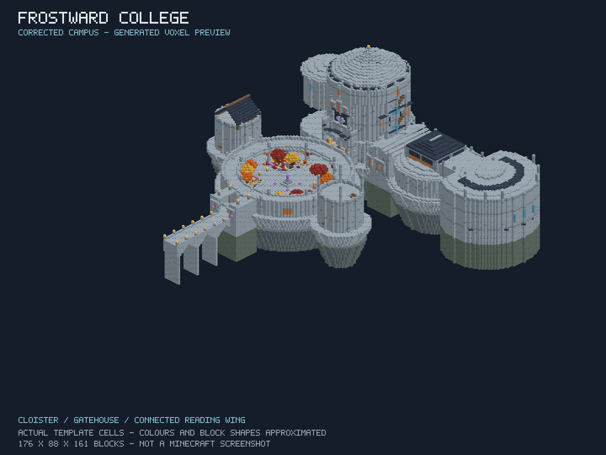
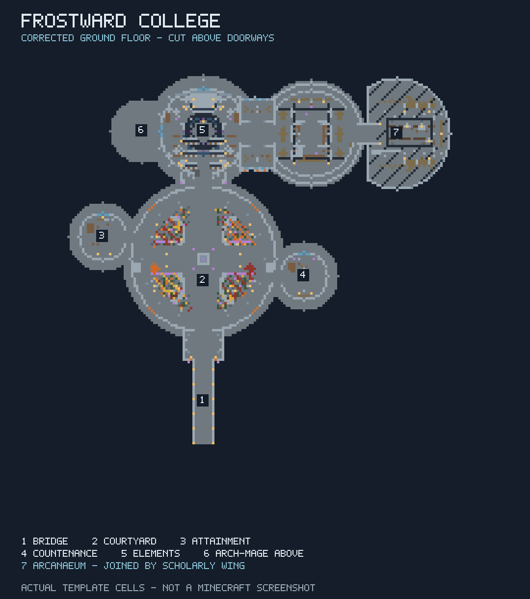
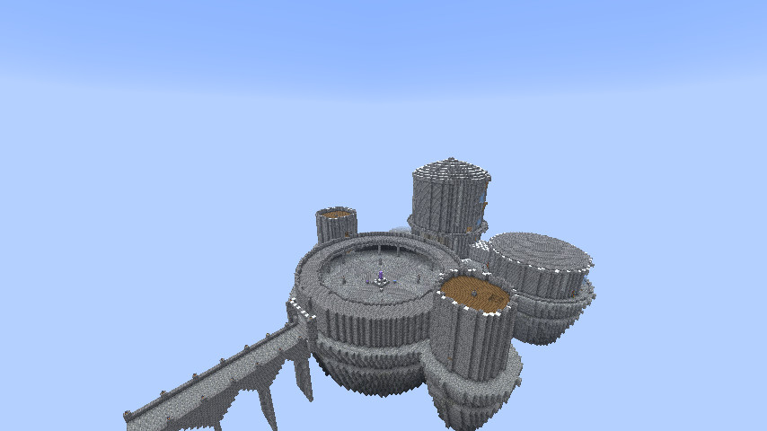
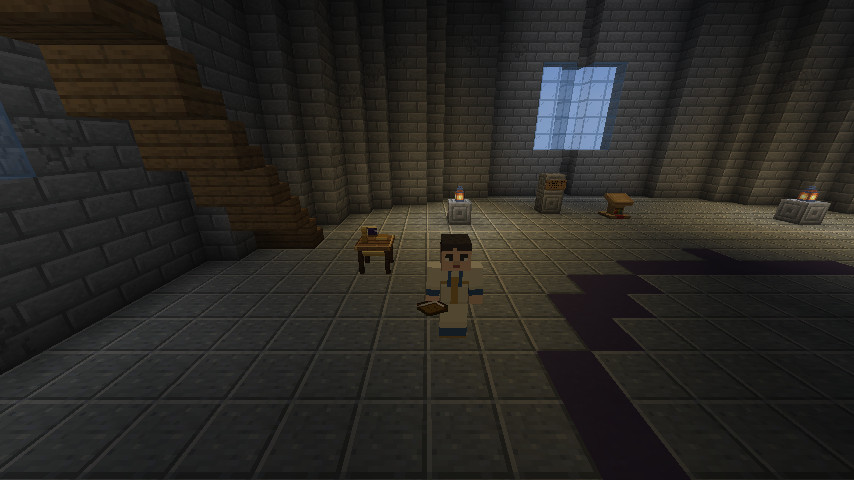
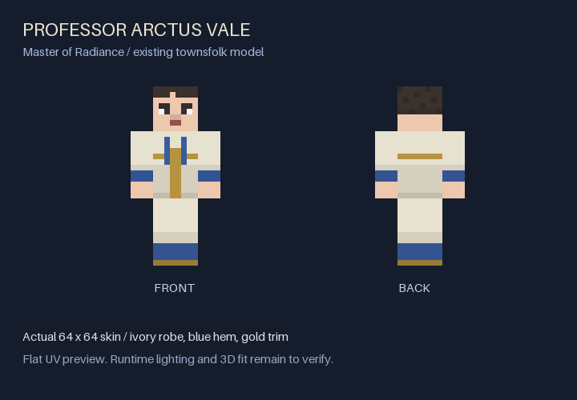

# Frostward College: Winterhold-inspired magical academy

## Current PR #448 checkpoint — 21 October 2026

The single `jugcraft:academy/winterhold` structure now measures **176 × 88 × 161**. Its Hall has a higher supported drum and roof with a small transformed relief motif selected from Fonta59's permission-cleared Winterhold world; a guarded upper teaching gallery opens views down to the original lesson floor. The Hall–Arcanaeum connection, eastern reading wing, western Arch-Mage annex, stations, 45 named room/anchor points, Arctus Vale, S01 runes and Midden remain in place. Student and faculty residences now have different rooflines and common-room treatments. [The source adaptation record](frostward-fonta59-adaptations.md) credits the exact donor regions and transformations. The courtyard has four red/orange/yellow Jugcraft maples, supported arcade bays and warm windows alongside its pumpkins, fallen leaves and local drifting leaves/fog. **There is no authored snow.** [The live progress ledger](frostward-rebuild-progress.md) distinguishes generated geometry, client screenshots and unverified gameplay. Sections below retain historical prototype details and should be read in that context.

## Continuation from merged PR #447 — 21 October 2026

PR [#447](https://github.com/jimbozoomer-byte/jugcraft/pull/447) merged the College M0 from closed PR [#441](https://github.com/jimbozoomer-byte/jugcraft/pull/441) into main at `38f1f809001d5d1415f7e77524be94320d469350`. Older sections below describe historical checkpoints; their claims that #441 is open, snow is the intended permanent climate, or full Build remains pending do not describe current main.

The current [draft PR #448](https://github.com/jimbozoomer-byte/jugcraft/pull/448) narrows the overwide outer cloister from radius 33 to 30 while keeping the walkable inner court and distinct residential halls. A vaulted gatehouse now frames the bridge landing; its corner piers were shortened after actual bridge captures showed that they competed with the distant Hall. A transverse two-room academic wing physically joins the Hall and Arcanaeum. A larger eastern reading wing extends the library into a 176 × 76 × 161 template, with a connected upper archive gallery, stone roof knuckle, shelf bays, restrained windows and reading lights. The Hall gains a flush teaching-circle inlay, seats, piers and lighting; a furnished western upper annex gives the Arch-Mage suite a separate bridge-visible mass, a usable bed and storage. Both cloister roof walks regain stair access. The single `jugcraft:academy/winterhold` generator and template remain authoritative. Existing ward, four runes, stations, instructor, library, bedrooms and Midden remain in place.

The College's authored snowcaps are removed. Restrained red/orange/yellow leaf piles and four pumpkins occupy selected court edges; the client-local effect now emits continuously drifting red, orange and yellow leaves using Jugcraft's existing petal silhouette, alongside the existing low mist. It retains off/low/normal modes, Minecraft particle-setting compliance, the 512-particle cap, dimension/boundary cleanup and unchanged global weather. This is an autumn implementation slice, not a claim of completed landscape or measured multiplayer performance.

[Measured reference/current/proposed comparison](../images/frostward-footprint-comparison.svg), [regenerated plan](../images/frostward-academy-revised-plan.png), [regenerated bridge projection](../images/frostward-academy-revised-bridge.png) and [overview](../images/frostward-academy-revised-overview.png) are architectural aids generated from the template. They are not Minecraft screenshots. The supplied seven-landmark floorplan controls topology; its image orientation is not a compass requirement. The original Minecraft entrance and courtyard images control silhouette. A room/status/test ledger is maintained in [frostward-rebuild-progress.md](frostward-rebuild-progress.md).

## Interior revision, 21 October 2026

Owner feedback correctly identified the first screenshots as a sparse architectural base. The Arcanaeum now has a central reading hall and four connected side archive/research areas, broad stone arches, 96 additional bookshelf blocks, reading tables and facing seats, quartz pilasters, illuminated ceiling coffers and dark stone floor inlays. Its large glazed openings are replaced with masonry, making the archives windowless. Broad spruce-plank surfaces throughout the academy become polished diorite; working wooden doors, bookshelves and shaped joinery remain. No Bethesda assets, loot or new progression currency is introduced. Authoring is in `tools/academy_interiors.py`, applied to the same single `academy/winterhold` template. This is an interior improvement checkpoint, not completion of the grand academy plan. Other rooms still need individual furnishing and stair-edge review.

Ten Python structure tests pass, including the new enclosure, stack and arch regression. Independent Node validation reaches all 37 room points and retains eight doors, seven beds, eight signs and 753 supported snow layers. The vanilla 26.3 registry probe validates all 56 vanilla palette states; nine Jugcraft states are deliberately outside that probe. The previously reported 2,111 server tests apply to the preceding M0 checkpoint; they are not a fresh full-suite result for this revision.

The revised `AcademyClientGameTests` completed successfully and captured nine screenshots, with the library and quarters inspected. The targeted run reused previously compiled common/client classes and previously processed main resources, explicitly replacing the processed template with the newly generated NBT; client resources and GameTest Java compilation ran normally. This is not a clean full build. The following full JAR task was stopped during slow ZIP writing after the client task completed; the incomplete local JAR was removed. The packaging check could not run on a completed JAR, so no distributable certification is claimed. An attempted check while the archive was still being written reported BadZipFile; this is not evidence of a completed broken archive. Run `jar` to completion and then `python tools/check_mixin_jar.py <built-jar>` before distribution.





Recovery/duplication audit: the latest 100 upstream PR records contain one academy PR, #441 (open draft, unmerged); the contributor fork has only `main` and `feature/frostward-academy`. Different checkpoint commit titles update the same template rather than installing duplicate colleges.

The reported missing `jugcraft.client.mixins.json` error matches the earlier development launch that excluded `processClientResources`. The source config exists; processing client resources normally allowed the subsequent client run to pass. Do not delete the manifest entry or disable required mixins. `tools/check_mixin_jar.py` checks every declared config and its classes inside the actual built JAR, including client resources. It checks packaging, not mixin application. AI for this revision: OpenAI Codex, GPT-6.1.

Status: manually placeable circular campus plus M0 instructor, personal courtyard memory and localized winter prototype. Nine Python structure tests, independent Node/Java checks, all 2,111 required server GameTests and the selected academy client GameTest pass. Nine actual Minecraft screenshots were captured and inspected. Full-build certification and human multiplayer acceptance remain open in [draft PR #441](https://github.com/jimbozoomer-byte/jugcraft/pull/441).

Contributor: @TwentyFiveSeconds. AI: OpenAI Codex (GPT-6), explicitly requested by the contributor. Base: upstream main at `62c32ad3a5cfa05c298eab93e978951ab351aba8`, 20 October 2026. Tier: shared magical workshop infrastructure.

## Recovery and implementation

The interrupted session left an uncommitted generator, template, five offline tests, two Java test classes, documentation and a preview on the contributor's PC. The fork branch still pointed at main. These actual files were recovered and preserved in commits `721ce826ef173f211f144c22370e7c139180d439` and `70776ad137a0b6a280e7dd49f54457ff659aa27f`, then expanded. Current main, recent commits, branches and open/closed PRs were checked; no overlapping academy was found. Open boss/factory/creature PRs are not dependencies.





These are code-rendered previews of actual NBT cells, **not Minecraft screenshots**. Colours, lighting and block shapes are approximated. The plan cuts at Y=28. Previous Blender [overview](../images/frostward-academy-overview.jpg), [section](../images/frostward-academy-cutaway.jpg) and [recovery preview](../images/frostward-academy-layout.png) show superseded layouts.

## Actual Minecraft views — 21 October 2026





These are real frames from the passing `AcademyClientGameTests`, exported as JPEG (quality 90; no scene retouching). The isolated flat test world places the template at `(0,224,0)`; it demonstrates manual placement, not terrain-aware world generation. Render distance 10, FOV 75, OpenGL and no shaderpack. All nine views were visually inspected; localized snow is visible in the bridge/courtyard while global weather is clear. Detailed interior dressing and stair-edge/connection polish are still needed; the images show the actual prototype rather than a finished furnished academy.

| Scene | Screenshot |
| --- | --- |
| Exterior | [Overview](../images/frostward-runtime/overview.jpg), [bridge](../images/frostward-runtime/bridge.jpg), [courtyard/cloister](../images/frostward-runtime/cloister.jpg) |
| Teaching | [Hall of the Elements](../images/frostward-runtime/hall.jpg), [Radiance instructor](../images/frostward-runtime/radiance_instructor.jpg) |
| Upper rooms | [Arcanaeum](../images/frostward-runtime/library.jpg), [Arch-Mage rooms](../images/frostward-runtime/archmage.jpg) |
| Midden | [Forge](../images/frostward-runtime/midden_forge.jpg), [Echo Chamber](../images/frostward-runtime/echo_chamber.jpg) |

## Layout revision from contributor references

The contributor supplied two College maps after reviewing the first prototype. The revision replaces the rectangular platform with a circular enclosed court and covered annular cloister. Residential towers attach at staggered points on the rim, and their dormitory floors connect to the cloister roof walk. The bridge/gate/monument/main-hall axis remains clear. A separate low Arcanaeum wing attaches beside the main hall through a covered gallery; the former library level is now an upper teaching gallery, with Archmage quarters above it. The rocky foundation follows the joined circular footprints. Interiors, stairs, bedrooms, archive, stations and Midden components are reused.

The layout adapts the supplied maps rather than claiming an exact Skyrim reconstruction. M0 below adds its first instructor and orientation activity. Kitchens, baths, schedules and later lessons remain deferred.

## Grand Academy M0 checkpoint

The approved [planning package](../plans/winterhold-grand-academy-2026-10-20/README_START_HERE.md) is preserved unchanged, with a separate [implementation ledger](../plans/winterhold-grand-academy-2026-10-20/IMPLEMENTATION.md). Checkpoint `9d7cc28` saves the initial implementation on the existing fork branch. This continues the same geometry, not a second academy.

Professor Arctus Vale, Master of Radiance, appears beside the Hall of the Elements' western study area, template `(59,25,31)`. He uses `Townsfolk`'s existing player model, persistent name/home/skin, safe local wandering and book. Speak to open the existing Concordance Journal; sneak and speak for text orientation only. He directs apprentices to the existing specimens/research/paid Lampwright benches. He does not teach a new spell system or grant research. Full schedules and practical combat instruction are later milestones.

The central monument contains `academy_ward` at `(68,27,85)`; four `academy_rune` blocks at `(64,25,81)`, `(72,25,81)`, `(72,25,89)`, `(64,25,89)` demonstrate Dawn → Noon → Dusk → Night. Use the ward for the complete text clue. Each stone announces its name when used, independently of its particle/color cue. Wrong presses or more than 200 ticks between presses reset only that player's attempt. Completion stores a personal lore flag kept through saves/death; replay prints the same lore. It gives no items, spell unlocks, currencies or economic benefit. At most 64 active attempts per ward are retained; expired entries are pruned each second. Client requests never supply completion claims.

The guide's instance UUID and successful spawn marker persist with the ward. Loaded home chunks and safe two-block headroom are required to spawn. A saved successful spawn never triggers another merely because the entity is unloaded. Deliberately killing the instructor requires operator repair; automatic replacement is intentionally absent in this prototype. Rotation and reflection transform the instructor home and rune positions together with the template.

| Activity | Tier / input producer | Output consumer | Cost / failure |
| --- | --- | --- | --- |
| Instructor consultation | Orientation; visitor | Existing read-only Concordance Journal | No material cost or research change; per-player rate limit |
| Radiance practice | Existing Concordance research and gathered specimens | Existing Lampwright benches / existing workings | Existing bench requirements and consumptions remain authoritative |
| S01 courtyard memory | Exploration; four authored stones | Personal academy journal lore | No resource reward; wrong/late press resets, no shared completion |
| Academy winter | Authored ward infrastructure | Client snow / existing agriculture mist particle | Cosmetic only; bounded work, no power/production or biome effects |

### Local winter and configuration

The ward records a per-dimension `AcademyRegions` entry matching the actual court, hall, library, tower and bridge footprints. Sites persist when the anchor chunk unloads. Only loaded anchors are checked for removal; validation never loads chunks. Up to 32 sites per dimension are supported, with at most 16 nearby sites in a bounded clientbound snapshot every 40 ticks. New placement must tick its ward once before ambience is discovered; invalid/unloaded sites are not searched globally.

Client snow and reused `JugcraftAgriculture.FOG` wisps use a 16-block horizontal smooth fade, a bounded vertical range, sky visibility checks, and at most 512 owned particle handles. Normal spawns at most six snow particles per tick and one mist every five ticks; low uses two and one every twelve ticks. Overlapping sites share the budget. Minimal particles disable the effect. On exit, indoor entry, dimension/world change, disconnect or disabling effects, owned particles are removed. No fog shader, global weather, lightning, biome, seasonal state, terrain snow/ice or farming rule is changed.

`/academyfx off`, `/academyfx low`, `/academyfx normal` persist a client preference in `jugcraft-academy-client.properties`. Server `academy.active=off` in the existing Jugcraft config stops ward activities/spawning and sends empty climate snapshots. All block/entity/attachment registrations and earned lore remain saved. Existing NPCs remain present. Existing `concordance.enabled` behavior still governs the real benches; academy consultation cannot bypass it.

### M0 assets and source ownership

`tools/academy_data.py` supplies fixture blockstates/models and language, called by the shared material generator. Fixture models reference vanilla block texture identifiers without copying texture bytes. No fixture BlockItems, recipes, loot or survival acquisition are introduced. `tools/academy_skins.py` reuses `town_skins.py`'s original classic-player UV/robe helpers for the ivory robe, blue hem and gold trim at `textures/entity/townsfolk/academy_radiance.png`; no new rig/renderer is needed.



This is a flat UV projection of the actual skin, not a Minecraft screenshot. Reproduce with `python tools/academy_skins.py --preview-only docs/images/frostward-instructor-skin-preview.png`.

The owner library's magic robe item assets and `originals/Magic/assets/ars_jimbaux/textures/entity/villager/profession/shady_wizard.png` were inspected. Those item/villager UVs do not fit the existing townsfolk player model. Original library files remain unchanged. The skin is generated using the existing Jugcraft helper rather than blindly importing an incompatible UV layout.

### M0 validation — 21 October 2026

Passed locally: canonical Python regeneration/freshness; all nine `test_winterhold_academy.py` tests, including two-block navigation to 33 room points/new controls; Node NBT/schema/navigation checks; Java 25 `AcademyLogicProbe` checks sequence, isolation, wrong input, timeout/rollback, visual order and climate bounds. The template has 287,054 cells, 58 palette states, eight doors, 14 bed halves, eight supported signs and 753 supported snow layers.

Common, client and game-test Java compilation passed against Minecraft 26.3, Fabric API 0.161.0+26.3, Loader 0.19.5, Loom 1.17.21, Gradle 9.6.0 and Microsoft Java 25.0.1 (`compileJava compileClientJava compileGametestJava -x processResources -x processClientResources`: successful in 1m52s). First client compilation exposed old API names; these were checked against the installed pinned JARs and corrected.

**Minecraft server result: all 2,111 required GameTests passed**, including all four academy methods. The test server reported completion in 14.47 minutes; the Gradle task completed successfully in 15m37s, exit 0. This exercises the actual Jugcraft/Fabric registries, template, workstations, teacher and puzzle. It is not a client render or two-client playtest.

The initial full build was stopped during expensive resource-output fingerprinting after the complete resource tree and expanded manifest were written; an earlier overlapping attempt hit a resource-directory conflict. Runtime tests reused those processed resources and verified current compiled classes, using `runGameTest -x processResources -x processClientResources -x compileJava -x compileClientJava -x compileClientKotlin -x compileGametestJava -x compileGametestKotlin`. No server test assertion/entrypoint was removed or filtered. Source compilation and server execution both passed separately; **the full `build` gate is still not certified**.

**Selected Minecraft client result: `AcademyClientGameTests` passed**, task exit 0 in 3m20s. It verifies received block states across the bridge, both residential wings, teaching hall, library, ward and highest roof; waits for lighting and section rendering; captures nine views; and checks exactly one instructor plus unchanged global clear weather. The passing command was `compileGametestJava runClientGameTest -PclientTests=AcademyClientGameTests -x processResources -x compileJava -x compileClientJava -x compileClientKotlin -x compileGametestKotlin`; the existing client mixin resource was processed normally.

Earlier client attempts exposed missing processed client resources and two timeouts in the API's default whole-view-distance download/render wait. The final isolated fixture uses a flat world, an overview camera within build height/range, explicit academy geometry download checks, and the public render-only wait overload. Lighting/render readiness is still required; the test no longer demands unrelated terrain at view-distance corners. Failure diagnostics capture a frame and native render status. This is a focused architecture/instructor screenshot test, not a natural-worldgen or whole-world streaming certification.

The repository/link checker was attempted in this sparse checkout and failed because excluded `.github`/art source files are absent locally. That result is not an academy link regression or a passing repository check. The source/asset subset does include all runtime resources for the build. No checker assertions or CI gates were weakened.

The full `tools/check_mod_data.py` audit also stopped during import on the excluded owner-library `originals/Magic/assets/ars_jimbaux/lang/en_us.json`; it did not audit the academy or return a pass. The academy feature/ledger's own local documentation links and `git diff --check` pass.

Passing server acceptance covers all palette IDs/properties, existing bench research/material costs, personal lore/no research grants, instructor save-marker/no duplicate on reload and all template rotations/mirrors. Passing client acceptance covers the placed geometry, instructor rendering and global clear weather check. Hot-biome placements, boundary/dimension transitions, off/low/minimal, real persistence/reconnect, journal interaction through the client, performance and two independent clients still need observation. Mist/particle budgeting is implemented but not a measured frame-time guarantee. Keep the PR draft while these and full-build certification remain open.

Reproduce the pure checks with `python tools/winterhold_academy.py --check`, `python -m unittest discover -s tools -p test_winterhold_academy.py -v`, `node tools/preview_winterhold_layout.mjs --check`, then Java 25 `javac -d <scratch> src/main/java/io/github/jimbozoomer/jugcraft/academy/AcademyPuzzle.java src/main/java/io/github/jimbozoomer/jugcraft/academy/AcademyClimate.java tools/AcademyLogicProbe.java` and `java -cp <scratch> AcademyLogicProbe`. Actual Minecraft gates remain `./gradlew build` and `./gradlew runClientGameTest -PclientTests=AcademyClientGameTests`.

AI: initial M0 checkpoint used OpenAI Codex (GPT-6); subsequent client API corrections/validation used OpenAI Codex (`gpt-6.1-sol-wm`). No dependency, platform pin or CI workflow changes.

| Location | Implemented spaces |
| --- | --- |
| Exterior | 24-block raised rock/stone foundation following the circular campus, arched bridge and piers, entrance frame, enclosed courtyard, covered cloister/roof walk, amethyst monument, snow/weathering, battlements |
| Hall of Elements | Circular teaching chamber, demonstration ring, seats, lectern, two existing study benches, broad switchback stairs |
| Hall of Attainment | Apprentice study/storage floor, three bedrooms with doors/beds, storage and stairs to guarded roof |
| Hall of Countenance | Faculty research floor, three bedrooms, alchemy/artifice workstations, vanilla enchanting table/bookshelves and accessible guarded roof |
| Arcanaeum | Separate low wing with bookcases, reading desks/seats, special-collections enclosure and Conclave Lectern; covered connection to the main hall |
| Archmage quarters | Private sleeping/study space, storage/books, botanical garden, brewing stand and cauldron |
| Midden | Stair from the hall, branching passages, forge with furnace/anvil/unlit hearth, secret laboratory behind a door, blue-lit Augur-inspired Echo Chamber |

The bridge/court approach, hall ahead, attached residential towers, adjacent library, quarters above and passages below preserve Winterhold's broad organization. The footprint is adapted to Minecraft, not a room-for-room reconstruction. Frostward College is the Jugcraft-facing name; the stable ID is `jugcraft:academy/winterhold`.

References inspected: the labeled [College map](https://www.pinterest.com/pin/the-art-of-architecture-skyrim-architecture-college-of-winterhold--248049891953811875/) and [Winterhold maps guide](https://steamcommunity.com/sharedfiles/filedetails/?id=2564928813). Reference image bytes are not redistributed.

## Existing magic and progression

Coordinates below include the rocky base and are relative to the template origin.

| Activity | Position | Existing requirements retained |
| --- | --- | --- |
| Study / lantern work | `(57,25,28)`, `(79,25,28)` | Lampwright's Bench: specimens, tools, study time and First Light |
| Alchemy | `(113,25,85)` | Alembic Crucible: research, ingredients, water, instruments and preparation |
| Artifice | `(105,25,85)` | Artificer's Bench: research, substrates and enhancement costs |
| Enchanting | `(109,25,98)` | Vanilla equipment, lapis and experience |
| Oath / commissions | `(112,25,23)` | Conclave Lectern: First Light, rank, inventory and weekly limits |

Bring your own ingredients, instruments and learned spells. Practice in the ring and share research with the existing authored-notes system; the journal/codex remain the learning guide. Input producers are normal gathering, farming, wood/copper production and refined substrates. Research, lanterns, mixtures and equipment feed exploration, workshops and trade. Solo and teaching/trading routes remain; unrelated industry, bosses, seasons and simultaneous players are not prerequisites.

No recipe, research gate, Focus payment, quantity or conversion loss changes. No new currency, spell engine or parallel progression is added. Building materials/stations are operator-authored infrastructure, like a Creative build; repeatable survival worldgen is absent.

The placed Conclave Lectern has **no owner**. Its public oath/standing/commission interactions use `Starbound.use`; owner/party projects need a normally player-placed lectern. It fabricates no owner or first-visitor claim. See [Conclave](arcane-concordance-conclave.md), [First Light](arcane-concordance-first-light.md) and [research sharing](arcane-concordance-sharing.md).

The forge has ordinary furnace/anvil behavior, not Skyrim's summoning recipes; its campfire starts unlit. The Echo Chamber contains a sealed light, not an NPC/reward. No hostile mobs, spawners, filled inventories or loot tables are generated. M0 supplies one orientation instructor through the existing townsfolk model, as described above; scheduled lessons and quests remain deferred.

## Manual placement

Use a disposable Creative world and a clear `145 x 76 x 161` volume. Origin is its northwest bottom corner; entry faces south at relative `(68,25,160)`. Output: **287,054 explicit blocks**, including authored air, and **53 states**. Existing blocks in rooms are replaced; the template does not clear every bounding-box cell. There is no terrain fitting, collision preflight, claim creation or undo.

For origin `0 160 0`:

```mcfunction
/forceload add 0 0 144 160
/place template jugcraft:academy/winterhold 0 160 0
/tp @s 68.5 185 160.5 180 0
/forceload remove 0 0 144 160
```

Remove the temporary forced chunks even on failure. These commands are test setup; the feature never creates chunk loaders. Walk north across the bridge, around the monument and into the hall. Main stairs connect the upper teaching gallery/quarters. The covered eastern gallery leads to the ground-floor library. The Midden stair is west of the hall entrance; passages branch to forge, lab and Echo Chamber. Both towers have bedroom and roof access. Wooden doors open by hand.

Natural generation, survival acquisition and exact [World Designer](../WORLD_DESIGNER.md) settlement placement remain future work. Current native structure pins do not place this template as a complete settlement. No custom placement command, global active-design singleton or silent chunk rewrite is added.

## Authority, persistence and performance

Stations retain existing server authority, inventory checks, processing bounds and ownership. Bench study keeps single-user ownership and pending-notes persistence. Empty storage uses vanilla access rules. Operators manage public-site protection.

Placed blocks and existing block entities save normally. No registry, attachment, save schema or released-ID rename is introduced. Concordance disable preserves saved blocks/registrations while existing logic refuses disabled activities. Template updates do not modify colleges already placed; restore a matching backup to reverse placement. No dimensions, pets, bosses or seasonal expiry are involved.

Placement writes once. No academy tick scan, network handler or entity population is added. Placement duration and multiplayer performance are unmeasured.

## Files and reproduction

- `tools/winterhold_layout.json` and `tools/winterhold_layout.py`: reviewed campus operations and assembler, reusing recovered architectural components.
- `tools/winterhold_academy.py`: deterministic original generator, using `retro_game_shop`'s writer, lowercase `id`/`properties` schema and DataVersion **5023**.
- `src/main/resources/data/jugcraft/structure/academy/winterhold.nbt`: compressed runtime template.
- `tools/test_winterhold_academy.py`: eight checks: NBT round-trip/freshness/determinism, bounds/budget, room/station access, no rewards/owners, beds/signs, doors/snow foundation and circular-footprint regression.
- `AcademyGameTests`: registered palette/property checks and placed-station integration, research refusal, paid lantern creation and Conclave oath.
- `AcademyClientGameTests`: registered placement plus eight screenshots: overview, bridge, cloister, hall, library, quarters, forge and Echo Chamber. Not run yet.
- `tools/preview_winterhold_academy.py`: optional Blender rendering, camera framing updated for the new footprint; this revision was not rendered in Blender.
- `tools/preview_winterhold_layout.mjs`: dependency-free Node NBT checks and raster previews; `node tools/preview_winterhold_layout.mjs`.
- `tools/AcademyVanillaProbe.java`: optional headless vanilla palette verification, with no mod or world launch.

```sh
python tools/winterhold_academy.py
python tools/winterhold_academy.py --check
python -m unittest discover -s tools -p test_winterhold_academy.py -v
blender --background --python tools/preview_winterhold_academy.py -- --output-dir docs/images
```

Owner-library guides/catalog and actual magic source were inspected. Already integrated station models/textures are reused unchanged; no new owner-library files are imported. Source originals/notices remain intact. Architecture, code and previews are original MIT work; no Bethesda assets or extracted geometry are included.

No dependency/platform pins changed: Minecraft 26.3, Java 25, Loader 0.19.5, Fabric API 0.161.0+26.3, Gradle 9.6.0; Loom retains the source's `1.17-SNAPSHOT`. Actual AI attribution is OpenAI Codex (GPT-6), not Claude; maintainer acceptance of the repository's model-policy exception remains for review.

## Earlier layout validation (historical)

Previous layout validation, Windows, 20 October 2026: Blender 5.2 / Python 3.13.13. Five recovered tests passed before expansion; **seven expanded academy tests passed before this layout revision**. The navigation model checks two-block headroom/one-block steps, hand-openable wooden doors and passable thin snow. It reaches all six bedrooms, upper battlements, balconies, archive and underground rooms. It does not simulate exact Minecraft collision.

**Six client-test selection regressions** and **eleven World Designer model/compiler regressions** pass. The repository structure/link check passes with a Windows path-normalization wrapper for long catalog paths; its assertions were unchanged. Both architectural previews were rendered and visually inspected. The full material-data audit was attempted after restoring source assets and supplying its existing DejaVu font dependency. It did not finish after an extended local run and was stopped without a result: **incomplete, not passed**. CI must rerun it.

The installed vanilla Minecraft **26.3** JAR and its 75 available launcher libraries were also loaded by Microsoft Java **25.0.1**. `AcademyVanillaProbe` bootstrapped the real vanilla registries and read the generated NBT: **49 vanilla palette states passed** ID/property/value validation; **four Jugcraft states were explicitly skipped**. DataVersion was 5023. This is not Jugcraft compilation, structure placement, server GameTests or a client launch. To reproduce, use Java 25 with the installed vanilla 26.3 launcher's complete classpath:

```sh
java --class-path "<vanilla-26.3-launcher-classpath>" tools/AcademyVanillaProbe.java src/main/resources/data/jugcraft/structure/academy/winterhold.nbt
```

A local Microsoft JDK **25.0.1** was found. `gradlew.bat build --no-daemon` stopped before compilation with `java.net.UnknownHostException: services.gradle.org` fetching Gradle. Upstream Build/Foundation runs report `action_required`: a maintainer must approve fork CI. The upstream workflow is unchanged. Neither is a passing Minecraft result.

At the earlier layout checkpoint, execution reported **No usable execution environment is available**. The eight Python tests, Gradle compilation, Blender rerender and Minecraft tests could not be rerun at that time. The M0 validation section above supersedes that environment limitation. No CI workflow was added or changed to work around it.

The runtime template was regenerated through the same declarative operations applied to the preserved prior NBT. An independent JavaScript NBT reader/writer checked compression CRC, primitive round-trip, bounds/uniqueness, all six station positions, 31 room/walkway points using the existing navigation model, eight complete doors, 14 bed halves, eight supported signs, 753 supported snow layers, no inventories/owners/entities, a single Conclave Lectern, the circular footprint and separate library roof. All passed. All 53 palette states are identical to the previous template's states; the earlier vanilla-only palette probe still is not a mod runtime placement test. The two current PNGs were generated from those actual cells and visually inspected.

NBT freshness compares decompressed content, allowing standard gzip encoders to produce different compressed streams without changing the authored template. The canonical Python build still uses the shared writer. CI must verify its generated content equals the committed resource.

Remaining acceptance work:

1. Approve CI, compile, run server GameTests and `AcademyClientGameTests`, inspect actual screenshots and fix exposed registry/model/collision issues; run optional-integrations-absent coverage.
2. Walk every stair/door; use study, spell practice, alchemy, enchanting, artifice and the lectern. Test two users, concurrent benches, reconnect/restart with active study, disable behavior and placement timing.
3. Review proportions in-game; voxel previews cannot certify appearance.
4. Future slices: terrain-aware survival/worldgen, supported World Designer integration, additional instructors/curriculum/quests and authored hazardous encounters. No unmerged API is assumed.

A real academy implementation is saved for review and manual placement after building. Runtime certification and those later school systems remain outstanding.

