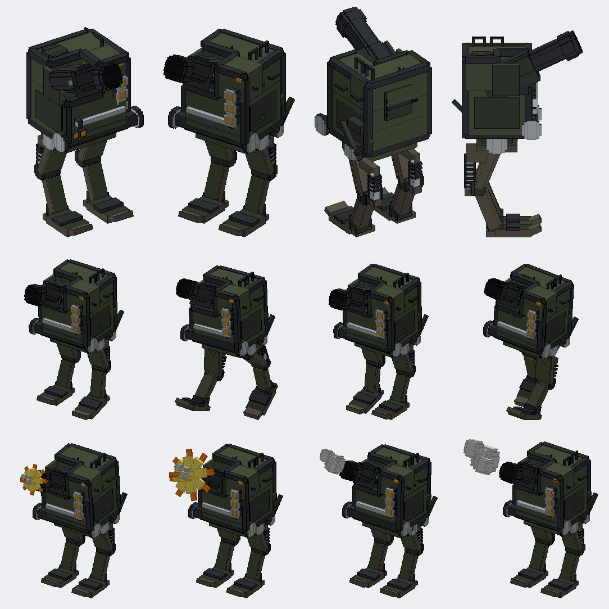

# The Howitzer Walker

Status: implemented (pending CI and review)
Proposal issue: none. On 9 October 2026 the owner sent a render of a two-legged artillery walker they had modelled ("I want you to model this in blockbench next for the Jugcraft mod I just drew it"), asked for it to match the drawing's shapes and parts closely, then for "a walking animation ... and then a shooting animation with a cartoony blast", with "its animations all floaty and bouncy", and corrected the feet to point forward. At first it was a model only ("I just want you to model stuff, don't implement"). On 13 October 2026 the owner asked to "implement the Howitzer-Walker into the game using its animations and add functionality to it".
Owner: @jimbozoomer-byte
Target milestone and tier: steel tier, beside the Armoured Walker (batch 58): both are made from a Diesel Walker (batch 47).
Primary specialty and supported player role: combat; long-range artillery support that can still defend itself up close

## Player experience

A tall walker, about five and a half blocks high, in the owner's design:

| Part | In the owner's model | Here |
| --- | --- | --- |
| Hull | A riveted olive box with rounded edges, cut away at its front top corner for the gun | A riveted olive box notched at its front top left, round bumper rails along every edge, dark recessed side panels, a chrome rail on brackets under the nose, a riveted plate and louvred vent on the back |
| Gun | A big howitzer lying in an open cradle, a thick jacket at its root and a flared muzzle | A trunnion hub in a cradle of a floor and two walls, open on top; a breech block and cap, the barrel with its jacket and a flared muzzle brake, recoil rods along the cradle; at rest elevated 25 degrees |
| Pivot and linkage | A big axle with hubs under the nose and a wishbone down the right side | The front pivot axle with chrome hubs, and an A-arm of two bars from a hub on the hip up to a bracket on the hull's side |
| Lamps | Three ringed headlamps up the front's right, two small ones low on the left, an amber light at the top right | Three chrome-ringed amber lamps, two small lamps, the amber indicator, and one on the waist plate, all glowing |
| Roof and sides | Grab hoops on the roof, handles on the side, a hatch | Two hoops on the roof's right, two handles on the right side, the pilot's hatch ring at the roof's rear left |
| Waist | A flat plate over big round hips | A riveted waist plate, a centre block, the hip axle through big chrome-capped hubs |
| Legs | Reverse-jointed: a flat thigh plate angled back, a knee hub, a shin angled forward, a coil spring on a shock absorber behind, a round ankle, broad flat feet pointing forward | The same: a hip drum, a broad flat thigh plate under its armour plate, a knee drum, a shin under a shin guard, a chrome shock absorber in a coil spring behind the thigh, an ankle housing, and a broad foot with a hinge strip, an upturned toe plate in front and a heel behind |

**Colours:** olive riveted plate with darker olive-grey recesses, brown-grey legs, gunmetal rails and barrel, chrome hubs, rods and lamp rings, amber lamps. No rust (the clean style).

### Piloting
- **Place** it from its item (it needs room for its height), **use** it to climb into the enclosed cockpit (the pilot model and equipment are hidden only while mounted), and **refuel** it with a diesel, premium diesel or kerosene bucket, exactly like the Diesel Walker.
- **Walk, turn and climb** one-block steps with the movement keys, burning 4 mB of fuel a second while it walks or turns, as the Diesel Walker does.
- **Move the mouse to aim; hold use to fire the howitzer.** The gun tracks before the trigger is pressed. A/D take priority for manual hull steering; release them to resume mouse steering.
  - **What it aims at:** the pilot's own Range Finder mark, if they have one (it says "Laying on your Range Finder mark"); else the block they look at, up to 128 blocks; else, looking at open sky, straight along their look.
  - **Laying:** the gun is fixed in the hull, so the whole walker turns to face the target (4 degrees a tick, burning fuel as turning does), and the barrel elevates on its trunnion, 3 degrees a tick, between 15 degrees down and 60 up, to the arc that lands the shell there. It picks the low arc, or the high one when the low cannot reach.
  - **Firing:** once laid and reloaded it fires a **Heavy Shell** from the pilot's inventory (none in creative), then reloads for 4 seconds. Holding use fires; releasing use keeps tracking without spending ammunition. It reaches about 115 blocks on level ground. An unmarked target too near or too far falls back to direct aim and gets "Out of the howitzer's range" when firing (for a mark, the big guns' own "The marked target is out of range"); no shells, "No Heavy Shell". Each is said once a press.
  - **Dismount, run out of fuel or stop sending controls,** and the barrel settles back to 25 degrees. An unreachable Range Finder mark allows aiming but blocks firing.
- **Jump:** it crouches for 6 ticks, then springs about three blocks up, and lands with a squash and a thud.
- **Attack: the stomp.** It crouches and hops (about a block and a half), or, already in the air, drives straight down; the landing hurts everything within 3.5 blocks of its feet for 14 damage, counted as the pilot's attack, and throws them outward. Once every 2 seconds.
- **Toughness:** 80 damage to knock it down (the Diesel Walker 60, the Armoured Walker 90). It heals slowly. Knocked down, it drops its item.

### The animations
The renderer draws the owner-reviewed clips from the same curves in `tools/howitzer_walker.py` that the Blockbench project's clips are sampled from:
- **walk**, from how far it has walked: each leg swings at its hip and tucks at its knee; the hull bounces twice a stride, stretching as it rises and squashing as it lands, sways and nods, and the gun jiggles on its trunnion a beat behind. Standing still, the legs ease back under it.
- **shoot**, from the tick it fired: the gun slams back along its barrel and runs out past its rest with a wobble, the hull rocks back and squats, and the cartoon star burst and three smoke puffs pop out of the muzzle, spin, roll and shrink away. The recoil, burst and puffs follow the barrel at whatever elevation it was laid to.
- **jump**, fitted to the real leap: the crouch starts when the server says it crouched; the stretch as it springs; the legs tucked in the air, read from how fast it climbs or falls, since a leap lasts as long as the ground under it decides; and the deep squash and bouncy settle from the tick it lands. The clip's own rise is left out because the walker really leaves the ground. A drop of more than about two blocks, or a stomp's slam, plays the air and landing too. The walk gives way to the jump and takes over again smoothly.
- **New in the game, not in the clips:** the barrel elevating to its firing solution and back. Laying moves only the gun on its trunnion; between 15 degrees down and 60 up its cradle and breech stay inside the hull's notch and roof.

## Connections
- **Recipe:** `SDS / PWP / R R`:
  - two steel blocks (S) for the barrel
  - a dispenser (D) for its breech, as the Self-Propelled Howitzer's
  - steel plates (P) for the cradle
  - a Diesel Walker (W)
  - pistons (R) for the coil-sprung legs
- **Input producers:** the Diesel Walker (batch 47), the metal press's steel plates and the steel blocks, vanilla dispensers and pistons, and the big guns' Heavy Shells (batch 51) as ammunition. Fuel comes from the refinery.
- **Output consumers:** none; it is a vehicle. It uses the Range Finder's marks (batch 51) to fire on targets the pilot cannot see.
- **Technology connection:** the petrochemical and steel tiers (fuel, steel, the walker frame) and the big guns' ammunition.
- **Magic connection:** none.
- **Reachable entry path:** everything in the recipe is made before it; it consumes a Diesel Walker, whose own recipe needs nothing from this one. No circular unlock.
- **A branch, not an upgrade:** it is made from the Diesel Walker beside the Armoured Walker, not from it. The Armoured Walker stays the close-assault walker (direct-fire cannon, piston ram, more armour), the Howitzer Walker the long-range one, and the Diesel Walker the one that mines.

## Balance and automation
- **The gun is the Self-Propelled Howitzer's in walker form:** the same Heavy Shell, speed, gravity and damage-only blast, and the same 4-second reload. It reaches about as far, but has to turn its whole body to aim and carries one pilot instead of a crew.
- **Costs:** a whole Diesel Walker plus 20 ingots of steel (two blocks and two plates), a dispenser and two pistons. Every shot uses a crafted Heavy Shell; walking, turning and laying burn fuel.
- **The stomp** is its close defence: 14 damage in a ring every 2 seconds, weaker than the Armoured Walker's ram (16 in front, every 1.2 seconds) but all round it, and it must hop to do it.
- **No block breaking of any kind:** no drill, damage-only shells, and the stomp hurts only living things.
- **Nothing to automate:** it only acts for a pilot. Nothing is made, so there is no conversion loop.

## Multiplayer and persistence
- **Server-authoritative:** as with the other walkers, the client sends only the pilot's keys (`WalkerInputPayload`). The server clamps them, ignores anyone but the pilot and stops listening after 10 ticks of silence. The server aims, fires, consumes the shell, leaps and resolves the stomp.
- **Aiming never loads a chunk:** the pilot's look is traced a chunk at a time and stops at the first chunk that is not loaded. The walk is bounded work: one 128-block trace and one firing solution a tick while the pilot controls the fuelled walker. Vanilla passenger rotation packets supply the look direction; the server remains authoritative.
- **Marks:** only the pilot's own Range Finder mark is used, never another player's, so a walker cannot be steered by someone else's mark. Marks are not saved, as for every gun.
- **Synced for the animations:** the barrel's elevation and the ticks it last fired and crouched. Everything else (stride, the jump's air and landing) is worked out on each client from its movement, so there is no extra networking. A walker coming into view does not replay an old shot or crouch.
- **Saving:** its fuel is saved, as the Diesel Walker's is. The barrel's elevation is not: it rests at 25 degrees after a reload.
- **IDs:** the entity and item `jugcraft:howitzer_walker`. Behind the `machines` switch, as the other walkers' recipes are.
- Not verified with two players or on a dedicated server.

## Dependencies and assets
- **No dependencies.** The model is Jugcraft's own box model, made from the owner's render (their own work, shared for this) by `tools/howitzer_walker.py`.
  - Parts: hull, lamps, gun, thigh, shin, flash and puff. They are built from the steampunk helpers, with stepped round prisms for every pipe, hub, barrel and spring coil.
  - Exported as quads to `assets/jugcraft/howitzer_walker_quads.json`, cut into 16-pixel cells with hidden faces removed and same-plane faces resolved.
- **Textures:** drawn in the clean style by the same file:
  - `hw_plate`, `hw_plate_dark` and `hw_leg`;
  - the flat cartoon colours `hw_flash`, `hw_flash_rim` and `hw_smoke`;
  - the rails, hubs, lamps and bore reuse `dp_gunmetal`, `dp_chrome`, `aw_lamp` and `aw_bore`.
- **Item icon:** a 16×16 map, `tools/item_icons/howitzer_walker.txt`, drawn from the side in olive, gunmetal, concrete grey and brass, after [ITEM_ICONS.md](../ITEM_ICONS.md). It passes `tools/check_icon_maps.py`; it has not been seen in the game.
- **Blockbench project:** `art/howitzer_walker/howitzer_walker.bbmodel`, written by `tools/blockbench_export.py` with the walk, shoot and jump clips. The Python model stays the source; a change made in Blockbench is carried back into it.
- **Sounds:** vanilla's (iron golem steps, piston, explosion, anvil).
- **Code:**
  - `walker/HowitzerWalker` extends `DieselWalker`. DieselWalker gains three hooks, `leap`, `leapSpeed` and `workingEffects`, whose defaults keep the Diesel and Armoured Walkers as they were.
  - `walker/WalkerLeap` fits the jump clip to the real leap on the client.
  - `client/HowitzerWalkerRenderer` draws the parts with the clips' curves.
  - `tools/check_mod_data.py` (`check_howitzer_walker`) keeps the Java numbers, joints and curve constants equal to the tool's.

## Verification
- **Planned in CI:**
  - `howitzerWalkerWalksOnFuel`: it walks forward on fuel and burns it.
  - `howitzerWalkerShellsWhatThePilotLooksAt`: the pilot looks at a pig 30 blocks off to the walker's side; holding use turns the walker to face it and the shell lands on it, using one shell.
  - `howitzerWalkerFiresOnItsPilotsMark`: with the pilot looking behind the walker, it lays on their Range Finder mark instead and shells the pig there.
  - `howitzerWalkerReloadsBetweenShots`: 100 ticks of holding use fire exactly twice.
  - `howitzerWalkerCrouchesThenLeaps`: still on the ground 4 ticks after jump is pressed, then over two blocks up.
  - `howitzerWalkerStomps`: attack hops it and the landing hurts a pig beside it.
  - The client screenshot `jugcraft_howitzer_walker`.
- **Done locally (13 October 2026):**
  - `python tools/check_mod_data.py`, `python scripts/check_repository.py` and `python tools/check_icon_maps.py` pass. The new `check_howitzer_walker` was also shown to catch a deliberately changed leap speed, trunnion and kick.
  - Every Minecraft class and member the new code uses was checked against the 26.3 game jar in the local Loom cache.
  - The gun's clearance through its elevation range was computed from the model.
  - The icon was previewed at 8×, 2× and 1×.
  - Gradle cannot run here (no JDK 25), so the compile, the game tests and the screenshot are left to CI.
- **Not done:** piloting it in a client (how the clips look in motion in the game, how laying feels), two players, a dedicated server.

## World and event applicability
Not applicable: it is crafted and placed by players only. No raider version yet.

## Rollout and open questions
- The name "Howitzer Walker" comes from the owner's request; they may want another.
- The feet are part of the shins, so they tilt with the swing; a hinged foot would be a third part a leg.
- The fuel reading every 2 seconds shares the action bar with the gun's messages, so a message can be replaced quickly.
- It fires only for a pilot: it does not take orders from a Fire Control Table, and does not use other players' marks. Either could come later if the owner wants a walker battery.
- Possible later: a raider version, other shells (smoke, flak), and a second seat for a spotter.

## Owner playtest correction — 13 October 2026

Implemented with OpenAI Codex (GPT-6), following the owner's hands-on feedback:

- Aiming no longer requires holding fire. Nearby terrain without a valid ballistic arc no longer freezes hull rotation or barrel elevation. Marks still take priority and cannot waste ammunition when unreachable.
- A/D retain priority while held; releasing them resumes mouse steering. Existing Diesel/Armoured Walker tools retain their use-only behavior through the default tool hook.
- Client rendering omits the mounted Howitzer pilot, including armor, held equipment and name tag; first-person hands/items are omitted too. Dismount restores rendering automatically. No invisibility effect, saved flag, targeting immunity or server gameplay change is applied to the player.
- Added server regressions for aiming without firing/spending shells and recovering from a too-close ground target.
- Render injection signatures were checked against the pinned Minecraft 26.3 classes. The revised model hiding still requires the owner's manual visual check. No local graphical test or game control will be run for this revision at the owner's request.
- Final local verification: `gradlew.bat build --offline --no-daemon -Pkotlin.compiler.execution.strategy=in-process` succeeded; **all 1,387 required server tests passed**, including both new aim regressions and the existing Howitzer firing, Range Finder, reload, walking, jump and stomp tests. Repository/link validation and the focused model/code audit passed. The first run exposed head-yaw versus camera-yaw aim inconsistency; the second exposed an overly exact test expectation for a ballistically adjusted barrel angle. Both were corrected before this passing run.

- Owner acceptance: the owner reported "it works now" for the v2 pack and authorized merging the Howitzer and these fixes to main on 13 October 2026. The preview source was `a1f0953a8`; this PR integrates it with the community main batch.
