# The Iron Dreadnought

Status: implemented in source; CI passes (below), and the pictures are from its client test. This is part 2 of boss 7 in the [bosses plan](../branches/BOSSES.md#the-iron-dreadnought-the-plan-being-built), built by [the boss playbook](../branches/BOSS_PLAYBOOK.md): the boss of the Foundry Trench, his plating and the discharge routed through the pylons, his Sparkers, rivets and mortar shells, and his loot. It is built on part 1, the trench and the Sealed Orders that open it ([foundry-trench.md](foundry-trench.md)), and on the lair framework ([hollow-acre.md](hollow-acre.md)). It has not been played by hand, and the two-client dedicated-server playtest is still to do.
Proposal issue: none. On 14 October 2026 the owner answered the Crypt Lich's checkpoint with "go with recommendations", whose next chunk was the Iron Dreadnought, built the same two-part way: the Foundry Trench and its summoning, then the Dreadnought himself and his loot. He is the fifth of the first eight in [branches/BOSSES.md](../branches/BOSSES.md), and the first of the dieselpunk tiers.
Owner: @jimbozoomer-byte

Target milestone and tier: Specialization tier (dungeon expeditions), as the lairs are. He is reached only through Sealed Orders, which take the industrial tier's steel plate and copper wire (part 1). Nothing a tier needs comes only from him.
Primary specialty and supported player role: adventuring. His loot also serves the summoning's makers (Salvaged Coil in the next orders), whoever works near power lines, lightning or Tesla guns (the Grounding Strap), redstone builders (Salvaged Coil into redstone) and costume wearers (trick-or-treating and the costume contest).

## Player experience

### He waits

The Iron Dreadnought stands dormant in the assembly gantry at the north end of every Foundry Trench's pit, placed with the trench, facing south over it, his searchlight dark. He is a walking fortress of riveted gunmetal on two piston legs:
- olive-drab plates worn bright at the edges, "D-07" stencilled on his hull, and yellow-and-black hazard stripes on the ram across his front;
- two ribbed tesla coils on his shoulders, their copper balls glowing violet when they crackle;
- a battery of rivet guns under steel shutters on his left pauldron, a mortar in a hatch on his back, two stacks on his back and a searchlight for an eye;
- vents in his sides and back, their flaps shut over furnaces that glow orange when they open.

His body is 3.5 blocks wide and 5.5 high; his shoulders, coils and arms reach past it, a little over four blocks wide at his coils and six high to their tops.

Dormant, he takes no harm. He wakes when a player who can fight him (anyone not in creative or spectator mode) stands on the pit's floor (in the pit, and less than half a block over its floor: the ramp's steps, the pylons' footings, the cover and the catwalks are not its floor), or strikes him. Then:
- "The Iron Dreadnought's boilers fire: his searchlight burns, and he steps down from the gantry", his eye lights, smoke pours from his stacks and his bar shows;
- his boilers fire for three quarters of a second, then he steps down out of the gantry in a second and three quarters, onto the pit's floor at the gantry's mouth; nothing can hurt him meanwhile;
- his health is set for the party: 440, half as much again for each player after the first within 42 blocks of the pit's middle, at most two and a half times (1100 for four or more).

He has armour 12 and cannot be knocked back. Poison, Wither, drowning and falls never harm him. He cannot ride, be leashed or be pushed. He walks at 0.14 blocks a tick, stops three and a half blocks short of his foe, and steps up nothing a block high. His arena is the pit and the gantry: he fights only players there, and his blows reach only them; the fire trench and the dugout are safe. If he is ever more than 34 blocks from the pit's middle, or fallen below its floor, he is set back at its middle in a gust of steam.

### His rule: the discharge

His plating is thick: while his vents are shut, every blow, arrow and spell does a quarter of its damage, with a shower of sparks ("His plating turns the blow: route his discharge into a pylon", now and then).
- **Every 20 seconds** of fighting (the count waits while he is overloaded, and a charge that falls due during an attack waits for the attack to end) he **charges his coils:** he plants his legs and his coils whine, the pylon nearest his foe lights (its crown crackles violet, its breaker's lamp burns amber), violet threads run from his coils to its crown, and his bar names it: "The Iron Dreadnought: discharge to the west pylon!". Everyone near hears "His coils whine: the discharge will strike the west pylon. Throw its breaker!". The charge takes four and a half seconds.
- **Throw that pylon's breaker** before it ends (use it), and "The breaker slams home: the bolt is earthed, and the surge throws the Dreadnought's vents open!": the bolt leaps to the crown, down the lattice and into the ground through the terminal, which burns violet, and he **overloads**. His vents blow open, glowing orange, and for 6 seconds every blow does full damage; he reels for the first 1.5, and any attack he had begun is spoiled.
- **Leave it,** and "The discharge runs out down the lane": 8 damage, an electric arc, to every player on the pit's floor (up to three blocks over it) within 3 blocks of the lit pylon's lane; his plating holds.
- A breaker whose pylon is dark only sparks. A second after the charge ends, every breaker springs open again and the terminals go dark.

### Phase 1, the Advance (full to half health)

Every attack has a wind-up you can read, a strike and a recovery. He waits at least a second between attacks.

| Attack | Read it by | What it does |
| --- | --- | --- |
| Piston Punch | His arm draws back on its piston with a hiss of steam (0.8 s) | A blow 4.5 blocks before him, 60° either side of his face: 9 damage, and thrown back hard. Close in, his most frequent attack |
| Rivet Fan | The shutters on his shoulder battery snap open (0.9 s) | Five hot rivets in a fan 10° apart at his foe, 1.1 blocks a tick: 4 damage each. Anything solid stops them, and they cool after 30 ticks. He fires them from 4 to 24 blocks, at a foe he can see |
| Trench Charge | He lowers his ram, his stacks belch smoke and the dust kicks up ahead of him (1.2 s) | He runs straight at where his foe stood at 0.8 blocks a tick, up to 24 blocks: 10 damage to everyone he runs into, once each, and thrown aside. Run into anything solid (cover, a pylon's footing, the pit's wall), he is stunned for 2 seconds with a vent knocked open: full damage meanwhile. From 8 to 24 blocks, at a foe he can see |
| Coil Arc | His coils crackle and sparks dance on them (1.0 s) | An arc from his coil to his foe (within 17 blocks, seen): 5 damage, then it jumps to the nearest other player within 4 blocks of the last it struck, up to three jumps, 5 damage each. Spread out |

### The Torn Plate (at half health)

"The Torn Plate: he tears a plate from his hull and hurls it into a breaker":
- he grinds to a halt for 2 seconds, unhurt, and tears a plate from his hull; any charge under way is spent;
- a second and a half in, he hurls it into the breaker of the pylon nearest his foe, and it is **fouled**: jammed with the plate, smoking, it will not throw. Using it works the plate ("A plate of his hull jams the breaker: knock it loose (2 more)"), and the third use knocks it loose ("The plate clangs loose: the breaker is clear"). Each use counts as taking part;
- whenever his vents clang shut after that (an overload or a stun ending) with no breaker fouled, he fouls the one nearest his foe. Only one is fouled at a time, so two of the three are always clear;
- from now on his charge lights **two** pylons, the two nearest his foe, and either breaker routes it.

### Phase 2, the Overcharge (half to a fifth)

He keeps every attack, and adds:

| Attack | Read it by | What it does |
| --- | --- | --- |
| Mortar | He drops to one knee and the hatch on his back swings open; a ring of red smoke marks the ground at his foe's feet (1.5 s) | The shell leaves the mortar as the wind-up ends and lands on the mark a second later, over a high arc: 10 damage within 3 blocks. Move off the mark. It breaks nothing. From 6 to 32 blocks |
| Blowdown | His stacks shriek and steam hisses from round his feet (1.0 s) | A burst of scalding steam within 5 blocks of his middle: 6 damage, Slowness II for 2 seconds, and pushed back. Back off |
| Sparkers | A hatch in his belly drops open, sparks spilling (1.2 s) | Two **Sparkers** drop from it, at most four at a time. Each scuttles at the nearest player who may fight him within 24 blocks; within 1.5 blocks it stops and crackles for 0.6 seconds, then discharges: 4 damage, an electric arc, to everyone within 1.5 blocks, and it is spent. It has 6 health: struck first, it dies, and its striker takes part. It burns out after 30 seconds, or when he falls, resets or is gone |

### Red Line (below a fifth)

"Red Line: his boilers redline, and his vents jam open": his vents stay open for good, so every blow does full damage to the end, and his bar reads "The Iron Dreadnought: Red Line". Every cooldown, and his pause between attacks, is a third shorter, and he charges his coils every 12 seconds (the next within 12).

### His fall

When he falls:
- his Sparkers burn out, and his rivets and shells are gone;
- each participant gets their loot (below) and Grounded;
- "The Iron Dreadnought sags in his tracks with a long hiss of steam, and his searchlight goes dark": he sags in his tracks, steam pours out of him, every pylon goes dark and every breaker is cleared, and a gate of **Grey Mist** three blocks wide and two high opens at the back of the gantry he came from. It takes players home, as the Grey Mist in the dugout's doorway does;
- the instance is ended, and it closes once everyone has left. The next instance in that slot is placed fresh, and he stands in his gantry again; the Grey Mist he opened in that slot before is cleared first.

### Left alone

If no player he can fight is in his arena for 10 seconds: "The Iron Dreadnought walks back to his gantry, and the pylons go dark". He is back in his gantry at once, dormant and healed: his Sparkers burn out, his rivets and shells are gone, every pylon is dark, every breaker is cleared and open, every terminal is dark, his eye is dark, and who hurt him is forgotten, so a fresh fight starts from nothing.

### His loot

Each participant rolls their own loot. A participant is a player who hurt him or his Sparkers, threw a lit breaker (routing a discharge) or worked at a fouled one, and is within 64 blocks of the pit's middle when he falls. The loot goes straight into their inventory, and what does not fit lands at their feet. "His salvage is yours".

| Loot | Chance |
| --- | --- |
| **Salvaged Coil**, copper wound from his tesla coils | 3 to 6, always |
| **A trophy:** the Dynamo Halberd or the Piston Hammer, Arms VII's (one of the two) | 15%; one is certain on a player's first kill (whoever has not yet earned Grounded) |
| **The Grounding Strap** | 25% |
| **The Dreadnought Visor** | 20% |
| 300 experience, shared out among the participants | always |
| The advancement **Grounded** (a challenge in the Adventure tab): "Route the Iron Dreadnought's discharge into the ground and bring him down in the Foundry Trench" | always |

He is no Witching Season boss: the Halloween event adds nothing to his loot.

**What they are for:**
- **Salvaged Coil:**
  - **Cheaper Sealed Orders:** three paper, two Salvaged Coil and a honeycomb, shapeless. The coil takes the place of the steel plate and the copper wire. This is the plan's "part of what calls him up".
  - **For those who never fight him:** one Salvaged Coil makes two redstone, the charge left in it.
- **The Grounding Strap:** a braided copper strap and clamp. Held in the offhand, electric harm does you half, after your armour: lightning, a live power line's electrocution, a Tesla gun's zap, and his own arcs (his Coil Arc, his unrouted discharge and his Sparkers'). It does nothing against other harm.
- **The Dreadnought Visor:** a costume worn on the head, a riveted plate of olive drab across the brow with his searchlight's housing standing out from its middle and its warm lens drawn glowing. It counts for trick-or-treating and the costume contest.
- **The Dynamo Halberd and the Piston Hammer:** Arms VII's two Iron Dreadnought trophies, until now in the creative tab only. They fight as the steel halberd and war hammer do, are epic, last twice as long as steel, and carry his boon, **Shock**: a hit arcs to the nearest other foe within 4 blocks for 30% of the blow.

### Settings

His settings are the ones every lair boss shares, in `config/jugcraft.properties` (`lair/LairBosses.java`):
- `lairs.boss_health` (1.0, from 0.25 to 4): multiplies his health;
- `lairs.boss_damage` (1.0, from 0.25 to 4): multiplies his Piston Punch, rivets, Trench Charge, Coil Arc, unrouted discharge, mortar shell, Blowdown and his Sparkers' discharge (not the Blowdown's Slowness, which is vanilla's).

`lairs.event_loot` does not touch him: he has no Halloween extra. His damage numbers are Normal difficulty's: Easy and Hard scale them as they scale every monster's blows.

## Changes from the plan

- **His charge takes four and a half seconds,** not 3. The plan's promise was that a player alone can reach the lit pylon in time, since he picks the pylon nearest them; but from the pit's north end, by the gantry, a player must sprint some 22 blocks round the cover to come within reach of the nearest breaker, about 79 ticks. `tools/check_mod_data.py` now walks the pit's open cells and checks that from every one a sprinting player comes within reach (4.5 blocks) of the nearest breaker before the charge ends.
- **He wakes when a player stands on the pit's floor,** less than half a block over it, looked for every half-second, or strikes him. The plan said "steps off the ramp onto the pit's floor", as it is; the ramp's steps, the footings, the cover and the catwalks are not the floor.
- **His arena is the pit and the gantry:** he fights only players there, and his blows and arcs reach only them, so the fire trench and the dugout are safe, as the plan's lair contract says. His party is everyone within 42 blocks of the pit's middle, the dugout and the fire trench included.
- **Waking** is three quarters of a second of his boilers firing and a second and three quarters stepping down, 2.5 seconds in all, as the plan said.
- **The Piston Punch** reaches 4.5 blocks, 60° either side of his face; the plan said "4 blocks across his front".
- **The Trench Charge stuns him on anything solid,** the pit's walls too, not only cover and a pylon's footing.
- **The Mortar's shell** leaves as the 1.5-second wind-up ends and lands a second later; the plan said only that it lands on the mark.
- **The Blowdown** reaches 5 blocks from his middle, about three and a quarter past his side; the plan said "4 blocks round him".
- **A Sparker** crackles for 0.6 seconds within 1.5 blocks before it discharges, and burns out after 30 seconds.
- **The Torn Plate's plate** fouls the breaker of the pylon nearest his foe (the plan said "at a pylon"), and when his vents shut he fouls another only if none is fouled, so at most one is fouled at a time and two are always clear, as the plan required.
- **The Grounding Strap halves "electric harm":** the damage type tag `#jugcraft:electric` (lightning, a live power line's electrocution, the Tesla gun's zap, and his arcs, a new damage type `jugcraft:arc`), after armour. No hook in Fabric's API changes a blow's harm, only cancels it, so a small mixin on `LivingEntity` scales it (`mixin/GroundingStrapMixin.java`).
- **Salvaged Coil's second use is two redstone,** not copper wire. The plan left it to be settled with no loop that gains; the audit counts a coil as holding no metal, so wire from it would be copper made from nothing.
- **Left alone, he is back in his gantry at once,** and strayed from the pit he is set back at its middle; the plan said he walks back.
- **Whoever works at a fouled breaker** takes part, from the first use; the plan said "cleared a fouled one".
- **His Sparkers, hot rivets and mortar shells are their own entities,** `jugcraft:sparker`, `jugcraft:hot_rivet` and `jugcraft:mortar_shell`.
- **He is a monster:** on Peaceful he is gone, as every monster is, and the trench stands empty.
- **Animations by GeckoLib,** as the other lair bosses' are: GeckoLib 5.5.7 is already pinned.

## Connections

- **Inputs:** the way in is part 1's Sealed Orders, used on a Field Telephone in a dug trench, so paper, a steel plate, copper wire and a honeycomb feed every fight.
- **Outputs:**
  - **Salvaged Coil** feeds back into the summoning (the cheaper orders), and into redstone;
  - **the Grounding Strap** is an offhand charm against electric harm: lightning, the power lines' electrocution ([power-lines.md](power-lines.md)), Tesla guns and his own arcs;
  - **the Dreadnought Visor** is a costume for trick-or-treating and the costume contest (`#jugcraft:trick_or_treat_costumes` and `#jugcraft:costume_hats`);
  - **the Dynamo Halberd and the Piston Hammer** are Arms VII's boss trophies: the fifth of its eight bosses to drop his.
- **Technology and magic:** the industrial tier's steel and copper wire (in the orders); the electric harm the strap halves is the power grid's and the Tesla gun's. Of the plan's magic links (a Tempest spell priming a terminal, Strata bracing against a piston, Clockheart helpers working a breaker, Tide cooling a vent), none is in the game yet; none is needed.
- **Trade and solo routes:** a solo player can do everything. A breaker is thrown and cleared by hand, the live pylon is shown by its crackling crown, its amber lamp and the words on his bar, cover is there for anyone, and every attack is read before it lands. Alone, a player is always near enough the pylon he picks to throw its breaker in time. His health is lowest for one player, and the first kill always brings a trophy. His loot can be traded like any item.
- **Reachable entry path:** the orders take what the industrial tier makes without him (part 1), and nothing he drops is needed to reach him.

## Balance and automation

- **Every fight costs a summoning:** fresh Sealed Orders, as part 1 set it.
- **No gain loop:** Salvaged Coil makes orders that still need paper, a honeycomb, a telephone in a trench and a whole fight, or redstone; no recipe makes Salvaged Coil, so nothing he drops turns into more of itself, and nothing he drops becomes metal. Nothing he drops sells to a Jugcraft shop for Jugs.
- **No leeching:** only participants get loot. A bystander who took no part gets nothing, and loot is rolled per participant, so nobody takes another's.
- **First kill once:** the trophy's first-kill guarantee is stored with the advancement, so it comes once per player.
- **Abandoning resets him:** leaving him alone for 10 seconds heals him, clears his breakers and forgets everyone's part. He cannot be worn down between visits.
- **Never plated for good:** every routed discharge and every charge into something solid opens his vents, and in Red Line they stay open. A charge can always be routed: the nearest breaker is within a sprint, and at most one breaker is fouled.
- **No automation:** he wakes only for a player, a breaker is thrown or worked only by a player's hand, and his loot goes only to players. His Sparkers, rivets and shells drop nothing and give no experience.
- **Units:** health and damage in half hearts, before `lairs.boss_health` and `lairs.boss_damage`. Times are in ticks, 20 a second; distances in blocks, his reaches from his middle. Every number is in `tools/iron_dreadnought.py`, and `tools/check_mod_data.py` holds the Java to it.

## Multiplayer and persistence

- **Server authority:** the server decides everything: waking, targets, every attack's hits, his plating and vents, which pylons are lit, a breaker's throwing, fouling and clearing, his Sparkers, rivets and shells, the Grounding Strap, the loot and the advancement. Clients only draw what his synced state says (his action, his eye, his vents and his coils) and play the matching animations. A breaker used tells him on the server, and only the Dreadnought whose trench it is answers.
- **The Grounding Strap** is decided on the server as each blow lands: a tag test and a look at the offhand, nothing per tick.
- **What is saved:** he is saved with his instance's chunks: his phase and where his trench is. A passing moment is not resumed: loaded while waking, he lands at the gantry's mouth and fights; loaded in the Torn Plate, the Overcharge begins. His charge, overload and fouled breaker are not saved: loaded fighting, the pylons are put back dark and every breaker open and clear. His Sparkers, rivets and shells are never saved. Instances close on a restart (part 1), and he goes with his.
- **The fixtures:** the only blocks he changes are his own trench's crowns, breakers' lamps, breakers (thrown and fouled) and terminals, and the Grey Mist he opens in the gantry when he falls. All are put back when he resets or falls, and each instance is placed fresh.
- **Chunks:** nothing is force-loaded. His arena stays loaded while players stand in the trench.
- **No griefing:** he cannot leave his lair, his attacks strike only players who can fight him in his arena, his shells break nothing, and every fixture he changes is put back.
- **Still to do:** the two-client dedicated-server playtest.

## Dependencies and assets

No new dependency. GeckoLib 5.5.7 for 26.3 is already pinned (`distribution/frameworks.lock.json`); it draws him, his Sparkers, his rivets and his shells. The Grounding Strap's mixin uses MixinExtras's `@ModifyReturnValue`, which Fabric Loader bundles and other Jugcraft mixins already use. Everything is drawn by code:
- **Bodies and clips:** `tools/iron_dreadnought_models.py` builds the GeckoLib models and animations on Vesperine's builder: 28 of his (dormant, waking, idle, walking, every attack's wind-up and strike, the brace of his charge, the reel, the tear and death; his searchlight dark and lit, his vents shut and open, and his coils quiet and crackling, each on a controller of its own); the Sparker's drop, idle, walk and fuse; the rivet's flight; and the shell's tumbling flight.
- **Textures:** `tools/iron_dreadnought_art.py` paints them at four times Minecraft's scale: 1024 × 1024 for him, 256 × 256 for the Sparker and the shell, 128 × 128 for the rivet. His glowmask lights his searchlight's lens, his coils' balls and arcs, and the furnaces behind his vents and their seams; the Sparker's its coil and lenses; the rivet's its heat; the shell's its fuse. It also paints the worn visor's plate and lamp.
- **Icons:** Salvaged Coil, the Grounding Strap and the visor from icon maps (`tools/item_icons/`); the trophies' art is Arms VII's.
- **Data:** `tools/iron_dreadnought_data.py` writes the bodies, the names, tooltips, messages and death messages, the damage type `jugcraft:arc` and the tag `#jugcraft:electric`, the item models (the visor worn as its own model), the loot table, the two recipes, the costume tags and the advancement.

No Mojang texture is read, traced or copied.

## Verification

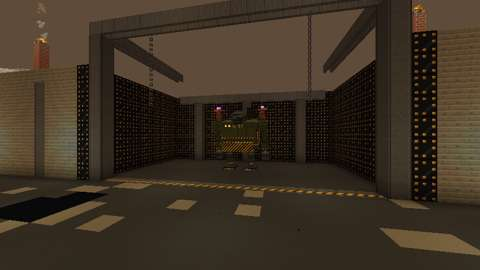
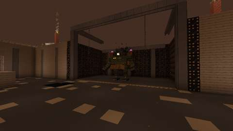
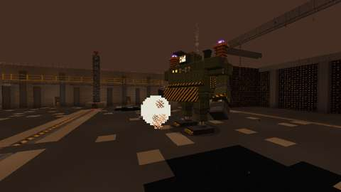
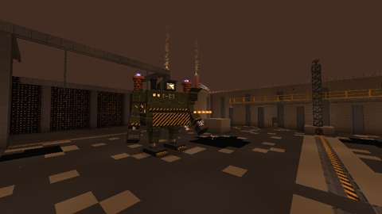
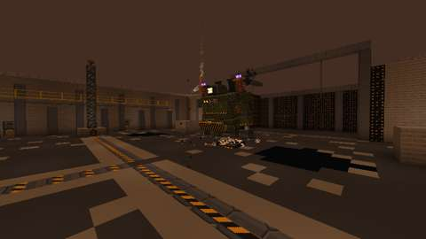
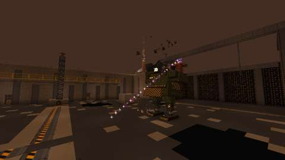
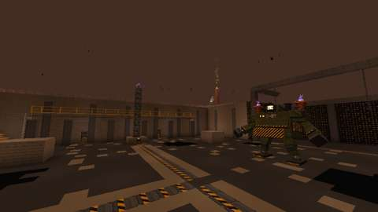
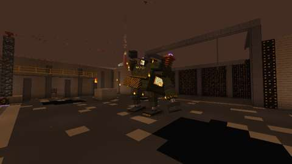
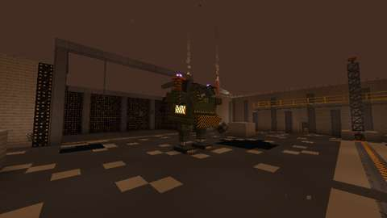
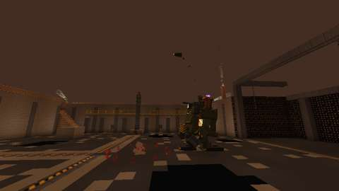
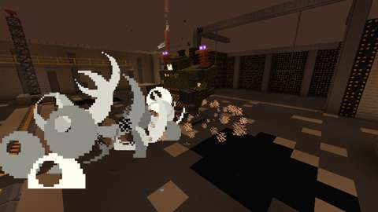
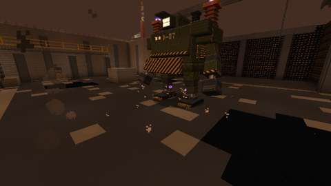
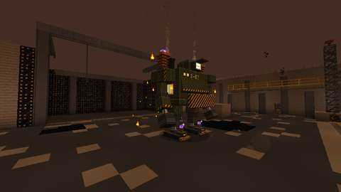
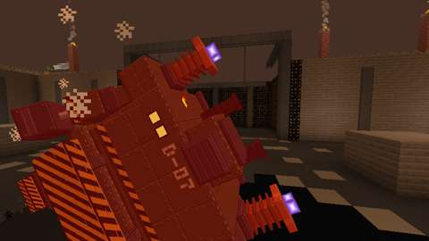

*The client game test's pictures (CI, commit `a31bd68`): he waits, wakes, his four Advance attacks, his charge on the west pylon and his overload when it is routed, the Torn Plate, the Overcharge's Mortar, Blowdown and Sparkers, Red Line and his fall. The world is frozen for each, so a pose holds. 480 × 270, as CI's log carries them.*

CI (14 October 2026, GitHub Actions, the pins in [PLATFORM.md](../PLATFORM.md)):

| Commit | What ran | Result |
| --- | --- | --- |
| `4ce32d4` | Build, data audit, game tests | **Pass:** all 1615 required game tests, his 19 among them; `repository`; `optional integrations absent`. Its client shards were cancelled by the next push before they finished |
| `a31bd68` (the above merged with the Foundry Trench at `c8f33f0`, which carries `main` after jimbozoomer-byte/jugcraft#358) | Build, data audit, game tests, client game tests | **All pass:** all 1666 required game tests, his 19 among them; `repository`; `optional integrations absent`; and every client test class (171; the change adds a shared test file, so `tools/select_client_tests.py` picks them all). His fight passed end to end in a real Foundry Trench. The pictures above are from this commit |

Run locally (14 October 2026):

| Check | Result |
| --- | --- |
| `python3 tools/check_mod_data.py`: now also checks (`check_iron_dreadnought`) his Java numbers, attacks and his things' numbers against `tools/iron_dreadnought.py`, and that his rule can be played (Red Line comes after the Torn Plate and shortens his cooldowns; his plating turns some but not all of a blow; his overload outlasts its stagger; each charge ends before the next is due, and Red Line's come sooner; he drops no more Sparkers than his cap, and a fouled breaker can be cleared; his Trench Charge runs its whole range within its active ticks; a rivet reaches his farthest Rivet Fan target within its life; a sprinting player anywhere on the pit's floor comes within reach of the nearest breaker before the charge ends); that his waking, the Torn Plate and the shell's flight last as long as their clips, and his rivets, shells and arcs leave from where his model's battery, mortar and coils are; that where his fight looks for the trench's parts (`FoundryTrench.java`: where he waits and wakes, the gantry and how high over the pit's floor a player wakes him) is where `tools/foundry_trench.py` builds them, that his body fits where he waits, where he wakes and the way between, every cell of the pit's floor lies within his leash, and the Grey Mist he leaves opens on open cells of the gantry; that his plating lets a quarter through only while his vents are shut, a breaker is answered only by its own trench's fight, Red Line's charges come sooner and two pylons light from the Torn Plate on; that whoever hurts a Sparker takes part and it burns out when he is gone; that his arcs, his discharge and his Sparkers' are `jugcraft:arc`; that the Grounding Strap's mixin is written and registered, and the strap halves `#jugcraft:electric` for whoever holds it in their offhand, a tag holding lightning, the power lines', the Tesla gun's and his own; his registrations, names, death messages and renderers; the GeckoLib models, every clip the Java plays, sheet sizes, glowmasks and controllers' bones; the loot table and his trophies against Arms VII's; recipes (none making Salvaged Coil), costume tags, advancement and messages; and that nothing of his loads chunks or changes dimension. 48 deliberate changes to his Java, the tables and the data, one at a time, each failed it | Pass, 2567 IDs |
| `python3 scripts/check_repository.py` | Pass |
| `python3 tools/check_icon_maps.py` on the three new maps | Pass |
| `python3 tools/generate_material_data.py` and `tools/generate_textures.py`, then `git status` | Write this part's data and textures only (the PNGs they re-encoded with identical pixels were reverted) |
| `javac` on the new Java and tests, for syntax only | No errors |
| `./gradlew build`, game tests and client game tests | Not run locally (the Fabric Maven is out of reach here); run by CI: all pass (above) |

The game tests (`IronDreadnoughtGameTests`) show what a game-test server can, with a Dreadnought put down on his own (no lair) over a trench laid out from near the corner of an arena the pit's size; each test lays the floor and fixtures it needs:
1. he stands dormant in his gantry, his eye dark, and takes no harm; a player a block over the pit's floor does not wake him, nor does a creative player on it or their blow; a player who may fight him standing on the pit's floor does, at full health, his eye lit, unhurt while he wakes; he steps down onto the pit's floor where he wakes, his health one player's, every pylon dark and every breaker open;
2. his health scales 1, 1.5 and 2.5 times for one, two and four or more players, and waking with two players near his trench he has 1.5 times his health; Wither and poison never take hold of him; a player's blow from beyond the pit wakes him, unhurt; Red Line jams his vents open, makes his cooldowns a third shorter and his charges come every 12 seconds, and then a blow lands in full and counts as taking part, and a bystander does not;
3. his shut plating lets a quarter of a blow through at most; overloaded, his vents blow open for 6 seconds, he reels for 1.5, and a blow lands in full and counts as taking part;
4. his charge comes when it is due, planted and crackling, with the pylon nearest his foe lit (its crown and its breaker's lamp) and the others dark; a dark breaker thrown does nothing; the lit breaker thrown by a player routes the discharge (the breaker thrown, the terminal live, the pylon dark), counts as taking part and overloads him; a second later the breaker springs open and the terminal goes dark, his vents still open;
5. left unrouted, the discharge strikes a player on the lit lane and one beside it, spares one farther off, one on a dark lane and one well above the floor, and is electric harm; the Grounding Strap halves it; his plating holds, the pylon goes dark and the next charge waits its full gap;
6. at half health he halts, unhurt, tearing a plate, and fouls the breaker of the pylon nearest his foe; 2 seconds later the Overcharge begins with two pylons to a charge; at a fifth of his health Red Line jams his vents open and hastens his charges and cooldowns;
7. a fouled breaker does not throw: each use works at the plate and counts as taking part, and the third knocks it loose; in the Overcharge, his vents shutting after a stun with none fouled fouls the breaker nearest him;
8. his Piston Punch strikes a player before him and one 45° aside, throwing the one before him back, and spares one beside him, one behind him and one out of reach;
9. his Rivet Fan fires five hot rivets in a fan 40° across, the middle one straight at the player; it strikes the player, and the rivets are gone by the end of their flight;
10. his Trench Charge strikes a player he runs into and throws them aside, once only, and spares one ahead not yet touched;
11. in the fight, his Trench Charge winds up where he stands, runs at his foe and, into a wall, he is stunned with a vent open, short of the wall, his charge over;
12. his Coil Arc strikes the player and jumps twice to the next players within 4 blocks, electric harm, and spares one 7 blocks from the last;
13. his mortar shell flies from the hatch on his back for a second and lands on its mark, striking two players within 3 blocks of it and sparing one 4 blocks off;
14. his Blowdown scalds and slows two players within 5 blocks of his middle, pushing the nearer back, and spares one farther off;
15. his Sparkers drop two at a time up to four; struck, a Sparker dies and its striker takes part; one near a player discharges an electric arc and is gone; when he goes back to his gantry his Sparkers burn out;
16. the Grounding Strap in the offhand halves an arc and lightning, not magic; in the main hand it does nothing;
17. strayed farther than 34 blocks from the pit's middle, he is set back in his pit;
18. left alone 10 seconds, he goes back to his gantry, healed, his eye dark, every pylon dark and every breaker open and clear, his Sparkers burnt out, and who hurt him forgotten;
19. his loot is each participant's own: Salvaged Coil and, on a first kill, one of his trophies into the inventory of each who struck him and of one who only routed a discharge, with a third of his experience each, Grounded theirs afterwards, nothing for a bystander; he falls with his eye going dark and the pylons put to rest, and with no lair instance no Grey Mist opens.

The client test (`IronDreadnoughtClientGameTests`) runs his whole fight in a real Foundry Trench, with the one player in survival under Resistance: he stands dormant in his gantry; standing on the pit's floor wakes him and he steps down, his eye lit; the Advance's four attacks; his charge lighting the west pylon (the player's nearest) and the player throwing its breaker, so that he overloads; the Torn Plate fouling a breaker; the Overcharge's Mortar, Blowdown and Sparkers; Red Line; and his fall: the player's Salvaged Coil, trophy and Grounded, his Sparkers and shells gone, every pylon dark, Grey Mist in the gantry; then a fresh instance in his slot with no Grey Mist and him in his gantry again. Fourteen pictures along the way.

**New game APIs:** `LivingEntity.getDamageAfterMagicAbsorb` (the Grounding Strap's mixin, which scales what it returns) and `DamageTypes.LIGHTNING_BOLT` (in the tag and a test; a sibling of the `WITHER` and `FALL` types already used). The build compiles them against the pinned game, and a mixin whose target is missing stops the game at start, which the game tests would show.

## Rollout and open questions

- **Difficulty:** his numbers are the plan's, but for the charge's length. After a hand playtest the owner may want his plating thicker or thinner (a quarter), his overload longer or shorter (6 s), or his charges more or less often (20 s, 12 in Red Line).
- **Still to do:** the two-client dedicated-server playtest, and a play by hand.
