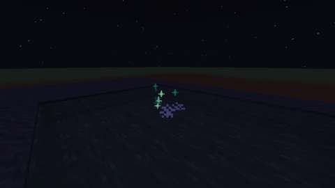
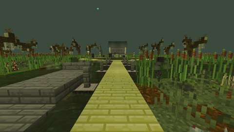
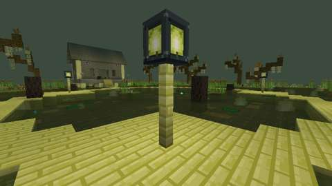
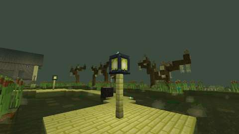
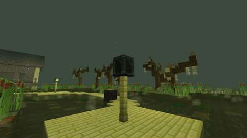
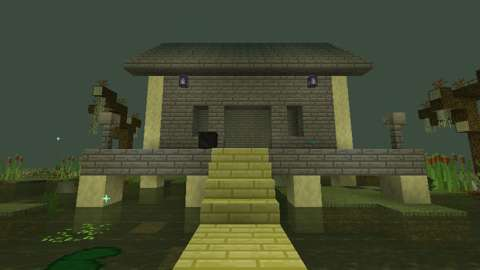
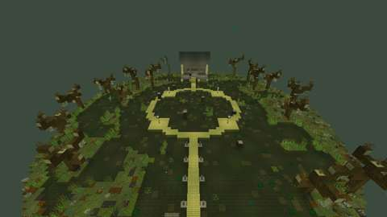
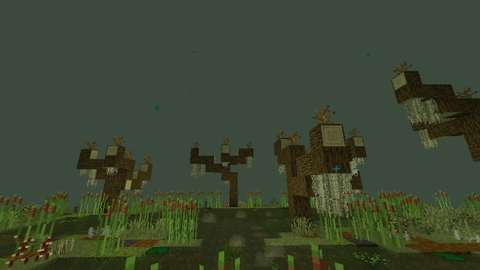
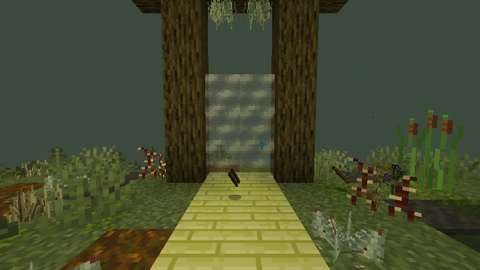

# The Lantern Fen

Status: implemented in source; CI passes (below), and its client test's pictures are in the record. Part 1 of boss 5, the Mire Hag, in the [bosses plan](../branches/BOSSES.md#the-mire-hag-the-plan-being-built), built by [the boss playbook](../branches/BOSS_PLAYBOOK.md): the Lantern Fen, a fifth lair on the shared framework ([hollow-acre.md](hollow-acre.md)), and the Hag Stone that opens it. The Mire Hag and her loot are part 2, in their own pull request ([mire-hag.md](mire-hag.md)). It has not been played by hand, and the two-client dedicated-server playtest is still to do.
Proposal issue: none. On 13 October 2026 the owner chose the recommendation at the Cinder Tyrant's checkpoint ("Go with recommendations"): the Mire Hag next, built the same two-part way, her bog lair and summoning first.
Owner: @jimbozoomer-byte

Target milestone and tier: Specialization tier (dungeon expeditions), as the other lairs are. The stone takes what a player has early on: string, flint, mud, gold and a fermented spider eye.
Primary specialty and supported player role: adventuring, in the Overworld's wetlands.

## Player experience

### The Hag Stone

1. Craft a **Hag Stone**: a flint with a hole worn through it, threaded on string, bound with two gold ingots and two blocks of mud, and set with a fermented spider eye (mud, string, mud over gold, flint, gold over a fermented spider eye).
2. At night, stand in shallow water or on mud (`#jugcraft:hag_stone_ground`) in a wetland (`#jugcraft:hag_stone_lands`): any swamp, Jugcraft's or vanilla's (the conventional `#c:is_swamp`), the Floodplain or the Muskeg. Look through the stone (use it).
3. Through its hole a lantern burns far off in mist. A witch's cackle carries over the water, the water stills, and mist rises from it with a marsh-light bobbing in it. The mist closes round you, and you wake on the jetty of the Lantern Fen. The stone is used up.
4. For 60 seconds (`lairs.gate_seconds`) the mist stays over the water. Anyone who uses it is taken after you, while the party has room (`lairs.party_size`). Nobody is taken in by standing near it.
5. When something is missing, the stone only says what, and nothing is used up:
   - outside the Overworld: "Through the stone you see only stone";
   - by day: "By day the stone shows nothing but the sky";
   - out of the wetlands: "The stone shows its lantern only in a wetland";
   - out of the water and off the mud, or in water too deep to stand in: "Stand in shallow water or on mud to look through it";
   - where the mist has already risen, within 3 blocks: use the mist to follow;
   - when every instance of the fen is taken.
6. Every look, answered or not, rests the stone for two seconds.

"Shallow" is water at your feet with none over it, so you are not under it, and none under it, so you are not swimming over deep water. Mud counts in it or on it: mud is lower than a whole block, so you stand a little way into it.

The Mire Hag is no Witching Season boss: the stone works all year, at night, whatever `lairs.off_season` says.

When the instance closes, the mist sinks at once.

### The Lantern Fen

A drowned fen floating in a night of mist, an island of mud about 75 blocks across and 83 long hanging over the void, its underside trailing roots. The sky is green-black and the fog a grey-green; the water is a murky olive. Pale motes of marsh-light drift in the air, and on this client low banks of mist gather over the open water round you. The music is vanilla's swamp music.

- **The arrival:** the south end of a jetty of willow planks, a punt of dead wood moored beside it, its stern half sunk. You wake there facing north, up the jetty to the marsh, with the Hag's hut far off beyond it.
- **The way home:** behind you, Grey Mist hangs between two dead willows whose crowns have grown together over the jetty's end. Use it at any time, in or out of a fight, to go back to exactly where you stood.
- **The marsh,** the arena: 44 blocks across, black water knee-deep over mud. Six tussocks of sedge rise from it, and six drowned stumps; lily pads and duckweed float here and there. You wade it: your feet are in the water and on the mud, a block below the boardwalks, and the water slows you.
- **The boardwalks:** walkways of willow planks two blocks wide, laid in the water's own layer, so they are stood on a block above the mud with the water just under them. A ring joins four lamp platforms round the marsh's middle (north-west, north-east, south-west and south-east); a spur runs north from it to the porch's stair, and the jetty south to the arrival. They are firm and quick.
- **The lamps:** on each platform a **fen lamp**, a great lantern of blackened iron on a willow post two blocks high, its panes burning with a yellow-green marsh-light at light 15, motes of light drifting up from its cap. Any player in the fen lights one that has gone out by using it. In part 2 the Hag puts them out.
- **The hut:** the Hag's hut on stilts at the north edge, of dead planks under a roof of dead-wood stairs, a door and windows in its walls, her shelves and a hanging lantern inside. Its porch stands over the water facing the marsh, a block above the boardwalks, her bubbling cauldron on it, a skull on a post at each front corner and two lanterns under the eaves. A stair of two steps climbs to it from the spur, half a block at a time. She will wait on the porch (part 2).
- **Round the marsh:** banks of moss, podzol and grass, more of them toward the rim, with reeds and cattails along their shores, ferns, ghost ferns, withered grass, brambles and nightshade. Sixteen dead willows stand on them, their branches bare to the twigs, shroud moss hanging from them and ivy on their trunks. A bank all round the rim holds the water in.
- **The light:** hidden light blocks over the boardwalks' height, the lamps, and the hut's lanterns and cauldron. Every open cell of the marsh has block light 8 or more.

Everything else is the shared framework ([hollow-acre.md](hollow-acre.md#lairs-the-shared-rules)): an instance per opening, at most eight; at most four players; nothing can be built or broken (the fen lamps are the fen's one fixture besides the Grey Mist); the mist's toll at the edges; Grave Goods on death; closing after 30 seconds empty.

## Changes from the plan

- **The mist is used, not walked into.** The plan's first draft let anyone who walked into the mist follow. Every lair's gate takes only those who use it, so that nobody is pulled in by standing near it, and the fen's does the same. The plan now says so.
- **The punt rides at its mooring, its stern half sunk,** rather than lying sunk. A punt under the water would leave a hole in the water's surface: blocks in the template cannot be filled with water.
- **The trees are dead willows of logs, bare twigs (dead bushes), shroud moss and creeping ivy.** Leaves and vanilla vines change by themselves once placed: lair templates are placed without block updates, so leaves would rot away (dropping sticks a player could carry out) and follow the seasons, and vines would spread. Dead bushes and Jugcraft's ivy stay as they are placed. For the same reason the bank under a trunk or a post is podzol, not grass, which would turn to dirt.
- **The fen's mist is drawn on the client,** from the Fog Machine's ground fog, and the drifting marsh-lights are vanilla's glow motes in the fen's biome. A biome's fog distance would have done it in data, but no Jugcraft file uses that setting yet, and a setting the game rejects would stop every lair loading; the client's own mist is checked by the build.
- **The fen lamp stands on a willow post,** two blocks high, in the middle of its platform.
- **The Hag Stone stacks to 16.**
- **Hagmoss** in a cheaper stone comes with the Hag's loot in part 2.

## Connections

- **Inputs:**
  - string, from spiders or cobwebs;
  - flint, from gravel;
  - two blocks of mud, from water on dirt or a mangrove swamp;
  - two gold ingots;
  - a fermented spider eye, from a spider eye, sugar and a brown mushroom;
  - shallow water or mud to stand in, in a wetland, at night.
- **Outputs:** the way into the Lantern Fen, where the Mire Hag will wait (part 2).
- **Technology and magic:** none yet; the fen is an adventuring destination. Part 2 brings Arms VII's two Mire Hag trophies (the Hagthorn and the Bogfang) into survival. Of the plan's magic links, Radiance's Revelation already makes a creature glow, which will show the Hag as a lamp does.
- **Reachable entry path:** every input is reachable without the fen, in the Overworld's first nights: no circular unlock.

## Balance and automation

- **The cost:** every opening uses up a Hag Stone: string, flint, two mud, two gold and a fermented spider eye. There is no cooldown beyond the stone's two-second rest: the stone is the limit, as the other rituals' items are.
- **No loop:** nothing comes out of the fen in part 1. Its lair-only block drops nothing and has no item, and nothing in it changes by itself once placed, so nothing grows or rots there to carry out.
- **No automation:** only a player's own look opens the fen, only a player's own use of the mist takes them in, and only a player in the fen lights a lamp.

## Multiplayer and persistence

- **Server authority:** the server decides everything. Clients only send the use: the look, the refusals (night, the wetland, the water underfoot, a mist already risen), the mist and the entry, and the lamps' lighting all happen on the server. The stone's rest is counted there. The fen's mist and motes are drawn by each client for itself and decide nothing.
- **What is saved:**
  - the mist is never saved, since a restart closes its instance;
  - a lamp's state is saved with the instance's chunks; each instance is placed fresh, its lamps burning;
  - a player's visit and Grave Goods are saved with the player, as for every lair.
- **Chunks:** no chunk is force-loaded. The mist shows itself only where its chunk is loaded (an entity, ticked by its chunk).
- **Griefing:** nobody is pulled in. A second stone where the mist has risen is refused and kept. Nothing in the fen can be changed but its lamps, which every instance places burning.
- **Still to do:** the two-client dedicated-server playtest.

## Dependencies and assets

No new dependency. The owner's asset library (`art/owner-library/catalog/files.csv`) was searched first: its 45 lanterns and lamps are the Guns set's industrial and plasma lamps, the Weapon Smithing smeltery's lanterns, a source-gem lamp and the Lantern of Paranoia item, and its swamp and witch entries are witch hats and tags. None is a marsh lantern on a post, a fen or a hag stone, so everything here is drawn by code:
- the fen is laid out by `tools/lantern_fen.py`, on `tools/lair_layout.py`. Its template has 16,939 blocks: only the earth touching the open air is kept. It is all vanilla blocks and Jugcraft's own (the willow and dead-wood sets, the wetland plants, the witch's decor), but for the fen lamp;
- the fen lamp's textures (its frame, its cap, and its panes lit and gone out) are painted by `tools/lantern_fen_textures.py`, in the manner of the vanilla blocks (`tools/block_style.py`), and its model is built by `tools/lair_data.py`;
- the Hag Stone's icon is a 16×16 map, `tools/item_icons/hag_stone.txt`, drawn by [ITEM_ICONS.md](../ITEM_ICONS.md), with one new material, `fen_flint`, in `tools/icon_materials.py`, and checked by `tools/check_icon_maps.py`;
- the dimension files are written by `tools/lair_data.py` from the fen's line in `tools/lairs.py`. Its music is vanilla's swamp music, and its motes vanilla's glow particle;
- the fen's mist reuses the Fog Machine's ground fog particle (`jugcraft:fog`).

No Mojang texture is read, traced or copied.

New IDs (all under `jugcraft`):
- the dimension, dimension type and biome `lantern_fen`;
- the structure `lair/lantern_fen`;
- the lair-only block `fen_lamp`;
- the item `hag_stone`;
- the block tag `hag_stone_ground` and the biome tag `hag_stone_lands`.

Nothing is renamed.

## Verification

*The client game test's pictures (CI, commit `bdaab72`): the mist where the stone was looked through, then in the fen the view from the jetty, the marsh from the south-west lamp's platform, the south-east lamp burning and put out, the hut and its porch, the fen from above, the willows on the banks and the Grey Mist behind the jetty. The test client renders at 480x270.*

CI (13 October 2026, GitHub Actions, the pins in [PLATFORM.md](../PLATFORM.md)):

| Commit | What ran | Result |
| --- | --- | --- |
| `42f8af0` | Build, data audit, game tests, client game tests | **One failure.** `mod` passed all 1384 required server game tests, the fen's five among them, and `optional integrations absent` and `repository` passed. The fen's client test stopped at its first refusals: the test world is superflat, its player standing at y -60, and the test's pool lies a block lower, so the bog it laid round the pool reached down to y -65, below the world's floor. The server refused the fill ("That position is out of this world!"), the land stayed plains, and the stone, looked through at night on stone, said "not a wetland" rather than "not wet" |
| `bdaab72` | The same, the bog laid from the plains' floor (the world's), the land checked before the test goes on, and every refusal printing what the stone said and what was in hand | **All pass:** all 1384 required game tests, and the client test classes `tools/select_client_tests.py` picked, `LanternFenClientGameTests` among them: the stone passed end to end, and the game's own light on the marsh was at least 8 on all 1,499 of its open cells (the darkest at 8). The pictures above are from this commit |

Run locally (13 October 2026):

| Check | Result |
| --- | --- |
| `python3 scripts/check_repository.py` | Pass |
| `python3 tools/check_mod_data.py`: now also checks `Lair.LANTERN_FEN` against `tools/lantern_fen.py` (size, arrival, centre, bounds, floor, no moon); the stone's rest and reach against `tools/lairs.py`; its ground and land tags, and that every land is a biome or a biome tag; the fen lamp's light; and the fen itself (`check_lantern_fen`, below). A tag inside a biome tag (`#c:is_swamp`) is now looked for among the biome tags, where it is | Pass, 2191 IDs |
| Deliberate breaks of the fen and its Java, one at a time (below) | 28 of 28 failed it |
| `python3 tools/check_icon_maps.py tools/item_icons/hag_stone.txt` | Pass |
| `python3 tools/generate_material_data.py` and `tools/generate_textures.py`, then `git status` | Write this part's data and textures only (the PNGs they re-encoded with identical pixels were put back) |
| `javac` on the new and changed Java, for syntax only | Only the expected errors for the game's missing libraries |
| `python3 -m unittest discover -s scripts/tests` | Pass, 14 tests; the five client jobs are each estimated at about 20 minutes with the fen's client test |
| `./gradlew build`, game tests and client game tests | Not run locally (the Fabric Maven is out of reach here); to be run by CI |

`check_lantern_fen` checks the fen as `tools/lantern_fen.py` builds it:
- the arrival stands on the jetty's planks with room overhead, and the Grey Mist hangs between the willows;
- a walk from the arrival along the boardwalks and banks, never stepping more than half a block (the stair's half steps) nor into the water, reaches every lamp's platform and the porch where the Hag waits;
- the water is one block deep on mud wherever the layout puts it, but where a stump, a stilt, a stair's support or the punt's stern stands in it, and it is held in on every side and below, so none of it can flow;
- each lamp burns on its willow post;
- the porch has room for the Hag (three blocks clear), and her cauldron stands on it;
- the light, flooded from the hidden lights, the lamps, the lanterns and the cauldron as the game floods block light, is at least `MARSH_LIGHT` (8) on every open cell of the marsh (1,522 cells: 8 to 13, the median 9), and the client test reads against the same;
- nothing in it changes by itself once placed: no leaves, no vanilla vines, no grass under a whole block, nothing that burns or flows.

The 28 deliberate breaks: no planks under the arrival; a cell of the Grey Mist missing; the spur to the hut broken by water; the stair's lower step a whole block; a lamp out; a lamp without its post; the north-west lamp's platform cut off; a hole in the mud under the water; a bank beside the water opened; a block where the Hag waits; no cauldron; no hidden lights over the marsh; the lights two levels dimmer; `MARSH_LIGHT` raised to 9; leaves on a tree; vanilla vines; grass under a trunk; the client test reading against 7; `Lair.LANTERN_FEN`'s bounds, and its arrival; `HagStoneRite`'s rest, and its reach; the lamp's light; the Hag Stone unregistered; a stone message without words; the ground tag, and the lands tag, changed; a land that is no biome.

What the building found:
- Lair templates are placed without block updates. Leaves keep the state they are written with, and would rot away and follow the seasons; vines would spread; grass under a trunk would turn to dirt. The fen has none of them now, and the audit keeps it so.
- The audit's first walk refused every column over the water, the porch's among them; it now judges a column by where one can stand in it, and nobody stands in the water's own cells.
- The hut's moss carpets covered one of its four shelves; they now keep off whatever is already there.
- CI's first run found the client test's own fault: it laid its bog a block below the superflat test world (above, `42f8af0`). The stone was right to refuse there; the test now lays the bog where the world has room and checks that it took.

The game tests (`LanternFenGameTests`) show what a game-test server can:
1. the fen's dimension type and biome load from their files;
2. its template loads in the running game, at the size `Lair.LANTERN_FEN` gives, with the fen lamp, the Grey Mist, the boardwalks' planks, the water and the cauldron, and the game's data version, and without leaves or vines;
3. the stone's checks: on mud (the feet taken in the cell over it) and in shallow water at night in a wetland it takes; by day or out of the wetlands it is refused; on stone, under the water or over deep water it is refused; every Jugcraft wetland, vanilla's two swamps, the Floodplain and the Muskeg are wetlands, and the plains, the desert and the Volcano are not;
4. the stone looked through in full when no instance can open: the fen is full, the stone is kept, nobody moves, no mist rises; by day it is refused and kept;
5. a fen lamp burns at 15, gives no light put out, and is lit again by a player's hand; it cannot be broken, has no item and is a lair fixture; the soul brazier still burns at 12.

The client game test (`LanternFenClientGameTests`, CI job `client`) runs the stone from end to end in a real world, with its one player in survival:
1. standing in a pool on mud, in the plains, the stone is refused and kept; the land made a bog's, by day it is refused; at night, out of the water on stone, it is refused;
2. at night in the pool, the stone used in the hand opens an instance in the fen's own dimension and places the fen. It checks the jetty under the arrival, the Grey Mist between the willows, the four lamps burning, the cauldron on the porch, the porch's planks and the marsh's water one block deep on mud. The stone is used up and rested, a mist rises over the pool, and the player wakes on the jetty, unable to build;
3. a lamp can be used and the boardwalk cannot be built on. A lamp put out is lit again by the player's hand. In the marsh the player wades, in the water and on the mud. Falling off the fen throws the player back to the jetty for the mist's toll;
4. leaving takes the player back to where they stood. A second stone at the risen mist is refused and kept, and using the mist takes the player back into the same fen;
5. when the instance closes, the player goes home and the mist is gone.

Then it takes nine pictures: the mist over the pool, and in the fen the view from the jetty, the marsh from the south-west lamp's platform, the south-east lamp burning and then gone out, the hut and its porch from the spur, the fen from high over the jetty, the dead willows on the west banks, and the Grey Mist behind the jetty. Last it reads the game's own block light on every open cell of the marsh, and fails under 8.

Not run: the two-client dedicated-server playtest, and play by hand.

## World and event applicability

The Lantern Fen is its own dimension, so nothing here changes the Overworld but the mist, which lasts its minute. The stone works at night, all year, in the Overworld's wetlands. No season gates it.

## Rollout and open questions

The shared framework's defaults hold: four players and eight instances, Grave Goods on death.

Part 2, the Mire Hag, adds:
- the fight in the marsh: her Likenesses, which the lamps' light betrays, and her shadow and ripple, which tell her from them;
- her Root Knot, which crawls along a boardwalk to put out a lamp, and her snuffing of the lamps;
- her loot: Hagmoss, the Hagthorn and the Bogfang, the Hag's Eye, the Hag's Shawl and the advancement Seen Through;
- Hagmoss in a cheaper stone.
