# The Mire Hag

Status: implemented in source; CI passes on `1ca6ba4` (every server game test with and without the optional integrations, and every client test class, her whole fight among them). On the way CI found faults in her tests and in how her Likenesses walk, each fixed (results below). This is part 2 of boss 5 in the [bosses plan](../branches/BOSSES.md#the-mire-hag-the-plan-being-built), built by [the boss playbook](../branches/BOSS_PLAYBOOK.md): the boss of the Lantern Fen, her Likenesses, her Root Knot, her roots, hands and brews, and her loot. It is built on part 1, the fen and the Hag Stone that opens it ([lantern-fen.md](lantern-fen.md)), and on the lair framework ([hollow-acre.md](hollow-acre.md)). It has not been played by hand, and the two-client dedicated-server playtest is still to do.
Proposal issue: none. On 13 October 2026 the owner answered the Cinder Tyrant's checkpoint with "Go with recommendations", whose next chunk was "The Mire Hag, built the same two-part way: her bog lair and summoning, then her fight among illusions of herself and her loot"; the Mire Hag is the next of the first eight in [branches/BOSSES.md](../branches/BOSSES.md).
Owner: @jimbozoomer-byte

Target milestone and tier: Specialization tier (dungeon expeditions), as the lairs are. She is reached only through the Hag Stone, which takes things a player has early on: flint, string, mud, gold and a fermented spider eye. Nothing a tier needs comes only from her.
Primary specialty and supported player role: adventuring. Her loot also serves the summoning's makers (Hagmoss in the next stone), dyers and gardeners (Hagmoss into light grey dye or compost), whoever hunts what hides (the Hag's Eye) and costume wearers (trick-or-treating and the costume contest).

## Player experience

### She waits

The Mire Hag waits on the porch of her hut in every Lantern Fen, placed with the fen, bent over her bubbling cauldron, stirring it. She is a crone of the deep fen, bent nearly double and a head taller than a man even so (1 block wide, 2.3 high):
- a long robe of rotted sackcloth, its ragged hem trailing in the water, belted with knotted rope;
- a shawl of grey moss over her shoulders and humped back, its fringe hanging, and a hood of it over her head;
- a gaunt face with a long hooked nose and eyes of sickly marsh-light green, her matted hair hung with sedge;
- long thin arms in ragged sleeves, the fingers of her left hand long and knotted as roots;
- in her right hand a crooked staff of bog oak, a little lantern swinging from its crook, its flame the same green.

Waiting, she takes no harm. She wakes when a player who can fight her (anyone not in creative or spectator mode) comes within 18 blocks of the marsh's middle (the ring of boardwalk and a few blocks past it, at the water's level), comes within 6 blocks of her on her porch, or strikes her. Then:
- "The Mire Hag looks up from her cauldron: the lamps gutter, and the mist rises", and her bar shows;
- she looks up for three quarters of a second, then steps down off her porch into the water beside the spur in an arc, in a second and a quarter, landing with a splash; nothing can hurt her meanwhile;
- her health is set for the party: 360, half as much again for each player after the first within 38 blocks of the marsh's middle, at most two and a half times (900 for four or more);
- her first two **Likenesses** form out of the mist round her.

She has armour 6 (the hunt is in finding her, not in wearing her down) and cannot be knocked back. Poison, drowning and falls never harm her. She cannot ride, be leashed or be pushed. She wades the fen as if the water were dry land, at 0.15 blocks a tick, and stops two and a half blocks short of her foe; she steps up onto the boardwalks and round a stump or a post. If she is ever more than 30 blocks from the marsh's middle, or fallen below its mud, she glides back to its middle.

### Her rule: the light finds her

She is never alone. Her **Likenesses** walk the fen with her, two at first:
- each looks just as she does: her model and her sheet, her name ("The Mire Hag"), her size, her health and her lantern's flame. Each plays what she plays, holds still when she strikes and turns on her foe as she does, and walks in its own place round her foe: one a quarter-turn's worth either side of her (50°), and in the Drowned Dark two more, twice as far round (100°), at her distance from the foe;
- but a Likeness **casts no shadow** and **leaves no ripple** where it wades. She casts a shadow, and the water rings round her feet;
- anything striking a Likeness (a blow, an arrow, a thrown snowball or egg) bursts it into a puff of marsh gas, harmlessly, and counts as taking part in her fight. Another forms from the mist **10 seconds** later, out of the lamps' light. A Likeness never hurts anyone;
- within **8 blocks** of a burning lamp her Likenesses gutter and fade (and form again later), and she cannot hide: while she stands in a lamp's light **her outline shows** (she glows, through walls, for everyone). A Likeness never walks into the light of its own accord: where its way to its place lies through a lamp's light, it goes round, half a block clear of the light's edge. Only a lamp lit again, her Exchange or a blow puts one in the light;
- **lighting a lamp that has gone out** (any player, by using it) shows her for **5 seconds** wherever she is, and bursts every Likeness in its light: "The lamplight finds her!".

### Phase 1, the Lure (full to 55% health)

Every attack has a wind-up you can read, a strike and a recovery. She waits at least a second between attacks.

| Attack | Read it by | What it does |
| --- | --- | --- |
| Clawing Swipe | She draws back her hand of roots, witch-sparks round her claws (0.6 s) | Her claws sweep across her front, 3 blocks past her body, 60° either side of her face: 8 damage. Close in, her most frequent attack |
| Root Lanes | She raises her staff and plunges it into the water, and lines of bubbles race out toward her foe along three lanes (1.2 s) | Roots burst up along three lanes 12 blocks long, 20° apart, a clump every block and a half; whoever is within three quarters of a block of a lane: 6 damage, and **held fast** for 1.5 s (no speed left and no jump). Never twice running on one player |
| Poison Brew | She draws a green flask from her shawl, and a ring of venom marks where her foe stands (0.8 s) | She lobs it in an arc; it shatters where it lands (or on the first player it strikes) into a **pool of venom** 3 blocks across for 6 s: every half-second, whoever stands in it is poisoned for 3 s (Poison I, which never kills). At most six pools lie at once |
| Likeness Exchange | She and her Likenesses shimmer as the mist thickens, arms spread (2 s) | She trades places with one of her Likenesses in a burst of mist, and every Likeness burst comes back now |

### Lights Out (at 55% health)

"Lights Out: the Hag cackles, and the lamps gutter out". She cackles for 3 seconds, unhurt:
- the **two lamps burning nearest her foe** gutter out;
- a **Root Knot** bursts up through the boardwalk ring 10 blocks along it from the lamp still burning nearest her foe, and crawls along the ring toward it at 0.06 blocks a tick (about seven seconds): "A knot of roots crawls toward a lamp!". If it comes within 2 blocks of the lamp's post, "The Root Knot reaches the lamp, and it goes out", and it sinks. It has 30 health: cut it down and "The Root Knot is cut down, and the lamp burns on". Whoever hurts it has taken part in her fight. It never strikes anyone;
- then the Drowned Dark begins.

### Phase 2, the Drowned Dark (55% to a fifth)

Her Likenesses are up to four, and she keeps all four of the Lure's attacks, and adds:

| Attack | Read it by | What it does |
| --- | --- | --- |
| Mire Grasp | She reaches down, and the water churns and bubbles in a ring round her foe (1.2 s) | Six hands of mud reach up in a ring 3 blocks across round where her foe stood and clutch for a second: 6 damage, and Slowness II for 2 s |
| Snuff | She pinches the wick of her lantern, and smoke rises from the lamp burning nearest her (1.5 s) | That lamp goes out; at most one every 20 seconds |

### The Last Light (below a fifth)

"The Last Light: her lantern flares, and she can hide no longer". Her lantern's flame flares; her Likenesses burst and none comes back; her outline shows to the end. Every cooldown, and her pause between attacks, is a third shorter.

### Her fall

When she falls:
- her Likenesses burst, the Root Knot sinks, and her roots, hands, brews and pools are gone;
- each participant gets their loot (below) and Seen Through;
- "The Mire Hag falls: her lantern goes out, and the mist lifts": her lantern goes dark, the mist lifts off the marsh, and a gate of **Grey Mist** two blocks wide opens in the middle of the marsh, in the water and over it. It takes players home, as the arch behind the jetty does;
- the instance is ended, and it closes once everyone has left. The next instance in that slot is placed fresh, every lamp burning, and she waits on her porch again; the Grey Mist she opened in that slot before is cleared first, and the water is water again.

### Left alone

If no player she can fight is within 38 blocks of the marsh's middle for 10 seconds: "The Mire Hag climbs back onto her porch, and the lamps burn again". She heals fully, her Likenesses burst, every lamp of her fen burns again, her pools, roots, hands, brews and knot are gone, and who hurt her is forgotten, so a fresh fight starts from nothing.

### Her loot

Each participant rolls their own loot. A participant is a player who hurt her, her Likenesses or the Root Knot and is within 64 blocks of the marsh's middle when she falls. The loot goes straight into their inventory, and what does not fit lands at their feet. "Her hoard of the fen is yours".

| Loot | Chance |
| --- | --- |
| **Hagmoss**, grey moss from her shawl | 3 to 6, always |
| **A trophy:** the Hagthorn or the Bogfang, Arms VII's (one of the two) | 15%; one is certain on a player's first kill (whoever has not yet earned Seen Through) |
| **The Hag's Eye** | 25% |
| **The Hag's Shawl** | 20% |
| 300 experience, shared out among the participants | always |
| The advancement **Seen Through** (a challenge in the Adventure tab): "Find the Mire Hag among her Likenesses and bring her down in the Lantern Fen" | always |

She is no Witching Season boss: the Halloween event adds nothing to her loot.

**What they are for:**
- **Hagmoss:**
  - **A cheaper Hag Stone:** two mud, string, flint, a gold ingot and two Hagmoss, shapeless. The Hagmoss takes the fermented spider eye's place and one gold ingot's. This is the plan's "part of what summons her again".
  - **For those who never fight her:** one Hagmoss makes two light grey dye, and it composts (a medium chance, half).
- **The Hag's Eye:** a hag stone that has seen through her, a marsh-light green eye glowing in its hole. Held in the offhand, every second each invisible creature within 16 blocks of its holder glows for a second and a half, as a spectral arrow makes it glow (for everyone). It does nothing against her Likenesses, which are not invisible.
- **The Hag's Shawl:** a costume worn on the head, her hood of grey moss with two blades of sedge crossed in its crown. It counts for trick-or-treating and the costume contest.
- **The Hagthorn and the Bogfang:** Arms VII's two Mire Hag trophies, until now in the creative tab only. The Hagthorn fights as the steel scythe does and the Bogfang as the steel kama; both are epic, last twice as long as steel, read "Trophy of the Mire Hag", and carry her boon, **Venom:** a hit poisons the foe for 4 seconds.

### Settings

Her settings are the ones every lair boss shares, in `config/jugcraft.properties` (`lair/LairBosses.java`):
- `lairs.boss_health` (1.0, from 0.25 to 4): multiplies her health;
- `lairs.boss_damage` (1.0, from 0.25 to 4): multiplies her Clawing Swipe, her roots and her Mire Grasp (not her pools' poison, which is vanilla's Poison).

`lairs.event_loot` does not touch her: she has no Halloween extra. Her damage numbers are Normal difficulty's: Easy and Hard scale them as they scale every monster's blows.

## Changes from the plan

- **She wakes when a player comes within 18 blocks of the marsh's middle,** at the water's level, or within 6 of her on her porch, or strikes her. The plan said "steps off the jetty into the marsh": the jetty runs south from the ring, so walking down it wakes her a few blocks short of the ring, and the arrival, 37 blocks from the middle, is safe.
- **Waking** is three quarters of a second looking up and a step down in an arc of a second and a quarter, landing in the water beside the spur, 18 blocks north of the marsh's middle. The plan said 2 seconds, unhurt, as it is.
- **Her Likenesses walk in places round her foe** (50° either side, then 100°, at her distance from the foe), and form only where no lamp's light falls and within the marsh; the plan did not say where they walk. They walk round a lamp's light, half a block clear of it, rather than through it: her client test's first CI run lost a Likeness that way (by her code and a model of the walk, through the north-east lamp's light on its way to its place), and a Likeness fading where no one found it gives players a win they did not earn. A Likeness bursts at anything struck with something behind it (a player, an arrow, a snowball, an egg, a tame wolf); a hurt with nothing behind it (a fall, drowning, magic) passes over it.
- **The Likeness Exchange** trades her with one of her Likenesses, not all of them with each other, and brings back every Likeness burst. The plan said "they trade places".
- **The two lamps Lights Out puts out** are the two burning nearest her foe, and the Root Knot crawls on the lamp still burning nearest after them. It bursts up through the boards of the ring itself (the plan: "from the water beside a third lamp's boardwalk"), 10 blocks along the ring from its lamp, and crawls along the ring's middle; it passes through the two drowned stumps that stand on the ring.
- **The Snuff puts out the lamp burning nearest her,** not nearest her foe.
- **Her pools poison every half-second for 3 seconds,** so standing in one keeps you poisoned and stepping out ends it soon after; the plan said "Poison while in it".
- **Held fast** is Slowness VII (no speed left) and no jumping for the 1.5 seconds; a transient change to the player's jump strength, given back the moment the hold ends, and on every restart.
- **Hagmoss's use for those who never fight her** (the plan: "to be settled in part 2") is two light grey dye, or compost.
- **Her Likenesses are their own entity, `jugcraft:hag_likeness`,** drawn from a copy of her model, clips and sheet under their name (GeckoLib finds a body by its entity's ID), named as she is. Her Root Knot, roots, hands and brews are `jugcraft:root_knot`, `jugcraft:hag_roots`, `jugcraft:mire_grasp` and `jugcraft:poison_brew`.
- **Her shadow is the one tell a sharp eye catches at a glance:** with entity shadows turned off in the video settings it is gone, and her ripple (particles) remains; with both off, the lamps still find her, and a blow still bursts a Likeness.
- **Her brews leave from her left hand** as she throws (1.375 blocks ahead of her feet and 1.875 up, where her model's left hand is).
- **Her voice is a witch's,** pitched low; her Likenesses mutter as she does.
- **She is a monster:** on Peaceful she is gone, as every monster is, and the Lantern Fen stands empty.
- **Animations by GeckoLib,** as the other lair bosses' are: GeckoLib 5.5.7 is already pinned.

## Connections

- **Inputs:** the way in is part 1's Hag Stone, looked through at night in a wetland, so flint, string, mud, gold and a fermented spider eye feed every fight.
- **Outputs:**
  - **Hagmoss** feeds back into the summoning (the cheaper Hag Stone), and into light grey dye or compost;
  - **the Hag's Eye** is an offhand charm against invisible creatures (invisible players, illusioners and anything under the potion);
  - **the Hag's Shawl** is a costume for trick-or-treating and the costume contest (`#jugcraft:trick_or_treat_costumes` and `#jugcraft:costume_hats`);
  - **the Hagthorn and the Bogfang** are Arms VII's boss trophies: the third of its eight bosses to drop hers.
- **Technology and magic:** none required. Radiance's Revelation, already in the game, makes a creature glow, so cast on her it shows her as a lamp does; the plan's Verdance, Tether and Tide links wait for those schools.
- **Trade and solo routes:** a solo player can do everything. A lamp is lit by hand, a Likeness bursts at any blow or anything thrown, her roots, pools and grasps are read before they land, and her poison never kills (milk or the chemical reactor's Antidote cures it). Her health is lowest for one player, and the first kill always brings a trophy. Her loot can be traded like any item.
- **Reachable entry path:** the stone takes what a player has early on (part 1), and nothing she drops is needed to reach her.

## Balance and automation

- **Every fight costs a summoning:** a fresh Hag Stone, as part 1 set it.
- **No gain loop:** Hagmoss makes a stone that still needs mud, string, flint, gold and a whole fight, or dye, or compost; no recipe makes Hagmoss, so nothing she drops turns into more of itself. Nothing she drops sells to a Jugcraft shop for Jugs.
- **No leeching:** only participants get loot. A bystander who never struck her, a Likeness or the Root Knot gets nothing, and loot is rolled per participant, so nobody takes another's.
- **First kill once:** the trophy's first-kill guarantee is stored with the advancement, so it comes once per player.
- **Abandoning resets her:** leaving her alone for 10 seconds heals her and forgets everyone's part. She cannot be worn down between visits.
- **No automation:** she wakes only for a player, a lamp is lit only by a player's hand (a lamp lit any other way shows her nothing), and her loot goes only to players. Her Likenesses, knot, roots, hands and brews drop nothing and give no experience.
- **Units:** health and damage in half hearts, before `lairs.boss_health` and `lairs.boss_damage`. Times are in ticks, 20 a second; distances in blocks. Every number is in `tools/mire_hag.py`, and `tools/check_mod_data.py` holds the Java to it.

## Multiplayer and persistence

- **Server authority:** the server decides everything: waking, targets, every attack's hits, the light and the reveal, her Likenesses and where they walk, the Root Knot, the lamps, the pools, the hold, the Hag's Eye, the loot and the advancement. Clients only draw what her synced state says (her action and her lantern's flame, which her Likenesses copy) and play the matching animations; whether a lamp was lit by a player's hand is told to her by the lamp on the server.
- **What is saved:** she is saved with her instance's chunks: her phase and where her fen is. A passing moment (waking, Lights Out) is not resumed: loaded while waking she lands in the water and fights on; loaded crying Lights Out, the Drowned Dark begins. Her Likenesses, knot, roots, hands and brews are never saved, and her Likenesses form again round her when she is loaded; her pools are forgotten. Instances close on a restart (part 1), and she goes with hers.
- **The lamps:** the only blocks she changes are her own fen's lamps, going out (her Snuff, Lights Out, the Root Knot) and burning again (a player's hand, her reset, the next instance).
- **Chunks:** nothing is force-loaded. Her arena stays loaded while players stand in the fen.
- **The Hag's Eye** looks round each player holding it once a second, on the server; the glow it gives is the Glowing effect, seen by everyone, as a spectral arrow's is.
- **Held fast** is a transient change to the player's jump strength, never saved, and given back by the server the moment the hold ends.
- **No griefing:** she cannot leave her lair, her attacks strike only players who can fight her, her Likenesses hurt no one, and every lamp she puts out burns again.
- **Still to do:** the two-client dedicated-server playtest.

## Dependencies and assets

No new dependency. GeckoLib 5.5.7 for 26.3 is already pinned (`distribution/frameworks.lock.json`); it draws her, her Likenesses, her Root Knot, her roots, her hands and her brews. Everything is drawn by code:
- **Bodies and clips:** `tools/mire_hag_models.py` builds the GeckoLib models and animations on Vesperine's builder: 21 of hers (stirring, waking, idle, walking, every attack's wind-up and strike, the cackle, death, and her lantern's flame, lit, flaring and out, on a controller of its own), which her Likenesses share; the Root Knot's crawl and burst, the roots' burst, stand and sink, the hands' rise, hold and sink, and the flask's spin.
- **Textures:** `tools/mire_hag_art.py` paints them at four times Minecraft's scale: 512 × 512 for her (and her Likenesses, the same sheet) and the roots, 256 × 256 for the Root Knot and the hands, 128 × 128 for the flask. Her glowmask lights her eyes and her lantern's flame, and the flask's its venom. It also paints the worn shawl's moss and sedge.
- **Icons:** Hagmoss, the Hag's Eye and the shawl from icon maps (`tools/item_icons/`), on two new icon materials, Hagmoss's grey moss and the marsh-light green; the trophies' art is Arms VII's.
- **Data:** `tools/mire_hag_data.py` writes the bodies, the names, tooltips and messages, the item models (the shawl worn as its own model), the loot table, the two recipes, the costume tags and the advancement.

No Mojang texture is read, traced or copied.

## Verification

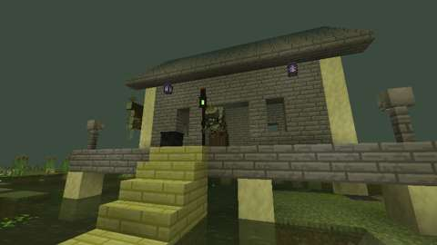
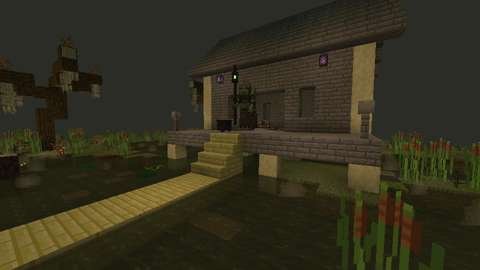
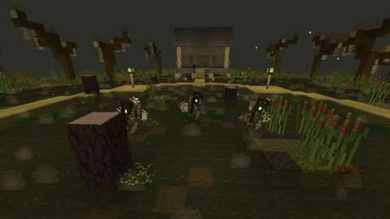
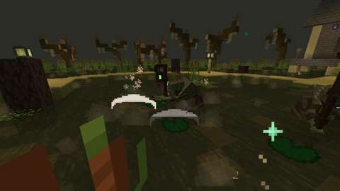
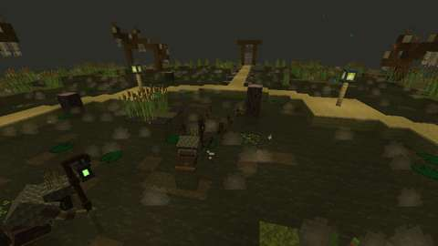
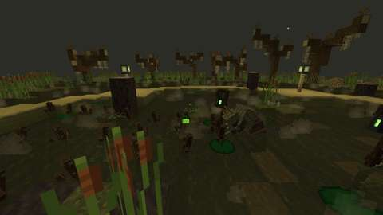
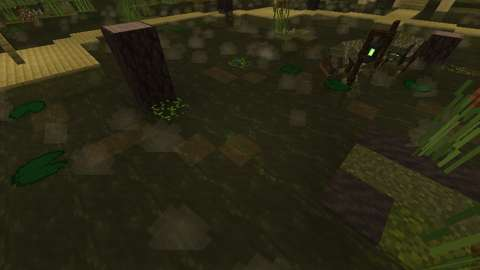
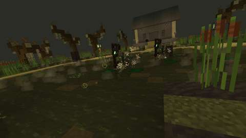
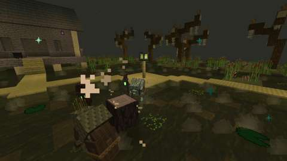
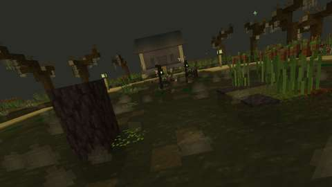
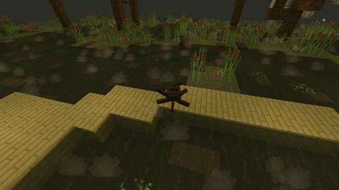
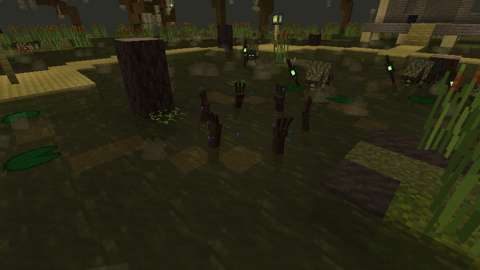
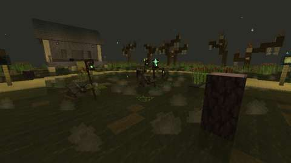
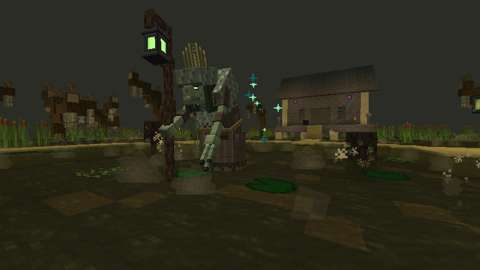
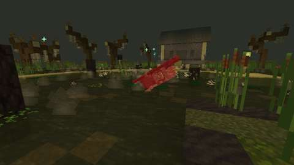

*The client game test's pictures (CI, commit `501a096`): waiting and waking; she and her Likenesses; the Lure's Clawing Swipe, Root Lanes, Poison Brew in the air and its pool, and the Exchange winding up; her outline in a lamp's light; Lights Out; the Root Knot; the Drowned Dark's Mire Grasp and Snuff; the Last Light; and her fall. Each attack is posed and frozen mid-move. The fen is a dark bog and the test client renders at 480x270: several of these, Lights Out and her fall most, are hard to read at that size.*

CI (13 October 2026, GitHub Actions, the pins in [PLATFORM.md](../PLATFORM.md)):

| Commit | What ran | Result |
| --- | --- | --- |
| `f78303f` | Build, data audit, every server game test with and without the optional integrations, and every client test class (her arena is a new structure file, which the selection counts as shared) | **Two of her tests failed, both on what the test assumed rather than what she did.** The build and the data audit passed, and both server jobs passed 1398 of the 1400 required game tests. Her waking test wanted her within 1.5 blocks of where she comes down, but by the time it looked she had waded up to about 3.5 blocks toward the player. The Hag's Eye test hid its pigs with the invisible flag, which the game works out again from the Invisibility effect whenever a creature's effects change, so the Eye's glow wearing off showed them again. The client jobs were cancelled by the push of the fix |
| `14ec3a6` | The same | The waking test now allows the 3.9 blocks she can wade before it looks, and the Eye test hides its pigs with the Invisibility effect. **Her client test failed; all else passed.** Both server jobs passed all 1400 required game tests, her sixteen among them, and four of the five client jobs passed (15 to 38 minutes). The fifth, which runs her fight in the real fen, stopped once she had come down to fight: one Likeness walked with her, not two. The log says only that; the cause, found from her code and a model of the walk, is that the other had walked through the north-east lamp's light on its way to its place round the player, and faded (the server tests had no burning lamp on such a way). A Likeness now goes round a lamp's light (above), and a server test walks two past the northern lamps. Her first two pictures were taken, her fight's were not |
| `33d87a3` | The same | **The server game tests crashed, and her client test failed further on.** Both server jobs stopped partway, the game-test server crashed by a NullPointerException in its own list of a test's timed checks: the new walk test had set 80 per-tick looks from inside one of those checks, and the list broke as it grew while being gone through. Every test before the crash passed. Her client test, now in the first client job, got past her Likenesses (both walked with her) and stopped at her brew: no flask was in the air when it looked. The flask flies for under half a second, and the test had looked a fixed count of the client's ticks after the throw, which the server can run ahead of. Its swipe picture also had a Likeness standing in front of the camera. The walk test now sets its looks as it begins; the client test runs the world on until a flask has flown a few ticks and freezes it in the same server step, and each pose stands her Likenesses behind her |
| `fe1f3ae`, `19e8c1e` | The same | **Her client test failed further on; all else so far passed.** Both server jobs passed all 1401 required game tests, the new walk test among them: two Likenesses walked past the northern lamps and neither stood in their light. Her client test caught her brew in the air, her pool and her Exchange's wind-up, then stopped at the lamp's light: the Exchange begun for the picture before went on, and traded her into the dark marsh in the very tick the test looked for her glow. Its swipe and brew pictures were spoiled by splashes and reeds close to the camera. The test now runs the world on until her Exchange is done, and those cameras stand higher |
| `501a096` | The same | **Her client test passed, from end to end; one server test failed once.** All five client jobs passed (her fight's in 36 minutes, with every check and all fifteen pictures above). `optional integrations absent` passed all 1401 required game tests; `mod` failed one, "the Likeness Exchange and the Snuff" ("She did not trade places with her Likeness"): her Exchange picks one of the Likenesses walking with her at random, and the test checked the trade against the first in her list only, so with two walking it failed half the time. It had passed in each of the seven runs of it before. The test now accepts the trade with whichever she picks |
| `1ca6ba4` | The same | **All passed.** Both server jobs passed all 1401 required game tests, the Exchange test among them; all five client jobs passed, the one with her fight in 34 minutes, taking all fifteen pictures again. The build and the data audit (2194 IDs) passed |

Run locally (13 October 2026):

| Check | Result |
| --- | --- |
| `python3 tools/check_mod_data.py`: now also checks (`check_mire_hag`) her Java numbers, attacks and her things' numbers against `tools/mire_hag.py`, and her rule can be played (the marsh's middle lies beyond every lamp's light, and the half block her Likenesses keep from it; every step a Likeness takes goes through `keepDark`, so none walks into a lamp's light of its own accord; her Likenesses' places never meet behind her foe; the Root Knot gives at least five seconds to cut it down; her roots let go before her Root Lanes come round again; her brew reaches its farthest mark within its life, and her pools poison again before the last poisoning wears off); that where her fight looks for the fen's parts (`LanternFen.java`: the marsh's middle and radius, the mud, the water and the boardwalks' heights, the ring, the lamps, her porch, where she comes down and where the Grey Mist opens) is where `tools/lantern_fen.py` builds them, and that her porch has room for her, where she comes down is open water on mud, the Grey Mist opens in water with air over it, the ring is boards all round the Root Knot's way (or a drowned stump) and each lamp is a fen lamp; that her brews leave from her model's left hand; that her Likenesses are she to look at (her model, clips, sheet and glowmask, her size and her name) and cast no shadow while she does; that her roots take all of a player's speed and their jump, given back on the server's tick; her registrations, names and renderers; the GeckoLib models, every clip the Java plays, sheet sizes, glowmasks and controllers' bones; the loot table and her trophies against Arms VII's; recipes (none making Hagmoss), costume tags, advancement and messages; the Hag's Eye on the server's tick; that a lamp tells her only on the server; and that nothing of hers loads chunks or changes dimension. 41 deliberate changes to her Java, the tables and the data, one at a time (36 at first, and 5 more to the Likenesses' walk round the light), each failed it | Pass, 2194 IDs |
| `python3 tools/check_icon_maps.py` on the three new maps | Pass |
| `python3 tools/generate_material_data.py` and `tools/generate_textures.py`, then `git status` | Write this part's data and textures only (the PNGs they re-encoded with identical pixels were reverted) |
| `javac` on the new Java and tests, for syntax only | Only the expected errors for the game's missing libraries |
| `./gradlew build`, game tests and client game tests | Not run locally (the Fabric Maven is out of reach here); to be run by CI |

The game tests (`MireHagGameTests`) show what a game-test server can, with a Hag put down on her own (no lair) over a fen laid out from the corner of an arena the fen's width and length; each test lays the marsh's mud and the lamps it needs:
1. she waits on her porch stirring her cauldron, and takes no harm; a creative player's blow does not wake her; a player who may fight her coming into the marsh does, at full health, unhurt while she wakes; she comes down into the water where she wakes, two Likenesses with her;
2. her health scales 1, 1.5 and 2.5 times for one, two and four or more players; poison and water never harm her; a player's blow from afar wakes her, unhurt; the Last Light makes her cooldowns a third shorter, flares her lantern, shows her, and leaves her no Likenesses;
3. her rule: in the marsh's middle she is hidden; in a lamp's light she glows, and a Likeness in a lamp's light fades, to form again 10 seconds later; a lamp gone out and lit again by a player's hand shows her for 5 seconds and bursts the Likeness in its light;
4. her Likenesses walk round the lamps' light: woken with no foe, she comes down and they form round her; when she takes the player in the marsh's middle for her foe their places swing round past the two northern lamps, and for 4 seconds after not one stands in a lamp's light, none fades and both still walk with her;
5. a Likeness has her health and her lantern, shrugs off a hurt nobody dealt, and bursts at a player's blow, which counts as taking part; it will form again;
6. her Clawing Swipe strikes a player before her and one 45° aside, and spares one beside her, one behind her and one out of reach;
7. her Root Lanes burst 24 clumps of roots along three lanes; a player on the middle lane and one on a side lane are struck and held fast (Slowness VII and no jump), one between the lanes and one past their end are spared; the held are let go after 1.5 seconds, and the roots sink and are gone;
8. her Mire Grasp strikes and slows (Slowness II) the player on its mark and spares one beside it; a flask of her brew flies onto its mark, shatters into a pool and poisons the player in it; at most six pools lie at once;
9. Lights Out: she cackles, unhurt; the two lamps nearest her foe go out and no others; the Root Knot crawls on the lamp nearest after them; the Drowned Dark begins 3 seconds later, with four Likenesses walking or to come;
10. the Root Knot bursts up on the ring's boards and crawls toward its lamp, and let alone puts it out and sinks;
11. cut down, the Root Knot dies short of its lamp, which burns on, and whoever cut it has taken part;
12. the Likeness Exchange trades her place with a Likeness's; the Snuff puts out the lamp burning nearest her, and only that one;
13. the Last Light bursts her Likenesses, none comes back, she glows, and her lantern flares;
14. left alone 10 seconds, she climbs back onto her porch, healed, her Likenesses gone, every lamp burning, and who hurt her forgotten;
15. her loot is each participant's own: Hagmoss and, on a first kill, one of her trophies into each striker's inventory, Seen Through theirs afterwards, nothing for a bystander; she falls with her lantern going out;
16. her Likenesses' places are 50° apart either side, and from the marsh's middle every place is in the marsh and out of the lamps' light; beside a lamp no place is in its light;
17. the Hag's Eye in the offhand makes an invisible creature near its holder glow, and not a visible one nor an invisible one 20 blocks off; the server looks again every second while it is held, and not once it is put away.

The client test (`MireHagClientGameTests`) runs her whole fight in a real Lantern Fen, with the one player in survival under Resistance: she waits on her porch; coming into the marsh wakes her and she steps down, and two Likenesses form and walk with her, neither fading in a lamp's light on its way; she and they, posed in the marsh's middle round the player; the Lure's four attacks, the venom pool; her outline in a lamp's light; Lights Out with two lamps out and the Root Knot crawling; the Drowned Dark with four Likenesses, the Mire Grasp and the Snuff; the Last Light; and her fall: the player's Hagmoss, trophy and Seen Through, her Likenesses and knot gone, Grey Mist in the marsh's middle; then a fresh instance in her slot with no Grey Mist, every lamp burning and her on her porch again. Fifteen pictures along the way.

## Rollout and open questions

- **Difficulty:** her numbers are the plan's. After a hand playtest the owner may want her Likenesses to return faster or slower (10 s), the lamps' light wider or narrower (8 blocks), or the Root Knot quicker (about 7 s to its lamp).
- **Still to do:** the two-client dedicated-server playtest, and a play by hand.
