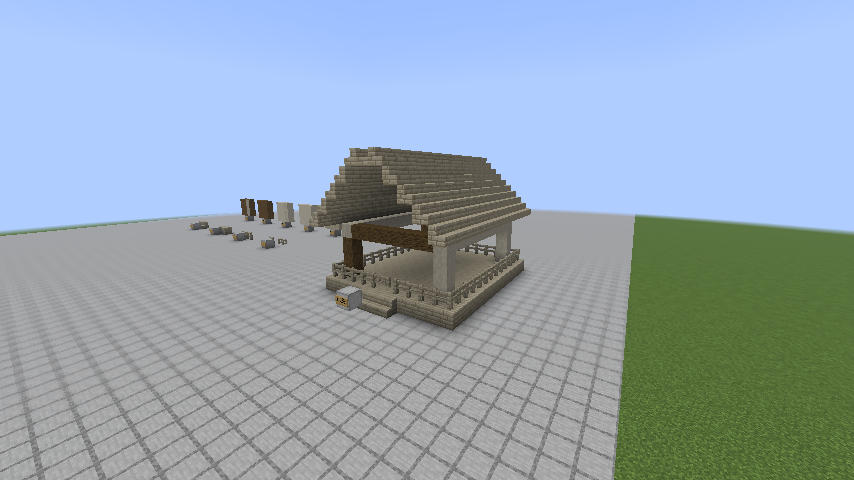
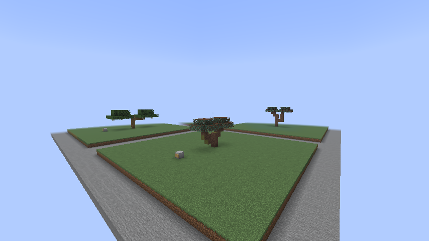
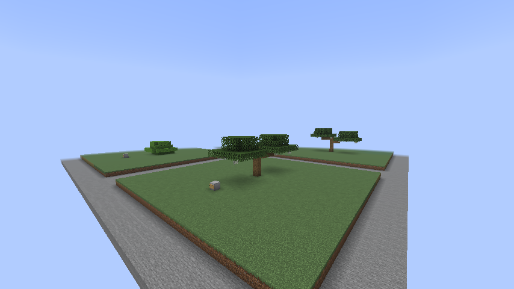
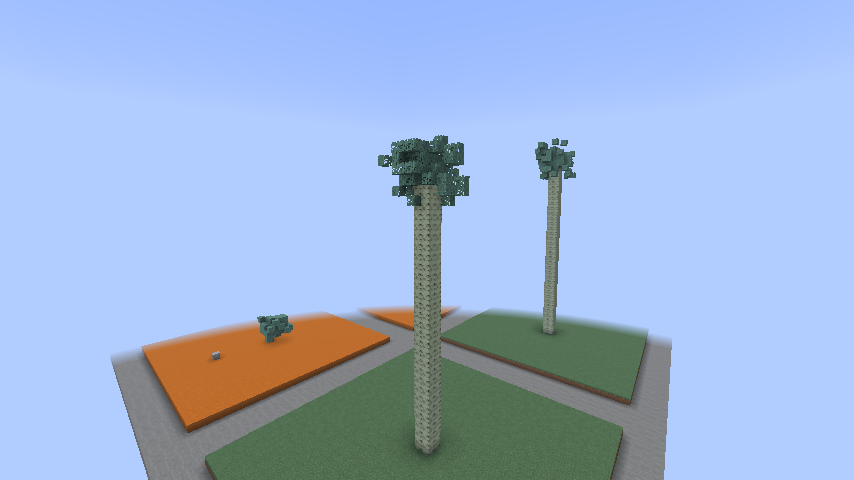
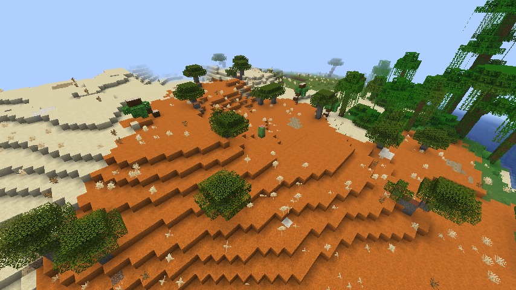

# Trees batch 2: pine approval and warm/mountain tree generation

Status: owner-authorized implementation, 15 October 2026. Public branch `speedygroyper:codex/tree-generation-batch-2`. **The owner approved the original pine textures on 15 October and authorized the remaining trees and biome changes, with tree/biome tests. Batch 2 is implemented, tested and visually approved by the owner on 15 October: “Batch 2 looks good.” PR #386 is ready for review. The owner subsequently limited the remaining work to finishing batch 3.** Actual tool: OpenAI Codex (GPT-6), directly requested by the owner.

## First checkpoint: pine wood

Match the quality of the existing woods, using the shared nine-block wood family: log, wood, stripped log, stripped wood, planks, stairs, slab, fence and fence gate. **Owner correction, 15 October: use the original pine tree-block textures from the main repository directly, without recoloring.** Pine now uses its own local bark/end-grain textures instead of tinted vanilla references.

The initial grey-tan proposal has been replaced by the owner's original pine palette. The set has Creative/inspection access and normal processing recipes. The approved tree stage now supplies pine through natural windswept trees and renewable saplings.

## Authorized work after pine approval

The owner approved the planning recommendations in this chat:

- Cottonwood: Floodplain 30%, Prairie 10%, Lush River 10%; target 12-18 blocks tall and 11-17 across, using aspen wood and seasonal leaves.
- Japanese maple: Hot Springs 30%; target 4-5 tall and 7-9 across, using seasonal maple.
- Live oak: Subtropics 30%, Bayou 15%; target 6-8 tall and 13-17 across, with sparse existing shroud moss.
- Windswept pine: Shield 25%, Karst Pinnacles 65%, Hot Springs 55%; target 6-9 tall and 7-11 across, with the approved pine wood and new needles/sapling.
- Big jacaranda: Jacaranda Glade and Glimmer Grove 15% each; target 10-14 tall and 9-13 across.
- Mallee: Outback 30%, with desert acacia 70%; target 4-6 tall and 5-7 across, with sand-compatible natural placement.
- Giant eucalyptus: Eucalyptus Forest 8%; target 28-42 tall and 7-9 across with a 2x2 trunk. Full mix: ordinary eucalyptus 47%, big eucalyptus 25%, oak bush 20%, giant 8%. Four eucalyptus saplings grow the giant.
- Preserve existing per-chunk attempt budgets and unrelated tree/fruit selections, including Shield's aspen/larch and Subtropics' citrus. Percentages are shares before placement failures; dimensions are visual targets to measure in generated samples.
- Lush Desert: desert acacia 80%, small palm 20%, plus scattered grass/dirt islands targeting 10-15% visible surface coverage after measurement.
- Flower Isle: apple 15%, oak bush 85%, retaining its separate wild apple patches.
- Existing-tree swaps: cypress 10% in Lavender Field; small palm 10% in Lush Grassland and 15% in Oasis; palm 20% and small palm 20% in Overgrown Beach; replace Mycelial Jungle's ordinary oak with mahogany. Defer Lavender's proposed winter-snow change to the later olive/climate pass.
- Use seeded variation, soil and clearance checks, shared seasons and wood systems. New chunks only; no retrogeneration. The other six variants initially remain natural shapes of existing woods.

Planning reference: [tree roster](../branches/TREES.md). The roster's old current-state table predates batch 1 and its final table includes future batches; neither is to be applied wholesale.

## Validation and delivery

**Texture revision:** the owner explicitly requested no tests. At their subsequent request, the direct pine-texture revision was rebuilt with `assemble -x test -x runGameTest -x runClientGameTest` and packaged with the existing gallery. No tests were run. The screenshots and test results below describe the earlier grey-tan version at `abbfcfc25`, not this texture revision. The updated local pack is `pine-original-textures-preview-2026-10-15/Jugcraft-Pine-Original-Textures.mrpack`.

The actual Creative gallery compares pine with vanilla oak, spruce and birch plus Jugcraft cedar, fir, larch, eucalyptus and chestnut. The first wall shows all nine forms, log axes and end grain; a pavilion shows tiled planks, roof stairs, beams, stripped framing, slabs, fences and gates. The client test saves and reopens the gallery, checks 55 placed states and all nine inventory items, and exports it for owner inspection. Screenshots below are from the real client, with the full optional integration set.

Validation on 15 October 2026 (Minecraft 26.3, Loader 0.19.5, Fabric API 0.161.0+26.3, Java 25.0.4.1):

- `./build-local.ps1 -Tasks build`: all **1,646 required server tests passed**, including four pine tests for axe stripping/durability and axes, actual hand recipes, drops/tags/fuel and powered sawmill processing.
- `runClientGameTest -PclientTests=PineWoodClientGameTests`: passed with full integrations, then with `-PjugcraftOptionalIntegrations=false`. Both runs verified save/reopen and inventory; screenshots were visually inspected.
- `python tools/check_mod_data.py`: passed 2,657 material IDs and data/recipe audit; checked 8,374 block/item models, 3,707 quad parts and 171 combined models. `check_icon_maps.py` passed with 27 existing non-pine warnings.
- `python scripts/check_repository.py`, all 34 `scripts/tests` tests, `package_modrinth.py check`, and verification of all 18 locked downloads passed. Generators/tests used the required DejaVu font directory.
- The exported save was copied before cleanup. All 1,554 saved region records and the other save files were scanned; no actual test content was present. Only two development datapack names and five unused test registry names were removed. Every other NBT value and all other saved file bytes were preserved.
- Ordinary `runClient` opened the cleaned gallery with the full integration set and no test mod. The player joined at `(0.5, -60, 5.5)` without missing-content or datapack failures; the client was left open for owner inspection.

The first full-suite run exposed overlapping nuclear test fixtures: the radiation test's large plant and the relay-room test's medium plant both used nearby relative `(5000, 0, -5000)` sites. The failed test passed alone; giving its large plant a separate fixed site made the full suite pass. Only test placement changed, with all nuclear assertions and production code retained.

World files, logs, source commit and exact artifact hashes are delivered with the local preview, outside Git. The pack contains the matching JAR and saved gallery; third-party launcher import, two-client multiplayer and long-duration performance are not claimed. Fresh tree-generation tests and a natural batch-2 inspection world are in progress below.

## Compatibility and provenance

New saved IDs remain registered when acquisition is disabled. No dependency or platform upgrades, release, merge or server deployment are included.

The owner selected the originals in [main's pine/tree-block collection](https://github.com/jimbozoomer-byte/jugcraft/tree/main/art/owner-library/originals/Blocks/biomes%20and%20tree%20blocks). These five files are copied byte-for-byte from `art/owner-library/originals/Blocks/biomes and tree blocks/` to `assets/jugcraft/textures/block/`: `pine_log.png`, `pine_log_top.png`, `stripped_pine_log.png`, `stripped_pine_log_top.png` and `pine_planks.png`. The local source files match main's Git blob IDs. No recoloring, redrawing or source-library edits were made.

`tools/owner_art.py` preserves these imports when textures regenerate. Pine is excluded from `tools/vanilla_logs.py`, and its standard wood models and items use the local images without tinting. Planks also supply the existing stairs, slabs, fences and gates. The old `wood_style.py` pine entry remains only as an overridden fallback/seed slot. This direct owner instruction supersedes the earlier vanilla-reference treatment for pine; other woods retain their existing appearance. Doors, boats and other extra forms are not part of the existing nine-block family.

## Tree implementation checkpoint

The pine approval gate is satisfied. All seven configured shapes and nineteen biome selectors are implemented. Existing biome climates, structures, count budgets, wild apple patches and unrelated citrus picks are preserved. Selector percentages are conditional probabilities calculated from the intended shares. Live oaks use the existing shroud moss; no second moss type is introduced.

Pine needles, brown twig overlay and sapling are direct, unmodified copies of `pine_leaves.png`, `pine_leaves_overlay.png` and `pine_sapling.png` from the same owner-library directory as its approved wood. The leaf is named `pine_needles` at runtime. The supplied needles are grayscale, so the block and inventory model apply a fixed `#78A88A` evergreen tint; the separate brown overlay is untinted. This does not recolor any approved wood texture. The generator writes the tint mapping used by the client. Existing woods and seasonal foliage supply the other shapes.

Four eucalyptus saplings grow the giant. The shared giant-sapling path now preserves all four original sapling states when clearance fails, and will not fall back to a small tree. Single saplings retain their ordinary forms. The focused server test also exercises this for redwood and mahogany.

These are Discovery-stage resources: naturally generated trees produce timber, leaves and saplings for building, planting, ordinary wood recipes, fuel and the existing powered sawmill/tree farm. No new progression gate or required cross-specialty ingredient is added. Placement uses bounded native Minecraft tree features, no ticking scans, entities, chunk loaders or terrain rewriting. Pine uses the shared biomes feature switch and keeps its saved IDs registered when disabled.

In-game measurements prompted smaller live-oak limbs, denser pine foliage, wider mature cottonwood/jacaranda crowns, and shorter mallee stems. The final shape regression uses twelve widely separated seeds, each repeated, with per-shape size limits and autumn foliage checks. Its observed height/width ranges are below; these are sampled dimensions, not hard global minima/maxima. The Japanese maple deliberately includes an occasional three-block bonsai form.

| Shape | Sampled height | Sampled widest span |
|---|---:|---:|
| Cottonwood | 14-17 | 12-17 |
| Japanese maple | 3-5 | 7-8 |
| Live oak | 7-8 | 14-17 |
| Pine | 6-9 | 10-11 |
| Big jacaranda | 10-14 | 9-14 |
| Mallee | 4-6 | 5-7 |
| Giant eucalyptus | 33-40 | 7 |

The soil test rejects stone and solid trunk obstructions and checks mallee, desert acacia and small palm on both sands. The sapling regression covers pine and single/four-sapling eucalyptus, redwood and mahogany, including mixed sapling stages after a blocked attempt.

The comparison garden contains three seeded examples of all seven shapes. The natural survey explicitly loads each sampled chunk and counts dry surface columns inside the actual surface biome, separately from the authored garden. A grass-over-sandstone diagnostic at a Jacaranda Glade/Lush Desert vertical boundary was not a generated grass island; the survey counts the actual surface biome. Later cave carving can also expose grass directly on stone or air. The client checks that at least 95% of sampled grass has dirt below, while the generator regression checks identical grass/dirt noise conditions. The matching island rules now use surface noise at least 0.2, selected from the measured terrain distribution rather than assuming a noise range corresponds to an area percentage.

The public coordination check on 15 October found no competing tree implementation among open PRs and the public branches in upstream and its four forks. `claude/tree-roster` is the planning reference. The owner additionally authorized all remaining roster trees after this batch, using the already approved palette defaults recorded at the top of the roster. No merge, release or server deployment is authorized by this work.

## Final validation, 15 October 2026

- Full `build`: **1,649 required server tests passed**, including the three batch-2 tests. The final client-only follow-up changes inspection assertions to account for natural cave carving; tree and biome production parameters are unchanged from that server run.
- All **37** `scripts/tests` tests passed, including biome shares, preservation of existing citrus/Shield picks and identical grass/dirt noise conditions. Repository structure/documentation check passed.
- `tools/check_mod_data.py`: passed **2,659** material IDs and the recipe/data audit; art check passed **8,375** block/item models, **3,707** quad parts and **171** combined models, using the existing documented allow-lists.
- Capturing the final outputs of the tree and biome generators verified all **599** generated JSON files match. All eight selected pine PNGs match their owner-library originals byte-for-byte. The pine twig overlay uses the shared model finishing pass to separate its faces from the needle cube.

The fully loaded Lush Desert sample contains **637 grass columns of 5,566 dry surface columns (11.44%)**, within the 10-15% target. **611 of the 637 (95.92%)** have dirt immediately beneath; the other subsoil is air (3), stone (7), sand (10) or clay (6), from natural terrain openings, carving, boundaries and deposits. This is one measured location in seed `jugcraft`, not a claim that every desert has the same percentage.

`runClientGameTest -PclientTests=TreeBatchTwoClientGameTests` passed with the full integration set. All ten natural biome stops were found, and all 21 garden trees survived save/reopen with identical measured geometry. Screenshots above were taken in that client run.

The export was copied before cleaning. The scan covered **16,058 saved region records** and all other save files, with no actual test content. Only two development datapack names and five unused test registry names were removed. All other NBT values and the other **116 of 119 saved files** were preserved exactly. The untouched source export is retained. Ordinary `runClient`, with the full integration set and without the test mod, opened the cleaned save successfully at `(1120.5, 180, -987.5)`. The client is left open for inspection. The local delivery folder contains a Modrinth pack, standalone world ZIP, matching JAR, tour and SHA-256 checksums, outside Git. Tests use Minecraft 26.3, Loader 0.19.5, Fabric API 0.161.0+26.3 and Java 25.0.4.1. No two-client multiplayer, external launcher import, long-duration performance or server-world deployment is claimed.
