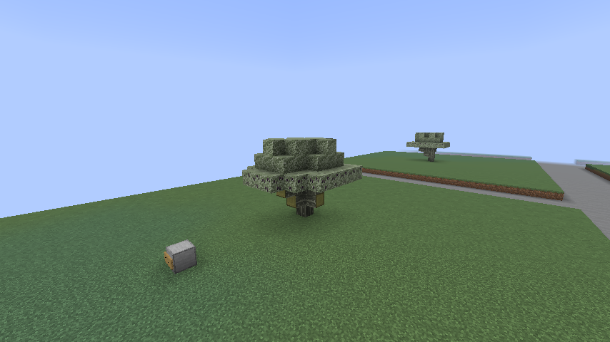
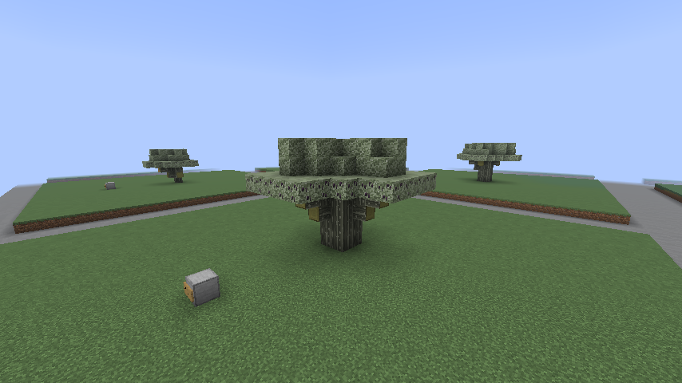
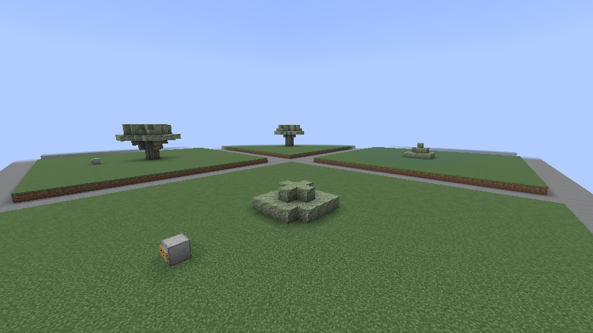
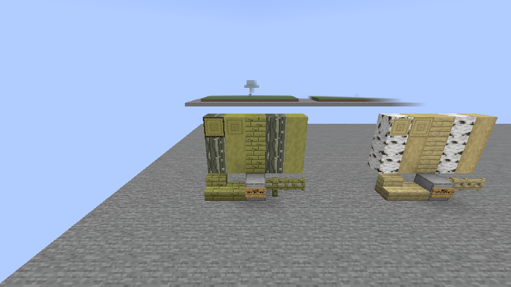
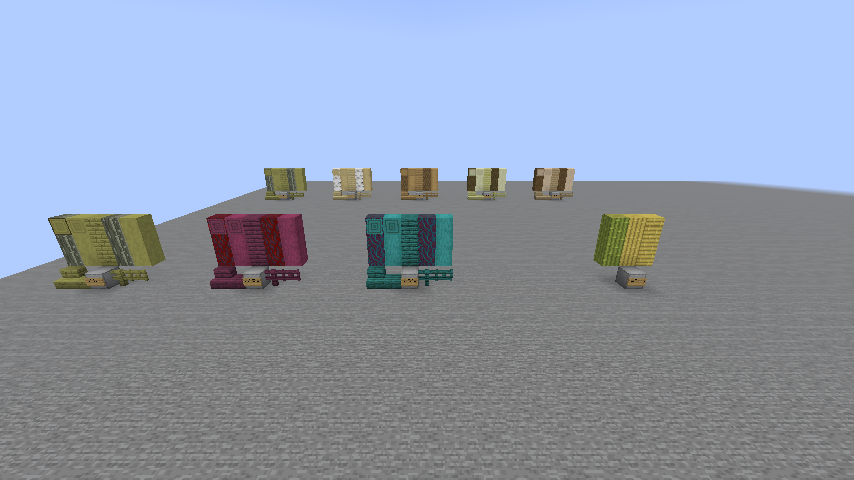
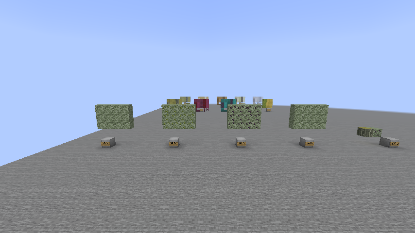
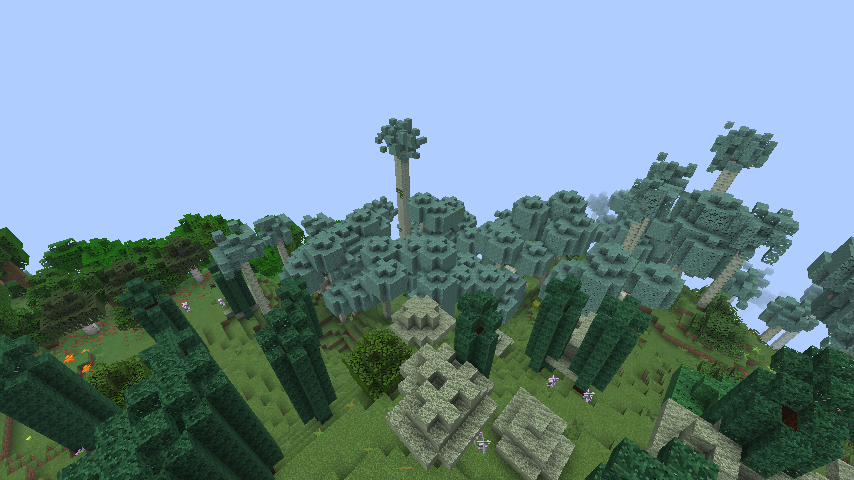
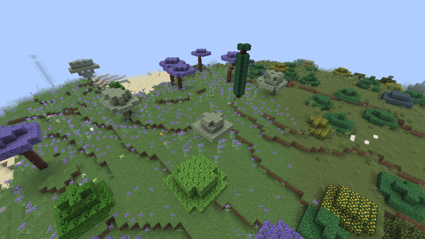
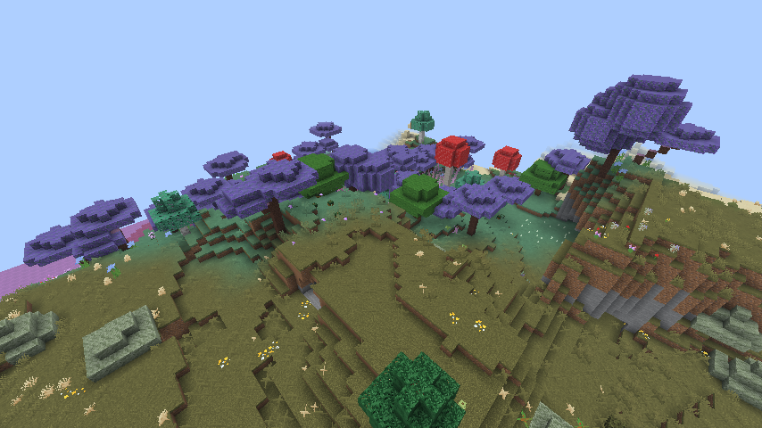

# Tree generation batch 7: olive

Status: implemented and locally tested; awaiting owner visual approval in [draft PR #408](https://github.com/jimbozoomer-byte/jugcraft/pull/408), owner-authorized on 16 October 2026. Public branch: `codex/tree-generation-batch-7` in `speedygroyper/jugcraft`. Actual tool/model: OpenAI Codex (GPT-6). Based on owner-approved batch 6b (PR #404), including batch 6 (PR #399), with main at `2804ba015`. Later batches are excluded.

## Approved scope

Add a short, low-forking olive with a broad irregular silver-green crown (target 5–7 blocks tall, 6–9 wide), the same tree with a 5% native beehive decorator, a squat ancient olive grown only from four saplings (target 6–8 tall, 9–11 wide), and permanently fruitless wild olive bushes (2–3 tall, about five wide). Measure actual shapes and connected foliage during testing rather than treating placer parameters as dimensions. A bounded native trunk-placer extension provides low, face-connected branches, with vanilla layered foliage at their ends. This replaces the originally suggested sparse random-spread crown so isolated leaves cannot float around the tree. Wild bushes use separate non-fruiting leaves and a renewable Wild Olive Bush Sapling; cultivated saplings always grow fruit-bearing trees.

Keep the existing placement-attempt budgets. Mediterranean Forest receives 25% olive and 15% olive bushes, preserving cypress, lemon and orange shares and reducing oak. Lavender Field receives 30% olive with bees, 10% oak with bees, 10% cypress and 50% jacaranda; disable its winter snow. Scrubland becomes 60% olive bushes, 25% oak bushes and 15% juniper. No olive generation in Orchard or Xeric Shrubland; no wild ancient olives.

Include the nine-block muted green-gold wood set, furrowed silver-grey bark, renewable saplings, evergreen foliage with unripe green and ripe purple-black fruit, right-click harvest and regrowth, and pickled olives (one Mason Jar, four olives, one cider vinegar) through the existing preserving system. Preserve existing wood processing, stripping, leaf loot and tree-farm integration. Wild bushes must remain fruitless after ticking and save/reload, rather than merely starting unripe. Player-placed leaves and repeated clicks must not yield instant repeat harvests.

The shared plant-oil system is absent at this starting revision, so oil pressing remains deferred. No olive-only fluid or new dependency is introduced. Olives and preserves are optional early-game food and building content, with no new mandatory technology or magic gate. Existing chunks are not rewritten; registered content remains when biome generation is disabled.

## Validation, 16 October 2026

Platform: Minecraft 26.3, Fabric Loader 0.19.5, Fabric API 0.161.0+26.3, JDK 25.0.4.1+1, and the unchanged pinned framework lock. Commands use the local JDK/Gradle wrapper (`build-local.ps1`); the focused init script passes `fabric-api.gametest.filter=jugcraft-test:olive_game_tests_*`.

- `build`: passed, including all 1,772 required server game tests and the Java compile-time guards. Gameplay/art commit: `5d1081e8f2178621c4e22ae415e7b9baa6ba5ba1`.
- Focused server tests: all five passed, then passed again within the full suite after raising the branch-end crowns to keep the low forks visible. Forty-eight trees (12 seeds per shape) stayed within the planned bounds; every generated leaf was non-persistent, had log distance below seven and belonged to a face-connected canopy. Ordinary olives were 5–7 tall and 6–9 wide, ancient olives 6–8 tall and 10 wide, and bushes 2–3 tall and five wide. Wrong soil, blocked single saplings and blocked mixed-stage 2×2 saplings were checked.
- Gameplay checks cover real empty-hand harvest, 1–2 fruit, repeated-click protection, regrowth in every season mode, placed leaves, permanently fruitless wild leaves, decay, stripping on every axis, wood crafting/sawing, both tree-farm routes, sapling/shears/Silk Touch loot, the heated cooking-pot recipe, one returned vinegar bottle and the last serving returning its Mason Jar.
- `python -m unittest discover -s scripts/tests -p 'test_tree*.py'`: all 32 passed, including exact biome selection shares, inherited tree regressions and evergreen/fruitless separation.
- `python scripts/check_repository.py` and `python tools/check_mod_data.py`: passed (2,821 material IDs, recipes and model audit).
- Generated-data comparison: 1,081 tree, biome, loot, model, tint and recipe-view JSON files match their generators; all 14 new PNGs match deterministic output. Every previously committed texture remains byte-identical.

`runClientGameTest -PclientTests=OliveClientGameTests`: passed with the pinned Sodium/Iris setup. The real client harvested with empty-hand input, checked repeated input, saved and reopened all 12 gallery trees and the leaf displays, then exported the world. Sixteen screenshots were inspected, including cutout/solid foliage, three natural biome stops and comparisons with all seven reference woods. The inspection world uses the existing real-client gallery system and seed `jugcraft`; it includes three examples per shape, all wood forms, native comparisons, a natural harvest demonstration, a heated pot and untouched natural biome stops. Random ticks are paused for inspection; `/gamerule minecraft:random_tick_speed 3` restores ripening, growth and decay. Flat leaf panels are decorative and intentionally cannot yield fruit.

The delivery copy preserves all 96 save files. A scan of 7,742 region records found no actual test content; cleanup changed only unused development metadata in `level.dat`, `level.dat_old` and `data/fabric/registry_entries.dat`, preserving every other NBT value. The original export and earlier worlds remain preserved. The natural samples establish local presence, not a measured global frequency. Ordinary Minecraft opened the cleaned save and joined at 1120.5, 180, -987.5 beside the wild-bush row.

Delivery: `Jugcraft-Tree-Batch-7.mrpack`, `Tree-Batch-7-World.zip`, the matching `jugcraft-tree-batch-7.jar`, tour, screenshots and SHA-256 checksums. Both archive integrity checks, every saved-world byte, the exact built JAR and all 18 pinned dependency entries passed verification. The pack records gameplay/art source `5d1081e8f2178621c4e22ae415e7b9baa6ba5ba1`; subsequent changes only record this evidence.

Two independent clients, dedicated-server deployment, external launcher import, live season transitions and a prior-release world upgrade are not claimed by these checks.

## Texture review

Olive keeps the approved muted green-gold planks, with restrained broken dark grain, silver-grey furrowed bark, narrow silvery foliage and distinct green/unripe and purple-black/ripe fruit. The local bark follows the same approved original-texture exception used for holly; cut and stripped faces use tinted native pale-oak references. No native texture PNG is redistributed.

CIE76 distances between mean plank-texture colours (D65) are bamboo 21.02, birch 17.64, oak 14.07, crimson 58.62, warped 42.72, willow 19.39 and chestnut 14.79. This is a palette sanity check, not a claim about shaders or human perception. Rendered side-by-side inspection confirmed distinct green-gold timber, a readable silver-grey trunk and visibly different fruit states. Owner approval remains pending.

## Coordination and provenance

Open upstream PRs and public branches of all four listed forks were checked before implementation; no separate olive implementation was identified. The branch continues the owner's approved tree work and remains separate from later batches. The owner-library catalog contains no olive-named asset. Extend existing deterministic natural-texture generators using the approved `#9c9951` palette from owner painting 3; use native texture references for cut/stripped wood without bundling Mojang images. Preserve all supplied originals.

## In-game screenshots

