# Tree batches 8, 8b and 8c: dry-country trees

Status: implemented and owner-approved, 17 October 2026. Ready-for-review PR: [#411](https://github.com/jimbozoomer-byte/jugcraft/pull/411). Public branch: `codex/tree-generation-batch-8abc` in `speedygroyper/jugcraft`. Actual tool/model: OpenAI Codex (GPT-6). Starts at `8b98d4c4d`, retaining approved batches 6, 6b and 7 (PRs #399, #404 and #408) above main `2804ba015`. No later batch is included.

## Authorized plan

Batch 8 adds umbrella pine (9–11 tall, 7–9 wide), alpine stone pine (6–10 tall, 5–7 wide), pinyon (4–6 tall, 4–6 wide), wattle (4–6 tall, 4–6 wide) and wattle bushes (2–3 tall, 4–5 wide). Nut pines use approved pine timber and distinct evergreen cone-bearing needles. Wattle uses acacia timber, grey-green phyllodes and golden flowers. Pine nuts are renewable empty-hand harvests, roast at a campfire, and feed squirrels. Decorative leaves do not produce food.

Keep existing tree-attempt budgets. Mediterranean Forest: cypress 35%, olive 25%, olive bush 15%, umbrella pine 15%, lemon 5%, orange 5%. Heathland replaces its 25% vanilla pine with umbrella pine. Dryland replaces its 45% vanilla pine with pinyon; Canyon its 40%. Alpine Spawn changes to larch 50%, stone pine 20%, spruce 20%, juniper bush 10%, retaining 0–2 attempts/chunk and independent feature support. Eucalyptus Forest replaces its 20% oak bushes with wattle bushes. Gilded Shrubland becomes wattle bushes 70%, wattle 30%. Dune Beach stays treeless.

Batch 8b adds tamarisk: low forks and connected feathery crowns, 4–6 tall and 5–7 wide, sparse dusty pink plumes over grey-green leaves, and its own dusty-rose timber/dark furrowed bark. Wasteland: tamarisk 15%, dead tree 45%, snags 40% at one attempt/chunk on suitable soil. Oasis: tamarisk 10%, palm 75%, small palm 15%, retaining 2–3 attempts/chunk. Dry River: one candidate/chunk, 40% tamarisk on exposed suitable banks; the remaining 60% stays empty until batch 10's date palm. Tamarisk grows on sand and appropriate dirt, not bare salt/calcite or underwater.

Batch 8c adds Joshua trees, 4–6 tall and about 5–7 wide, with two or three irregular upturned arms and visibly supported spiky rosettes. Pale shaggy bark and khaki-grey yucca timber form a full wood set; the plant retains the Joshua Tree name. Lush Desert: Joshua 35%, desert acacia 45%, small palm 20%. Xeric Shrubland: Joshua 30%, desert acacia 45%, juniper 25%. Both retain 1–2 attempts/chunk. Natural generation and planted saplings support sand, red sand and appropriate dirt soils.

## Integration and validation contract

Discovery-tier building, forestry and optional food; gathering and renewable saplings provide the solo entry. Existing wood crafting, stripping, sawmill and tree-farm systems remain the consumers. No new dependency, machine or progression gate. Existing chunks are not rewritten; saved registrations remain when generation is disabled. Server-side harvest authority, regrowth and repeated-click protection reuse the existing fruit-leaf system.

Implement all three batches before running validation. Check generated data and art, biome shares and independent Alpine configuration, varied shapes and connected non-decaying crowns, soil acceptance/rejection, saplings, harvest/regrowth, recipes and wood processing. Build and run server tests, then a rendered client inspection covering natural biome stops, all tree forms, wood sets and a usable harvest demonstration. Deliver a matching ordinary-client world and pack. Validation results are recorded below; two-client multiplayer and release deployment are not claimed.

## Implementation and asset provenance

All seven shapes, both timber sets, pine-nut food/roasting and the approved biome selectors are implemented. Saplings preserve the existing tree/wood identity split: stone pine grows three equally weighted forms, wattle grows trees/bushes at 30/70, Joshua trees yield yucca, and wattle farms return only one log because bushes can grow from the same sapling. Native trunk/foliage placement keeps generation bounded; the custom dry-country trunk placer builds face-connected forks before attaching vanilla foliage. Tamarisk's former sparse random-spread proposal is replaced with connected small sprays.

The shared owner library catalog was searched for tamarisk, yucca, Joshua tree, wattle and stone pine; no matching named files were found. Approved pine artwork remains unchanged. New timber uses the established `tools/wood_style.py` painter and owner palettes: tamarisk follows painting 2:6 recoloured dusty rose, yucca painting 2:3 recoloured khaki-grey, with the roster's furrowed and shaggy bark ramps. Unlike the older tinted-reference woods, these two sets use their own generated local bark, ends and stripped textures. `tools/dry_country_textures.py` draws deterministic original 16x16 foliage, saplings and nuts in the existing natural-art pipeline. No library original is changed and no external artwork is copied.

Raw pine nuts give 1 hunger/0.1 saturation modifier and roasted nuts 3/0.4. Each eligible ripe leaf yields 1–2 nuts and resets; two stages each require an average of ten random ticks, independent of seasons. Both foods join the existing squirrel-food tag. Cooking uses the shared furnace/smoker/campfire recipes, one raw item to one roasted item. No fruit is added to wattle, tamarisk or Joshua trees.

## Validation — 17 October 2026

Windows, JDK 25.0.4.1+1, Minecraft 26.3, Fabric Loader 0.19.5 and Fabric API 0.161.0+26.3; dependencies remain pinned by `distribution/frameworks.lock.json`. The local wrapper supplies that JDK and shared Gradle cache. No platform or dependency changes.

- `python scripts/check_repository.py` and `git diff --check`: passed.
- `python -m unittest discover -s scripts/tests -v`: all 72 passed (including 37 tree tests). Set `JUGCRAFT_FONT_DIR` to the installed DejaVu TTF directory on Windows.
- Exact JSON comparisons for the tree, biome, Alpine and agriculture-recipe generators: 1,474 resources match. Existing texture bytes remain unchanged.
- `tools/check_mod_data.py` (all checks, with an ignored progress-logging wrapper): passed for 2,849 material IDs, assets, data and the complete recipe audit.
- `python scripts/package_modrinth.py check`: all 18 dependency entries and platform pins passed.
- Unfiltered `build`: 1,775 of 1,777 server game tests passed. The crow flight test timed out, and the pumpjack timing assertion saw 4 mB. Both passed on isolated reruns without code changes. No crow or pumpjack implementation/test was changed. This is not a claim that the initial full-suite run was clean.
- Optional integrations absent: the same five dry-country server tests passed with `-PjugcraftOptionalIntegrations=false`.
- Final `build runClientGameTest -PclientTests=DryCountryTreeClientGameTests`, with an ignored init script passing `fabric-api.gametest.filter=jugcraft-test:dry_country_tree_game_tests_*`: passed. All five server tests and the rendered client inspection passed after the final crown adjustment.

The five server tests cover 12 seeds for each of seven shapes, planned size limits, variation, timber/foliage identity, connected non-persistent leaves, soil acceptance and rejection, blocked growth, renewable saplings, shearing, stripping on every axis, crafting, sawmill/tree-farm recipes, real empty-hand nut harvesting, repeated clicks, ripening in every season mode, decorative-leaf rejection, leaf decay, campfire cooking and squirrel-food tags. Initial size failures led to bounded branch-length corrections. Small-tree crowns now cover their branch tips without increasing the planned envelope.

Measured ranges across the 12 fixed seeds:

| Shape | Height | Width | Logs | Leaf blocks |
| --- | ---: | ---: | ---: | ---: |
| Umbrella Pine | 9–11 | 8–9 | 14–18 | 76–120 |
| Stone Pine | 6–10 | 5 | 5–9 | 31–35 |
| Pinyon | 4–6 | 4–5 | 7–16 | 17–26 |
| Wattle | 4–6 | 4–5 | 7–16 | 17–26 |
| Wattle Bush | 2–3 | 5 | 1 | 28–31 |
| Tamarisk | 4–6 | 5–7 | 8–20 | 24–36 |
| Joshua Tree | 4–6 | 5–7 | 7–17 | 21–33 |

The real client created a normal world with seed `jugcraft`, grew three examples of each form, found the expected new foliage in all twelve intended natural biome samples, harvested the marked leaf using client input, checked an immediate repeat, and saved/reopened all 21 gallery trees and leaf displays. All 30 screenshots are preserved with the local export; selected evidence follows. Cutout and solid foliage, wood comparisons and all seven close-up shapes were inspected. Natural samples demonstrate local presence, not measured global spawn rates.

The exported world contains a separate authored gallery and untouched natural biome stops. Flat leaf panels are decorative; the marked natural ripe leaf is the harvest demonstration. Random ticks are paused for review; `/gamerule minecraft:random_tick_speed 3` resumes growth, ripening and decay. The delivery cleanup scanned 20,989 saved region records, found no actual test content, and preserved all 141 save files. Only unused development metadata in `level.dat`, `level.dat_old` and `data/fabric/registry_entries.dat` changed; all other NBT values and files were preserved.

Not claimed: two independent clients, dedicated-server deployment, external launcher import, live season transitions, global frequency measurements, or a prior-release world upgrade.

## Steppe client-survey correction

PR #411's CI on `463047146` failed in `TreeBatchSixClientGameTests`: the Steppe sample at (-1480, 66, 2224) contained 20 apple-leaf blocks but no oak logs. The survey classifies each column by its ground biome, so a neighboring canopy crossing the boundary was mistaken for a fruit tree growing in Steppe. Both configured apple and peach trees use straight oak trunks; Steppe's own shrubs use deadwood and juniper.

The client assertion now rejects oak trunks in Steppe columns instead of rejecting overhanging apple/peach leaves. The existing runtime checks still require Steppe's shrub and corn features and exclude both apple and peach patches. No world generation, biome mix, texture or gameplay changed. Fix prepared with OpenAI Codex (GPT-6).

Focused validation on 17 October 2026 (same pinned Windows/JDK/platform as above):

- `python -m unittest discover -s scripts/tests -p test_tree_batch_six.py -v`: all five passed.
- `runGameTest` filtered to `jugcraft-test:tree_batch_six_game_tests_steppe_has_low_shrubs_and_keeps_its_plains_crop_tag`: exactly one test ran and passed.
- `runClientGameTest -PclientTests=TreeBatchSixClientGameTests`: passed all twelve natural biome surveys, including the identical Steppe coordinates and 20-leaf/no-oak-trunk sample from CI, plus the existing 15-tree garden and save/reopen validation.
- The two game-test tasks ran together using the local wrapper and ignored `build/focused.gradle` filter adapter; Gradle reported `BUILD SUCCESSFUL in 5m 14s`. The first sandboxed launch could not connect to its local Gradle daemon; the permitted retry completed successfully. No full test suite was rerun.

## Delivery

Gameplay/art source: `273e6bac146e74fd3034833e45d914fa9523e895`. The matching `Jugcraft-Tree-Batches-8-8c.mrpack`, `Tree-Batches-8-8c-World.zip`, standalone JAR, tour, thirty screenshots and SHA-256 checksums were delivered in the local `tree-batch-8abc-2026-10-17` folder. Both archive integrity checks, every world file, the exact built JAR and all eighteen locked dependency entries passed. All 1,474 generated tree/biome/recipe resources also match the delivered JAR; no obsolete Grassland selector remains.

Ordinary `runClient -I build/tree-batch-8abc-runtime.init.gradle` opened the cleaned save successfully and the local player joined. The original export, delivery save and earlier inspection worlds are preserved; the open game uses a separate runtime copy. These delivery notes change no gameplay or art after the recorded source commit.

## Rendered evidence

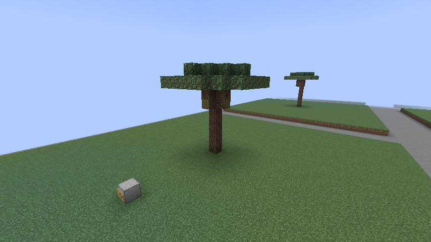

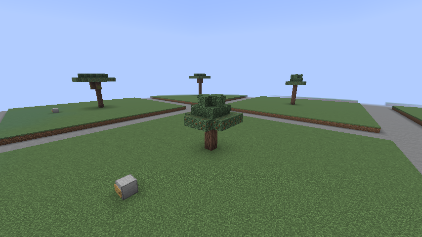

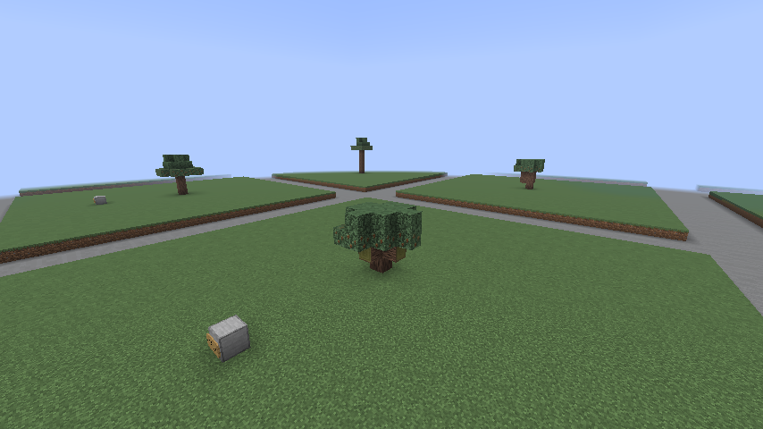

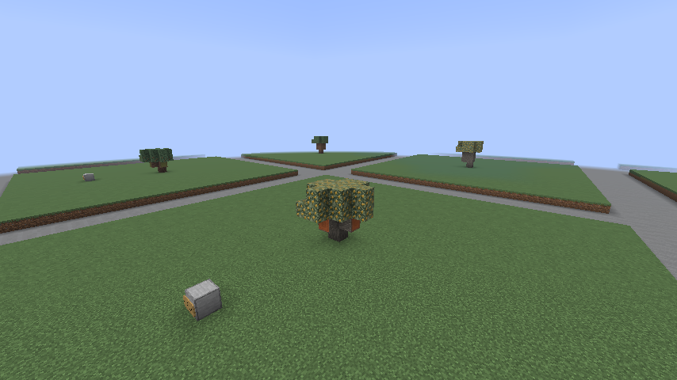

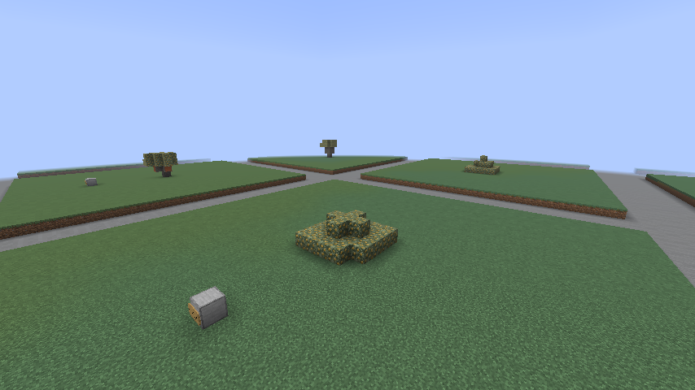

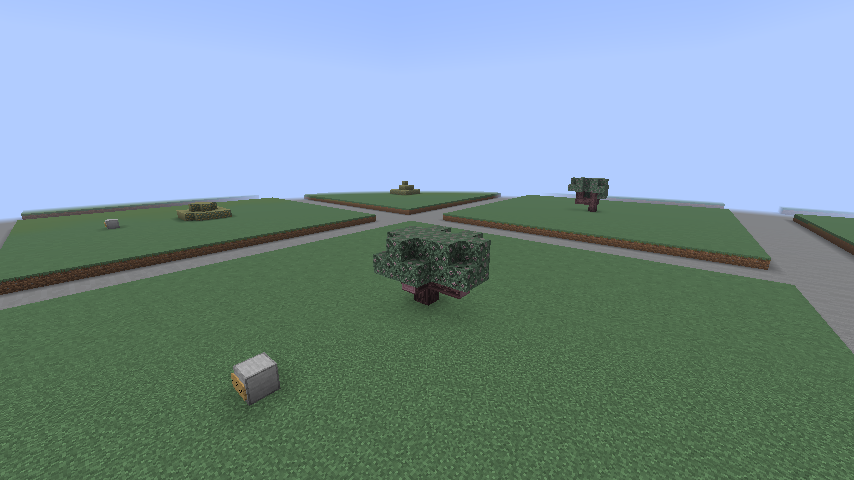

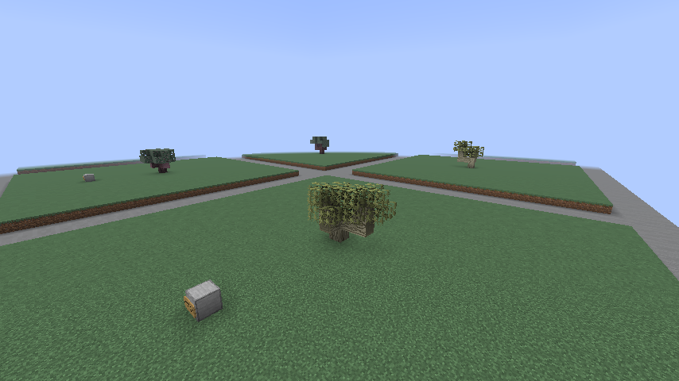

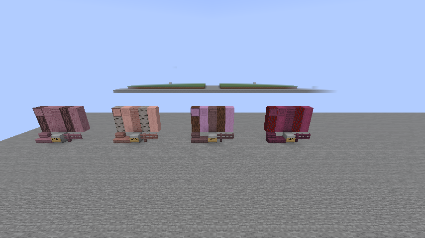

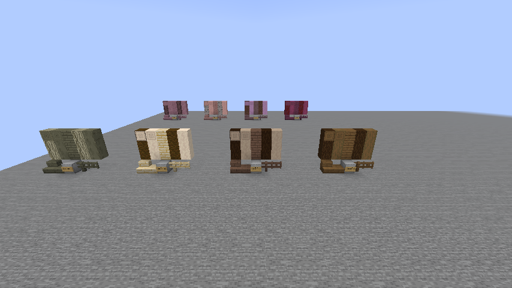

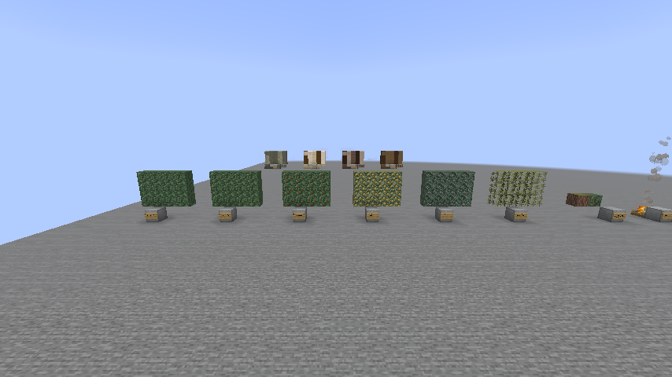

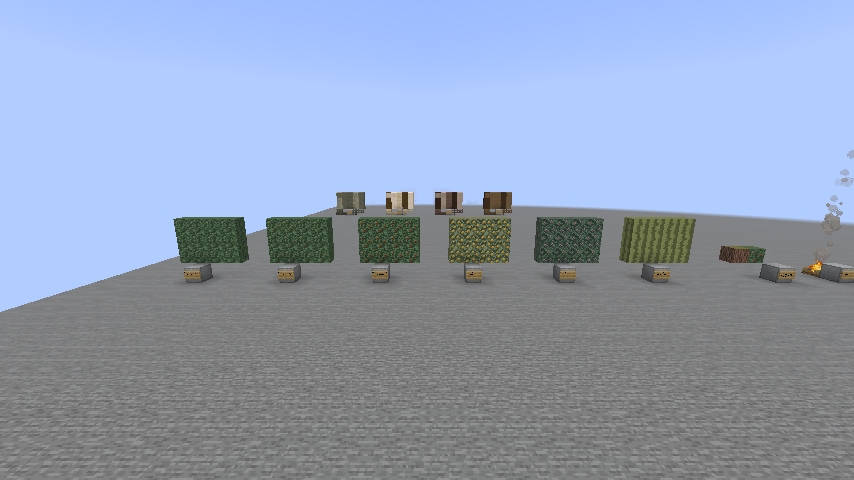

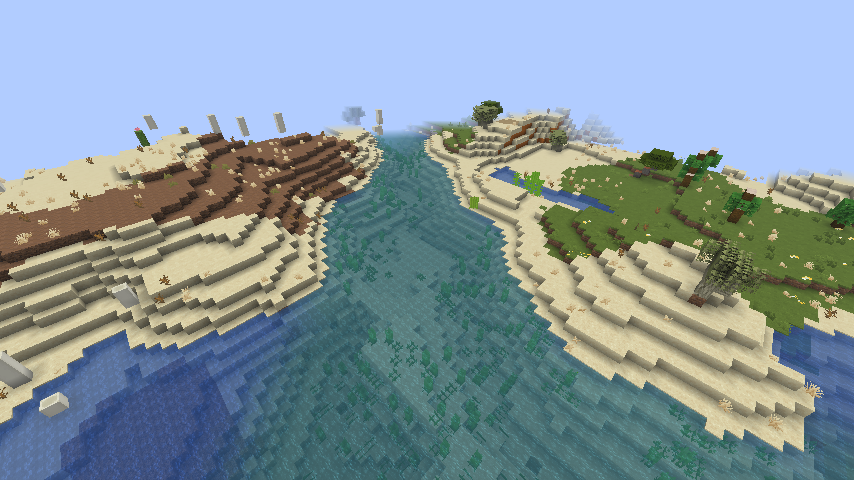

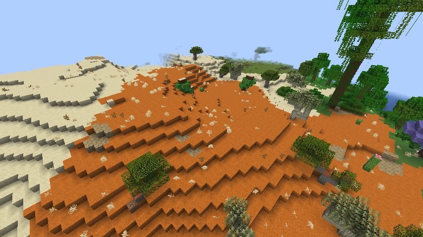
