# The Yeti King

Status: implemented in source. CI builds it, and its game tests and client game test pass (below). This is part 2 of boss 3 in the [bosses plan](../branches/BOSSES.md#the-yeti-king-the-plan-being-built): the boss of the Glacier Hall, his kin and his thrown and fallen things, and his loot. It is built on part 1, the hall and the Frost Horn that opens it ([glacier-hall.md](glacier-hall.md)), and on the lair framework ([hollow-acre.md](hollow-acre.md)). It has not been played by hand, and the two-client dedicated-server playtest is still to do. Since Concordance Chunk B (unit 1) his reward is the lairs' shared one ([lair-encounter-credit.md](lair-encounter-credit.md)), and unit 2 held his fight to the chunk's completion evidence, with three fixes; both pass in CI (run 38543250503, by workflow_dispatch; not merged). Unit 4's change to his frost passes too (run 38549876709, with units 1 to 3; not merged). Unit 5 gave Brace and Rimebind their part in his fight and made his column Rimekeeping practice ([below](#optional-counters-concordance-chunk-b-b-09)); its tests pass too (run 38591108210, with units 1 to 4; not merged).
Proposal issue: none. On 10 October 2026 the owner asked for the next boss "exact same way you did the spider but adjusted for that character", and chose a new boss built from start to finish; the Yeti King is the owner's own example in [branches/BOSSES.md](../branches/BOSSES.md).
Owner: @jimbozoomer-byte

Target milestone and tier: Specialization tier (dungeon expeditions), as the lairs are. He is reached only through the Frost Horn, which takes Discovery-tier things. Nothing a tier needs comes only from him.
Primary specialty and supported player role: adventuring. His loot also serves the summoning's makers (Yeti Fur in the next horn), cold-biome travellers (the Yeti Mitten; since Concordance Chunk B, unit 4, they also have Winter Brine and the Rime travel kit, [arcane-concordance-winter.md](arcane-concordance-winter.md)) and costume wearers (trick-or-treating and the costume contest).

## Player experience

### He waits

The Yeti King sits slumped on the throne of every Glacier Hall, placed with the hall, asleep. He is a great white ape of the glacier, twice a player's height and more (3.4 blocks tall, 2 wide):
- shaggy white fur in long locks, shadowed blue-grey and frosted blue at their tips, with a shaggy mantle over his shoulders;
- a bare blue-grey face, palms, knuckles and soles; eyes of glacier blue under a heavy white brow; ivory fangs;
- long arms that reach his knuckles to the snow, the fur hanging from his forearms hung with icicles;
- a crown of blue ice, its tallest point at the front.

Waiting, he takes no harm. He wakes when a player who can fight him (anyone not in creative or spectator mode) steps onto the lake, or strikes him. Then:
- "The Yeti King rises from his throne with a roar that shakes the ice", and his bar shows;
- he roars on his throne for a second and leaps down onto the lake below his dais in another, and nothing can hurt him meanwhile;
- his health is set for the party: 420, half as much again for each player after the first within 38 blocks of the lake's centre, at most two and a half times (1050 for four or more).

He has armour 10 and cannot be knocked back. He takes no fall damage, never freezes and no web or powder snow holds him; he walks his own snow and ice without sliding. No Levitation (an End gun's bullet, a shulker's or a potion) takes on him or his whelps, so neither floats off the lake, nor he as he dies (Concordance Chunk B, B-04). He cannot ride, be leashed or be pushed. On the lake he lopes at a quarter-block a tick on his legs and knuckles and stops two and a half blocks short of his foe. If he is ever more than 30 blocks from the lake's centre, or fallen below it, he bounds back to its middle.

### His rule: the snow is his

His **Ground Slam** blasts the drift snow from the lake round where he lands, baring **glare ice**, as slick as blue ice, for **12 seconds** before the snow drifts back over it. On it you slide, and every blow carries you further. He bares only drift snow: never the trampled snow round an ice column, at the ramp's foot, before his dais or on the dens' paths, nor the glare ice the wind has already scoured, so there is always firm footing somewhere.

### Phase 1, the Hunt (full to half health)

Every attack has a wind-up you can read, a strike and a recovery. He waits at least a second between attacks.

| Attack | Read it by | What it does |
| --- | --- | --- |
| Maul Swipe | He rears back on his right, that fist raised out wide behind him (0.6 s) | His fist rakes across his front, 120°, 4 blocks past his body: 12 damage and a knockback. Up close, his most frequent attack |
| Boulder Throw | He digs both fists into the snow and heaves a block of ice up over his head (0.8 s) | He hurls it in an arc at where his foe stood; it shatters where it lands, or on the first player it strikes: 10 damage within 2.5 blocks |
| Ground Slam | He crouches low, fists high, while a ring of frost spreads round his foe (0.8 s) | He leaps onto where his foe stood (0.8 s in the air): 14 damage within 3 blocks, a knockback within 6, and the drift snow blasted bare within 7 (his rule) |
| Frost Breath | He swells his chest, head thrown back, frost at his jaws (1 s) | A cone of freezing breath before him, 60° and 6 blocks, for 1.5 s: 2 damage every quarter-second and the frost. It stacks past freezing you through, so standing in it lets the cold bite |
| Avalanche Charge | He drops to all fours and paws the snow (0.8 s) | He charges in a straight line at 0.7 blocks a tick for up to 1.2 s (about 16 blocks): 12 damage and a heavy knockback to each player he passes, once each. **Into an ice column** (a step that would bring him within 5.2 blocks of its centre, or his body against its flared foot) **he crashes, reels for 3 s and takes a third more damage meanwhile** ("The Yeti King crashes into the ice and reels"). The charge also ends at his leash. A charge that ends in a column is a deed of his fight for the player it was aimed at, if they had already taken part (a blow, healing or a ward) as he set off |

### The King's Roar (at half health)

"The King's Roar: a blizzard howls through the hall, and his kin answer". He bounds back onto the top step of his dais and roars for 3 seconds, unhurt:
- a blizzard chills everyone near: the frost, to just short of freezing them through;
- two **Yeti Whelps** climb out of the dens in the side walls.

Then he leaps back down onto the lake below the dais, and the fight changes.

### Phase 2, the Blizzard (half health to a fifth)

He keeps his Maul Swipe, Boulder Throw, Ground Slam and Avalanche Charge, stops breathing frost, and adds:

| Attack | Read it by | What it does |
| --- | --- | --- |
| Icicle Fall | He roars up at the vault, fists raised, and dark shadows spread on the snow round his foe (1 s) | Eight icicles fall one by one over 0.8 s, onto marks within 3 blocks of his foe, from 12 blocks up: 6 damage to a player within a block of where one shatters |
| Glacial Spikes | He raises a fist high while cracks race across the ice towards his foe (0.8 s) | He drives it into the ice: a spike bursts up each tick along the line, 12 blocks: 10 damage and thrown up. Each stands a second, then crumbles |
| Kin Call | He beats his chest and calls (1 s) | Two Yeti Whelps climb out of the dens; at most four at a time |

**Yeti Whelps:** round white cubs with big glacier eyes and a tuft of blue frost, 16 health, their blows 3 damage, quick. They go for the nearest player, never freeze, drop nothing, give no experience and are never saved. They flee into the snow when he falls, resets or is gone, or no longer counts them his (loaded again after an unload). Whoever hurts one, or whose tamed creature does, has taken part in his fight.

### The Fury of the Peaks (below a fifth)

"The Fury of the Peaks: his crown blazes, and his eyes burn blue". Blue fire wraps the points of his crown and rises from his eyes. Every cooldown, and his pause between attacks, is a third shorter; his Ground Slam bares a wider ring, 10 blocks; and a charge that does not stun him is followed at once by another.

### Optional counters (Concordance Chunk B, B-09)

Two of the Concordance's spells answer him, if a player chooses; neither is needed to win (none of his numbers changed,
and without them his fight is as it was).
- **Only a Brace lessens his throws.** Braced, the next of his blows, slams, charges or glacial spikes throws you half
  as far; a Brace braces the rest of the tick it is spent in, so a blow and its own push are halved once, not twice.
  Knockback resistance from anything else (netherite, Earthbound Thallite's Rooted, the Ice Breaker) still does not
  lessen his throws; a blow's own small knockback and his boulders' and icicles' are the game's, as before, which such
  resistance lessens. A shield that wholly blocks his swipe or a spike stops its throw, as before. The Water Bangle's
  Brace counts as well.
- **Bracing a friend is your part in his fight.** A Brace you put on another player that takes one of his throws is a
  deed of his fight for you, as baiting his charge into a column is (no part needed before it, but you must be in his
  fight and able to fight him). A Brace on yourself, the Water Bangle's and one whose caster a relog forgot earn no one
  anything.
- **Rimebind holds his next wind-up.** He moves by his own steps, so its slow does not hold him. A binding that takes
  instead holds his next wind-up 4 ticks longer (a starting value, not yet tuned), frost-locked, with a puff of
  snowflakes and the sound of glass: the wind-up under way if it is not about to strike, else the next. On him a
  binding lasts 1.5 seconds and its thaw 3.5, in which no one binds him again, so the hold comes once each time he
  thaws. Waiting on his throne a binding holds nothing, and left alone he forgets it.
- **The column is cold work.** For a Rimekeeper (Rimekeeping understood), drawing his charge into an ice column as the
  player it was aimed at (with a part in his fight already, as its deed asks) is Rimekeeping's elective kind of cold
  work, the same kind as a Frost boon arm's slow: counted once ([Rime and Strata](arcane-concordance-rime-strata.md)).

### His fall

When he falls:
- his whelps flee into the snow, and his blocks of ice, icicles and spikes are gone;
- the snow drifts back over everything he bared, at once;
- each player who qualified in his fight is paid their loot (below) and Abominable, once however often his fall is reported;
- "The Yeti King falls, and the glacier is still", and a gate of **Grey Mist** two blocks wide and two high opens in the middle of the lake. It takes players home, as the arch beside the ledge does;
- the instance is ended, and it closes once everyone has left. The mist stays until then; the next instance in that slot clears it as he takes his throne again.

### Left alone

If no player he can fight is within 38 blocks of the lake's centre for 10 seconds: "The Yeti King climbs back onto his throne". The snow drifts back, he heals fully, his crown is calm again, his whelps flee and his things are gone. Who took part is forgotten, so a fresh fight starts from nothing.

### His loot

Each player who qualified in his fight is paid their own loot, once. Since Concordance Chunk B a player qualifies as at every lair boss on the shared credit ([lair-encounter-credit.md](lair-encounter-credit.md)), by any one of these:
- a blow to him or a whelp, their own or their tamed creature's, however small; the blow that fells him counts, even if it is the striker's only one;
- giving other players back 4 or more of the health his side's blows took from them, with the Concordance;
- a Concordance ward on another player that soaks 4 or more of those blows;
- baiting his Avalanche Charge into an ice column: the player it was aimed at as he set off earns this deed if they had already taken part (a blow, healing or a ward, even short of qualifying), once for each player a fight. Being struck by his fight is not taking part.

Freezing is no blow: the freeze damage his frost and the blizzard bring on has no attacker, so healing what it took earns nothing (his Frost Breath's own blows count).

Who is paid: everyone who qualified and is alive within 64 blocks of the lake's centre when he falls, at once; one who died in his fight, once they are back on their feet, wherever they are; one who left the game in it and is still away when he falls, when they next join. Each fall pays each player once, and each share is rolled when it is handed over. The loot goes straight into their inventory, and what does not fit lands at their feet. "His frozen hoard is yours".

| Loot | Chance |
| --- | --- |
| **Yeti Fur**, a thick tuft of his white fur | 4 to 8, always |
| **A trophy:** the Glacier Maul or the Rimeclaw, Arms VII's (one of the two) | 15%; one is certain on a player's first kill (whoever has not yet earned Abominable) |
| **Yeti Mitten** | 25% |
| **The Yeti King's Crown** | 20% |
| 300 experience, shared out among everyone paid, now or later | always |
| The advancement **Abominable** (a challenge in the Adventure tab) | always |

He is no Witching Season boss: the Halloween event adds nothing to his loot.

With JEI installed, each of these has an information page with these numbers, "with the default data" (since Concordance Chunk B, B-02: [concordance-first-loadout.md](concordance-first-loadout.md)); `check_acquisition` holds the pages to this table and to `YetiKingLoot`.

**What they are for:**
- **Yeti Fur:**
  - **A cheaper Frost Horn:** a goat horn, a gold ingot, two snow blocks and Yeti Fur, shapeless. The fur takes the two leather's place and one gold ingot's. This is the plan's "part of what summons him again".
  - **Shorn:** one fur makes two white wool.
- **Yeti Mitten:** held in the offhand, its wearer never freezes. Powder snow, his Frost Breath and his blizzard leave them warm: whatever frost they gather is gone each tick, and his frost never lands on them. It is the lasting answer: since Concordance Chunk B, unit 4, Winter Brine's Frostward does the same for as long as it lasts (at most 2 minutes a draught), and the water sets of the Rime travel kit stop only the freezing harm, not his frost or its slow ([arcane-concordance-winter.md](arcane-concordance-winter.md)).
- **The Yeti King's Crown:** a costume worn on the head, his crown of blue ice in small: a band of ice and six points rising from it, the tallest at the front. It counts for trick-or-treating and the costume contest.
- **The Glacier Maul and the Rimeclaw:** Arms VII's two Yeti King trophies, until now in the creative tab only. The maul fights as the steel maul does and the Rimeclaw as the steel katar; both are epic, last twice as long as steel, read "Trophy of the Yeti King", and carry his boon, **Frost:** a hit chills the foe, Slowness II for 3 seconds.

### Settings

His settings are the ones every lair boss shares, in `config/jugcraft.properties` (`lair/LairBosses.java`):
- `lairs.boss_health` (1.0, from 0.25 to 4): multiplies his health;
- `lairs.boss_damage` (1.0, from 0.25 to 4): multiplies his blows, blocks of ice, slam, breath, charge, icicles and spikes (not his whelps' bites).

`lairs.event_loot` does not touch him: he has no Halloween extra. His damage numbers are Normal difficulty's: Easy and Hard scale them as they scale every monster's blows.

## Changes from the plan

- **Maul Swipe is one fist, not two.** The plan raised both fists; he rears back on his right and rakes it across his front. Its reach (120°, 4 blocks) and damage are the plan's.
- **The Fury's slam bares a ring of 10 blocks,** not twice the Hunt's 7: 14 would have bared most of the lake at once and left no snow to stand on.
- **Frost Breath stacks the frost past freezing through** (up to 10 seconds of it), so the cold's own damage can bite; the blizzard stops just short, as the plan's "the frost, for a moment".
- **Where he lands when he wakes,** and after his roar: on the lake four blocks out from the foot of his dais. **Where he roars from:** the front of his dais's top step, before the throne. The plan did not say.
- **His block of ice is drawn from nowhere:** he heaves it up as if torn from the lake, but the lake is not changed. It leaves his hands 4.5 blocks up, where his model holds it over his head.
- **His icicles and spikes are entities, not blocks.** The hall's giant icicles stay on the vault; the falling ones are their own, dropped from 12 blocks over their marks. The spikes stand a second and crumble, and no block of the lake is touched.
- **The charge ends at his leash** as well as at a column, and a glancing run that would meet a column's foot stuns him as a straight one does. A charge that does not stun him, in the Fury of the Peaks, is followed by exactly one more.
- **His whelps are `jugcraft:yeti_whelp`,** and **his blocks of ice, icicles and spikes** `jugcraft:hurled_boulder`, `jugcraft:falling_icicle` and `jugcraft:glacial_spike`.
- **His voice is the polar bear's,** pitched down, and his roars the warden's.
- **He is a monster:** on Peaceful he is gone, as every monster is, and the Glacier Hall stands empty.
- **Animations by GeckoLib,** as the other lair bosses' are: GeckoLib 5.5.7 is already pinned.

## Connections

- **Inputs:** the way in is part 1's Frost Horn, blown on snow at night, so goats' horns, gold, leather and snow feed every fight.
- **Outputs:**
  - **Yeti Fur** feeds back into the summoning (the cheaper Frost Horn) and into wool;
  - **the Yeti Mitten** is an offhand charm for powder snow and the cold biomes, the permanent answer to his frost (Winter Brine's Frostward is the timed one, since Concordance Chunk B, unit 4);
  - **the Yeti King's Crown** is a costume for trick-or-treating and the costume contest (`#jugcraft:trick_or_treat_costumes` and `#jugcraft:costume_hats`);
  - **the Glacier Maul and the Rimeclaw** are Arms VII's boss trophies: the first of the eight bosses still to be made in Arms VII's list to drop his.
- **Technology and magic:** none required. He is fought with whatever players bring, and nothing in a tier needs his loot. Since Concordance Chunk B, unit 3, he is resistant to Concordance control (`#jugcraft:concordance/resistant`): a harmful Concordance status (Rimebind's slow, Smoulder, Dazzle, the Ice Breaker's slow) lasts half as long on him, and Concordance pushes already did nothing (his knockback resistance is 1.0). He moves by fixed steps, so Rimebind's slow does nothing to his charge; since unit 5 (B-09) a binding holds his wind-up (the one under way unless it is about to strike, else his next) 4 ticks instead, and only a Brace lessens his push ([Optional counters](#optional-counters-concordance-chunk-b-b-09); [Rime and Strata](arcane-concordance-rime-strata.md#tolerance-of-the-lair-keepers)). `aRimeboundKingWindsUpLongerOnceAThaw` and `aRimeboundChargeKeepsItsPace` test both, once they run. Arriving in his hall is Rimekeeping's field study, and drawing his charge into a column is its elective cold work.
- **Trade and solo routes:** a solo player can do everything. His health is lowest for one player, and the first kill always brings a trophy. His loot can be traded like any item.
- **Reachable entry path:** the horn takes Discovery-tier things (part 1), and nothing he drops is needed to reach him.
- **The encyclopedia and JEI (since Concordance Chunk B, B-02):** carrying a Frost Horn shows the Glacier Hall's dossier under Expeditions (its rite, the horn's recipe, that it works all year, and the party it holds); meeting or beating him adds how support earns a share (his whelps, healing, wards and the column), the two trophies of which a first win brings one, his loot with JEI's words, the cheaper horn and the way home. JEI has an information page for each of his five things. A first win over him completes the First Light route's lair step ([arcane-concordance-first-route.md](arcane-concordance-first-route.md)).

## Balance and automation

- **Every fight costs a summoning:** a fresh Frost Horn, as part 1 set it.
- **No gain loop:** fur makes a horn that still needs a goat horn, gold, snow and a whole fight, and fur shears into two wool, while wool makes no fur. Nothing he drops turns into more of itself. Nothing he drops sells to a Jugcraft shop for Jugs.
- **No leeching:** only those who qualified get loot. A bystander who never struck him or a whelp gets nothing, and so does one who heals or wards only themselves, braces only themselves (or wears the Water Bangle, whose Brace is nobody's cast), or a late arrival with no part in his fight whom his charge was turned on. Loot is rolled per player, so nobody takes another's. A Brace deed (since unit 5) is one for each braced player and tick, bounded by Brace's 8-second cooldown; past qualifying, more adds nothing.
- **First kill once:** the trophy's first-kill guarantee is stored with the advancement, so it comes once per player.
- **Abandoning resets him:** leaving him alone for 10 seconds heals him and forgets everyone's part. He cannot be worn down between visits.
- **No automation:** he wakes only for a player, bares his lake only in a fight, and his loot goes only to players. His whelps drop nothing and give no experience.
- **Units:** health and damage in half hearts, before `lairs.boss_health` and `lairs.boss_damage`. Times are in ticks, 20 a second; distances in blocks. Every number is in `tools/yeti_king.py`, and `tools/check_mod_data.py` holds the Java to it. Since unit 5, `RIMEBOUND_WINDUP` = 4 ticks, how much longer a binding holds one wind-up: untuned, a starting value until people play him (04:194).

## Multiplayer and persistence

- **Server authority:** the server decides everything: waking, targets, every attack's hits, the bared snow and its drifting back, the phases, his kin, the frost and the mitten's warmth, the loot and the advancement. Clients only draw what his synced state says (his action and whether he is furious) and play the matching animations.
- **What is saved:** he is saved with his instance's chunks. His phase, his fury and the cells of his lake he has bared are saved, and a passing moment (waking, his roar) resumes as the phase it leads to. When he is loaded, the snow drifts back over what he had bared. His whelps, blocks of ice, icicles and spikes are never saved, and each lasts only while he counts it his (`YetiKingEntity.owning`); his count is not saved either, so loaded again after an unload mid-fight he counts none from before, and any left in chunks that stopped without unloading are gone on their next tick instead of falling, flying or serving on. Instances close on a restart (part 1), and he goes with his. Since Concordance Chunk B, unit 2, this is shown by `loadedAgainMidFightHeDriftsHisSnowBackAndBringsNoKin` and `loadedAgainHeCountsNoKinOrIceFromBefore` (an unload emulated on a game-test server), by the client test's away and back (a real unload), and for a restart by `LairClientGameTests` steps 7b and 9 ([hollow-acre.md](hollow-acre.md#verification)).
- **The snow:** a bared patch is set back to drift snow cell by cell, and only where it is still glare ice.
- **Chunks:** nothing is force-loaded. His arena stays loaded while players stand in the hall.
- **The mitten** is looked at once a tick for each player; nothing about it is stored.
- **No griefing:** he cannot leave his lair, his attacks strike only players who can fight him, and the only blocks he changes are his own lake's snow, which drifts back.
- **Rimebind's hold** (since unit 5): the ticks a wind-up still holds and his last Thaw reading (`rimeHold`, `thawLeft`) are not saved; a king loaded mid-Thaw sees that Thaw as a new binding and holds one wind-up more.
- **His fight's record** (who took part and how, `lair/Encounter`) is in memory only and not saved with him. Loaded awake, he begins a fresh one, so after his chunk is reloaded mid-fight only what is done from then on counts.
- **What he owes waits:** a share kept for a player who died or left the game in his fight is held in `jugcraft:lair_rewards` (with the player, or in the world's record while they are away) under the name `yeti_king`, which is saved and so must not change. An older build has no payer for that name, and drops a kept Yeti King reward unpaid when it would hand it over.
- **Freezing earns nothing (proposed, B-P5):** freeze damage has no attacking creature, so it is not his fight's hurt, and healing it earns no share.
- **Still to do:** the two-client dedicated-server playtest.

## Dependencies and assets

No new dependency. GeckoLib 5.5.7 for 26.3 is already pinned (`distribution/frameworks.lock.json`); it draws him, his whelps, his blocks of ice, his icicles and his spikes. Everything is drawn by code:
- **Bodies and clips:** `tools/yeti_king_models.py` builds the GeckoLib models and animations on Vesperine's builder: 24 of his (throne, wake, leap, idle, walk, every attack's wind-up and strike, stunned, roar, call, death, and his crown calm and blazing, on a controller of their own), the whelp's walk and idle, the block's tumble, the icicle's fall and the spike's burst.
- **Textures:** `tools/yeti_king_art.py` paints them at four times Minecraft's scale: 1024 × 1024 for him (his parts need a 256 sheet), 256 × 256 for the whelp, the block of ice, the icicle and the spike. His glowmask lights his eyes and the Fury's blue fire. It also paints the worn crown's ice and band.
- **Icons:** Yeti Fur, the Yeti Mitten and the crown from icon maps (`tools/item_icons/`), with a new icon material for his fur (`yeti_fur`, `tools/icon_materials.py`); the trophies' art is Arms VII's.
- **Data:** `tools/yeti_king_data.py` writes the names, tooltips and messages, the item models (the crown worn as its own model), the loot table, the two recipes, the costume tags and the advancement.

No Mojang texture is read, traced or copied.

## Verification

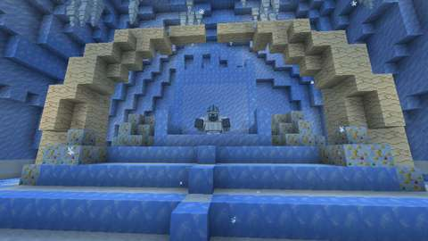
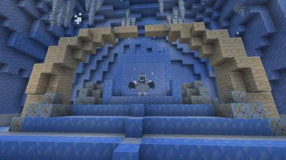
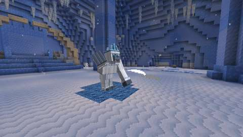
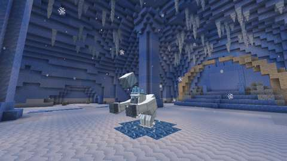
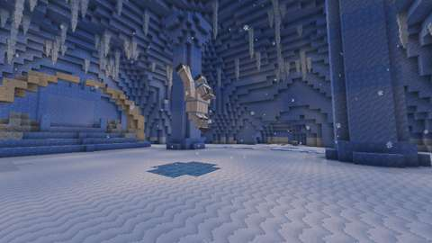
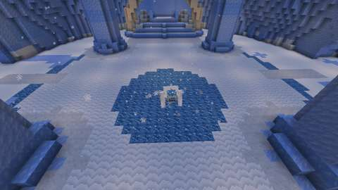
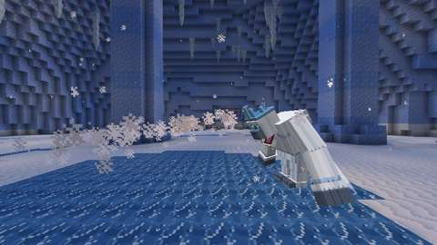
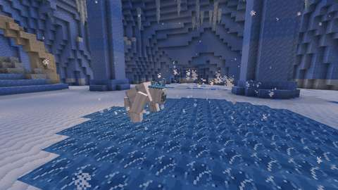
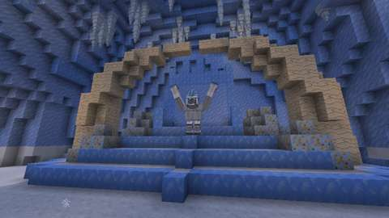
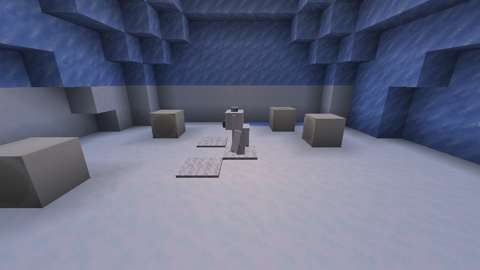
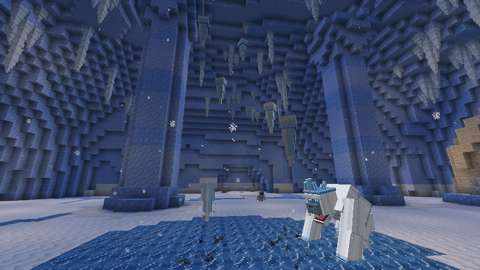
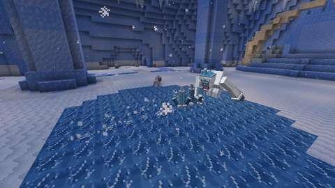
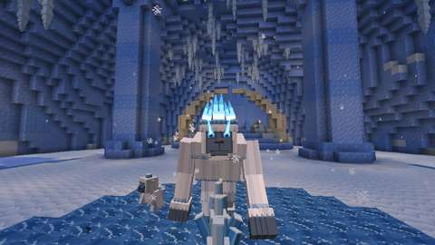
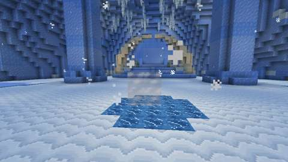

*The client game test's pictures (CI, commit `bd610bd`; the Glacial Spikes from `f2cd4aa`, whose run caught the spikes as they burst): waiting and waking; the Hunt's Maul Swipe, Boulder Throw and Ground Slam, the glare ice his slam bared, his Frost Breath and his Avalanche Charge; the King's Roar and his kin in a den; the Blizzard's Icicle Fall and Glacial Spikes; the Fury of the Peaks; and after his fall. Each attack is frozen mid-move. The test client renders at 480x270.*

CI (10 October 2026, GitHub Actions, the pins in [PLATFORM.md](../PLATFORM.md)):

| Commit | What ran | Result |
| --- | --- | --- |
| `d6a30b6` | Build | **Failed to compile:** his knockback set `hurtMarked`, a field 26.3 does not have. Nothing else ran |
| `f2cd4aa` | Build, data audit, every server game test with and without the optional integrations, and every client test class (his test arena is a new structure file, which the selection counts as shared) | His knockback now sends the player's motion packet, as the spider's spool does. **All pass but one:** his nine game tests in both server jobs, and `YetiKingClientGameTests` (his whole fight) with every other client class. `mod` failed 1 of its 1292 required tests: Arms VIII's javelin test, which on `main` too now and then flies its javelin through its pig (pull request 303); `optional integrations absent` passed it on the same commit. The Fury's picture was taken too close, and the falling icicles were lost among the vault's own |
| `bd610bd` | The same, with pull request 303's fix for the javelin ported (`294651b`), and those two pictures re-aimed | **All pass:** all 1293 required game tests (the fix's new test among them), and every client test class. The pictures above are from this commit, but for the Glacial Spikes |

Run locally (10 October 2026):

| Check | Result |
| --- | --- |
| `python3 scripts/check_repository.py` | Pass |
| `python3 tools/check_mod_data.py`: now also checks (`check_yeti`) his Java numbers, attacks and his things' numbers against `tools/yeti_king.py`; that where his fight looks for the hall's parts (`GlacierHall.java`: the lake, its centre and radius, the columns, the top step, the throne, the roar's place and the dens) is where `tools/glacier_hall.py` builds them, and that his throne, the place he roars from, where he lands and the dens' mouths are clear in the template and stand on its floor; that the block he hurls leaves from where his model holds it; his registrations, names and renderers; the GeckoLib models, every clip the Java plays, sheet sizes, glowmask and controllers' bones; the loot table and his trophies against Arms VII's; recipes, costume tags, advancement and messages; and that nothing of his loads chunks or changes dimension. Ten deliberate changes to his Java, one at a time, each failed it | Pass, 2159 IDs |
| `python3 tools/check_icon_maps.py` on the three new maps | Pass; the new `yeti_fur` material passes the palette rules |
| `python3 tools/generate_material_data.py` and `tools/generate_textures.py`, then `git status` | Write this part's data and textures only (the PNGs they re-encoded with identical pixels were reverted) |
| `./gradlew build`, game tests and client game tests | Not run locally (the Fabric Maven is out of reach here); run by CI |

The first audit run found the west den's mouth holding a pelt, a carpet; the check now lets a carpet stand where his kin come out.

The game tests (`YetiKingGameTests`) show what a game-test server can, with a king put down on his own (no lair) over a hall laid out from the corner of a hall-sized arena:
1. waiting on his throne, he takes no harm; a player's blow wakes him at full health, and he leaps down onto his lake below the dais, to hunt;
2. his health scales 1, 1.5 and 2.5 times for one, two and four or more players (at four, 1050 is held to the game's
   own cap on a creature's health, 1024); in his fury his cooldowns are a third shorter and his slam's ring wider;
3. Maul Swipe strikes a player in front of him and spares one behind him;
4. his slam bares the drift snow within its ring to glare ice, never the trampled snow nor the snow beyond, and 12 seconds later the snow has drifted back;
5. an Avalanche Charge at a foe beyond an ice column stops short of it with him stunned, and stunned he takes a third more damage;
6. his kin come out of the dens, never more than four at once, and when he is left alone they flee and he is back on his throne, healed;
7. his blizzard chills a player to just short of freezing them through, his breath's frost stacks past it, and a Yeti Mitten keeps its wearer warm;
8. a glacial spike strikes a player and throws them up, and an icicle shatters on its mark, striking the player there;
9. his loot is each participant's own: two who struck him each get Yeti Fur and, on a first kill, one trophy, and both earn Abominable; a bystander who never struck him gets nothing.

The client game test (`YetiKingClientGameTests`, CI job `client`) runs his fight in a real Glacier Hall, with its one player in survival under Resistance:
1. an instance opens with him waiting on his throne, and (since Concordance Chunk B, unit 2) his lake is noted as the hall placed it: drift snow, trampled snow and glare ice;
2. stepping onto the lake wakes him, and he comes down onto it to hunt;
3. the Hunt's five attacks, his slam leaving bare glare ice where he came down and (unit 2) changing nothing of his lake but drift snow to glare ice;
4. at half health the King's Roar from his dais, with two whelps out of the dens, then down again for the Blizzard;
5. the Blizzard's icicles and spikes;
6. below a fifth, the Fury of the Peaks;
7. (unit 2) away and back mid-fight: his fury's slam beside a column's trampled ring bares a wider ring, only of drift snow, and his kin come out; the player leaves, and the hall's chunks unload with him in them; coming back, the player finds him loaded again, still in his fury, his bar shown again and his fury synced to the client, the snow drifted back, and none of his kin or ice;
8. when he falls (with a patch of his lake bare and his kin about), the player has Yeti Fur, one trophy (a first kill) and Abominable, the snow has drifted back, his kin are gone, Grey Mist stands in the lake's middle, and (unit 2) his whole lake is as the hall placed it;
9. a fresh instance opened in his slot has none of the old instance's Grey Mist.

Along the way it takes a picture of each part of the fight (above).

Concordance Chunk B, unit 1 (B-01), put his reward on the shared credit and added these game tests. They pass in CI (runs 38514144531 and 38519234934, by workflow_dispatch; not merged); in the first run, 38509414542, only `fourPlayersAreEachPaidOnce` failed (below).
- `YetiKingGameTests.supportSharesHisLootOnce`: a healer who mended 4 of what his fight did is paid; a striker who died in his fight (a real death of a test player) is kept their share and handed it back on their feet; one who left the game (marked, on a stand-in player the server never listed) has it kept in the world and handed over on joining; the experience is shared among the three paid; one who walked away, a bystander and the one he only hurt get nothing; and his fall reported again pays no one twice.
- `aKillingBlowAloneIsPaid`; `aPetsBlowIsItsOwners` (a tamed wolf's bite on him and on a whelp).
- `twoBaitersEachEarnTheirDeed`: two players with a part short of qualifying, each charged into the column in turn, earn one deed each and qualify by it; `anIdleLateArrivalEarnsNothing`: one struck by his fight but with no part, charged into the column, earns no deed and no loot.
- `fourPlayersAreEachPaidOnce`: woken by four, his health is two and a half times his own, held to the game's cap of 1024 (1050 asked), and each of the four is paid once, a quarter of the experience each. In run 38509414542 it still expected 1050 and failed; since `579ab5f6f` it expects the cap.
- `aFightLoadedAwakeIsRecordedAfresh`: saved awake and loaded again, he holds no one's part and begins a fresh record.
- `LairEncounterGameTests.aKeptYetiKingRewardIsSavedAndPaid`: a reward kept under `yeti_king` survives a save and is paid once by his payer.

Concordance Chunk B, unit 1 (B-02), added his dossier and JEI pages, with these game tests, which pass in the same runs (38509414542 included):
- `YetiKingGameTests.hisLootIsWhatHisPagesSay`: a player who has already won Abominable rolls 400 shares; each holds 4 to 8 Yeti Fur and never both trophies, and the counts of the maul, the Rimeclaw, the mitten and the crown each lie within five standard deviations of 7.5%, 7.5%, 25% and 20%.
- `EncyclopediaGameTests.theGlacierHallsDossier`, `eachRiteSaysWhenItWorks`, `aWinOverAnyKeeperIsTheLairStep` and `theExpeditionsPageHoldsEveryKeeper`; `GlacierHallGameTests.theHornIsNoHalloweenRite`.

`python3 tools/check_mod_data.py` (whose `check_yeti` now also holds his credit and reward to `Encounter` and `LairRewards`: the record begun, abandoned and claimed, the striker's credit on him and his whelps, the payment and payer under `yeti_king`, and the column deed's key) and `python3 scripts/check_repository.py` pass locally at this commit. Five deliberate changes, each made in a scratch copy, each failed `check_yeti`: the claim guard dropped, the whelp crediting `source.getEntity()`, the payer dropped, the old `YetiKingLoot.reward` payment restored, and a constant column key.

Run 38519234934 also ran every client test class; `YetiKingClientGameTests`, unchanged by Chunk B, passed by its shard's success (shard 3).

Concordance Chunk B, unit 2 (B-04; [the chunk's contract](concordance-chunk-b.md)), held his fight to the chunk's completion evidence with these game tests, and fixed three faults in it (the CHANGELOG has each). Not merged. They pass in CI run 38543250503 on `1266c905a`, by workflow_dispatch: all 1658 required game tests passed with and without the optional integrations (the logs name no test, but each of these is registered and required), and `YetiKingClientGameTests` passed by its shard's success (shard 4). The first run, 38534127130 on `0e7de6bf1`, failed `aChargeThatMeetsAColumnSouthOfItStunsHim` in both server jobs (he met the column's foot and slid on unstunned, to (29.7340, 32.3164) in the template) and the client test's away-and-back step ("His ice came back with him"); `215a1c1e0` and `1266c905a` fixed them.
- `aGrazingChargeStunsHimOnlyWithinAColumnsReach`: passing 5.6 from a column's centre he runs his full line, and again to the very same spot; passing 4.8 from it he stops 5.32 short, stunned.
- `inTheHallHisChargeStopsAtTheDaisTheRampAndTheDensWall`: in the hall's own template he never climbs: north he stops against the dais's lowest step, south against the ramp's first half step, and at the west den's corner he slides along the wall until his leash ends the run; never inside a block.
- `aChargeThatMeetsAColumnSouthOfItStunsHim`: a glancing charge past a column's south side that meets its foot stuns him, rather than sliding him round it; `aChargeThatClearsAColumnsFootRunsOnUnstunned`: past its east side, within a block of its reach but clear of its foot, he runs on unstunned.
- `aChargeEndsAtHisLeashTheSameEveryRun`: out to his leash he stops 28.8 from the centre; from it, outward, on his first step; from it, inward, he runs his full line; never past it.
- `inHisFuryAMissedChargeIsFollowedByExactlyOneMore`; `inHisFuryABaitLeadsTheChainedChargeIntoAColumn`: a bait who moves during the chained wind-up leads the second charge into a column, and a stun never chains.
- `soloMeleeBaitsAChargeIntoAColumnAndStrikesHimReeling`: baited from beyond a column he crashes into it, and a blow while he reels takes a third more before armour than the same blow after.
- `soloCasterBaitsAChargeIntoAColumnAndLancesHimReeling`: the bait is the caster, who steps clear and lances him reeling, cast through Spell Engine, for a third more; the Lance is credited.
- `aPartyOfTwoSolvesTheColumnLoop`: the bait side-steps 3 blocks during the wind-up, and the charge runs on into the column, trampling the caster on its line once; the bait strikes him reeling, the caster lances him, and both are credited. Two test players, not two people.
- `leftAloneAfterHisSlamHisLakeIsAsItWas`: his slam bares only drift snow round where his foe stood, beside a trampled route; left alone, his reset drifts it all back, his kin flee and the lake is exactly as laid.
- `leftAloneHisIceIsGoneAtOnce`: left alone, his standing spikes, a block of ice in the air and his falling icicles are all gone at once.
- `whenHeFallsHisSnowDriftsBackAndHisKinAndIceAreGone`: his fury's wider ring and a second overlapping slam bare only drift snow; as he falls the lake comes back exactly, and his kin and spikes are gone.
- `loadedAgainMidFightHeDriftsHisSnowBackAndBringsNoKin`: an unload emulated (each entity offered to `save()`, then removed as a chunk's unloading removes it): only he is written; loaded, he is the king he was, hunting, and on his first tick the snow he had bared drifts back; none of his kin or ice comes back.
- `loadedAgainHeCountsNoKinOrIceFromBefore`: loaded again while his whelps and ice stay where they were, in chunks that did not unload, he counts none of them his, and each is gone on its next tick.
- `woolAndLeatherStopTheFreezeButNotHisFrost`: a knitted sweater and a leather tunic stop the freeze's damage, but not his frost, its slowness or its thaw, which are as on bare skin; only the Yeti Mitten stops both.
- `endGunLevitationLiftsNeitherHimNorHisKin`: End-gun Levitation is refused by him, by his whelps, and by him as an End gun's shot fells him; none of them rises.

The client test's new steps are in its list above (1, 3, 7 and 8). Of its pictures in run 38543250503 (480×270 previews), the one after his fall shows the lake's rippled drift snow, the glare ice in its middle with a faint grey column of mist over it, and the dais and throne beyond, with no King, whelp or spike in view; the Fury's picture still shows pale shards of ice between his feet, which look like the spikes of the pose before. The pictures above were not replaced.

Concordance Chunk B, unit 4 (B-08 and B-10), changed only his `chill` (it now passes by a player under Frostward, as by one holding the Mitten) and added these game tests, which passed in CI (run 38549876709 on `b012875ab`, by workflow_dispatch; not merged), among its 1676 required server tests: `YetiKingGameTests.aFrostwardDrinkerIsNotChilledByTheYeti` (his blizzard and breath frost leave a Winter Brine drinker unfrozen, and land again once Frostward is gone) and `aKitWearerIsSlowedButNotHurtByHisFrost` (in a piece of the Rime travel kit his frost still lands, freezes and slows, but the freezing deals no damage); `ConcordanceWinterClientGameTests` runs his frost on a real player in Winterguard's set (no health lost, still slowed; taken off, hurt), and passed by its shard (4); the Glacier Hall's dossier names Winter Brine and the Mitten (`EncyclopediaGameTests.theGlacierHallsRiteNamesWinterBrine`). Record: [arcane-concordance-winter.md](arcane-concordance-winter.md).

Concordance Chunk B, unit 5 (B-09 and B-11; [the contract](concordance-chunk-b.md)), not merged, added these game tests, which passed in CI (run 38591108210 on `25644502a`, by workflow_dispatch), among its 1682 required server tests, with and without the optional integrations:
- `aBracedPlayerIsPushedHalfAsFarOnce`: his slam's push (1.4 across, 0.4 up) is the same on a player with knockback resistance 1 from elsewhere and half on a braced one, whoever put the Brace on (a friend, they themselves, the Water Bangle); a second push that tick is braced too; the next tick the Brace is gone.
- `hisBlowAndSpikeAreBracedOnceNotTwice`: his swipe pushes a braced player half as far as a bare one, not a quarter, and a glacial spike lifts them half as high.
- `aBraceOnAFriendIsTheCastersDeed`: a Brace one player put on another that meets his push is the caster's deed, one for each push it meets (two in one tick are one), with no part needed before; one's own Brace, the bangle's and one whose caster was forgotten credit no one, and being braced earns nothing.
- `aRimeboundKingWindsUpLongerOnceAThaw`: bound, his Maul Swipe strikes 16 ticks after it begins, not 12; while he thaws no one binds him and his next swipe strikes on time; bound again while he reels, the hold waits out his stun and holds his next wind-up.
- `aRimeboundChargeKeepsItsPace`: bound as his charge's run begins, his speed attribute a fifth down, seven steps on he is where an unbound run puts him; the binding, past his wind-up, waits for his next one.
- `aColumnIsElectiveRimeworkForItsBaiterOnce`: his charge broken on a column is Rimekeeping's elective cold work for its baiter if they understand Rimekeeping, once, kept through a save; nothing for one who has only encountered it, or with the Concordance off; the column adds nothing after a Frost boon slow, or the reverse; with Rimebind's restraint it does not master Rimekeeping without a Preserve.

`check_yeti` now also holds his push to `Brace.spend` (and to nothing else), every push of his to `YetiKingEntity.push`, the Brace deed's caster and key, and the hold (set not added, before a wind-up's last two ticks, never while he waits, forgotten on a reset, its number against `tools/yeti_king.py`), and the column's practice in `baited`. The client test gains a step in the real hall: his Avalanche Charge baited into the north-west ice column, running (`jugcraft_yeti_king_charge_column`) and reeling at z 28.8 (`jugcraft_yeti_king_reeling`), the column checked as the real player's deed; it passed by its shard (2) in that run. In the 480×270 previews he is small and grey on the snow left of the centre, leaning into his run, with the column right of the centre; then close and low beside the column's stepped foot, his stun's sparks above him ([the contract's client evidence](concordance-chunk-b.md#client-evidence)). With no counter, his pushes and wind-ups are as before, and the tests above (units 1 to 4), unchanged, passed again in that run.

Not run: the two-client dedicated-server playtest, and play by hand; a second client joining mid-fight (the client test has one client leave and come back); a dedicated server; a real disconnect. No test yet times his attacks against real players, measures how long a fight lasts, or tries sliding on his glare ice, his charge or his blocks of ice on a moving player.

## World and event applicability

He is confined to the Glacier Hall, his own dimension; nothing of his reaches the Overworld, and the only blocks he changes are his lake's snow, which drifts back. His loot rarity is set above, and his one boon is his trophies' Frost. The horn, and so the fight, works on any night of the year. No event adds to him or takes him away.

## Rollout and open questions

Known limits:
- untested by hand and with two clients, so his numbers are the plan's and may need tuning once he is played;
- on Peaceful there is no fight, though the horn is used up and the hall opens (proposed, B-P37);
- a step of his charge that would bring him within 5.2 blocks of a column's centre stuns him, so a charge begun that near one can end on its first step though its line passes the column (proposed, B-P38);
- with four or more players his health stops at the game's cap of 1024, not the 1050 his scale asks (the attribute's
  top; found by Chunk B's four-player test in CI); kept until four people have fought him (proposed, B-P59);
- the counters' numbers are untried by people: Rimebind's 4-tick hold is untuned, and a Brace now halves his throws,
  the Water Bangle's about every 35 seconds at no Focus cost (B-P54, B-P20); a binding mid-wind-up freezes his pose,
  which GeckoLib is expected but not seen to hold;
- Yeti Fur has two uses so far.

With him, the first of the bosses Arms VII's trophies wait for is built.
